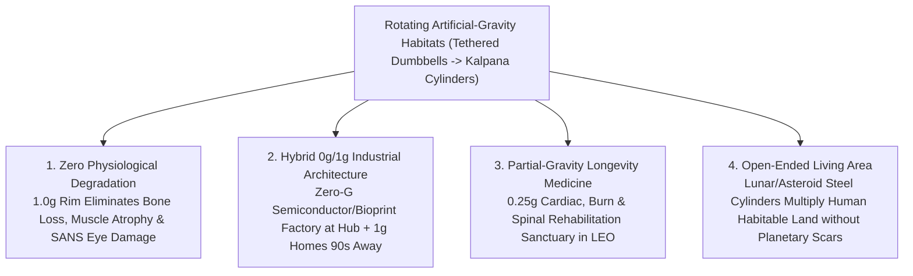

# VISION 01 — SPACE EXPANSION & CISLUNAR CIVILIZATION
## Sub-Pathway 1C: Spinning Artificial-Gravity Habitats — *From Zero-G Outposts to Rotating Worlds in Orbit*

> **Executive Framing & Structure**
> * **The Cynic's Objection:** *"Giant spinning space stations like 2001: A Space Odyssey or O'Neill Cylinders are pure 1970s science fiction. Even the International Space Station took 15 years and \$150 billion just to bolt together narrow aluminum tubes in zero gravity—where astronauts lose bone density, suffer vision damage from fluid shifts, and exercise two hours a day just to survive. Nobody is building rotating cities in space for centuries."*
> * **The Core Thesis:** The ISS was expensive and cramped because every module had to fit inside a rigid `4.5-meter` Shuttle/Proton payload fairing at **\$20,000+ per kilogram**, and stayed at `0 g` because rigid truss rings were too heavy to launch. Between **2024 and 2026**, four breakthroughs changed the architecture of human spaceflight forever: **commercial artificial-gravity station developers** (Vast Space's *Haven-1* & spinning stick station roadmap), **high-tenacity woven Vectran expandable habitats** (Sierra Space's *LIFE* modules passing ultimate burst testing at NASA Marshall and expanding to $300\text{–}1,400\text{ m}^3$ in a single launch), **autonomous electron-beam robotic orbital welding** (ThinkOrbital), and **8-to-9-meter reusable super-heavy fairings** (Starship & New Glenn). Starting with **100-meter rotating stick and tethered-dumbbell stations in the 2030s** and scaling via lunar/asteroid steel to **Kalpana One cylinders in the 2040s–2050s**, artificial gravity turns space from an extreme temporary camping trip into a permanent, healthy human home.

---

## ACT I: A BELIEVABLE NEAR-FUTURE VISION (THE WORLD OF 2040)
### Pouring a Cup of Coffee at Lunar and Martian Gravity in Low Earth Orbit

Imagine stepping out of a crew ferry docked at the central zero-gravity hub of **Haven-Ring Alpha**, orbiting 450 kilometers above Earth in **2040**.

You float down a central elevator shaft inside a tensioned Kevlar-and-steel spoke toward the outer habitat torus **112 meters below the hub**. As the elevator car descends, your boots press gently against the floor. By the time the doors open onto the main promenade, the station's slow, steady rotation of **2.6 revolutions per minute (RPM)** produces a rock-steady centripetal acceleration of **`0.85 g` to `1.0 g`** (or selectable **`0.38 g` Martian** and **`0.165 g` Lunar** gravity decks higher up the spoke):

1. **Ordinary Human Physiology (Zero Bone Loss, Zero Space Blindness):**
   * Inside the curved cedar-and-Vectran promenade, a researcher pours hot coffee from a carafe into an open ceramic mug. The steam rises; the liquid stays in the cup.
   * Because hydrostatic pressure pulls bodily fluids naturally toward the feet, **Spaceflight-Associated Neuro-Ocular Syndrome (SANS)**—the skull fluid buildup that flattened eyeballs and damaged optic nerves on the old ISS—does not exist here.
   * Residents lose **zero percent of their bone mineral density**, require no two-hour daily harness treadmill marathons, use normal flush toilets and hot showers, and sleep under normal blankets.
2. **Three-Story Woven Expandable Living Volumes:**
   * The habitat segments ringing the station were not launched as cramped aluminum soda cans. Each module launched folded inside a single fairing as a **multi-layer woven Vectran and Kevlar bladder** (Sierra Space *LIFE* architecture) that inflated on orbit to **9 meters in diameter and 1,400 cubic meters of internal volume**—exceeding the entire pressurized volume of the old International Space Station in a single launch.
   * Once inflated, its multi-layer Nextel ceramic-fabric Whipple shield—five times stronger per kilogram than steel against `10 km/s` orbital micrometeoroids—was rigidized and fitted out with three interior deck levels.
3. **The Central Zero-G Hub Upstairs:**
   * Take the spoke elevator 90 seconds back up to the non-rotating axis, and you are instantly back in **`0.0001 g` microgravity**—where technicians tend crystal-growth furnaces, 3D organ bioprinters, and docked cargo spaceplanes before heading "downstairs" to `1 g` at 6:00 PM to cook fresh stir-fry in a normal skillet and sleep in a normal bed.
4. **The Partial-Gravity Medical & Longevity Sanctuary:**
   * On the intermediate **`0.25 g` to `0.38 g` deck**, elderly rehabilitants, severe burn patients, and cardiac-recovery guests from Earth experience a physical miracle: their hearts work at a fraction of terrestrial strain, joint compression vanishes, and bedsores are impossible—yet enough downward gravity remains for normal digestion, inner-ear balance, and walking.

---

## ACT II: THE CONVERGENCE BRIDGE — HOW IT CAME ABOUT (2021–2038)
### The Physics of Centripetal Gravity, Expandable Vectran Shells, and Tethered Dumbbells

```mermaid
flowchart LR
    subgraph Physics["The Centripetal Physics Law (a = ω²r)"]
        F1["Coriolis Comfort Limit<br>(Ω ≤ 2–4 RPM for Inner Ear)"]
        F2["Tethered / Stick Geometry<br>(r = 50–112m Radius without Full Ring Mass)"]
        F3["Woven Softgoods & E-Beam Welding<br>(Vectran LIFE Shells + ThinkOrbital)"]
    end

    subgraph SOTA2026["2024–2026 Verified Hardware Breakout"]
        S1["Vast Space Haven-1 (2026)<br>& 100m Spinning Stick Station Design"]
        S2["Sierra Space LIFE Full-Scale Burst Tests<br>(Passed >4x Safety Factor at NASA Marshall)"]
        S3["Axiom, Starlab (Airbus/Voyager)<br>& ThinkOrbital Autonomous Welding"]
    end

    subgraph Scale2045["2030–2050 Rotating Habitat Cascade"]
        R1["2028–2032: 100m Spinning Stick<br>& Tethered Dumbbell Stations (0.16g–0.38g)"]
        R2["2033–2040: Multi-Spoke Modular Rings<br>(1g Living + 0g Central Industrial Hub)"]
        R3["2042–2050+: Lunar-Steel Kalpana One<br>Cylinders (500m Radius, 3,000+ Residents)"]
    end

    Physics --> SOTA2026 --> Scale2045
```

### Step 1: Why You Don't Need a Giant 2001 Wheel to Get Artificial Gravity
For decades, a misconception stalled artificial gravity: engineers assumed that to keep human inner ears from getting dizzy via **Coriolis cross-coupling** (which requires rotation rates below **2 to 4 RPM** under equation $a_c = \omega^2 r$), you had to launch a massive, complete circular wheel 200 meters across before anyone could move in.

Three structural breakthroughs solved the mass and geometry problem between **2023 and 2026**:

* **The Spinning "Stick" & Tethered Dumbbell Shortcut:**
  Centripetal acceleration ($a_c = \omega^2 r$) depends only on **radius from the center of mass ($r$)** and **angular velocity ($\omega$)**—it does **not** require a complete 360-degree solid ring!
  * **Vast Space** demonstrated that a single **100-meter modular "stick" station** (*Haven-2*), or two habitat modules connected by a high-strength **200-meter braided Zylon/carbon-nanotube truss tether** with a central docking counterweight, achieves **Lunar (`0.165 g`), Martian (`0.38 g`), or full Earth (`1.0 g`) gravity** at `<3 RPM` for **less than 10% of the structural mass** of a full torus.
* **High-Tenacity Woven Expandable Shells (Sierra Space *LIFE*):**
  Why launch empty air inside heavy aluminum cylinders? **Sierra Space** perfected the **Large Integrated Flexible Environment (LIFE)**—a multi-layer woven **Vectran** fabric shell (a liquid-crystal polymer with five times the tensile strength of steel by weight) lined with open-cell foam and Nextel ceramic Whipple shields.
  * In **2024–2025 full-scale ultimate burst tests** at NASA's Marshall Space Flight Center, *LIFE* test articles exceeded NASA's $4\times$ maximum operating pressure safety threshold (`>200 psi` equivalent)—proving that a single Starship or New Glenn launch can deploy a **$1,400\text{ m}^3$ five-story pressure hull** at a fraction of metallic mass.
* **Single-Launch 8-Meter Core Stations & Orbital Electron-Beam Welding:**
  Simultaneously, **Starlab** (Voyager Space, Airbus, Mitsubishi, and Northrop Grumman) designed a single-launch **8-meter-diameter metallic station** built to fly on a single SpaceX Starship, while **ThinkOrbital** demonstrated autonomous **electron-beam welding, X-ray inspection, and cutting in vacuum**—allowing flat-packed steel and aluminum plates launched inside a fairing to be robotically welded on orbit into 20-to-50-meter spherical and toroidal hulls.

### Step 2: 2025–2026 Global State of the Art (Verified Hardware & Milestones)

| Company / Consortium | Architecture | Verified 2024–2026 Milestone | Commercial & Artificial-G Pathway |
| :--- | :--- | :--- | :--- |
| **Vast Space (*Haven-1* & *Haven-2*)** | Single-Module $\rightarrow$ 100m Spinning Stick Station | **2024–2026:** Completed primary structure, qualification tank testing, and life-support integration in Long Beach, CA for **Haven-1** (world's first commercial station with planned artificial-G spin experiment); unveiled **Haven-2** 100-meter multi-module stick design. | **2026:** *Haven-1* launch on Falcon 9 (conducting Lunar-G spin tests). **2028–2032:** *Haven-2* multi-module rotating stick station delivering `0.16 g` to `1.0 g`. |
| **Sierra Space (*LIFE* Modules)** | Woven Vectran Expandable Habitats ($300\text{–}1,400\text{ m}^3$) | **2024–2025:** Passed full-scale ultimate burst pressure testing at NASA Marshall (`74–200+ psi`, exceeding NASA 4.0x human-rating safety factor) + micrometeoroid ballistic impact tests. | Deploying `300 m³` *LIFE* pathfinders in late 2020s and **`1,400 m³` (`9.3 m` diameter)** modules as lightweight counterweight nodes on rotating stations. |
| **Starlab Space (Voyager / Airbus / Mitsubishi)** | Single-Launch 8-Meter Diameter Metallic Station | Completed NASA Preliminary Design Review (PDR) & Critical Design milestones under \$217.5M NASA CLD award; contracted **SpaceX Starship** for single-launch deployment of the full `450 m³` core. | **2028–2029:** Single-launch turnkey deployment in LEO; modular hub design adaptable as the central zero-G spine of rotating industrial parks. |
| **Axiom Space (*Axiom Station*)** | Modular Pressurized Core & Independent Free-Flyer | Pressure shells fabricated by **Thales Alenia Space** in Italy arrived at Houston spaceport (2025–2026); revised sequence to detach *Payload Power Thermal Module (PPTM)* into an independent free-flying station by 2028. | Commercial microgravity research, orbital data centers, and modular node expansion in LEO. |
| **ThinkOrbital** | Autonomous Orbital Electron-Beam Welded Spheres | Tested vacuum electron-beam welding/cutting heads under U.S. Space Force & NASA contracts for **ThinkPlatform** (`4,000 m³` single-launch flat-packed spherical hulls). | Welding large-diameter (`20m–50m`) structural rings, radiation shields, and recycled upper-stage aluminum directly in orbit. |
| **Orbital Assembly / Above Space** | Modular Truss Rings & Variable-Gravity Frames | Patented and ground-tested automated space truss assembly jigs (*DSTAR* deployment mechanism) for concentric partial-gravity rings. | 2030s variable-gravity (`0.16 g – 0.6 g`) research, hospitality, and microgravity manufacturing rings. |

### Step 3: Solving the Human Vestibular Equation ($a_c = \omega^2 r$)
Why does a **56-to-112-meter radius** matter so much for human inner-ear comfort?
* At a radius of **$r = 56\text{ meters}$** (a 112-meter total span—shorter than a single football field end-to-end):
  * Spinning at **$\omega = 1.63\text{ RPM}$** produces **`0.165 g` (Lunar gravity)**—completely imperceptible to the inner ear (`0%` motion sickness), yet enough for liquids to pour, dust to settle to the floor for HEPA filtration, and toilets/showers to work normally.
  * Spinning at **$\omega = 2.47\text{ RPM}$** produces **`0.38 g` (Martian gravity)**—allowing astronauts and biologists to validate exact human physiological thresholds for multi-year Mars settlement before ever leaving Earth orbit.
* At a radius of **$r = 112\text{ meters}$** (224-meter span):
  * Spinning at **$\omega = 2.82\text{ RPM}$** produces **`1.0 g` (Full Earth gravity)** with less than a **1.5% gravity gradient** between head and feet and comfortable Coriolis adaptation within 24 hours.

---

## ACT III: PHASED ROLLOUT ROADMAP (2026–2050) & ECONOMIC CASCADE

| Phase | Timeline | Habitat Architecture & Spin Profile | Volume & Cost Metrics | Human Health & Societal Thresholds Unlocked |
| :--- | :--- | :--- | :--- | :--- |
| **Phase 1: First Commercial Outposts & Spin Pathfinders** | **2026–2030** | Vast *Haven-1* (`45 m³` single-module lunar-G spin demo), Sierra *LIFE 1.0* (`300 m³`), *Starlab* (`450 m³`), *Axiom*. | **\$2M–\$4M per $\text{m}^3$** of pressurized volume (down **10x** from ISS's ~\$40M/$\text{m}^3$). | Seamless private transition from ISS; first human sleep and physiological datasets in artificial Lunar/Martian gravity in LEO. |
| **Phase 2: 100-Meter Spinning Stick & Dumbbell Stations** | **2030–2035** | Vast *Haven-2* (`100 m` spinning stick) and **Tethered Dual-*LIFE* Dumbbells** (`2x 1,400 m³` modules on a `150 m` truss tether) spinning at `2.0–2.8 RPM` (`0.16g–0.85g`). | **\$300k–\$600k per $\text{m}^3$**; `50–120 occupants` per station; ticket cost drops below **\$250,000**. | **Complete elimination of bone loss and SANS optic nerve damage** on 1-year orbital stays; permanent orbital technician workforce. |
| **Phase 3: Multi-Spoke Torus Hubs (`0g` Core + `1g` Rim)** | **2035–2042** | 224-meter diameter modular wheel stations combining a **non-rotating `0 g` industrial factory hub** at the axle with a **`1.0 g` residential ring** at the rim (`500+ residents`). | **\$50k–\$120k per $\text{m}^3$** using ThinkOrbital e-beam welded hulls & Sierra *LIFE 3.0* megamodules. | First **orbital longevity/rehabilitation clinics** (`0.25 g` cardiac & orthopedic wards); families and non-astronaut scientists living multi-year tours in orbit. |
| **Phase 4: Lunar-Slag Shielded *Kalpana One* Cylinders** | **2042–2050+** | **500-meter radius, 325-meter long *Kalpana One* cylindrical habitats** built at Earth-Moon L1/L5 from **lunar-mined steel, basalt fiber, and regolith radiation shielding** (`3,000–5,000 residents`). | Built from **>95% lunar ISRU mass** delivered via lunar mass driver at **<\$15/kg**; real-estate cost comparable to urban high-rises. | Self-sustaining **orbital garden towns** with open parks, trees, lakes, clouds, and `1.0 g` agricultural terraces—unlocking unlimited human living space in the inner solar system. |

### Key Structural & Economic Inflection Metrics (2000–2050)
* **Pressurized Living Volume Cost Collapse (Cost per Cubic Meter in Orbit):**
  * *International Space Station (`916 m³`, 1998–2011):* **~\$160,000,000/$\text{m}^3$** total program cost (**~\$40,000,000/$\text{m}^3$** hardware + launch).
  * *First-Gen Commercial Modules (`300–450 m³`, 2026–2030):* **\$2,000,000–\$4,000,000/$\text{m}^3$** (Starlab, Haven-1, Sierra LIFE 1.0).
  * *Expandable *LIFE 3.0* & E-Beam Welded Spheres (`1,400–4,000 m³`, 2032–2038):* **\$150,000–\$400,000/$\text{m}^3$** (a **99% reduction** vs. ISS).
  * *Lunar-Steel *Kalpana One* Cylinder (`250,000,000 m³`, 2045+):* **<\$5,000/$\text{m}^3$** (comparable to high-density terrestrial architecture).
* **Structural Mass & Micrometeoroid Protection Ratios:**
  * *Woven Vectran Softgoods vs. Aluminum Hull:* **5x higher tensile strength-to-weight ratio** and **3x better ballistic micrometeoroid stopping power** via multi-layer Nextel ceramic-fabric Whipple spacing.
  * *Tethered Dumbbell vs. Full Solid Torus:* **88%–92% reduction in initial launch mass** required to reach `1.0 g` at `<3.0 RPM`.
  * *Closed-Loop Life Support (ECLSS):* **>98.5% water recovery** and **>90% oxygen recovery** via Sabatier/Bosch catalytic reactors combined with hydroponic plant walls.

---

## ACT IV: THE DEEPER HORIZON & SUMMARY FOR THE SKEPTIC
### Why Rotating Habitats Are the True Endpoint of Space Settlement

1. **Why Cylinders Ultimately Beat Planetary Gravity Wells:**
   * Here is the counterintuitive physics truth first calculated by Gerard O'Neill and refined by NASA Ames (*Kalpana One* design): planets are wonderful places to evolve, but inefficient places for an advanced industrial civilization to expand.
   * On Mars (`0.38 g`), you are stuck forever with 38% gravity, global dust storms, perchlorate soil, and a `5.0 km/s` gravity well. Inside a rotating **Kalpana One habitat** built from lunar or near-Earth asteroid metals, you dial in **exact `1.00 g` Earth gravity**, **24/7 uninterrupted sunshine**, **100% Earth-normal sea-level air and climate**, and a **zero-gravity shipyard right outside the central axis hub**.
2. **Low-Gravity Medicine & Elder Longevity on Earth's Doorstep:**
   * On Earth, gravity eventually wears down ageing human spines, hips, knees, and failing hearts.
   * A `0.25 g` to `0.35 g` deck on a rotating LEO station just 45 minutes via reusable spaceplane from Earth creates an entirely new field of **partial-gravity rehabilitative medicine**—allowing stroke, spinal-injury, severe burn, and frail cardiac patients to walk, heal, and rebuild strength without crushing gravitational load.
3. **Testing Mars Before We Go:**
   * Before humanity commits thousands of people to Mars, spinning stations in low Earth orbit let us answer the single biggest open question in space biology—*Is `0.38 g` Martian gravity enough for healthy human reproduction, child development, and multi-decade health?*—safely just 400 kilometers above Earth.
4. **Architectural Diversity & Ecological Sanctuaries in Orbit:**
   * Because a *Kalpana One* or O'Neill cylinder controls its own day-night mirror cycle, humidity, and seasonal temperature, different orbital cylinders can serve as curated **genetic arks and living botanical preserves**—from cloud-forest biomes to coral lagoons—powered 24 hours a day by free solar energy in vacuum.

> **Bottom Line for the Skeptic:**
> We don't have to jump straight from the cramped International Space Station to a 20-kilometer science-fiction ring. The engineering bridge is already under construction across three practical steps:
> * **Woven Expandable Softgoods (Sierra Space *LIFE*):** Multi-layer Vectran habitats five times stronger per pound than steel that expand to the size of a three-story house ($1,400\text{ m}^3$) in a single launch.
> * **Spinning Sticks & Tethered Dumbbells (Vast *Haven-2*):** Generating comfortable Lunar (`0.16 g`), Martian (`0.38 g`), and Earth (`1.0 g`) gravity at `<3 RPM` for less than one-tenth the mass of a solid wheel.
> * **Orbital E-Beam Welding & Lunar Steel (*ThinkOrbital* & *Kalpana One*):** Transitioning from Earth-launched modules in the 2030s to lunar-slag-shielded garden cylinders in the 2040s.
>
> Within fifteen years, living in space means pouring coffee into an open mug, walking on a cedar floor, and sleeping in a real bed.
