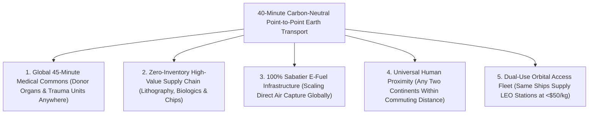

# VISION 01: SPACE INDUSTRIALIZATION & ORBITAL ABUNDANCE
## Pathway 1C: Suborbital Point-to-Point & Hypersonic Earth Transport — *Any Two Cities on Earth in 45 Minutes with Zero Net Carbon*

> **The Cynic's Objection:**
> *"Commercial supersonic flight died with the Concorde because of sonic booms over land and ruinous fuel burn. And strapping ordinary passengers into a rocket is way too violent, noisy, and expensive to ever compete with a Boeing 787!"*
>
> **The Core Thesis:**
> The Concorde failed because it tried to brute-force its way *through* the dense stratosphere at Mach 2 for three hours, fighting relentless aerodynamic drag and heating. By climbing above $100\text{ km}$ into the frictionless vacuum of space—or gliding across the upper mesosphere via Rotating Detonation Rocket Engines (RDRE)—a reusable stainless-steel Starship or Mach 9 spaceplane turns a **15-hour transoceanic flight into a 38-minute ballistic coast**. When launched from offshore floating platforms fueled by coastal solar/fusion Sabatier e-methane ($\text{CO}_2 + 4\text{H}_2 \rightarrow \text{CH}_4 + 2\text{H}_2\text{O}$), one vehicle completes **8 transoceanic flights per day** instead of one—dropping ticket prices below business-class airfare with zero sonic booms over cities and zero fossil carbon.

---

## ACT I: A BELIEVABLE NEAR-FUTURE VISION (THE WORLD OF 2040)
### A Tuesday Morning in 2040 — London to Tokyo Over Lunch, or a Donor Heart Across an Ocean in 32 Minutes

Imagine stepping onto an electric hydrofoil ferry—or a 5-minute coastal hyperloop shuttle—from Tokyo Bay, Los Angeles, London, or Singapore on a crisp morning in **2040**.

Twenty miles offshore sits a gleaming, wave-stabilized floating port flanked by a coastal clean-energy refinery that pulls $\text{CO}_2$ from the breeze and hydrogen from seawater. Four quiet realities have redefined distance on Planet Earth:

1. **The 38-Minute Transpacific Hop:**
   You board a pressurized cabin inside a gleaming 304L stainless-steel suborbital liner—or taxi down a coastal runway aboard a Mach 9 boost-glide spaceplane. After a smooth 2-minute ascent peaking at a gentle **$2.0g$ to $2.5g$** (less than a theme-park roller coaster), the engines cut off in the silent blackness of space 120 kilometers up. For 25 minutes, you look out panoramic windows at the glowing blue curve of Earth while coasting friction-free at **$25,000\text{ km/h}$**. Thirty-eight minutes after leaving Tokyo, the ship touches down softly off San Francisco.
2. **The Global Organ & Emergency Lifeline:**
   Before passenger cabins even scaled, point-to-point suborbital pods transformed global medicine and disaster response. A matched donor heart or custom-synthesized biologic therapy in Zurich reaches a surgical theater in Sydney in **42 minutes**. When an earthquake strikes a remote mountain region, a reusable cargo lander delivers **80 tons of mobile surgical units, water purifiers, and rescue robotics** anywhere on Earth inside the first Golden Hour.
3. ** Airline Economics via 10x Vehicle Utilization:**
   Why does a ticket from New York to Shanghai cost the same as an economy-plus airline seat did in 2026? Because a subsonic airliner takes 16 hours to cross the Pacific, flying barely **1.2 trips per day**. A point-to-point reusable rocket or Mach 9 spaceplane completes the trip in **39 minutes**, turns around in an hour, and flies **8 to 10 revenue sorties every single day**—amortizing its capital cost across $8\times$ more passengers per year.
4. **The Skeptic's Question:**
   To a traveler sitting at an airport gate in 2026, this sounds like pure 1950s science fiction. *"How did we solve the heatshield maintenance nightmare that crippled the Space Shuttle, how did we eliminate sonic booms, and how did rocket fuel become cleaner and cheaper than jet kerosene?"*

Here is the exact mechanical, propulsion, and thermodynamic chain from 2024–2026 that built the 45-minute planet.

---

## ACT II: THE CONVERGENCE BRIDGE — HOW IT CAME ABOUT (2021–2038)
### Ballistic Vacuum Coasting, Mechazilla Catches, and Detonation Propulsion

```mermaid
flowchart LR
    subgraph Physics["The Suborbital & Hypersonic Physics Advantage"]
        P1["Ballistic Vacuum Coast (>100 km): Zero Atmospheric Drag at Mach 22"]
        P2["8x Daily Asset Utilization: 40-Min Flight vs 15-Hr Subsonic Airliner"]
        P3["Closed-Loop Sabatier Methalox & LH2: Net-Zero Carbon Exhaust"]
    end

    subgraph SOTA["2024-2026 Hardware Breakthroughs"]
        S1["SpaceX Starship: Mechazilla Tower Catch & Raptor 3 (280 tf)"]
        S2["USSF Rocket Cargo Vanguard: <60-Min Global 100-Ton Delivery"]
        S3["Venus Aerospace RDRE (Mach 9) & Hermeus Chimera TBCC (Mach 5)"]
    end

    subgraph Reality2040["The 2040 45-Minute Planet"]
        R1["Offshore Floating Spaceports (Zero Urban Sonic Booms)"]
        R2["Global Organ, Medical & Disaster Relief in <1 Hour"]
        R3["Any Two Continents Connected in 30 to 45 Minutes"]
    end

    Physics --> SOTA
    SOTA ==> Reality2040
```

### Step 1: The Three Engineering Inflections That Beat the Concorde Trap
Why did suborbital point-to-point transport and high-altitude hypersonics succeed where the Mach 2 Concorde failed?

* **1. Climbing Above the Drag Wall (The Ballistic Energy Equation):**
  Aerodynamic drag scales with atmospheric density $\rho$ and the **square of velocity** ($F_{\text{drag}} = \frac{1}{2} \rho v^2 C_d A$). Flying fast *inside* the dense atmosphere wastes colossal energy fighting air molecules.
  By ascending vertically through the dense troposphere at moderate speed and accelerating once above $50\text{–}100\text{ km}$ where atmospheric density $\rho \rightarrow 0$, a suborbital vehicle follows a minimum-energy ballistic ellipse with speed $v \approx 6.8\text{ to }7.5\text{ km/s}$:
  $$t_{\text{antipodal}} \approx \pi \sqrt{\frac{R_{\text{Earth}}}{g}} \approx 42\text{ minutes (maximum ballistic time between any two points on Earth)}$$
  After a 3-minute boost burn, the spacecraft coasts **halfway around the world with engines off**, consuming zero fuel during cruise and using Earth's atmosphere as a free aerodynamic brake on arrival.
* **2. 304L Stainless Steel, Raptor 3 & Rotating Detonation Engines (RDRE):**
  The Space Shuttle used brittle aluminum shielded by 24,000 fragile silica tiles that took months to refurbish. Modern point-to-point vehicles use **cryogenically treated 304L stainless steel** (which retains high yield strength up to $800\text{ °C}$), mechanically pinned hexagonal heatshield tiles, and **SpaceX Raptor 3** full-flow staged-combustion engines (which integrate all cooling channels internally, eliminating external engine heatshields). Simultaneously, runway-to-runway spaceplanes unlocked **Rotating Detonation Rocket Engines (RDRE)**—where supersonic detonation waves spin continuously around an annular ring, boosting thermodynamic efficiency **15%–20% above conventional rocket nozzles** (proven in flight by **Venus Aerospace** in 2024–2026).
* **3. Carbon-Neutral Sabatier Methalox & Hydrogen ($\text{CO}_2$-Neutral Upper Atmosphere):**
  Unlike aviation kerosene (Jet-A) or rocket RP-1, which deposit black carbon soot in the stratosphere, liquid methane ($\text{LCH}_4$) + liquid oxygen ($\text{LOX}$) and liquid hydrogen ($\text{LH}_2$) burn with **zero soot**. Synthesized at coastal renewable/fusion plants via the Sabatier reaction:
  $$\text{CO}_2\text{ (from ambient air)} + 4\text{H}_2\text{ (from seawater)} \xrightarrow{400\text{ °C, Ni catalyst}} \text{CH}_4 + 2\text{H}_2\text{O}$$
  Every molecule of $\text{CO}_2$ released during ascent was captured directly from the atmosphere days earlier—creating a **100% closed-loop, fossil-free transoceanic transport system**.

### Step 2: The 2025–2026 Global State of the Art (Flight-Proven Hardware)
Between 2024 and 2026, rapid rocket reusability, precision mechanical catches, and hypersonic combined-cycle engines moved from test stands into flight operations:

| Organization / Program | Region | Vehicle & Propulsion Architecture | Verified 2024–2026 Milestone | Commercial & Point-to-Point Pathway |
| :--- | :--- | :--- | :--- | :--- |
| **SpaceX (*Starship & Super Heavy*)** | USA (TX / FL) | Fully Reusable 304L Stainless-Steel Methalox Vehicle (**Raptor 3**) | **Oct 2024–2026:** Achieved historic **Mechazilla chopstick tower catches** of 71m Super Heavy boosters; controlled hypersonic reentry & ocean landing burns of Starship; unveiled $280\text{ tf}$ **Raptor 3**. | **Earth-to-Earth Transport:** 100+ metric tons or 100–400 passengers between offshore floating spaceports anywhere on Earth in **<45 minutes**. |
| **U.S. Space Force & AFRL (*Rocket Cargo Vanguard*)** | USA | Point-to-Point Global Logistics & Humanitarian Cargo | Multi-year contracts with **SpaceX**, **Blue Origin**, and **Sierra Space**; developing **REGAL** precision landing pods for 30–100 ton global cargo delivery. | **Late 2020s:** 60-minute emergency relief, mobile hospitals, and critical logistics delivered to any continent. |
| **Venus Aerospace (*Stargazer* & VDR2)** | USA (TX) | **Mach 9** Runway-to-Runway Spaceplane (**RDRE** + Ramjet) | **2024–2026:** Flight-tested high-thrust **Rotating Detonation Rocket Engine (RDRE)** and unveiled **VDR2** detonation ramjet; partnered with **Velontra** for hypersonic propulsion. | Take off from standard coastal airports using jet engines, climb to 52 km (170,000 ft) at **Mach 9**—Los Angeles to Tokyo in **60 minutes**. |
| **Hermeus (*Quarterhorse* & *Halcyon*)** | USA (GA / CA) | **Mach 5** Turbine-Based Combined Cycle (**Chimera TBCC**) | **2024–2026:** Completed ground & flight test campaigns of **Quarterhorse Mk 1 & Mk 2**; validated turbofan-to-ramjet transition with **Pratt & Whitney F100** core. | *Darkhorse* autonomous hypersonic aircraft followed by **Halcyon** Mach 5 commercial passenger aircraft (New York to London in **90 minutes**). |
| **Destinus (*Destinus S & Eiger*)** | Switzerland / Spain / EU | Liquid Hydrogen ($\text{LH}_2$) Supersonic & Hypersonic Liners | Flew multiple hydrogen-afterburning prototypes (2023–2026); testing cryogenic $\text{LH}_2$ turbojet/ramjet propulsion with zero carbon emissions. | **Mach 5** hydrogen passenger spaceplanes connecting Europe to Asia/Australia in **2 to 3 hours** emitting only water vapor. |
| **Dawn Aerospace (*Mk-II Aurora*)** | New Zealand / Netherlands | Runway-Takeoff Suborbital Rocket Plane | **2024–2026:** Achieved supersonic climb and **same-day rapid turnaround** flights from conventional runways using non-toxic green propellants. | High-cadence suborbital express micro-cargo, atmospheric science, and point-to-point pathfinder operations. |
| **Sierra Space (*Dream Chaser* & *Ghost*)** | USA (CO) | Lifting-Body Spaceplane & Precision Reentry Capsules | Completed *Dream Chaser Tenacity* testing and demonstrated compact **Ghost** rapid-reentry cargo delivery systems for point-to-point logistics. | Gentle **$1.5g$ runway landings** at existing commercial airports for fragile medical biologics and emergency cargo. |

---

## ACT III: PHASED ROLLOUT ROADMAP (2026–2050) & ECONOMIC CASCADE
### From Express Emergency Cargo to Routine 40-Minute Transoceanic Liners

| Phase & Timeline | Turnaround & Vehicle Cadence | Route Economics & G-Load | Societal & Biosphere Thresholds Unlocked |
| :--- | :--- | :--- | :--- |
| **Phase 1: Emergency & Ultra-Critical Cargo** *(2026–2030)* | **24-Hour Turnaround** Starship Cargo, Sierra *Ghost*, Dawn *Aurora* | **\$150–\$400/kg** Point-to-Point; Uncrewed $3g\text{–}4g$ Profiles; Coastal & Range Spaceports | **<60-minute global disaster response** (mobile desalination, trauma units); donor organs & radioisotopes shipped across oceans before cell degradation. |
| **Phase 2: Mach 5–9 Runway Spaceplanes** *(2030–2036)* | **2-Hour Airline Turnaround** Venus *Stargazer*, Hermeus *Halcyon*, Destinus | **\$2,500–\$4,500/seat** (Business Class parity); Gentle **$1.5g$** Winged Glide; Existing Coastal Airports | Transpacific & transatlantic travel cut from **14 hours to 60–90 minutes**; oceanic supersonic corridors prevent any sonic boom over populated land. |
| **Phase 3: Offshore Floating Starship Ports** *(2035–2042)* | **60-Minute Turnaround** 8–10 Flights/Day per Ship; 30 km Offshore Hydrofoil/Hyperloop Hubs | **\$600–\$1,200/seat** (Economy-Plus parity); 200–400 Passengers per Ship; 100% Sabatier E-Methane | **Any two coastal cities on Earth in 30–45 minutes**; $1,000+$ flight certification milestone (matching FAA commercial transport reliability). |
| **Phase 4: Unified Planetary Express Grid** *(2042–2050)* | **30-Minute Automated Turnaround** Co-located Coastal Fusion Fuel Plants | **<\$350/seat** Global Access; Zero Net Carbon / Zero Soot; Sub-Hour Global Supply Chain | Physical distance vanishes as a barrier to human collaboration, family connection, emergency medicine, and global cultural exchange. |

### Global Route Comparison: Subsonic Airliner vs. Mach 9 Spaceplane vs. Suborbital Starship
By climbing above the dense troposphere where air drag vanishes, suborbital and boost-glide vehicles compress intercontinental travel by **$15\times\text{ to }25\times$** while multiplying daily aircraft utilization:

| Intercontinental Route | Distance | Boeing 787 / A350 (Mach 0.85) | Mach 9 RDRE Spaceplane (*Stargazer*) | Suborbital Starship (Mach 22 Coast) | Daily Flights / Vehicle |
| :--- | :--- | :--- | :--- | :--- | :--- |
| **Los Angeles $\leftrightarrow$ Tokyo** | $8,815\text{ km}$ | $11\text{ hr } 30\text{ min}$ | **$58\text{ minutes}$** | **$34\text{ minutes}$** | **8–10 flights/day** |
| **New York $\leftrightarrow$ London** | $5,570\text{ km}$ | $7\text{ hr } 10\text{ min}$ | **$42\text{ minutes}$** | **$29\text{ minutes}$** | **10–12 flights/day** |
| **London $\leftrightarrow$ Sydney** | $17,015\text{ km}$ | $19\text{ hr } 30\text{ min}$ | **$105\text{ minutes}$** | **$41\text{ minutes}$** | **8 flights/day** |
| **San Francisco $\leftrightarrow$ Singapore** | $13,590\text{ km}$ | $16\text{ hr } 45\text{ min}$ | **$82\text{ minutes}$** | **$39\text{ minutes}$** | **8–10 flights/day** |

### How Suborbital & Hypersonic Transport Solves Safety, Noise, and Emissions
* **Solving the Sonic Boom & Noise Barrier:**
  * *Offshore Floating Spaceports:* By siting Starship launch-and-catch platforms on stabilized offshore sea platforms **25–35 km off major coastal megacities** (connected to downtown terminals via 10-minute high-speed electric hydrofoils or subsea hyperloop tubes), acoustic launch energy and reentry sonic booms dissipate harmlessly over open ocean water ($<55\text{ dBA}$ at the shoreline).
  * *High-Altitude Mach Cutoff for Spaceplanes:* Winged Mach 5–9 vehicles (*Venus Stargazer*, *Hermeus*, *Destinus*) cruise above $45\text{–}55\text{ km}$ altitude over oceanic corridors where low air density attenuates ground overpressure below annoyance thresholds.
* **Solving Passenger Safety (5,000-Flight Certification & Multi-Engine Out):**
  * *Cargo-First Flight Heritage:* Point-to-point Starships and hypersonic gliders log **5,000+ uncrewed orbital satellite deployments and cargo deliveries** before carrying their first commercial passenger—matching the statistical reliability curve of modern ETOPS twin-aisle airliners.
  * *Multi-Engine Redundancy:* With 6 to 9 Raptor engines on the ship (and 33 on the booster), the vehicle maintains full abort-to-landing capability even if multiple engines shut down simultaneously at any point in flight.
* **Eliminating High-Altitude Contrails & Fossil Carbon:** Because Sabatier methalox is synthesized directly from atmospheric $\text{CO}_2$ and green hydrogen—and because ballistic trajectories spend 90% of their flight above the stratosphere in the dry exosphere—point-to-point transport eliminates persistent cirrus contrail warming and fossil fuel extraction.

---

## ACT IV: THE DEEPER HORIZON & SUMMARY FOR THE SKEPTIC

Shrinking Earth from a 20-hour wide planet to a **40-minute neighborhood** unlocks four lasting civilizational shifts:

1. **A Single Global Medical & Scientific Commons:**
   No patient on Earth dies waiting for a time-critical donor organ, short-half-life targeted alpha-particle cancer isotope, or specialized surgical team located on another continent. Every major hospital on Earth is effectively within a 45-minute ambulance radius of every other hospital.
2. **The End of Supply-Chain Fragility:**
   High-value electronics, semiconductor lithography optics, vaccines, and emergency grid transformers move between continents in under an hour—eliminating the need for carbon-intensive air-freight fleets burning millions of barrels of fossil jet fuel.
3. **Dual-Use Scale for Orbital Industrialization:**
   Because the exact same stainless-steel Starships, Raptor 3 engines, and coastal Sabatier propellant plants serve both **Earth-to-Earth transport** and **Earth-to-LEO orbital launch**, high-cadence terrestrial travel drives rocket manufacturing down the Wright's Law cost curve to airline production volumes.
4. **The Bottom Line for the Skeptic:**
   The physics of ballistic coasting in a vacuum ($v = 7.5\text{ km/s}$ with zero drag) and Rotating Detonation propulsion are already proven. With **SpaceX's Mechazilla booster catches**, the **U.S. Space Force Rocket Cargo program**, and **Venus/Hermeus/Destinus hypersonic flight tests** in 2024–2026, the hardware that connects orbital spaceports will simultaneously unite every continent on Earth in under 45 minutes.

