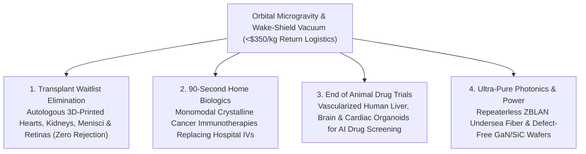

# VISION 01 — SPACE EXPANSION & CISLUNAR CIVILIZATION
## Sub-Pathway 1B: Zero-G Science & Orbital Manufacturing — *Microgravity Biologics, Flawless Crystals, and 3D-Printed Human Organs*

> **Executive Framing & Structure**
> * **The Cynic's Objection:** *"Manufacturing things in space to bring back to Earth sounds like peak billionaire hubris. Even if launch costs drop to \$500 per kilogram, why would any factory leave Earth's supply chains, cheap electricity, and gravity just to make products in orbit? Apart from novelty souvenirs, nothing is valuable enough per kilogram to justify orbital manufacturing."*
> * **The Core Thesis:** On Earth, gravity (`1 g`) is a relentless physical contaminant: it drives **buoyancy-driven convection, sedimentation, and hydrostatic container pressure** that introduce micro-defects into every crystal, optical fiber, alloy, and biological tissue we grow. Remove gravity, and molecular forces (surface tension and diffusion) take over completely. Between **2024 and 2026**, **autonomous reentry capsule factories** (Varda Space Industries' *W-1, W-2, and W-3*), **orbital pharmaceutical crystal labs** (Merck & Redwire *PIL-BOX*), **scaffold-free 3D tissue bioprinters** (Redwire *BFF*), and **microgravity ZBLAN fiber pullers** proved that products worth **\$100,000 to \$50,000,000 per kilogram** can be manufactured in low Earth orbit and returned to patients and data networks on Earth at massive positive margins.

---

## ACT I: A BELIEVABLE NEAR-FUTURE VISION (THE WORLD OF 2040)
### An Outpatient Clinic, a Transplant Ward, and a Transoceanic Cable in 2040

Step inside a community oncology clinic and regional medical center on a Tuesday morning in **2040**. None of the patients know they are interacting with space hardware—yet three quiet medical and technological revolutions in the building were forged **400 kilometers overhead in microgravity**:

1. **The 90-Second Cancer Injection (Replacing the 4-Hour IV Infusion):**
   * In 2026, millions of cancer and autoimmune patients had to travel to hospital infusion suites every three weeks and sit tethered to an intravenous drip for **two to four hours** to receive monoclonal antibody therapies (such as pembrolizumab / *Keytruda*).
   * Why? Because on Earth, gravity-driven convection causes large protein molecules to clump into uneven, viscous slurries that cannot pass through a fine hypodermic needle.
   * By **2040**, orbital crystallization capsules grow **uniform, monomodal micro-crystalline suspensions** in zero gravity that remain low-viscosity at ultra-high concentration (`>200 mg/mL`) and stable at room temperature. A visiting nurse delivers the exact same life-saving immunotherapy in **90 seconds via a painless subcutaneous autoinjector pen** at the patient's kitchen table.
2. **The Waiting-List-Free Organ & Cartilage Ward:**
   * Down the hall in orthopedic and cardiac surgery, a 52-year-old runner receives a replacement knee meniscus, and a child born with a congenital heart defect receives a vascularized cardiac patch—both grown from their own induced pluripotent stem cells (**iPSCs**), requiring **zero lifelong immunosuppressant drugs**.
   * On Earth, 3D-printing soft human tissues with high-density capillary networks collapses under its own weight like warm gelatin unless stiff, artificial plastic scaffolds or toxic chemical cross-linkers are added.
   * In orbital bioreactors, bio-ink cells float in three dimensions via surface tension alone, self-assembling into **living menisci, retinal layers, liver lobules, and vascularized heart tissues** before riding a gentle lifting-body reentry glider down to a local runway once a week.
3. **The Zero-Repeater Transoceanic & Quantum Fiber Backbone:**
   * Beneath the hospital's AI diagnostic wing runs a hair-thin optical fiber spun from **heavy-metal fluoride glass (ZBLAN)**.
   * Pulled in terrestrial gravity, heavy zirconium and barium ions sink while lighter sodium and aluminum ions rise, creating micro-crystals that scatter light.
   * Pulled in orbital microgravity, ZBLAN glass freezes with **atomic homogeneity**, delivering **10 to 100 times lower signal attenuation** than silica fiber across a broad mid-infrared spectrum—eliminating thousands of power-hungry undersea optical repeaters and powering ultra-low-loss laser surgery and continental quantum networks.

---

## ACT II: THE CONVERGENCE BRIDGE — HOW IT CAME ABOUT (2021–2038)
### Why Turning Off Gravity Unlocks Physics Impossible on Earth

```mermaid
flowchart LR
    subgraph Physics["The Zero-G Physics Advantage"]
        P1["Zero Sedimentation & Buoyancy<br>(Uniform Protein & Alloy Nucleation)"]
        P2["Zero Hydrostatic Slump<br>(Scaffold-Free 3D Organ Bioprinting)"]
        P3["Zero Convective Turbulence<br>(Defect-Free ZBLAN Glass & SiC Wafers)"]
    end

    subgraph SOTA2026["2024–2026 Verified Orbital Breakout"]
        S1["Varda W-1, W-2, W-3 Reentry Factories<br>(Mach 25 Return to Utah & Australia)"]
        S2["Merck Keytruda & Redwire PIL-BOX<br>(28+ Pharma Crystal Missions on ISS)"]
        S3["Redwire BFF 3D-Printed Meniscus<br>& Flawless ZBLAN Optical Fiber Pulls"]
    end

    subgraph Scale2040["2030–2040 Commercial Fleet"]
        C1["Weekly Autonomous Reentry Capsules<br>(Subcutaneous Biologics & Polymorphs)"]
        C2["Commercial Space Station Bioreactors<br>(Haven-2, Starlab, Axiom Organ Hubs)"]
        C3["Industrial Wafer & Fiber Foundries<br>(100x Lower-Loss Telecom & Power Chips)"]
    end

    Physics --> SOTA2026 --> Scale2040
```

### Step 1: The Three Physical Laws That Only Work at $0\text{ g}$
Why can't we simulate zero gravity inside a laboratory on Earth? Acoustic, magnetic, or diamagnetic levitation only acts on specific molecular susceptibilities and still leaves internal density gradients intact. True free-fall in orbit eliminates three terrestrial bottlenecks simultaneously:

* **Eliminating Buoyancy-Driven Convection (Perfect Protein & Semiconductor Crystals):**
  On Earth, whenever a crystal grows from a liquid or vapor, the depleted fluid near the crystal face is slightly lighter or heavier than the surrounding fluid. Gravity immediately pulls the denser fluid down, creating chaotic convective currents that scar the growing crystal lattice with dislocations and impurities. In microgravity, **transport is 100% diffusion-controlled**. Protein crystals grow **$3\times$ to $10\times$ larger with near-zero internal defects**, revealing exact atomic binding pockets for AI drug design (like Eli Lilly, Bristol Myers Squibb, and Merck programs) or forming novel drug **polymorphs** (such as Varda's metastable ritonavir crystal structures) that dissolve more effectively in the human bloodstream.
* **Containerless Processing & Zero Sedimentation (ZBLAN & Immiscible Alloys):**
  Heavy-metal fluoride glasses ($\text{ZrF}_4\text{-BaF}_2\text{-LaF}_3\text{-AlF}_3\text{-NaF}$) have a theoretical intrinsic attenuation of **`0.001 to 0.01 dB/km`** at `2.5 μm` wavelength—compared to **`0.15 to 0.20 dB/km`** for the best terrestrial silica fiber. In microgravity, heavy and light ions never stratify during cooling, suppressing crystallization completely.
* **Eliminating Hydrostatic Self-Weight Collapse (3D Bioprinting of Soft Organs):**
  Human capillary networks, alveoli, liver lobules, and neural tissues have an elastic modulus softer than tofu (`<1 kPa`). Printed at `1 g`, hollow blood vessels flatten and collapse before cells can fuse and secrete their own extracellular matrix (ECM). In `0 g`, low-viscosity cell-laden bio-inks stay suspended exactly where the printhead places them for days while the tissue matures inside a perfusion bioreactor.

### Step 2: 2025–2026 Global State of the Art (Verified Hardware & Milestones)

| Company / Program | Product Domain | Verified 2024–2026 Milestone | Commercial & Clinical Pathway |
| :--- | :--- | :--- | :--- |
| **Varda Space Industries (*W-Series*)** | Autonomous Free-Flying Pharmaceutical Capsules | **Feb 2024 (*W-1*), Feb 2025 (*W-2*), & May 2025 (*W-3*):** Launched autonomous orbital mini-factories, crystallized **ritonavir** (discovering a 3rd stable polymorph) and hypergravity/microgravity payloads, and executed **Mach 25 atmospheric reentries** to Utah (UTTR) and Koonibba, South Australia; raised **\$329M+** (including \$187M Series C, July 2025). | Monthly-to-weekly cadence of uncrewed pharmaceutical manufacturing & hypersonic reentry capsules (`W-4+`) for small-molecule & biologic therapeutics. |
| **Merck & Co. (*Keytruda* Microgravity Program)** | Subcutaneous Monoclonal Antibody Biologics | Synthesized uniform, low-viscosity crystalline suspensions of **pembrolizumab (*Keytruda*)** on the ISS, proving that `0 g` eliminates multi-modal clumping and allows room-temperature storage and concentrated syringe delivery. | Transitioning \$25B+/yr oncology biologics from multi-hour hospital IV infusions to rapid outpatient/home subcutaneous injections. |
| **Redwire Space (*PIL-BOX* & *BFF*)** | Pharma Crystal Discovery & 3D Organ Bioprinting | **2023–2026:** Successfully printed the **first human knee meniscus** and **living cardiac tissue** in orbit using the **BioFabrication Facility (BFF)** and returned them to Earth; flew **28+ *PIL-BOX* pharmaceutical crystal missions** with Eli Lilly, Bristol Myers Squibb, Butler University, and ExesaLibero Pharma. | Scaling orbital *PIL-BOX* "seed crystal" discovery (where tiny space-grown seed crystals are brought back to Earth to template ton-scale terrestrial bioreactors) + autologous tissue printing. |
| **Flawless Photonics / FOMS Inc. / Mercury** | Microgravity ZBLAN Optical Fiber Drawing | Completed multiple ISS filament draws producing multi-hundred-meter spools of defect-free **ZBLAN fluoride glass fiber** in microgravity with verified suppression of crystallite scattering sites. | High-margin mid-IR fiber lasers (defense, lidar, non-invasive surgery), quantum key distribution, and repeaterless undersea cables. |
| **Space Forge (UK / Europe)** | Wide-Bandgap Semiconductors ($\text{SiC, GaN, Ga}_2\text{O}_3$) | Developed the reusable **ForgeStar** orbital foundry satellite with proprietary *Pridwen* high-temperature fabric heatshield for parachute-free/net-captured return of ultra-pure semiconductor substrates. | Growing large-diameter gallium nitride ($\text{GaN}$), silicon carbide ($\text{SiC}$), and diamond substrates with **10x fewer crystal dislocations** for EV & grid power electronics (`~60%` switching loss reduction). |
| **Prometheus Life Technologies & LambdaVision** | Stem-Cell Organoids & Artificial Human Retinas | **LambdaVision** completed 9+ ISS missions layering **200+ bacteriorhodopsin protein films** into an artificial retina (entered FDA pre-clinical pathway for retinitis pigmentosa); **Prometheus** won the 2024 NASA/NSF Tissue Engineering Prize for scaffold-free organoid spheroids. | Restoring sight to patients with macular degeneration and retinitis pigmentosa; supplying human liver/brain organoids to replace animal testing in drug trials. |
| **Sierra Space (*Dream Chaser*) & SpaceX (*Dragon*)** | Gentle Low-G Return Logistics | **Dragon** executing routine splashdowns of delicate biological samples; **Dream Chaser** lifting-body spaceplane designed for **`<1.5 g` gentle runway landings** at Kennedy Space Center and global spaceports. | Preserving fragile 3D-printed human organs and vascularized grafts during atmospheric reentry without high-G crushing forces. |

### Step 3: The "Orbital Seed Crystal" Multiplier (Why You Only Need to Launch Grams to Transform Tons)
How does orbital pharmaceutical manufacturing scale to millions of patients without launching millions of kilograms of liquid chemicals?
1. **Thermodynamic Seed Templating:**
   * Once a specific pharmaceutical polymorph (crystal packing geometry) is nucleated in `0 g` inside a 50-kilogram capsule like Varda's *W-series* or Redwire's *PIL-BOX*, those ultra-pure **micro-seed crystals** (weighing just a few kilograms) are returned to Earth inside an ablative heatshield capsule.
   * Because metastable polymorphs have a high activation barrier to initial nucleation at `1 g`—yet remain thermodynamically stable once formed—orbit acts as the "key-maker" for new molecular geometries.
2. **Terrestrial Bioreactor Amplification:**
   * When those orbital seed crystals are dropped into a conventional **10,000-liter pharmaceutical tank on Earth**, newly crystallizing molecules lock onto the template of the space-grown seeds.
   * This allows **1 kilogram of orbital seed crystals to template 10,000+ kilograms of improved terrestrial medicine**, multiplying the economic yield of a single capsule flight ten-thousand-fold.
3. **Direct High-Value End Products:**
   * For products that must be grown entirely in orbit—such as **artificial retinas** (`<1 gram` per patient, worth `\$50,000+`), **ZBLAN fiber** (`\$1,000,000+ per kg`), **GaN/diamond master boules**, and **autologous 3D-printed menisci or cardiac patches**—the value-to-mass ratio (`\$500,000 to \$50,000,000/kg`) exceeds launch and return costs (`<\$1,000/kg`) by **500-to-1 to 50,000-to-1**.

---

## ACT III: PHASED ROLLOUT ROADMAP (2026–2050) & ECONOMIC CASCADE

| Phase | Timeline | Orbital Infrastructure & Return Cadence | Economics & Cost-per-kg Metrics | Medical & Industrial Thresholds Unlocked |
| :--- | :--- | :--- | :--- | :--- |
| **Phase 1: Free-Flyer Capsules & ISS Seed Foundry** | **2026–2030** | Quarterly-to-monthly Varda *W-series* & Space Forge *ForgeStar* capsules; Redwire *PIL-BOX* & *BFF* racks operating on ISS and Vast *Haven-1*. | Launch + Return: **\$2,500–\$4,000/kg**; Product value: **\$1M–\$50M/kg** (Seed crystals, retinas, specialty ZBLAN). | First FDA human clinical trials for **orbital-layered artificial retinas** (LambdaVision) and **orbital-seeded small-molecule drugs**; commercial mid-IR ZBLAN laser fibers. |
| **Phase 2: Dedicated Commercial Lab Stations & Weekly Return** | **2030–2035** | Transition from ISS to commercial stations (*Haven-2, Starlab, Axiom*) with dedicated cleanroom bioreactor modules; **weekly autonomous capsule & `<1.5 g` spaceplane runway returns**. | Launch + Return: **\$600–\$1,200/kg** via Starship/New Glenn rideshares & reusable reentry gliders. | Widespread rollout of **subcutaneous home-injected cancer biologics** (replacing hospital IV drips); FDA approval of **3D-printed knee menisci and pediatric cardiac patches**. |
| **Phase 3: Automated Orbital Cleanroom Parks** | **2035–2042** | Fleet of **50+ uncrewed, high-vacuum free-flying semiconductor and fiber foundries** tended robotically between service visits; pressurized bioprinting hospitals in LEO. | Launch + Return: **\$150–\$350/kg**; automated solar-powered orbital processing at near-zero marginal power cost. | Mass production of **ultra-pure $\text{SiC/GaN/Ga}_2\text{O}_3$ master wafers** (cutting data center & EV grid conversion losses by 50%); transoceanic repeaterless ZBLAN optical trunks. |
| **Phase 4: Full Autologous Organ Replacement & Atomic Manufacturing** | **2042–2050+** | High-throughput orbital bio-foundries receiving patient stem-cell vials via daily spaceplane shuttles and returning mature vascularized organs within 21 days. | End-to-end orbital organ print & return cost **<\$15,000 per organ** (less than 1 year of terrestrial kidney dialysis). | **Elimination of the human organ transplant waiting list** (kidneys, livers, hearts, corneas, pancreases grown from the patient's own cells with zero rejection). |

### Key Economic & Engineering Inflection Metrics (2024–2045)
* **Orbital Round-Trip Logistics Cost Collapse (Launch + Reentry Return):**
  * *Space Shuttle Era (1981–2011):* **>\$50,000/kg** up and down, with multi-year manifest delays.
  * *ISS / Early Free-Flyer Era (2024–2028):* **\$3,000–\$6,000/kg** via Falcon 9 rideshares and Varda *W-series* / Dragon capsules.
  * *Commercial Station & Reusable Glider Era (2030–2038):* **\$400–\$900/kg** via Starship/New Glenn launches and weekly capsule/lifting-body returns.
  * *High-Throughput Automated Foundries (2040+):* **<\$150/kg** round-trip logistics cost.
* **Value-to-Mass Product Economics (Why Margins Exceed 1,000x):**
  * **Bacteriorhodopsin Artificial Retinas (LambdaVision):** `<1 gram` per implant; clinical value `>\$25,000` (**>\$25,000,000/kg**).
  * **Monoclonal Antibody Seed Crystals & Polymorphs:** `1 kg` of orbital seed crystals templates `10,000 kg` of terrestrial bioreactor output (**>\$10,000,000/kg** effective leverage).
  * **Autologous 3D-Printed Menisci & Cardiac Grafts:** `50–300 grams` per tissue graft; saves `\$100,000+` in dialysis, heart-failure hospitalization, and immunosuppressant therapy (**>\$1,000,000/kg**).
  * **Microgravity ZBLAN Optical Fiber & Wide-Bandgap Boules:** **\$250,000 to \$2,000,000/kg** for repeaterless telecom trunks, mid-IR surgical lasers, and ultra-pure $\text{GaN/SiC}$ master substrates.

---

## ACT IV: THE DEEPER HORIZON & SUMMARY FOR THE SKEPTIC
### Why Low Earth Orbit Becomes Humanity's Cleanest Laboratory

1. **Ending the Tragedy of the Organ Transplant List:**
   * In the 2020s, over **100,000 patients in the United States alone** (and millions globally) sat on organ transplant waiting lists, with 17 people dying every single day waiting for a match—while those fortunate enough to receive a donor organ faced a lifetime of harsh immunosuppressive drugs that increase cancer and infection risks.
   * By turning low Earth orbit into a scaffold-free 3D tissue foundry where a patient's own stem cells self-assemble in `0 g` without collapsing, spaceflight directly saves hundreds of thousands of lives on Earth every year.
2. **Replacing Animal Testing with Vascularized Human Organoids:**
   * Over 90% of drugs that pass mouse and animal trials fail in human clinical trials because animal physiology differs from human biology.
   * Microgravity bioreactors grow thick, vascularized **3D human liver, cardiac, and blood-brain-barrier organoids** that stay alive for months—allowing pharmaceutical researchers on Earth to test toxicity and efficacy on real human micro-tissues before a single human volunteer is ever exposed to risk.
3. **The Infinite Vacuum & Solar Foundry:**
   * Behind an orbital molecular wake shield moving at `7.8 km/s`, the vacuum is **$1,000\times$ to $1,000,000\times$ cleaner** than the most expensive ultra-high-vacuum semiconductor chamber on Earth, with abundant 24/7 solar power.
   * Epitaxial thin films, topological quantum computing chips, and wide-bandgap power semiconductors can be deposited atom-by-atom without a single stray atmospheric molecule contaminating the lattice.
4. **Universal Global Access via Autonomous Reentry Capsules:**
   * Because uncrewed capsules like Varda's *W-series* and Space Forge's *ForgeStar* can launch on routine commercial rideshares and land under precision parafoils on sovereign desert ranges or coastal barges (as proven in Utah in 2024 and South Australia in 2025), **every nation's universities, biotech startups, and hospital networks** can rent orbital bioreactor slots without needing a national astronaut corps.

> **Bottom Line for the Skeptic:**
> You don't manufacture concrete or steel in orbit to bring back to Earth. You use zero gravity to manufacture the **highest-value, highest-precision matter known to humanity**:
> * **Biologics & Pharmaceuticals:** Cancer immunotherapies that turn a 4-hour hospital IV into a 90-second home injection, and space-nucleated seed crystals that template 10,000-liter vats on Earth.
> * **Regenerative Medicine:** 3D-printed human menisci, cardiac patches, vascularized organoids, and 200-layer artificial retinas grown from a patient's own cells with zero plastic scaffolds and zero immune rejection.
> * **Photonics & Power Electronics:** ZBLAN optical fibers 20 to 100 times clearer than silica glass and defect-free wide-bandgap semiconductor substrates.
>
> Thanks to Varda, Redwire, Merck, Space Forge, and LambdaVision, this hardware is not 2050 science fiction—it has already flown, crystallized, and landed back on Earth.
