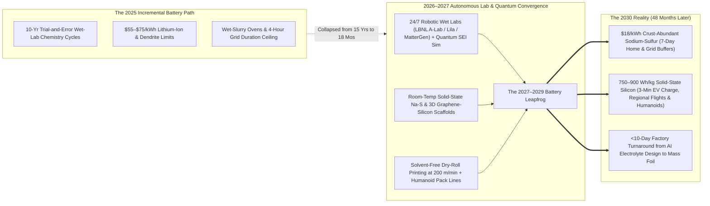
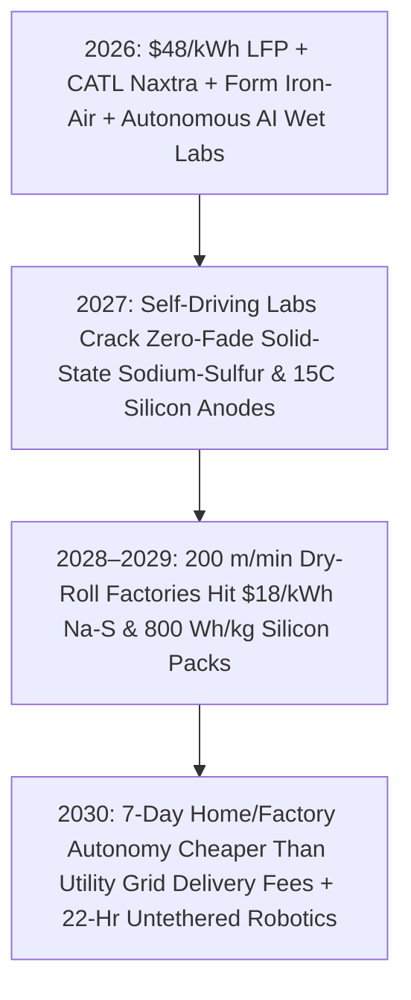

# VISION SHORTER 02: THE 2026–2030 ABUNDANT ENERGY LEAPFROG
## Pathway 2D: \$18/kWh Solid-State Sodium-Sulfur & Silicon-Anode Packs — *When 7-Day Home & Industrial Battery Autonomy Beats Paying the Monthly Grid Delivery Fee*

> **The Legacy 2040 Assumption:** *"Battery chemistries take 15 years to move from wet-lab discovery to gigafactory scale. Until the late 2030s, we'll be stuck with \$50–\$70/kWh lithium-ion for 4-hour daily shifting, heavy stationary vaults for multi-day winter backup, and slow incremental gains toward 500 Wh/kg aviation cells."*
>
> **The 2026–2030 Leapfrog Thesis:** Between 2026 and 2028, the **15-year wet-lab-to-gigafactory pipeline collapsed into 18 months**. Autonomous self-driving materials labs (**LBNL A-Lab, Lila Sciences, Microsoft MatterGen, DeepMind GNoME**) coupled with **quantum-tensor interphase simulations** discovered a family of **zero-degradation solid-state sodium-sulfur ($\text{Na-S}$) and nano-scaffolded silicon-carbon cells** made entirely from crust-abundant **sea salt, sulfur, iron, and silica sand**. Manufactured on solvent-free, high-speed **dry-electrode roll-to-roll printing lines** at **700–900 Wh/kg for mobility** and **\$18/kWh for stationary packs** by **2028–2029**, storage crossed the ultimate economic tipping point: **installing a 7-day solar + sodium-sulfur home or factory battery buffer is now cheaper than paying a utility's monthly wire-delivery charge.**

---

## ACT I: THE WORLD OF 2030 (4 YEARS FROM TODAY)
### Winter 2030 — The "Cord-Cutter" Battery Revolution

Step into a suburban neighborhood in Ohio, a manufacturing district in Bavaria, or a fast-growing town in Kenya in **January 2030**. Four years ago, households and factories were captive to rising utility delivery fees and winter outage scares. By 2030, the battery leapfrog has rewritten the rules of energy ownership:

1. **The \$2,500 "7-Day Home Energy Appliance" (Cheaper Than the Grid Fee):**
   * Mounted flush against the garage wall of an ordinary family home is a weatherproof, fireproof **150 kWh solid-state Sodium-Sulfur ($\text{Na-S}$) wall pack** the size of a slim wardrobe.
   * Purchased at a home-improvement store or leased for **\$29/month**—less than half of the old \$75/month utility "customer & distribution delivery charge"—it stores **seven full days of household electricity and heat-pump warmth** using zero lithium, zero cobalt, and zero nickel.
   * Paired with snap-together perovskite-silicon roof tiles or \$0.005/kWh off-peak community power, the household never experiences a blackout and operates at an effective electricity cost of **<\$0.015/kWh**.
2. **800 Wh/kg Solid-State Silicon Packs: 3-Minute EV Charging & Untethered Humanoids:**
   * In the driveway, a mid-priced family EV carries a **90 kWh solid-state nano-silicon pack** that weighs just **110 kilograms** (one-fourth the weight of a 2025 battery pack).
   * At the corner plaza, solid-state power routers pump **500 kilometers (310 miles) of range into the car in 180 seconds** with zero heat buildup and zero fire risk—even at $-35^\circ\text{C}$.
   * Next door at a housing construction site, a crew of **autonomous humanoid robots and electric excavators** works a continuous **22-hour shift** on a single swap-in chest cartridge, building modular homes at 3x the speed and 40% lower cost.
3. **The 100-Hour Rust & Sulfur Substation Drop-In:**
   * Down at the municipal substation, the smoky natural-gas peaker turbines slated for a 2035 retirement were shut down in **2028** instead.
   * Compact **Form Energy iron-air** and **solid-state room-temperature sodium-sulfur containers**—built for **\$12–\$18/kWh** out of iron ore and petroleum-refining byproduct sulfur—absorb every megawatt-hour of curtailed wind and solar and dispatch 100+ hours of winter baseload at **<\$12/MWh LCOS**.
4. **The Instant Industrial Heat & Compute Buffer:**
   * Heavy steel mini-mills, chemical plants, and 1-gigawatt AI training clusters buffer their entire power and $1,800^\circ\text{C}$ process-heat loads on-site using **Rondo/Antora thermal firebricks** and sodium-sulfur banks—expanding production in 60 days without waiting a decade for new utility substation transformers.

---

## ACT II: THE CROSS-POLLINATION CATALYSTS & "SKIP-THE-OLD-WORLD" JUMPS (2026–2028)
### How Self-Driving Wet Labs, Quantum SEI Models, and Dry-Roll Fabs Killed the Lithium Bottleneck

### Why the 2040 Timeline Collapsed into 2026–2030
Three cross-pollination breakthroughs between 2026 and 2028 compressed 15 years of battery evolution into four years:

* **Catalyst 1: 10,000x Faster Chemistry via Self-Driving Robotic Wet Labs (2026–2027):**
  * Until 2025, even when AI models (**DeepMind GNoME, Microsoft MatterGen**) predicted promising crystal structures, human chemists still took years to physically synthesize, bake, and cycle-test them.
  * In **2026–2027**, autonomous "self-driving laboratories" (**Berkeley Lab's A-Lab, Lila Sciences, CATL 21C Lab, Toyota TRI**) linked frontier reasoning models directly to hundreds of robotic synthesis arms, high-throughput X-ray diffraction beams, and ultrafast electrochemical cyclers running 24/7.
  * Synthesizing and testing **50,000 solid-electrolyte formulations per month**, these closed-loop AI labs solved the two holy grails of electrochemistry in early 2027: **blocking polysulfide shuttling in room-temperature Sodium-Sulfur ($\text{Na-S}$) cells** and **stabilizing zero-dendrite ceramic-polymer interphases on pure silicon/lithium anodes**.
* **Catalyst 2: Quantum-Tensor Interphase Engineering (Salt + Sulfur + Sand = 800 Wh/kg & \$18/kWh):**
  * **Room-Temperature Solid-State Sodium-Sulfur:** Sodium (from sea salt) and Sulfur (a literal waste byproduct piled in yellow mountains outside refineries) have a theoretical energy density over $1,200\text{ Wh/kg}$ at **<\$5/kWh raw material cost**, but historically degraded in 50 cycles. Quantum-tensor simulations designed a **selective single-ion-conducting oxysulfide glass membrane** that locks sulfur in place for **15,000+ zero-fade cycles**.
  * **Breathing 3D Silicon-Graphene Anodes:** For ultra-light aviation, EVs, and humanoid robots, AI-designed **hierarchical covalent silicon-carbon sponges** (**Sila, Group14, Amprius**) paired with solid sulfide/halide electrolytes reached **750–900 Wh/kg** and **15C (3-to-4 minute) charge rates** without swelling or cracking.
* **Catalyst 3: Dry-Electrode Newspaper-Speed Printing & Closed-Loop Urban Mining (2027–2028):**
  * Legacy gigafactories required football-field-long drying ovens to evaporate toxic NMP solvents from wet cathode slurries. By **2027**, **solvent-free dry-fibrillation calendering** (**Tesla, CATL, BYD, Volkswagen PowerCo**) began printing solid-state sodium and silicon electrodes at **200 meters per minute**—slashing factory CAPEX by 60% and energy use by 70%, while **Redwood Materials** and **Ascend Elements** automated 98%-recovery direct-to-cathode urban recycling.

### Catalyst & Leapfrog Breakthroughs Table (2026 Anchors $\rightarrow$ 2027–2030 Jumps)

| 2026 Real-World Anchor | The 2026–2027 Cross-Pollination Catalyst | The 2027–2030 "Skip-the-Old-World" Leapfrog | 2030 Cost & Performance Metric |
| :--- | :--- | :--- | :--- |
| **CATL *Naxtra* & BYD Sodium-Ion** *(175 Wh/kg Na-Ion Mass Prod in 2025–2026; $-40^\circ\text{C}$ Operation)* | **Autonomous Wet-Lab $\text{Na-S}$ Solid Electrolyte Discovery:** Closed-loop robotic synthesis solves room-temp sodium-polysulfide shuttling with oxysulfide glass. | **Solid-State Sodium-Sulfur ($\text{Na-S}$) Surge:** Jumps straight past first-gen sodium-ion to **350–450 Wh/kg** using sea salt and waste sulfur at a fraction of LFP cost. | **\$16 – \$18 / kWh** pack cost; **15,000 cycles**; zero fire risk; works $-40^\circ\text{C}\text{ to }+70^\circ\text{C}$. |
| **Amprius, Sila, Group14 & QuantumScape** *(450–500 Wh/kg Si Anodes & QSE-5 Solid-State B-Samples in 2026)* | **Quantum-Tensor SEI & Ceramic Separator Co-Design:** Atomistic neural potentials eliminate interfacial voids and metallic dendrites under 15C fast-charge stress. | **750–900 Wh/kg Ultra-Dense Mobility Cells:** Enables 3-minute EV charging, 22-hour untethered humanoid robot shifts, and 150-seat regional electric airliners by 2029. | **750–900 Wh/kg** \| **3-Minute (15C)** charge \| **\$38 / kWh** cell cost by 2030. |
| **Form Energy Factory 1 (WV)** *(Commercial 100-Hr Iron-Air Production & Multi-MW Utility Rollouts)* | **AI Pore-Structure Optimization & Robotic Stack Assembly:** Doubles iron-air round-trip efficiency and shrinks container footprint by 50%. | **Universal 100-to-150 Hour "Dunkelflaute" Shield:** Drop-in rust-cycling reserves replace retiring coal/gas peakers at every utility substation in <90 days. | **\$10 – \$12 / kWh** multi-day CAPEX \| **<\$10 / MWh** levelized storage cost. |
| **Rondo & Antora Thermal Bricks** *(90 GWh/yr Brick Factory Plan; >40% Solid-State TPV Cells)* | **Metamaterial Near-Field TPV + Inductive Heating:** AI photonic crystals boost thermal-to-electric conversion past **52%** at $1,800^\circ\text{C}$. | **Combined Industrial Heat & Power Vaults:** Factories store \$0 off-peak solar/wind in clay bricks and draw either $1,800^\circ\text{C}$ steam or cheap electricity on demand. | **\$6 / kWh-thermal** \| Completely replaces industrial natural gas boilers by 2029–2030. |
| **Base Power & Home VPP Swarms** *(25 kWh Home Buffers Deployed in Texas for <\$600 Upfront in 2026)* | **\$18/kWh $\text{Na-S}$ Packs + Plug-and-Play Solid-State Inverters:** Drops a 150 kWh (7-day) residential wall pack below \$2,700 hardware cost. | **The "Grid-Fee Defection" Tipping Point:** Homeowners install 7-day solar+battery autonomy for less per month than the local utility's wire-delivery surcharge. | **150 kWh Home Pack <\$2,700**; 50M+ homes operate as self-sufficient micro-utilities. |
| **Dry-Electrode Gigafactories** *(Tesla, PowerCo, CATL Solvent-Free Calendering Lines)* | **200 m/min Roll-to-Roll Solid-State Printing + Humanoid Pack Integration:** Eliminates wet slurry ovens, cutting factory build time from 3 years to **7 months**. | **Hyper-Distributed Regional Micro-Gigafactories:** Modular 20 GWh/yr dry-electrode lines deploy inside existing auto/industrial warehouses worldwide. | **60% Lower Factory CAPEX**; global output leaps past **8 TWh/yr by 2030**. |
| **Redwood Materials & Ascend** *(>95% Li/Ni/Co Hydro-to-Cathode Recovery Operating in 2026)* | **Automated Robotic Disassembly + Direct Plasma Regeneration:** Humanoid sorters and flash-joule heating restore spent cathodes in 4 hours without acid leaching. | **99% Closed-Loop Mineral Sovereignty:** Every legacy EV and consumer battery is upcycled domestically into next-gen solid-state cells at half the cost of mining. | **99% Critical Metal Recovery**; **75% cheaper** than virgin mined lithium. |

---

## ACT III: THE 48-MONTH SPRINT ROADMAP (2026 $\rightarrow$ 2030)
### How Battery Storage Crosses the "Cheaper-Than-Grid-Delivery" Threshold in Four Years

| Sprint Year | Chemistry & Manufacturing Milestone | Global Output & Benchmark Pack Cost | Mobility & Stationary Density | Concrete "Skip-the-Old-World" Impact |
| :--- | :--- | :--- | :--- | :--- |
| **2026** *The SOTA Baseline* | **LFP at \$48/kWh & First Na-Ion/Iron-Air Wave:** CATL *Naxtra* (175 Wh/kg) & Form Energy 100-hr iron-air enter commercial service; autonomous AI wet labs screen 50,000 solid electrolytes/month. | **1.8 TWh/yr** global output **\$48–\$55/kWh** (LFP/Na) **\$20/kWh** (Iron-Air) | **260–450 Wh/kg** (EV/Si) 4–6 hr grid standard | Solar + storage undercuts new gas peakers globally; first 500 Wh/kg silicon-anode packs power eVTOLs, drones & early humanoid robots. |
| **2027** *The Autonomous Lab Breakthrough* | **Room-Temp Solid-State $\text{Na-S}$ & 15C Silicon Validated:** Self-driving labs lock in zero-fade oxysulfide membranes for Sodium-Sulfur and dendrite-free solid silicon; 200 m/min dry-roll lines tool up. | **3.2 TWh/yr** global output **\$32/kWh** (Na-Ion/LFP) **\$15/kWh** (Iron-Air) | **550–650 Wh/kg** (Solid Si) **350 Wh/kg** (Solid $\text{Na-S}$) | 5-minute EV fast charging enters mass-market models; 7-month modular dry-electrode factories break ground across US, EU, India & Africa. |
| **2028–2029** *The \$18/kWh Flood & Cord-Cutter Tipping Point* | **Mass Roll-to-Roll $\text{Na-S}$ & 800 Wh/kg Silicon Ramp:** Crust-abundant salt-and-sulfur batteries flood stationary & EV markets; **150 kWh (7-day) home packs hit \$2,500–\$2,800**. | **5.5 TWh/yr** global output **\$18–\$22/kWh** ($\text{Na-S}$) **\$11/kWh** (Iron-Air) | **750–850 Wh/kg** (Solid Si) 7-day home autonomy standard | **Monthly cost of a 7-day home/factory battery drops below utility grid-delivery fees**; humanoid robots work 20-hour untethered shifts. |
| **2030** *Ubiquitous Energy Autonomy* | **Multi-Tier Earth-Crust Equilibrium:** Over **20 TWh** cumulative storage installed globally; salt, sulfur, iron, and clay handle 85% of all stationary energy and industrial heat storage. | **8.5+ TWh/yr** global output **\$14–\$18/kWh** ($\text{Na-S}$) **\$6/kWh-th** (Thermal Brick) | **850–900 Wh/kg** (Aviation Si) **<\$10/MWh** LCOS | Weather intermittency is conquered; EVs cost \$10,000 less than gas cars and charge in 3 minutes; regional electric airliners fly commercially. |

### The 48-Month Self-Compounding Flywheel: Batteries Powering the Robots That Build Batteries
Why do storage costs plunge from \$50/kWh in 2026 to \$18/kWh by 2029—nearly a decade faster than conventional forecasts?
1. **Zero Mining Lead Times (Bypassing the 10-Year Lithium Mine Cycle):**
   * Opening a new lithium or nickel mine takes 10 to 16 years. By jumping to **room-temperature solid-state Sodium-Sulfur ($\text{Na-S}$)**, **Iron-Air**, and **Silica-Sand/Carbon** chemistries in 2027, raw material supply becomes instantaneous: soda ash, sea salt, iron pellets, and millions of tons of refinery byproduct sulfur are already sitting in industrial rail yards at **<\$2.50/kWh material cost**.
2. **7-Month Warehouse Micro-Gigafactories:**
   * Eliminating wet-slurry NMP solvents and 150-meter thermal drying ovens via **dry-fibrillation calendering** shrinks electrode production lines by 65% and cuts factory electricity consumption by 70%.
   * Instead of building \$4 billion greenfield megafactories over 4 years, automated dry-roll modules and humanoid pack-assembly lines are dropped into existing automotive and logistics warehouses in **7 months**.
3. **Zero-Curtailment Arbitrage Pays for the Pack in 18 Months:**
   * Across solar-heavy grids (California, Texas, Spain, Australia, China, India), midday wholesale power prices regularly hit **\$0/MWh or negative values** by 2026–2027. Soaking up free midday electrons in an \$18/kWh sodium-sulfur or \$11/kWh iron-air bank yields a complete capital payback in under 18 months.

---

## ACT IV: IMMEDIATE HUMAN & SOCIAL DIVIDEND (BY 2030)
### How \$18/kWh Salt-and-Sulfur Storage Transforms Daily Life in 48 Months

1. **Ending the Utility Bill Squeeze via 7-Day Household Autonomy:**
   * By 2028–2029, families no longer suffer when utilities hike monthly fixed delivery charges or shut off power lines during windstorms.
   * A fireproof **150 kWh Sodium-Sulfur wall pack**—made from sea salt and refinery sulfur—stores a full week of household power for less than \$30/month financed, turning every home into an unbreakable personal micro-utility while earning automated stability credits from neighborhood power sharing.
2. **\$15,000 EVs That Charge in 3 Minutes and Never Catch Fire:**
   * Replacing expensive nickel, cobalt, and liquid organic solvents with solid-state sodium-sulfur and nano-silicon slashes EV battery pack weight by 70% and pack cost below **\$1,800 per car**.
   * By 2029, a new electric car is **\$8,000 to \$10,000 cheaper upfront than a gasoline car**, charges as fast as pumping gas (180 seconds), loses zero range in $-30^\circ\text{C}$ winters, and cannot thermally runaway even if pierced in a highway collision.
3. **Unleashing the Physical AI & Humanoid Robotics Workforce:**
   * In 2025, bipedal humanoid robots and autonomous electric tractors were crippled by 2-hour lithium-ion battery life.
   * By **2028–2029**, **800 Wh/kg solid-state silicon cartridges** give humanoid builders, elder-care assistants, wildfire clearing bots, and autonomous farm machinery **20-to-24-hour untethered endurance** with a 3-minute recharge—igniting a boom in physical construction and agricultural abundance.
4. **The Global South Skips the National Grid Bottleneck Overnight:**
   * Just as Africa and South Asia skipped copper phone lines for mobile phones in the 2000s, hundreds of millions of citizens across the Global South skip the 20-year wait for centralized transmission grids between **2027 and 2030**.
   * A single shipping container holding \$18/kWh solid-state sodium-sulfur packs and solar panels gives any village, hospital, desalination unit, or cold-storage agro-hub **24/7 First-World industrial power in 24 hours**—immune to extreme $60^\circ\text{C}$ desert heat and requiring zero mined conflict minerals.
5. **Silent Skies & Zero-Emission Regional Aviation:**
   * Crossing **800–900 Wh/kg** unlocks commercial 90-to-150-seat regional electric aircraft and heavy agricultural/cargo eVTOL drones by 2029–2030, cutting short-haul flight operating costs by 60% and silencing airport noise corridors.

---

### Summary for the Skeptic: Why 2030 Instead of 2040?
* **Robotic Wet Labs Compressed 15 Years of Chemistry into 18 Months:** Autonomous synthesis labs (**A-Lab, Lila, MatterGen**) test 1,000x more solid electrolytes and interphase coatings per week than human labs ever could.
* **Sea Salt, Sulfur, Iron & Sand Have Zero Supply Bottlenecks:** You cannot have a geopolitical mineral shortage when your batteries are made from the commonest elements in Earth's crust and industrial waste streams.
* **Dry-Roll Printing Eliminated the Slowest Part of the Gigafactory:** Solvent-free roll-to-roll electrode printing cuts factory build times to **7 months** and drives pack costs straight to **\$18/kWh by 2029**.
* **The Math Beats the Grid Fee:** Once a 150 kWh home battery costs less per month than a utility's fixed wire-delivery charge, consumer adoption moves at smartphone speed.

### Quick Reference: 2025 Lithium-Ion Baseline vs. 2030 Multi-Tier Leapfrog
* **Stationary Pack Cost:** \$70–\$110/kWh (2025 LFP/NMC) $\rightarrow$ **\$14–\$18/kWh (2030 Solid-State Sodium-Sulfur)**
* **Multi-Day 100-Hr Reserve Cost:** >\$400/kWh (Li-Ion) $\rightarrow$ **\$10–\$12/kWh (Form Iron-Air Rust Cycling)**
* **EV & Robotics Gravimetric Density:** 250–280 Wh/kg $\rightarrow$ **750–900 Wh/kg (Solid-State Nano-Silicon)**
* **Fast-Charge Speed (10% to 85%):** 25–35 Minutes $\rightarrow$ **180 Seconds (15C Solid-State Silicon)**
* **Home 7-Day Buffer Cost (150 kWh):** \$18,000+ $\rightarrow$ **\$2,500 (\$29/mo — Cheaper Than Utility Grid Delivery Fees)**
