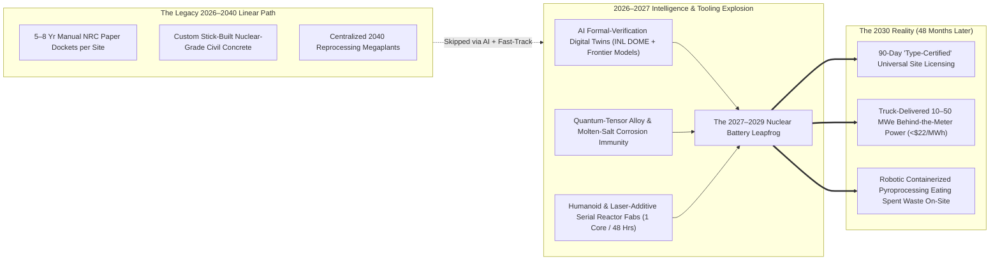
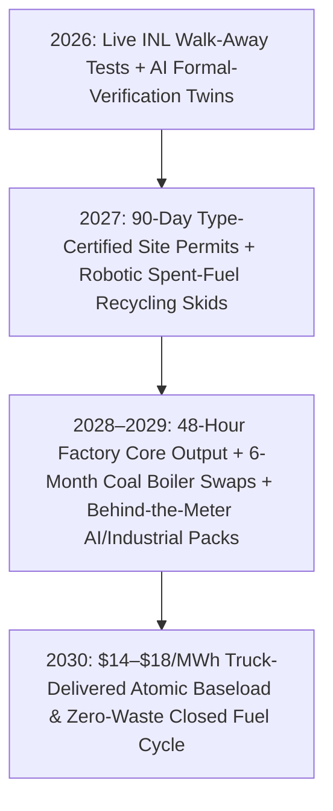

# VISION SHORTER 02: THE 2026–2030 ABUNDANT ENERGY LEAPFROG
## Pathway 2E: Factory-Sealed Nuclear Batteries, 90-Day AI Licensing & On-Site Waste Burners — *Skipping the Decade-Long Reactor Megaproject in 48 Months*

> **The Legacy 2040 Assumption:** *"Even with Generation IV small modular reactors (SMRs) and the 2024 ADVANCE Act, nuclear fission is still a slow heavy-industry play. Custom site permits take 4 to 8 years, first-of-a-kind plants won't scale until the mid-2030s, and nuclear fuel recycling requires multi-billion-dollar centralized reprocessing complexes that won't mature until 2040."*
>
> **The 2026–2030 Leapfrog Thesis:** The 2040 timeline collapsed into **48 months** because **frontier AI formal verification**, **autonomous robotic module fabs**, and **emergency defense/compute fast-track authorities** collided in 2026–2027. Instead of treating reactors as custom civil construction projects regulated by 10,000-page paper dockets, **physics-informed AI Digital Twins** mathematically prove walk-away passive safety across 100 million fault permutations in **90 days**. By **2027–2029**, hermetically sealed **10–50 MWe TRISO and molten-salt "nuclear batteries"** (*Kairos, Oklo, Radiant, eVinci, BWXT*) roll off humanoid-staffed assembly lines on flatbed trucks, plug directly behind-the-meter into towns, desalination plants, and gigawatt AI clusters, and use compact **autonomous pyroprocessing Skids** to eat existing spent nuclear waste on-site.

---

## ACT I: THE WORLD OF 2030 (4 YEARS FROM TODAY)
### Autumn 2030 — The Truck-Delivered Atomic Utility Box

Step onto the edge of a mid-sized municipal water district, a former coal town in Wyoming, or a regional industrial park in **October 2030**—just four years from today. The 15-year concrete cooling-tower megaproject is extinct; in its place sits the **"Skip-the-Grid" Atomic Appliance**:

1. **The 72-Hour Flatbed Plug-In at the Edge of Town:**
   * Behind a standard industrial perimeter fence sits a landscaped courtyard containing three 40-foot ISO steel shipping containers buried flush in seismic-isolated concrete vaults.
   * Inside each container is a factory-sealed **25-megawatt high-temperature TRISO/molten-salt or liquid-metal fast microreactor** delivered by heavy-haul truck 18 months ago and connected in 72 hours.
   * Because the fuel kernels are encased in silicon-carbide ceramic tested to $1,800^\circ\text{C}$ and cooled at **1 atmosphere of pressure**, a core meltdown is physically impossible. There are no sirens, no 10-mile evacuation zones, and no human operators on night shift—an autonomous on-chip digital twin monitors the core while delivering **\$19/MWh baseload electricity** and $700^\circ\text{C}$ district heat.
2. **Behind-the-Meter Sovereignty for AI, Steel & Desalination:**
   * Across the highway, an agricultural fertilizer cooperative, a green steel mini-mill, and a 500-megawatt AI scientific compute cluster did not wait 7 years in a utility transmission interconnection queue.
   * In **2028**, they leased a 10-pack of **50 MWe Kairos and Oklo modular powerhouses** placed directly on their parking lot footprint—completely bypassing congested high-voltage utility lines.
3. **The On-Site "Waste-Eater" Skid Turning Casks into Centuries of Power:**
   * At a decommissioned 1970s nuclear station nearby, the rows of concrete dry-storage casks holding "spent" light-water fuel rods are already shrinking.
   * Inside a heavily shielded, shipping-container-sized **Autonomous Pyroprocessing Cell** operated entirely by radiation-hardened robotic arms, old fuel assemblies (which still hold **96% of their original energy**) are electro-refined in molten salt and cast directly into metallic fast-reactor fuel pins on-site.
   * The long-lived actinide waste is burned into clean electricity, leaving behind a coffee-can volume of fission products that decay to natural ore levels in **under 300 years**.
4. **Zero-Diesel Remote Towns & Maritime Freighters:**
   * From Arctic villages in Alaska and mining camps in Chile to trans-Pacific container ships, \$8/gallon diesel barges have vanished—replaced by leased **5 MWe heat-pipe nuclear batteries** that run for 8 years without a single refueling stop.

---

## ACT II: THE CROSS-POLLINATION CATALYSTS & "SKIP-THE-OLD-WORLD" JUMPS (2026–2028)
### How AI Formal Verification, Quantum Materials, and Robotic Fabs Compressed 15 Years into 4

### Why the 2040 Timeline Collapsed into 2026–2030
Three cross-disciplinary detonations between late 2026 and 2028 shattered the traditional nuclear schedule:

* **Catalyst 1: AI Formal-Verification Twins & 90-Day "Airframe-Style" Type Licensing (2026–2027):**
  * Historically, licensing a reactor required thousands of human-hours reviewing static thermal-hydraulic codes and site-specific probabilistic risk assessments over 5+ years.
  * In **late 2026**, following U.S. Department of Energy / Department of Defense fast-track directives at **Idaho National Laboratory (INL DOME & LOTUS testbeds)** and the **2024 ADVANCE Act**, regulators paired live physical telemetry from **BWXT's *Project Pele***, **Radiant's *Kaleidos***, and **Kairos Power's *Hermes*** with **Frontier AI Multiphysics Provers**.
  * Just as the FAA certifies a Boeing or Airbus jet engine once for thousands of aircraft, AI formal verification exhaustively proved that TRISO and low-pressure molten-salt/sodium cores cannot melt down under *any* physical boundary condition. Site permits for pre-certified factory modules collapsed from **6 years to 90 days**.
* **Catalyst 2: Quantum-Simulated Corrosion Coatings & High-Density HALEU/Thorium Breeding (2027):**
  * Molten-salt and liquid-metal reactors previously faced material degradation limits from high-temperature salt corrosion and radiation swelling, plus bottlenecks in High-Assay Low-Enriched Uranium (HALEU) supply.
  * In **2027**, quantum-tensor chemistry models co-piloting autonomous materials labs synthesized **self-healing refractory high-entropy alloy claddings** and **laser-isotopic enrichment cascades (Silex/GLE)** while unlocking direct **spent-LWR-fuel electro-refining** (**Oklo / Curio / Argonne**)—completely bypassing the HALEU enrichment bottleneck by turning existing nuclear waste casks into immediate domestic fuel.
* **Catalyst 3: Humanoid & Laser-Additive "Shipyard" Microreactor Factories (2027–2028):**
  * Instead of pouring nuclear-grade concrete on-site, **Kairos Power**, **Oklo**, **Radiant**, **Westinghouse (*eVinci*)**, and **X-energy** deployed **large-format multi-laser powder-bed fusion (LPBF)** printers and 24/7 autonomous robotic welding cells that print and inspect an entire atmospheric-pressure reactor vessel and heat-exchanger core in **48 hours** with sub-millimeter ultrasonic AI verification.

### Catalyst & Leapfrog Breakthroughs Table (2026 Anchors $\rightarrow$ 2027–2030 Jumps)

| 2026 Real-World Anchor | The 2026–2027 Cross-Pollination Catalyst | The 2027–2030 "Skip-the-Old-World" Leapfrog | 2030 Cost & Deployment Metric |
| :--- | :--- | :--- | :--- |
| **INL Microreactor Testbed** *(BWXT Pele, Radiant Kaleidos, Westinghouse eVinci at INL)* | **AI Formal-Verification Licensing Twin:** Coupled live 2026 INL full-power zero-coolant test data with neural PDE provers under DOE/DOD Defense Fast-Track authority. | **Universal "Type-Certified" Nuclear Appliance:** Pre-certified 5–50 MWe factory cores deploy to any industrial or municipal pad with a **90-day automated environmental/seismic check**. | **90-Day Permitting** *(down from 6–8 years)*; zero off-site evacuation zone. |
| **Kairos Power *Hermes 1 & 2*** *(NRC Permits Approved; 500 MW Google PPA; Albuquerque Fab)* | **Laser-Printed Vessels & Autonomous Salt Loops:** AI-guided additive manufacturing + non-nuclear commercial ASME balance-of-plant codes for 1-atm $\text{FLiBe}$ salt. | **Behind-the-Meter Industrial & AI Power Packs:** Modular 50 MWe Kairos units drop directly behind the fence at data centers and chemical plants, skipping grid queues entirely. | **\$1,450 / kW CAPEX** \| **\$22 / MWh** 24/7 power & $650^\circ\text{C}$ steam by 2029. |
| **Oklo *Aurora* & Fuel Recycling** *(INL Site Permit & Fuel Award; 2.1+ GW Pipeline; Argonne Pyro)* | **Robotic Containerized Pyroprocessing:** Radiation-hardened autonomous manipulators + AI spectroscopic molten-salt control shrink fuel recycling into a 40-ft module. | **On-Site Spent-Waste-to-Fuel Conversion:** Decommissioned LWR sites convert their own dry-cask waste into metallic fast-reactor fuel pins without shipping waste across states. | **\$0 Raw Uranium Mining Cost**; waste radiotoxicity cut from **100,000 yrs $\rightarrow$ <300 yrs**. |
| **X-energy *Xe-100* & TRISO-X** *(Amazon 5 GW Deal; Dow Seadrift Texas Chemical Project)* | **Autonomous Roll-to-Roll CVD TRISO Coating:** Vision-guided fluidized-bed reactors triple-coat 100 million $\text{SiC}$ fuel kernels/day with 99.9999% zero-defect yield. | **Indestructible Ceramic Fuel Abundance:** TRISO pebbles become a standardized global commodity shipped in ordinary industrial drums with zero meltdown risk up to $1,800^\circ\text{C}$. | **70% Fuel Cost Drop** by 2028; direct $750^\circ\text{C}$ process heat for hydrogen & steel. |
| **TerraPower *Natrium* (WY)** *(Kemmerer Coal Site Groundbreaking; Molten-Salt Tank)* | **AI Coal-Site Repowering Blueprints:** Automated LiDAR/structural digital twins map all 300+ GW of retiring US/EU coal plants for drop-in reactor-to-turbine coupling. | **6-Month "Boiler-Swap" Coal Repowering:** Standardized sodium/salt heat sources hook directly into existing coal plant steam turbines and switchyards over a single outage season. | **45% CAPEX Savings**; zero new transmission towers or land condemnation. |
| **Silex / GLE Laser Enrichment** *(Paducah KY Commercial Laser Enrichment Pilot)* | **Quantum-Tuned Photonic Isotope Separation:** High-efficiency solid-state mid-IR lasers tuned by quantum control loops slash isotopic separation energy by 85%. | **Instant Domestic HALEU & Depleted-Tails Upcycling:** 500,000 tons of existing depleted uranium tails in Kentucky/Ohio are upcycled into high-assay reactor fuel in 24 months. | Eliminates foreign uranium enrichment dependence by **Q4 2027**. |
| **CORE POWER & Maritime SMRs** *(Floating Nuclear Production & Merchant Ship Consortia)* | **Automated Shipyard Modular Block Assembly:** South Korean, Japanese, and US shipyards integrate sealed molten-salt cores into standard hull blocks on robotic slipways. | **Plug-and-Play Coastal Power Barges:** 100–250 MWe floating nuclear desalination and power barges moor at coastal cities and island nations with a single subsea cable. | **12-Month Hull-to-Grid Delivery**; **\$0.40/m³** desalinated water. |

---

## ACT III: THE 48-MONTH SPRINT ROADMAP (2026 $\rightarrow$ 2030)
### How the Nuclear Battery Revolution Scales in Four Years

Because factory-sealed microreactors and modular fast cores weigh 40 to 150 tons (comparable to a commercial jetliner or heavy gas turbine) rather than 500,000 tons of site-poured concrete, production scales on an **aerospace/automotive learning curve (22% cost drop per doubling)** rather than a civil construction schedule:

| Sprint Year | Milestone & Regulatory Unlock | Factory Output & Fleet Scale | Installed Cost & LCOE | Concrete "Skip-the-Old-World" Impact |
| :--- | :--- | :--- | :--- | :--- |
| **2026** *The Ignition Year* | **INL DOME/Pele Criticality & Defense Fast-Track:** *Project Pele*, *Radiant*, and *eVinci* validate full passive walk-away safety at INL; DOE/NRC launch **AI Formal-Verification Twin** docket for type-certified factory reactors. | **5–10 First-of-a-Kind Cores** (*Hermes 1, Pele, Kaleidos*); TRISO-X & Albuquerque automated fabs commissioned. | **\$4,500 / kW** **\$62 / MWh** | Proves zero-meltdown physics in live hardware; AI data centers & defense bases sign binding upfront multi-GW factory reservation deposits. |
| **2027** *The 90-Day Permit & Waste Unlock* | **Universal Type-Certification & Pyro-Skid Launch:** Pre-certified 5–50 MWe reactor models receive **90-day site approval** at industrial/coal pads; *Oklo* & *Argonne* demonstrate first containerized robotic spent-fuel electro-refiner. | **60+ Factory Cores / Yr** across 4 US/Allied robotic gigafabs; Silex laser enrichment clears HALEU bottleneck. | **\$2,600 / kW** **\$36 / MWh** | Industrial parks, chemical refineries, and hyperscale compute clusters bypass 7-year utility grid queues by plugging nuclear batteries behind the meter. |
| **2028–2029** *The Coal-Swap & Truck-Fleet Surge* | **Automated "Boiler-Swap" & Maritime Rollout:** Humanoid-assisted assembly lines hit **1 reactor module every 48 hours**; first 25 retiring coal boilers swapped for sodium/molten-salt heat packs in <6 months; coastal power barges launch. | **300+ Cores / Yr (~12 GW/yr)** deployed across North America, Europe, Japan & emerging markets. | **\$1,550 / kW** **\$21 / MWh** | Retiring coal towns keep 100% of jobs & switchyards; remote Arctic/island communities retire diesel generators; on-site waste burners scale. |
| **2030** *Ubiquitous Atomic Appliances* | **Closed-Loop Autonomous Fleet Maturity:** Over **1,000 factory-sealed cores (40+ GW)** operating globally with zero human safety incidents; 40% of new fast-reactor fuel refined directly from legacy LWR waste casks. | **600+ Cores / Yr (25+ GW/yr)** serial capacity; standardized global container lease model. | **<\$1,100 / kW** **\$14 – \$18 / MWh** *(+\$1.80/MMBtu Heat)* | Clean 24/7 baseload electricity and $750^\circ\text{C}$ industrial steam become an on-demand, truck-delivered commodity anywhere on Earth. |

### The 48-Month Self-Compounding Flywheel: AI Compute + Robotics Building Nuclear Batteries
Why does unit cost plunge from \$4,500/kW in 2026 to under \$1,100/kW by 2030?
1. **AI Clusters Funding Their Own Power Fabs:**
   * Hyperscale AI operators (**Google, Amazon, Microsoft, Oracle, OpenAI**) face an immediate 2026–2028 power wall where every month of grid delay costs hundreds of millions of dollars in idle GPUs.
   * By pre-purchasing multi-gigawatt blocks of **Kairos, Oklo, X-energy, and Radiant** modules upfront in 2026–2027, tech balance sheets finance the first automated robotic reactor factories without slow project-finance debt.
2. **Nuclear-Powered Laser Printing & Zero-Defect Ultrasonic Twins:**
   * Once the first factory modules plug into the reactor gigafabs themselves in 2027, **free 24/7 nuclear electricity and $700^\circ\text{C}$ process heat** power the multi-laser metal 3D printers, CVD TRISO coating furnaces, and Silex laser enrichment cascades—slashing module embodied energy cost by 65%.
   * Embedded ultrasonic and neutron-radiography AI sensors inspect every weld Layer-by-Layer during printing, eliminating the post-build rework that bankrupted 20th-century nuclear construction.

---

## ACT IV: IMMEDIATE HUMAN & SOCIAL DIVIDEND (BY 2030)
### What Changes for Families, Workers, and Communities in 48 Months

1. **Grid Relief & Lower Household Utility Bills Starting in 2027–2028:**
   * In 2025–2026, residential ratepayers faced surging electricity bills as utilities spent billions upgrading lines to feed power-hungry AI data centers and industrial electrification.
   * By **2028**, because data centers, steel mills, and chemical plants install **behind-the-meter nuclear batteries** directly on their own sites—and return surplus off-peak megawatts to the local substation—households are shielded from grid expansion surcharges while enjoying rock-solid local voltage.
2. **Instant Revival for Coal & Industrial Towns (Zero Waiting for the 2030s):**
   * Instead of watching a local coal plant close in 2027 and waiting a decade for a replacement, communities from Wyoming and Appalachia to Poland and the Ruhr Valley perform a **6-month modular boiler swap**.
   * The town's existing turbine mechanics, electricians, and control-room operators transition straight onto the new molten-salt/sodium heat source at higher wages, keeping the county tax base intact without a single year of economic blight.
3. **Liquidating the "100,000-Year Nuclear Waste" Fear Before 2030:**
   * Communities living near legacy nuclear plants no longer have to fear being permanent nuclear waste dumps.
   * Compact **autonomous pyroprocessing skids** begin consuming the dry casks sitting on those very concrete pads in **2028–2029**, turning a political liability into decades of local revenue and clean power while cutting remaining waste storage times to less than 300 years.
4. **Drought-Proof Water & Clean Air for Port Cities and Remote Regions:**
   * Coastal cities in California, Texas, the Mediterranean, and the Middle East moor **floating molten-salt desalination barges** offshore by 2029, producing freshwater at **\$0.40/m³** without touching the terrestrial power grid.
   * Meanwhile, hundreds of remote Indigenous, Arctic, and island communities unplug noisy, carcinogen-spewing diesel generators forever—heating their homes and schools for a decade on a single silent container delivered on a flatbed truck.
5. **Carbon-Free Fertilizer, Steel & Synthetic Fuels at Fossil Parity:**
   * Because $750^\circ\text{C}$ TRISO and molten-salt modules sit safely inside chemical plant fence lines (**Dow Seadrift** model), zero-carbon industrial steam and hydrogen drop below **\$1.80/MMBtu thermal equivalent**—decarbonizing plastics, ammonia, and aviation fuel by 2030.

---

### Summary for the Skeptic: Why 2030 Instead of 2040?
* **Physics Replaced Active Safety Complexity:** TRISO ceramic fuel ($1,800^\circ\text{C}$ stability) and 1-atmosphere coolants (**Kairos, Oklo, Radiant, eVinci**) cannot physically melt down—allowing **AI Formal-Verification Twins** to replace 8-year custom site reviews with **90-day type-certified permits**.
* **Hardware Is Already Built in 2026:** **BWXT *Pele***, **Radiant *Kaleidos***, **Westinghouse *eVinci***, and **Kairos *Hermes*** are in active fabrication and testing at INL and Oak Ridge right now—not on 2035 drawing boards.
* **Robotic Fabs + Spent-Fuel Recycling Remove Every Bottleneck:** Laser-additive manufacturing prints reactor vessels in 48 hours, Silex laser enrichment upcycles depleted tails, and containerized electro-refining turns 90,000 tons of existing LWR spent fuel into immediate domestic fuel.
* **Behind-the-Meter Deployment Skips the Grid Queue:** You don't wait 10 years for new high-voltage transmission lines when a 25 MWe nuclear battery arrives on a flatbed truck and plugs straight into the factory or town substation.

### Quick Reference: 2026 Legacy Nuclear vs. 2030 Atomic Battery Leapfrog
* **Site Licensing Horizon:** 6–8 Years (Custom Paper Docket) $\rightarrow$ **90 Days (AI Formal-Verification Type Permit)**
* **Core Operating Pressure:** 150 Atmospheres (Water) $\rightarrow$ **1 Atmosphere (Molten Salt / Liquid Metal / Helium)**
* **Construction Method:** 12-Year Stick-Built Concrete Cathedral $\rightarrow$ **48-Hour Laser-Printed Module + 72-Hour Truck Plug-In**
* **Fuel & Waste Cycle:** 4% Burnup + 100,000-Year Waste Casks $\rightarrow$ **96% Recycled Spent Waste + <300-Year Decay**
* **All-In Baseload Cost:** \$110–\$160/MWh (Vogtle/Hinkley) $\rightarrow$ **\$14–\$18/MWh (2030 Serial Module Fleet)**
