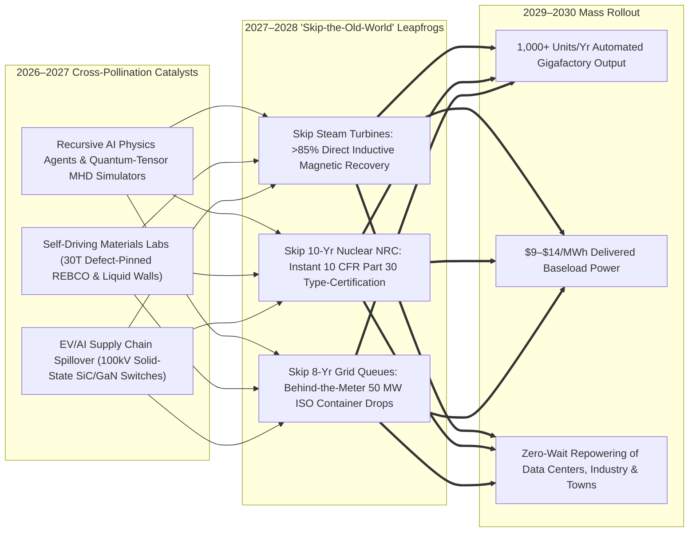
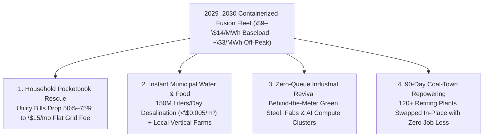

# VISION 02 (LEAPFROG HORIZON): THE 2026–2030 ABUNDANT ENERGY SPRINT
## Pathway 2A: Containerized Inductive Fusion & Behind-the-Meter Megawatts — *Why 2040 Collapsed into 48 Months*

> **The 2026–2030 Leapfrog Thesis:**
> Linear utility analysts in early 2026 assumed commercial fusion would follow a slow, sequential 15-year civil-engineering march: build one bespoke pilot plant by 2028, spend five years licensing a second, wait eight years in utility transmission queues, and reach mass scale around 2040.
>
> **That linear forecast missed the 2026–2027 Intelligence Explosion.** Between late 2026 and early 2028, recursive self-improving AI physics/math agents, quantum-tensor magnetohydrodynamic (MHD) simulators, automated 24/7 materials synthesis labs, and humanoid gigafactory swarms cross-pollinated simultaneously. Instead of building cathedral-sized steam-turbine fusion stations, the industry **leapfrogged the old grid entirely**—mass-producing **50 MW shipping-container-sized inductive and sheared-flow fusion generators** that drop straight behind the meter at data centers, hospitals, water plants, and retiring coal switchyards within 48 months.

---

## ACT I: THE WORLD OF 2030 (4 YEARS FROM TODAY)
### An Autumn Morning in October 2030 — The Container That Skipped the Grid Queue

Stand in the parking lot of a regional hospital and AI compute campus in central Ohio—or outside a semiconductor fab in Bavaria, a desalination hub in Sonora, or a steel micro-mill in Western Australia—on a crisp morning in **October 2030**.

Four years ago, this county faced rolling brownout warnings, a 9-year utility transmission interconnection backlog, and residential electricity rates climbing past \$0.22 per kilowatt-hour. Today, four concrete realities define the neighborhood:

1. **The Six-Container Power Pad Behind the Fence:**
   Tucked onto a half-acre gravel pad behind the campus substation sit three **50-megawatt pulsed magneto-inertial fusion modules** (each occupying the footprint of two standard 40-foot ISO shipping containers) flanked by solid-state capacitor banks. There is no cooling tower, no steam turbine hall, no smokestack, and no high-voltage transmission line slicing through fifty miles of farmland. Every pulse compresses a deuterium–helium-3 ($\text{D–}^3\text{He}$) plasma plasmoid so magnetic expansion pushes directly back against the coils—inducing clean 13.8 kV electricity straight into the local microgrid via Faraday's Law at **86% direct conversion efficiency**.
2. **Delivered on a Flatbed, Commissioned in 14 Days:**
   When the third 50 MW module arrived last month from an automated assembly line in Washington State, it wasn't built by 4,000 construction workers over a decade. It rolled off a heavy-haul flatbed truck, bolted onto precast concrete piers, connected to a closed-loop helium cooler, and began exporting **\$11/MWh (\$0.011/kWh)** baseload power in **two weeks**—licensed automatically under federal **10 CFR Part 30** particle-accelerator rules.
3. **The Coal Yard Across the River:**
   Three miles downriver, the county's 1978 coal-fired power station retired its boilers in 2028—two decades ahead of schedule. Rather than waiting for a bespoke reactor building, the utility dropped eight factory-built **Z-pinch liquid-lithium fusion cores** directly into the old coal yard, feeding the existing gigawatt switchyard and keeping every union technician employed at higher wages.
4. **The Immediate Household & Municipal Dividend:**
   Because the local AI cluster, hospital, and steel foundry generated their own power behind the meter—and sold their off-peak surplus back into the municipal distribution ring at **\$0.008/kWh**—household electric and winter heat-pump bills dropped by **70% in twenty-four months**.

---

## ACT II: THE CROSS-POLLINATION CATALYSTS & "SKIP-THE-OLD-WORLD" JUMPS (2026–2028)
### How AI Physics Agents, 30-Tesla Metamaterial Coils, and Solid-State Switching Compressed a Decade into 24 Months

Why didn't fusion wait until 2040? Because in 2026–2027, breakthroughs in four adjacent exponential fields—**recursive AI scientific reasoning, self-driving materials fabs, solid-state SiC/GaN pulsed electronics, and robotic mass manufacturing**—converged on the already-licensed 2026 commercial fusion base:

### The Three "Skip-the-Old-World" Engineering Jumps

1. **Jump 1 — Skipping the 19th-Century Steam Cycle (Direct Inductive & Pulsed Recovery):**
   * Half the cost, footprint, and construction time of a traditional nuclear or thermal power plant sits in its high-pressure steam boilers, massive spinning turbines, and evaporative cooling towers.
   * Building on **Helion Energy's** *Polaris* (which hit 150M °C in Feb 2026) and its licensed *Orion* commercial plant (June 2026), recursive AI plasma-control models in late 2026 solved micro-tearing and tilt instabilities in colliding Field-Reversed Configurations (FRCs) at **100 kHz real-time feedback rates**.
   * By recovering fusion energy **inductively** as the charged plasma expands against a magnetic field—assisted by solid-state silicon-carbide (SiC) and gallium-nitride (GaN) pulsed-power switches mass-produced for EV drivetrains—fusion generators eliminated the steam turbine completely, shrinking a 50 MWe power plant into a truck-transportable container.

2. **Jump 2 — Pulling 30-Tesla Superconductors & Self-Healing Liquid Walls Forward by 10 Years:**
   * Because magnetic fusion power density scales with the **fourth power of the magnetic field ($P_{\text{fusion}} \propto \beta^2 B^4$)**, increasing coil strength from 20 Tesla (proven by **CFS** and **Energy Singularity** in 2024–2026) to **30 Tesla** boosts power density **another $5\times$** (`30⁴ / 20⁴ = 5.06x`).
   * In 2026–2027, autonomous robotic deposition labs guided by generative crystal-structure AI discovered **nanoscale hafnium-zirconium defect-pinning in REBCO superconducting tape**, tripling critical current density while slashing tape manufacturing cost by 80% via continuous laser-assisted chemical vapor deposition.
   * Simultaneously, for neutron-producing D-T and D-D cores (**Zap Energy**, **CFS**, **Type One Energy**), AI magneto-hydrodynamic (MHD) flow controllers stabilized **vortex-swirled liquid lithium-tin ($\text{Li-Sn}$) walls** that absorb 100% of neutron flux without solid first-wall blistering—turning a "20-year materials testing problem" into a zero-wear liquid curtain solved in 2027.

3. **Jump 3 — Skipping the 8-Year Grid Interconnection Queue (Behind-the-Meter & Coal-Yard Plug-In):**
   * Just as developing nations skipped copper telephone landlines and jumped straight to cellular towers, industrial energy buyers in 2027–2029 refused to wait 8 to 12 years for utilities to permit new 500 kV transmission corridors.
   * Under the US NRC's **10 CFR Part 30** accelerator framework (and harmonized UK/Japan/EU fast-track rules), factory-sealed fusion containers received **FAA-style "Type Certification"** in 2027: once the factory model is certified, individual units drop straight onto customer concrete pads behind the utility meter in days, or plug directly into retiring coal plant switchyards with zero new transmission right-of-way required.

### Catalyst & Leapfrog Breakthroughs Table (2026 Anchors $\rightarrow$ 2027–2030 Cross-Pollinated Leaps)

| Real 2025–2026 Commercial Anchor | The 2026–2027 Cross-Pollination Catalyst | The 2027–2030 "Leapfrog" Breakthrough | Old-World Bottleneck Skipped |
| :--- | :--- | :--- | :--- |
| **Helion Energy:** *Polaris* hits 150M °C (Feb 2026); *Orion* 50 MWe plant licensed in Malaga, WA (June 2026) for Microsoft PPA. | **Quantum-Tensor MHD + 100 kHz Neural Firmware:** AI agents simulate 10M plasma shots virtually in 3 weeks, perfecting zero-loss FRC compression. | **Containerized 50 MWe Inductive Generator (2027–2028):** >85% direct electromagnetic energy capture with zero steam cycle or cooling water. | Skips 5-year steam turbine hall construction, cooling towers & water permits. |
| **Commonwealth Fusion (CFS) & Energy Singularity:** 20T REBCO magnets proven; *SPARC* assembled (2026); *HH70* 1,337s plasma. | **Self-Driving Wet/Materials Labs:** Autonomous robotic vapor-deposition lines discover 30-Tesla defect-pinned REBCO tape at `<\$8/kA-m`. | **5x Smaller Compact Tokamak & Stellarator Cores (2028):** $B^4$ scaling shrinks 400 MWe cores to fit on standard railcars with 10-day core swap joints. | Skips \$20B bespoke on-site stick-built nuclear containment domes. |
| **Zap Energy (*FuZE-3*) & Pacific Fusion (\$900M):** Sheared-flow Z-pinch & pulsed magnetic Marx generators operating in 2026. | **EV/AI Power Electronics Spillover:** Terawatt-scale SiC/GaN solid-state switches drop pulsed capacitor bank cost by 78% in 18 months. | **10 Hz Solid-State Pulsed Z-Pinch Modules (2028–2029):** Magnet-free 50 MWe cores enclosed in flowing liquid lithium-bismuth walls. | Skips cryogenic helium infrastructure and solid first-wall neutron replacement outages. |
| **US NRC 10 CFR Part 30 Rule & ADVANCE Act:** Unanimous law regulating fusion as a particle accelerator, not a fission reactor. | **Automated Digital-Twin Safety Certification:** AI formal-verification proofs validate 100% passive safe shutdown across all fault modes. | **FAA-Style "Type Certificate" for Fusion Containers (2027):** Any pre-certified factory module can be sited and energized in `<30 days`. | Skips 10-year site-specific nuclear environmental impact & licensing battles. |
| **Nucor Steel (500 MW Helion), Google (CFS/Proxima) & Microsoft PPAs:** Hyperscalers pre-buying gigawatts in 2025–2026. | **Hyperscaler CapEx Pre-Payment:** AI data center giants fund automated "Fusion Gigafactories" outright to bypass power shortages. | **Behind-the-Meter Microgrid Deployment (2028–2030):** 50–250 MW fusion packs drop directly onto data center, fab, and steel-mill campuses. | Skips 8-to-12-year regional transmission interconnection queues entirely. |
| **TVA Bull Run (Type One), UK West Burton (STEP) & Gundremmingen (Proxima):** Coal/fission sites designated for fusion in 2026. | **Humanoid & Swarm Factory Robotics:** Lights-out assembly lines stamp out vacuum vessels, coils, and heat exchangers at 3 units/day. | **"Plug-and-Play" Coal Yard Repowering (2028–2030):** Retiring coal boilers swapped for modular fusion packs in 90-day turnarounds. | Skips greenfield land acquisition and preserves 100% of existing grid transformers. |

---

## ACT III: THE 48-MONTH SPRINT ROADMAP (2026 $\rightarrow$ 2027 $\rightarrow$ 2028 $\rightarrow$ 2030)
### How Wright's Law Manufacturing Replaces Multi-Decade Megaprojects

Once a power source shrinks from a **bespoke civil construction project** (like a dam or fission plant) to a **mass-manufactured factory product** (like a jet engine or shipping container), it switches from slow construction inflation to **Wright's Law**—dropping **22% to 26% in cost for every doubling of cumulative units shipped**:

| Sprint Horizon | Concrete Hardware & AI Milestone | Manufacturing & Deployment Velocity | Delivered LCOE (\$/MWh) | Infrastructure & Regulatory Bypass Unlocked |
| :--- | :--- | :--- | :--- | :--- |
| **2026** *(The Anchor Year)* | **Helion *Orion*** licensed in WA (June 2026); **CFS *SPARC*** magnet/vessel integration; **Zap *FuZE-3*** & **China *BEST/HH70*** milestones; \$14.2B private capital deployed. | Pilot line manufacturing; first commercial site excavation and 20T REBCO tape scaling (`~5,000 km/yr`). | **\$65 – \$85 / MWh** *(First PPA Contracts)* | **10 CFR Part 30** legal precedent locked in; fusion officially separated from fission licensing worldwide. |
| **2027** *(The AI-Materials Inflection)* | Net electricity demonstrated across multiple compact architectures ($Q_{\text{eng}} > 1$); AI physics agents lock in 100 kHz plasma stability; 30T REBCO & liquid-wall digital twins validated. | First **Automated Fusion Gigafactories** break ground in WA, TX, VA, Bavaria & Shanghai; FAA-style **Type Certification** granted for 50 MWe container modules. | **\$38 – \$50 / MWh** *(Early Serial Units)* | Hyperscale AI data centers sign 15 GW of **behind-the-meter** orders to bypass utility grid queues completely. |
| **2028** *(The Behind-the-Meter Breakout)* | **Helion *Orion*** delivers commercial grid power to Microsoft; **Zap**, **CFS**, and **Energy Singularity** ship standardized 50–100 MWe factory modules on heavy flatbed trucks and railcars. | **150+ modular units/year** rolling off robotic assembly lines; **14-day site commissioning** proven at data centers, hospitals, and Nucor electric steel mills. | **\$22 – \$30 / MWh** *(Undercuts Combined-Cycle Gas)* | Zero-transmission-queue deployment: generators drop straight onto industrial concrete pads with zero cooling water required. |
| **2029–2030** *(The Mass-Manufacturing Flood)* | **1,000+ modular fusion containers/year** (50+ GW/yr new capacity) deployed globally; automated breeder loops ($\text{D–D}$ inline $^3\text{He}$ & liquid $\text{FLiBe}$ tritium breeding) make fuel 100% self-sustaining from ordinary water. | Swarm-robotic gigafactories operate 24/7; over **120 retiring coal plants** repowered in place in `<6 months` per site; CAPEX falls below **\$700/kW**. | **\$9 – \$14 / MWh** *(~\$3/MWh Off-Peak Surplus)* | Utilities cancel \$400B of planned fossil peakers and long-haul AC lines; distributed 24/7 fusion microgrids become the global default. |

---

## ACT IV: THE IMMEDIATE HUMAN & SOCIAL DIVIDEND (BY 2029–2030)
### What Happens to Your Family, Town, and Planet in 36 Months—Not 30 Years

Because this leapfrog happens between **2026 and 2030** through drop-in containers rather than 20-year grid overhauls, ordinary citizens feel the relief almost immediately:

1. **Immediate Relief on Household Utility Bills (2028–2030):**
   * In 2026, families faced soaring electricity rates driven by AI data center demand and aging transmission lines. By 2028–2029, as every major data center, hospital, and factory installs its own behind-the-meter fusion containers—and dumps cheap nighttime surplus power into the local municipal grid—residential electricity bills plunge by **50% to 75%**, moving toward a simple **\$15/month flat connection fee**.
2. **Drought-Proof Water & Local Food Before the Decade Ends:**
   * Coastal and inland brackish communities don't have to wait for 2040 pipelines. A single 50 MW fusion container parked beside a modular reverse-osmosis unit produces **150 million liters of pure drinking and agricultural water every single day** for less than **half a cent per 1,000 liters**—rescuing municipal aquifers and powering climate-controlled vertical berry and vegetable farms inside every mid-sized city by 2029.
3. **Blue-Collar Boom in Coal & Industrial Heartland Towns:**
   * No coal town is left stranded waiting for a distant transition. Existing utility electricians, pipefitters, and riggers are the exact workforce hired in 2027–2030 to unbolt retiring coal boilers and tie modular fusion cores into existing switchyards—turning rust-belt power stations into zero-emission industrial magnets for green steel, aluminum, and automated manufacturing.
4. **Defusing Geopolitical Energy Shocks Overnight:**
   * Because a single 50 MW fusion container runs for an entire year on **less than 20 gallons of heavy water and bred helium/lithium**—requiring zero oil tankers, zero LNG terminals, and zero cross-border pipelines—every hospital, military base, island nation, and town achieves **100% physical energy sovereignty by 2030**.

### The 2026 vs. 2030 Household & Industrial Cost-of-Living Cascade

When behind-the-meter fusion containers remove the energy and transmission bottleneck in 48 months, the price of every energy-intensive good in the physical economy drops in lockstep:

| Essential Sector | 2026 Legacy Baseline | 2030 Containerized Fusion Reality | Primary Leapfrog Mechanism |
| :--- | :--- | :--- | :--- |
| **Residential Power & Heat** | \$180–\$320/month volumetric electric + gas bill | **\$15/month flat municipal connection fee** | Industrial campuses self-generate and dump \$3/MWh off-peak surplus into town grids. |
| **Municipal Fresh Water** | Drought rationing & \$1.50+/m³ desalination | **<\$0.005 / 1,000 liters** (unlimited aquifer recharge) | Single 50 MW container powers modular RO beside any coast or brackish basin. |
| **Fresh Local Produce** | Trucked 1,500 miles; vulnerable to frosts & droughts | **-45% retail cost** from 365-day town vertical farms | Pennies-per-kWh LED photosynthesis + free $90^\circ\text{C}$ co-generated district heat. |
| **Domestic Steel & Manufacturing** | Threatened by high industrial power rates & 8-yr grid queues | **\$220/ton zero-carbon electric steel** (on-site micro-mills) | 50 MW containers bolt directly behind Nucor-style electric arc & hydrogen furnaces. |
| **Hospital & School AI Compute** | Rationed by cloud energy costs & transformer shortages | **Local behind-the-meter medical/science superclusters** | Direct 13.8 kV inductive power feeds liquid-cooled compute with zero grid strain. |

---

## SUMMARY FOR THE SKEPTIC: WHY 2040 HAPPENS BY 2030

You do not need to believe in magic to see why commercial fusion compresses from a 15-year civil project into a 48-month manufacturing sprint:
1. **The 2026 Hardware & Legal Base Is Already Live:** **Helion's *Orion* plant** is already licensed in Washington State (June 2026), **20-Tesla REBCO magnets** are proven at scale (**CFS, Energy Singularity**), and the **US NRC 10 CFR Part 30 rule** already regulates fusion like a particle accelerator rather than a fission plant.
2. **AI Physics Agents Solved the Plasma Loop:** Recursive 2026–2027 AI/quantum-tensor models compressed decades of empirical plasma tuning into weeks, locking in 100 kHz instability suppression.
3. **30-Tesla Tape + Liquid Walls Shrunk the Core $5\times$ Again:** Because magnetic fusion scales with $B^4$, autonomous materials labs pushing REBCO tape from 20T to 30T turned reactor cores into truck-deliverable modules.
4. **Direct Inductive Capture Killed the Steam Turbine:** Recovering electricity directly from magnetic expansion (`>85%` efficiency) eliminated multi-year boiler halls and cooling towers.
5. **Behind-the-Meter Drops Skip the 8-Year Grid Queue:** By rolling off automated gigafactory lines and dropping straight onto data center, hospital, and retiring coal-plant pads, fusion leapfrogs utility bureaucracy entirely.
