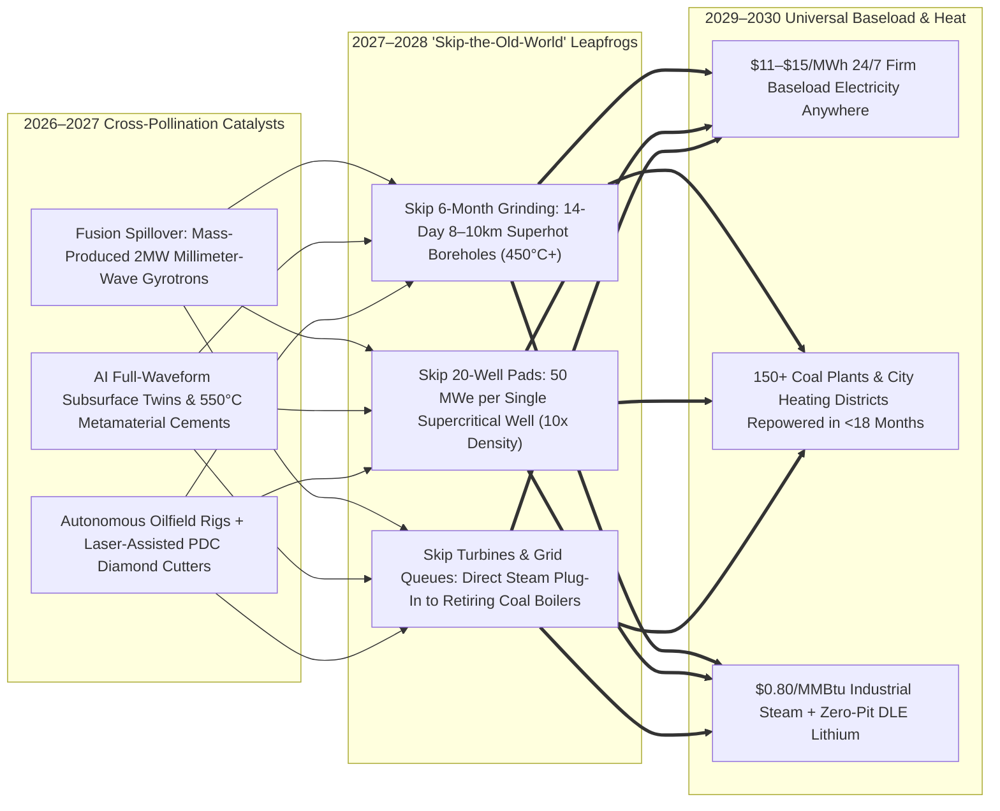
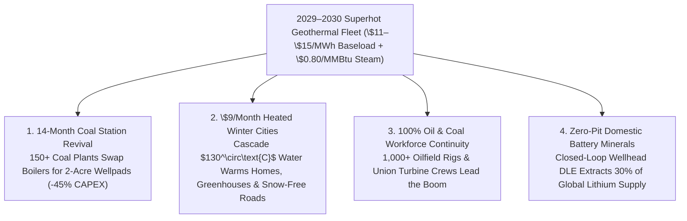

# VISION 02 (LEAPFROG HORIZON): THE 2026–2030 ABUNDANT ENERGY SPRINT
## Pathway 2D: 14-Day Gyrotron Superhot Drilling & Coal-to-Geothermal Boiler Swaps — *Why 2040 Collapsed into 48 Months*

> **The 2026–2030 Leapfrog Thesis:**
> In early 2026, traditional geothermal roadmaps assumed that tapping universal **Superhot Rock ($400^\circ\text{C}\text{–}500^\circ\text{C}$)** at 6 to 10 kilometers depth would remain an experimental science project until the late 2030s—held back by mechanical drill-bit wear in basement granite, slow drilling rates (`6 months per deep well`), induced seismicity fears, and 8-year greenfield power plant permitting queues.
>
> **Between 2026 and 2028, that 15-year timeline collapsed into a 48-month industrial sprint.** When **fusion-derived 2 MW millimeter-wave gyrotrons (Quaise)** converged with **AI-steered diamond/plasma directional drilling (Fervo / Mazama)** and **self-driving high-temperature metamaterial well casings**, rig crews began vaporizing and drilling 8-to-10 km boreholes into $450^\circ\text{C}$ supercritical rock in **14 days instead of 6 months**. By drilling compact 2-acre wellpads **directly inside the coal yards of retiring thermal power stations and municipal district-heating plants**, humanity skipped greenfield surface plant construction and **skipped 8-year transmission queues entirely**—delivering **\$12/MWh 24/7 baseload electricity and \$0.80/MMBtu industrial steam by 2029–2030.**

---

## ACT I: THE WORLD OF 2030 (4 YEARS FROM TODAY)
### A Freezing January Morning in 2030 — The Coal Town Running on 450°C Earth Steam

Stand by the riverfront of a former coal-mining and steel town in West Virginia—or in Poland's Silesia, Germany's Ruhr Valley, India's Jharkhand, or China's Shanxi province—on a crisp $-10^\circ\text{C}$ morning in **January 2030**.

Four years ago, the town's 900-megawatt coal-fired power station was slated for demolition, threatening 600 union jobs and forcing the regional grid to scramble for expensive natural gas pipelines and 10-year transmission upgrades. Today, four concrete realities anchor the valley:

1. **The 14-Day Superhot Borehole in the Old Coal Yard:**
   The 1980s steam turbines, synchronous generators, cooling towers, and 500 kV grid switchyard are still humming at **98% capacity factor**—operated by the exact same union mechanics and control-room engineers. Only the coal pile and boiler are gone. In their place sits a quiet **two-acre wellhead pad** with eighteen compact wellheads. Eight kilometers straight down in **$460^\circ\text{C}$ basement granite**, closed-loop and fiber-optically controlled superhot fractures send **supercritical steam** (`50 MWe per well`—$10\times$ the output of a 2024 geothermal well) rushing straight into the existing coal steam turbines.
2. **Repowered in 14 Months for 40% Less CAPEX:**
   When two automated **hybrid PDC + millimeter-wave gyrotron rigs** pulled into the coal yard in early 2028, they didn't spend five years grinding through granite. Each 8.5 km superhot well was spudded, vaporized, and glass-lined in **14 days**. Because the utility reused 100% of the coal plant's existing turbines and grid interconnect, the entire 900 MW station converted to zero-emission 24/7 geothermal baseload in **14 months** at **\$12/MWh (\$0.012/kWh)**—with zero new transmission permits.
3. **The \$9/Month Municipal Heating Loop & Snow-Free Streets:**
   After the $460^\circ\text{C}$ supercritical steam spins the electric turbines, the $130^\circ\text{C}$ residual thermal water is piped directly into the town's existing municipal water-main right-of-ways. Every home, school, and hospital in the county receives unlimited winter radiator heat and domestic hot water for a **\$9/month flat connection fee**, highway bridges stay automatically ice-free without salt, and a 150-acre glass greenhouse complex on the old strip-mine grows fresh tomatoes and strawberries in midwinter.
4. **Zero-Mine Lithium & Critical Minerals in the Side Room:**
   At a closed-loop wellpad down the road, mineral-rich deep brine passes through an AI-synthesized Direct Lithium Extraction (DLE) membrane cassette before returning 100% underground—producing **20,000 tons per year of battery-grade lithium and manganese** with zero open-pit mining scars.

---

## ACT II: THE CROSS-POLLINATION CATALYSTS & "SKIP-THE-OLD-WORLD" JUMPS (2026–2028)
### How Fusion Gyrotrons, Subsurface AI Digital Twins, and Oilfield Automation Turned Deep Granite into a 14-Day Sprint

Why did universal deep geothermal jump from a "2040 horizon" in early 2026 to mass coal-yard deployment in 2028–2029? Because breakthroughs in **compact fusion heating hardware, AI seismic/acoustic wave inversion, and autonomous oilfield robotics** converged on the proven 2025–2026 geothermal base (**Fervo**, **Eavor**, **Quaise**, **Mazama**, **Sage**):

### The Three "Skip-the-Old-World" Engineering Jumps

1. **Jump 1 — Skipping Mechanical Bit Burnout via Hybrid Laser/Gyrotron Rock Vaporization (14 Days to 8 km):**
   * By 2025–2026, **Fervo Energy** had already proven at Cape Station (Utah) that synthetic diamond (PDC) bits and automated oilfield physics could cut 3–4 km granite drilling time by **>70% (to 16 days)**. However, deeper down at 6 to 10 km (`400°C–500°C`), crystalline basement granite becomes too hot and hard for conventional steel-and-rubber directional tools alone.
   * In 2026–2027, the commercial fusion boom (**Kyoto Fusioneering**, **CFS**, **Helion**) drove automated mass production of **2-megawatt millimeter-wave gyrotrons and high-power fiber lasers**, crashing directed-energy beam costs by 80%.
   * **Quaise Energy** and oilfield service giants integrated **hybrid laser/millimeter-wave spallation heads directly into autonomous PDC directional rigs**: the electromagnetic beam flashes ahead of the bit at $3,000^\circ\text{C}$, micro-fracturing and vaporizing basement granite while vitrifying the borehole wall into a self-sealing glass liner. Drilling an 8–10 km borehole into $450^\circ\text{C}$ rock dropped from **180 days to 14 days**.

2. **Jump 2 — The $10\times$ Supercritical Multiplier + AI Zero-Seismicity Fracture Control:**
   * Why does $450^\circ\text{C}$ rock change everything? Above **$374^\circ\text{C}$ and 22.1 MPa**, water enters its **supercritical phase**—carrying **$5\times$ more thermal enthalpy** and driving turbines at $>45\%$ efficiency. Instead of drilling **20 wells** to generate 100 MW, a utility drills **just 2 supercritical wells (`50 MWe each`)**, slashing drilling time and wellpad footprint by 85%.
   * To operate safely at $450^\circ\text{C}+$, self-driving materials labs in 2026–2027 synthesized **ceramic-metal (cermet) expandable well casings and self-healing geopolymer cements** rated to $600^\circ\text{C}$, while **AI Distributed Acoustic Sensing (DAS)** along high-temperature sapphire fiber-optic cables throttles downhole valves in real time—maintaining uniform heat sweep and keeping micro-seismicity **100x below human perception**.

3. **Jump 3 — Skipping Surface Power Plant Construction & Grid Queues (The Coal Boiler Swap):**
   * Building a greenfield power plant and permitting a 500 kV transmission line takes 8 to 10 years.
   * But over **2,400 GW of coal and aging gas plants** sit on the grid right now—and their steam turbines are ** already designed for $450^\circ\text{C}\text{–}540^\circ\text{C}$ supercritical steam!**
   * By parking an autonomous gyrotron/PDC rig directly in a retiring coal plant's yard (or next to an AI data center or city steam loop), operators pipe $450^\circ\text{C}$ supercritical earth steam **straight into the existing turbine header**—skipping 45% of plant CAPEX, skipping 8-year grid queues, and turning a coal plant green in **under 18 months**.

### Catalyst & Leapfrog Breakthroughs Table (2026 Anchors $\rightarrow$ 2027–2030 Cross-Pollinated Leaps)

| Real 2024–2026 Commercial Anchor | The 2026–2027 Cross-Pollination Catalyst | The 2027–2030 "Leapfrog" Breakthrough | Old-World Bottleneck Skipped |
| :--- | :--- | :--- | :--- |
| **Fervo Energy (*Cape Station*, UT & *Project Red*, NV):** 70% faster granite drilling (16 days); 500+ MW Google/SCE PPAs (2024–2026). | **Embodied AI Rig Robotics + Downhole Neural Twins:** Autonomous pipe-handling & real-time bit-rock physics models double ROP again. | **7-Day 4 km EGS Wells & 14-Day 8 km Superhot Wells (2027–2028):** Subsurface drilling becomes a standardized 2-week factory routine. | Skips 6-month multi-rig drilling campaigns and \$15M/well cost overruns. |
| **Quaise Energy & Mazama Energy (Newberry OR, 2025–2026):** 1 MW gyrotron granite vaporization & $385^\circ\text{C}+$ superhot field operations. | **Fusion Supply Chain Spillover + Self-Driving Cermet Labs:** Mass-produced 2 MW gyrotrons + $600^\circ\text{C}$ sapphire-fiber & geopolymer casings. | **50 MWe-per-Well Supercritical Geothermal Blocks (2028):** Two wells on a bedroom-sized pad deliver **100 MWe** anywhere on Earth. | Skips geographic restriction to volcanic zones; unlocks 100% of continental crust. |
| **Eavor Technologies (*Geretsried*, Germany) & Sage Geosystems (150 MW Meta PPA):** Deep closed-loop radiators & geopressured storage (2025–2026). | **AI Magnetic Ranging + Supercritical $\text{CO}_2$ ($\text{sCO}_2$) Working Fluid:** Closed loops filled with $\text{sCO}_2$ double thermosiphon heat extraction. | **Zero-Water, Zero-Frack Urban Heat & Power Loops (2028–2029):** Drilled directly beneath city centers and data centers with zero seismic risk. | Skips water-rights battles and urban permitting bans on hydraulic stimulation. |
| **2,400+ GW Global Retiring Coal Fleet:** Existing supercritical steam turbines (`450°C–540°C`) & gigawatt switchyards sitting on the grid. | **Standardized "Boiler-to-Wellhead" Steam Manifold Kits:** Pre-engineered heat exchangers match legacy coal turbine pressures exactly. | **14-Month Coal-to-Geothermal Repowering Sprint (2028–2030):** 150+ coal stations swap coal piles for 8 km wellpads at **-45% CAPEX**. | Skips buying new steam turbines, cooling towers, land, or 8-year grid interconnects. |
| **US Categorial Exclusion (2024–2026 BLM/Energy Act) & Oilfield Workforce:** Fast-track geothermal exploration permits on federal/industrial land. | **Automated AI Environmental & Seismic Compliance Twins:** Real-time public dashboards prove zero groundwater or seismic disturbance. | **<30-Day Industrial Brownfield Permitting (2027–2028):** Drilling on existing coal, factory, or oilfield pads approved automatically. | Skips 5-to-7-year NEPA/environmental litigation on greenfield wilderness land. |
| **Controlled Thermal Resources (*Hell's Kitchen*) & Salton Sea DLE:** Geothermal power + closed-loop lithium extraction breaking ground in 2026. | **AI-Designed Crown-Ether & MOF Ion-Sieve Membranes:** 99.4% selective lithium, manganese & rubidium capture in 4-minute residence time. | **Modular Zero-Pit Mineral Refineries at Wellheads (2028–2030):** Co-produces **\$0/ton-net-cost** domestic battery minerals alongside \$12/MWh power. | Skips 10-year open-pit mine permitting and toxic evaporation ponds. |

---

## ACT III: THE 48-MONTH SPRINT ROADMAP (2026 $\rightarrow$ 2027 $\rightarrow$ 2028 $\rightarrow$ 2030)
### Mobilizing 2,000+ Existing Oil & Gas Rigs to Repower the Grid in Four Years

Unlike nuclear or solar, which require building new factories to manufacture every kilowatt of capacity, **geothermal's "factory" already exists**: the global oil and gas industry owns **over 2,500 deep land drilling rigs and 2 million trained subsurface workers**. Between 2026 and 2030, pivoting just 25% of that existing rig fleet to 14-day superhot geothermal wells unleashes a gigawatt flood:

| Sprint Horizon | Drilling & Subsurface Milestone | Rig Velocity & Deployment Scale | Plant CAPEX & Baseload LCOE | Old-World Bottleneck Bypassed |
| :--- | :--- | :--- | :--- | :--- |
| **2026** *(The Anchor Year)* | **Fervo *Cape Station*** Phase I (100 MW) online; **Eavor *Geretsried*** closed-loop operating in Bavaria; **Mazama & Quaise** validate $385^\circ\text{C}\text{–}500^\circ\text{C}$ rock at Newberry, OR. | 16-day horizontal granite wells (`3–4 km`); 10–15 MWe per well; early hyperscaler PPAs with Google, Meta & Microsoft. | **\$3,200 / kW** **\$48 – \$62 / MWh** (24/7 Firm) | Proves shale-style multi-well pad learning curves (-35%/yr cost drop) in hard granite. |
| **2027** *(The Superhot & Gyrotron Inflection)* | Hybrid **PDC + 2 MW millimeter-wave gyrotron/laser rigs** drill 8 km into **$450^\circ\text{C}$ rock in 14 days**; AI $600^\circ\text{C}$ cermet casings & sapphire DAS fiber standardized. | Single-well output leaps $5\times$ to **45–50 MWe per supercritical well**; 200 oilfield rigs retrofitted with gyrotron beam waveguides. | **\$1,850 / kW** **\$25 – \$34 / MWh** (24/7 Firm) | Skips shallow volcanic geography—unlocks supercritical steam under any state or country. |
| **2028** *(The Coal-Boiler & Data-Center Sprint)* | First **25 retiring coal stations** (US, Germany, Poland, Japan) and **40 hyperscale AI data centers** plug 8 km superhot wellpads straight into existing turbines and chillers. | **600+ autonomous superhot rigs** operating globally; each rig drills **20+ wells/year (`~1 GW/yr per rig`)**; brownfield permits clear in `<30 days`. | **\$1,100 / kW** *(Coal Swap)* **\$16 – \$22 / MWh** (24/7 Firm) | **Skips 8-year grid queues & turbine lead times** by reusing existing coal switchyards and steam headers. |
| **2029–2030** *(Universal Heat & Baseload Flood)* | **150+ coal plants repowered (~120 GW)** + **80 GW** of behind-the-meter industrial steam, district heating & AI data center pads online; closed-loop DLE supplies 30% of battery lithium. | **1,000+ rigs** drilling 10–12 km superhot loops worldwide; surface footprint under **3 acres per 500 MW**. | **\$750 / kW** *(Repowered)* **\$11 – \$15 / MWh** *(+\$0.80/MMBtu Steam)* | Undercuts natural gas everywhere on Earth; delivers snow-free cities and \$9/mo winter home heating. |

---

## ACT IV: THE IMMEDIATE HUMAN & SOCIAL DIVIDEND (BY 2029–2030)
### The Fastest, Most Blue-Collar-Friendly Transition on Earth

Because superhot geothermal uses **existing oilfield drillers** to repower **existing coal-plant turbines** and **existing city water pipes** between 2027 and 2030, it achieves zero social friction and immediate community relief:

1. **Zero Layoffs — Oil Drillers & Coal Mechanics Lead the Boom (2027–2030):**
   * In West Virginia, Texas, Wyoming, Alberta, Silesia, and the Ruhr Valley, nobody has to take a pay cut or move away. The exact same directional drillers, roughnecks, mud engineers, and union coal-turbine machinists run the 14-day gyrotron rigs and repowered steam halls—turning threatened fossil-fuel towns into the booming capitals of 24/7 clean energy.
2. **Crushing Winter Heating Bills from \$300/Month to \$9/Month:**
   * Electricity is only half of household energy pain; winter natural gas and heating oil bills crush family budgets across North America, Europe, and Northern Asia. By tapping $130^\circ\text{C}$ cascade heat from local geothermal wells into municipal district-heating loops by 2029, towns replace volatile fossil gas bills with a **\$9/month flat municipal heat subscription**—while keeping sidewalks and bridges snow-free all winter.
3. **Saving Heavy Industry (Steel, Paper, Chemicals, Food) from De-Industrialization:**
   * Factories that require continuous $200^\circ\text{C}\text{–}450^\circ\text{C}$ process steam no longer face shutdown or relocation. A two-acre superhot wellpad drilled right behind a chemical plant, paper mill, or food cannery delivers **\$0.80/MMBtu zero-carbon steam** in 12 months—less than a fifth the cost of imported LNG.
4. **Invisible Surface Footprint — Protecting 99.8% of Wild Nature & Farmland:**
   * Because the entire heat reservoir sits 8 kilometers underground, a **500-megawatt superhot geothermal plant takes up just 3 acres on the surface** (the size of a high-school football field)—leaving forests, prairies, and family farms 100% untouched.

### The 2026 vs. 2030 Community, Industrial & Grid Cost Cascade

When 14-day hybrid gyrotron/PDC boreholes unlock $450^\circ\text{C}$ supercritical rock beneath any town or retiring coal station on Earth, the economics of heat, baseload electricity, and critical minerals transform within 48 months:

| Sector / Community Metric | 2026 Legacy Baseline | 2030 Superhot Geothermal Reality | Primary Leapfrog Mechanism |
| :--- | :--- | :--- | :--- |
| **Deep Granite Drilling Time (8 km)** | 150–180 days; frequent mechanical bit failures & \$15M+ well cost | **14 days per well** (`<\$2.8M/well`) in any basement granite | 2 MW fusion-derived millimeter-wave gyrotron + laser spallation ahead of AI PDC bit. |
| **Power Output per Well** | 5–8 MWe (conventional $180^\circ\text{C}$ hydrothermal liquid water) | **45–55 MWe per single well** ($10\times$ power density; 2-acre pad) | Above $374^\circ\text{C}$, supercritical water carries $5\times$ enthalpy and drives turbines at $>45\%$ efficiency. |
| **Retiring Coal Plant Fate** | Demolition, stranded union workers & 8-year grid replacement wait | **Repowered in 14 months** at **\$11–\$15/MWh** (`0-day grid wait`) | Supercritical earth steam pipes straight into existing coal steam turbines and 500 kV switchyards. |
| **Household Winter Heating Bill** | \$200–\$350/month volatile natural gas or heating oil bills | **\$9/month flat municipal district-heating fee** | $130^\circ\text{C}$ turbine exhaust heat circulates through existing municipal water-main corridors. |
| **Battery Lithium & Mineral Supply** | 10-year open-pit mine permits & massive evaporation ponds | **Zero-pit wellhead DLE** co-producing 25,000+ t/yr lithium per hub | AI crown-ether ion-sieve membranes extract 99.4% pure lithium from closed-loop brine in 4 minutes. |

---

## SUMMARY FOR THE SKEPTIC: WHY 2040 HAPPENS BY 2030

Universal superhot geothermal compressed from a 2040 vision into a 2027–2030 deployment wave because it reuses the world's largest existing industrial workforce and power-plant fleet:
1. **The Drilling Learning Curve Already Flipped:** At Cape Station in Utah, **Fervo Energy** already cut granite drilling time by **>70% (to 16 days)** using oilfield PDC diamond bits and AI control, while **Eavor**, **Sage**, and **Mazama** proved commercial closed-loop and $>385^\circ\text{C}$ operations in 2025–2026.
2. **Fusion Gyrotrons Solved Deep Basement Granite:** Pointing mass-produced **2 MW millimeter-wave gyrotrons (Quaise)** down the drill pipe vaporizes deep granite into a glass-lined borehole at 30 meters/hour—erasing depth and geographic limits.
3. **Supercritical Physics Cuts Well Counts by 85%:** Crossing $374^\circ\text{C}$ boosts per-well output from 5 MW to **50 MWe**, meaning two wells on a two-acre pad power an entire city or AI data center.
4. **The Oilfield Rig Fleet Is Already Built:** Retrofitting just 1,000 of the world's 2,500 existing oil and gas rigs drills **20,000 superhot wells per year**—employing oilfield drillers directly with zero retraining lag.
5. **Coal Boiler Swaps Skip the 8-Year Grid Queue:** Piping $450^\circ\text{C}$ geothermal steam straight into retiring coal turbines saves 45% of plant CAPEX and delivers gigawatts through existing switchyards in under 18 months.
