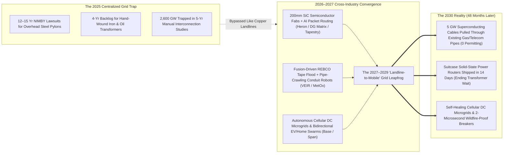
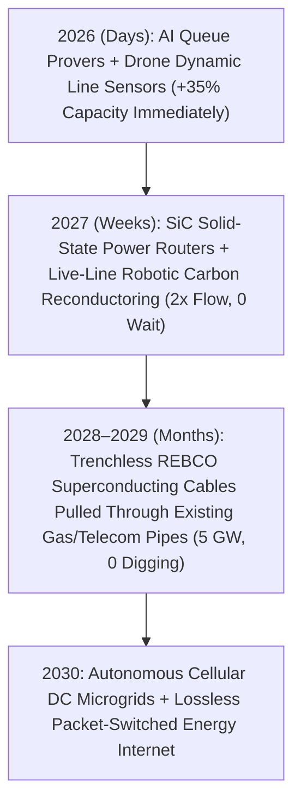

# VISION SHORTER 02: THE 2026–2030 ABUNDANT ENERGY LEAPFROG
## Pathway 2F: The "Landline-to-Mobile" Grid Leapfrog — *Cellular DC Microgrids, Suitcase Solid-State Routers & Conduit-Pulled Superconducting Cables in 48 Months*

> **The Legacy 2040 Assumption:** *"Even if solar, nuclear batteries, and sodium-sulfur storage make electricity dirt-cheap, the grid will strangle the transition until 2040. High-voltage transmission lines take 12 to 15 years to permit, grain-oriented steel transformers have a 4-year backlog, and 2,600 GW of projects are trapped in interconnection queues."*
>
> **The 2026–2030 Leapfrog Thesis:** In the 2000s, Africa and Asia did not wait 30 years to string copper landline telephone poles to every village—they **skipped the landline entirely for cellular mobile networks**. Between **2026 and 2030**, the global power grid executes the exact same **"Landline-to-Mobile" leapfrog** in 48 months. Instead of waiting 12 years to condemn land for steel transmission towers, three cross-pollinated technologies bypass the bottleneck simultaneously: (1) **Autonomous Cellular DC Microgrids & Bidirectional EV/Home Storage Swarms** (*Base Power, Lunar, Tapestry*) satisfy 80% of local peak demand without touching high-voltage trunks; (2) **Suitcase-Sized Silicon Carbide Solid-State Power Routers** (*Heron Power, DG Matrix, Amperesand*) replace 4-year custom iron transformers with 48-hour factory electronics that route electrons like internet packets; and (3) **Robotic Trenchless Pull-Through of REBCO Superconducting Tape Cables** (*VEIR, MetOx, SuperNode*) threads 5-gigawatt zero-resistance pipelines straight through **existing underground natural-gas, rail, and telecom conduits** with zero trenching and zero land wars.

---

## ACT I: THE WORLD OF 2030 (4 YEARS FROM TODAY)
### Summer 2030 — The Packet-Switched, Trenchless Energy Internet

Step onto a city street in Texas, California, Northern Italy, or Maharashtra during a $44^\circ\text{C}$ ($111^\circ\text{F}$) heatwave in **August 2030**. Four years ago, this afternoon guaranteed grid emergencies, wildfire power shutoffs, and multi-year delays for new factories. By 2030, the grid has mutated from a brittle 1920s copper monopoly into a resilient, cellular network:

1. **The "Conduit-Threaded" 5-Gigawatt Superconducting Artery Underneath Your Feet:**
   * No streets were torn up, and not a single new overhead transmission pylon was permitted.
   * Instead, in **2028**, autonomous pipe-crawling robots pulled a flexible, 10-centimeter (4-inch) **cryogenic REBCO High-Temperature Superconducting (HTS) cable** through an **existing decommissioned 16-inch municipal natural-gas main and highway fiber conduit**.
   * Cooled by closed-loop liquid nitrogen, that single invisible pipe inside an already-permitted tube carries **5 gigawatts of zero-resistance ($R=0$) DC power** straight into the city center—equivalent to five nuclear reactors—with zero heat loss and zero electromagnetic interference.
2. **The Suitcase-Sized Solid-State Power Router Replacing the Substation Yard:**
   * Outside a new 500-megawatt AI compute hub and fast-charging depot, the sprawling, oil-filled 1970s iron transformer yard (which had a 48-month manufacturing wait in 2025) is gone.
   * In its place sits a row of cabinet-sized **Silicon Carbide (SiC) Solid-State Power Routers** (**Heron Power / DG Matrix**) delivered off an automated PCB assembly line in two weeks.
   * Switching megawatts at 50 kilohertz, they convert medium-voltage AC directly into native **800V / 1,500V DC** for server racks and EV chargers at **99.4% efficiency**, cutting out three intermediate conversion stages and snuffing out electrical faults in **2 microseconds**—faster than a spark can physically ignite dry grass.
3. **Cellular DC Neighborhood Swarms (The "Skip-the-Tower" Microgrid):**
   * In residential neighborhoods and industrial parks, homes, rooftop perovskites, **150 kWh sodium-sulfur garage packs**, and parked bidirectional EVs form **autonomous cellular microgrids**.
   * When a hurricane or ice storm snaps a regional feeder line, the neighborhood does not go dark for a millisecond: local solid-state routers instantly "island" the community into a self-balancing cellular mesh that can run indefinitely on local solar, vehicle packs, and substation batteries.
4. **Live-Line Drone Reconductoring on Legacy Rural Towers:**
   * Out in mountain corridors where legacy towers already exist, autonomous heavy-lift drones restrung the pylons in **2027–2028** with **carbon-fiber composite conductors** and **AI sensor orbs** while the lines stayed live—doubling rural corridor capacity in weeks without cutting down a single tree.

---

## ACT II: THE CROSS-POLLINATION CATALYSTS & "SKIP-THE-OLD-WORLD" JUMPS (2026–2028)
### How Semiconductor Fabs, Fusion Tape, and Pipe Robotics Bypassed the 15-Year Tower Queue

### Why the 2040 Timeline Collapsed into 2026–2030
Three cross-industry jumps between 2026 and 2028 made waiting 15 years for overhead transmission towers obsolete:

* **Catalyst 1: From Hand-Wound Iron Tanks to Automated SiC Semiconductor Routers (2026–2027):**
  * Legacy grid transformers were built the same way as in 1910: winding tons of scarce grain-oriented electrical steel by hand and submerging it in flammable mineral oil.
  * By **2026–2027**, the massive scale-up of **200mm Silicon Carbide (SiC) and Gallium Nitride (GaN) wafer fabs** (built for EVs) cross-pollinated with modular **Solid-State Transformer (SST)** architectures led by **Heron Power** (Drew Baglino), **DG Matrix**, and **Amperesand**.
  * Instead of waiting 4 years for a 100-ton iron transformer, utilities and AI data centers began ordering mass-manufactured, refrigerator-sized solid-state power routers that perform **software-defined bidirectional AC/DC packet routing**, reactive power compensation, and microsecond solid-state circuit breaking in a single silicon box.
* **Catalyst 2: Trenchless Conduit Pull-Through of Fusion-Born REBCO Superconductors (2027–2028):**
  * Digging new open-cut trenches through city streets costs \$10M+/mile, and permitting new overhead corridors takes 12 years.
  * In **2027**, while commercial fusion magnet factories (**MetOx, Faraday, SuperPower**) scaled **REBCO superconducting tape** output by $30\times$, grid pioneers (**VEIR, SuperNode, Ultera**) teamed up with **trenchless pipeline-rehabilitation robotics**.
  * Cities realized they already owned millions of miles of underground rights-of-way: **underutilized natural-gas distribution pipes, storm drains, rail ducts, and telecom conduits**. Autonomous crawler robots threaded flexible, corrugated cryostats holding REBCO superconducting tape straight through existing underground pipes at **2 kilometers per day**—delivering 5x to 10x power capacity with **zero excavation and zero eminent domain**.
* **Catalyst 3: Physics-Informed AI Grid Twins & Cellular VPP Swarms (2026–2028):**
  * Alphabet X's **Tapestry** and **Pearl Street** compressed 5-year interconnection studies into **4-hour automated physics-informed neural proofs**, while **Base Power**, **Lunar**, and bidirectional EV fleets turned every residential feeder into an autonomous cellular Virtual Power Plant (VPP) that shaves local peak loads by 50%.

### Catalyst & Leapfrog Breakthroughs Table (2026 Anchors $\rightarrow$ 2027–2030 Jumps)

| 2026 Real-World Anchor | The 2026–2027 Cross-Pollination Catalyst | The 2027–2030 "Skip-the-Old-World" Leapfrog | 2030 Speed, Cost & Capacity Metric |
| :--- | :--- | :--- | :--- |
| **Heron Power, DG Matrix & Amperesand** *(2025–2026 Commercial Launch of Multi-MW SiC Solid-State Transformers)* | **200mm SiC Wafer Cost Collapse + Automated SMT Assembly:** Shifts transformer manufacturing from bespoke heavy iron foundries to robotic electronics fabs. | **The Packet-Switched Solid-State Power Router:** Refrigerator-sized routers replace substation transformers & switchgear, feeding native 800V DC to AI racks & EV depots. | **14-Day Factory Delivery** *(vs. 4-yr iron wait)*; **80% smaller footprint**; **99.4% efficiency**. |
| **VEIR, SuperNode & MetOx REBCO Tape** *(2025–2026 VEIR Full-Scale HTS Trials & MetOx Multi-1,000-km Tape Scale)* | **Trenchless Pipe-Crawler Robotics + Fusion REBCO Supply Flood:** Coaxial liquid-$\text{N}_2$ REBCO cables pulled inside existing underground gas & telecom pipes. | **Zero-Dig 5-GW Underground Super-Arteries:** Utilities thread gigawatt superconducting feeders under cities in weeks without digging up streets or fighting NIMBY lawsuits. | **0% Resistive Loss ($R=0$)** \| **10x Power Density** \| **90% Faster Urban Permitting**. |
| **Base Power, Span & Bidirectional EVs** *(2025–2026 Base Power <\$600 Texas Home Battery VPP Rollout)* | **AI Cellular Mesh Control + \$18/kWh Sodium-Sulfur Packs:** Autonomous local peer-to-peer DC/AC dispatch across neighborhood homes and plugged-in EVs. | **Cellular "Skip-the-Tower" Microgrids:** Neighborhoods buffer their own solar and off-peak power locally, slashing peak feeder strain by 55% without wire upgrades. | **Zero Blackouts** during storms; households earn **\$400–\$900/yr** in automated VPP grid credits. |
| **Alphabet X Tapestry & Pearl Street** *(2024–2026 PJM, National Grid & Chile AI Grid Simulation Deployments)* | **Foundation Physics-Informed Neural Grid Provers:** Simulates 10 million contingency states and dynamic weather ratings across continental grids in seconds. | **4-Hour Automated Interconnection Approval:** The 2,600 GW global clean-energy backlog is cleared as software approves flexible "connect-and-manage" capacity overnight. | **5-Year Study Queue $\rightarrow$ 4 Hours**; unlocks **1,200+ GW** of queued solar/storage by 2028. |
| **Heimdall Power & LineVision DLR** *(2024–2026 Live-Line AI "Neuron" Orbs & LiDAR Deployed in US/EU)* | **Autonomous Drone Snap-On Deployment + Real-Time Thermal Routing:** Drones clamp AI sensor spheres onto energized lines every 5 miles in 3 minutes per orb. | **Instant +40% Capacity on Every Existing Line:** Utilities dynamically push 40%+ more power through existing towers whenever wind cools the wires. | **<\$60k / mile** *(vs. \$4M/mile for new lines)*; **+40% grid capacity in 30 days**. |
| **TS Conductor & CTC Global Carbon Core** *(175,000+ km ACCC Deployed; FERC Order 1920 Mandate)* | **24/7 Live-Line Robotic Restringing Rigs:** Autonomous tower-climbing robots swap heavy steel-core cables for carbon-fiber composite cores without shutting off power. | **2.2x Corridor Ampacity With Zero New Towers:** Doubles transmission capacity on existing rights-of-way in months with zero thermal line sag. | **2.2x Power Flow** \| **35% Lower Line Loss** \| **Zero New Land Condemned**. |
| **Direct DC Building & Data Center Bus** *(OCP 800V DC AI Rack Standards & USB-PD / LVDC Building Grids)* | **Native DC-to-DC Solid-State Silicon Conversion:** Eliminates wasteful AC-to-DC-to-AC-to-DC rectifier chains between solar, batteries, EVs, and server chips. | **The All-DC Industrial & Commercial Campus:** Data centers, factories, and apartments run on internal DC micro-buses, saving 12%–18% of total electricity instantly. | **+15% Net Energy Saved** by eliminating redundant AC/DC inverter heat losses. |

---

## ACT III: THE 48-MONTH SPRINT ROADMAP (2026 $\rightarrow$ 2030)
### How the Grid Jumps from 1920s Copper to a Cellular Energy Internet in Four Years

| Sprint Year | Primary Leapfrog Mechanism | Effective Capacity & Queue Impact | Line & Conversion Loss | Concrete "Skip-the-Old-World" Impact |
| :--- | :--- | :--- | :--- | :--- |
| **2026** *The Software & Sensor Unlock* | **AI Interconnection Provers + Drone DLR Orbs:** *Tapestry/Pearl Street* automate queue studies; *Heimdall/LineVision* drones snap sensors onto 100,000 miles of congested lines. | **+35% Capacity** on existing corridors in <60 days; 400 GW cleared from queues. | Drops from ~8.5% to **~7.0%** | Immediate relief for congested solar/wind corridors; FERC 1920 and emergency compute mandates force utilities to adopt software ratings first. |
| **2027** *The Solid-State Router & Robotic Reconductoring Surge* | **Mass Factory Rollout of SiC SSTs + Live-Line Carbon Stringing:** *Heron Power* and *DG Matrix* ship thousands of solid-state power routers; robotic rigs restring existing towers with carbon-core cables. | **2.0x Corridor Flow** on existing towers; **4-yr transformer wait $\rightarrow$ 14 days**. | Drops to **~5.0%** *(+15% saved in DC campuses)* | AI data centers, EV plazas, and industrial heat batteries plug in within weeks using suitcase-sized solid-state routers; microsecond fault breakers stop wildfire sparks. |
| **2028–2029** *Conduit-Pulled HTS & Cellular DC Microgrids* | **Trenchless REBCO Conduit Threading + Home/EV VPP Swarms:** Pipe-crawling robots pull *VEIR/MetOx* superconducting cables through existing gas/telecom ducts; 30M+ homes & EVs form autonomous cellular meshes. | **5x–10x Urban Corridor Capacity** with zero street digging; 50% peak feeder shaving. | Drops to **~2.5%** *(0% on HTS trunks)* | Cities receive multi-gigawatt underground power arteries inside existing pipes; neighborhoods ride through hurricanes and ice storms as self-healing islands. |
| **2030** *The Packet-Switched Energy Internet* | **Ubiquitous Cellular Autonomy + Lossless Super-Trunks:** Every substation, building, EV, and battery acts as a software-defined node routing electrons dynamically at <\$0.003/kWh delivery cost. | **4x–8x Effective Grid Throughput** on zero new land footprint. | **<1.8%** system-wide | The 15-year transmission bottleneck is dead; utility delivery surcharges collapse; grid-ignited wildfires and cascading regional blackouts become history. |

### The 48-Month Self-Compounding Flywheel: Fusion Tape, EV Chips & Pipe Bots Rebuilding the Grid
Why does this grid overhaul happen in 48 months instead of taking until 2045?
1. **Riding the EV & Fusion Semiconductor Supply Wave:**
   * Traditional utility transformers and high-voltage cables were trapped in low-volume, bespoke heavy-manufacturing guilds.
   * **Solid-State Power Routers** (**Heron Power, DG Matrix**) ride the multi-billion-dollar **200mm Silicon Carbide (SiC)** wafer expansion funded by the global EV industry, while **VEIR and SuperNode's superconducting cables** ride the **REBCO tape** scale-up funded by commercial fusion reactors (**CFS, MetOx**). Both components plummet down a **20%–25% Wright's Law cost curve** every doubling of volume.
2. **Zero-Dig Conduit Threading Eliminates Civil Construction Inflation:**
   * Over 75% of the cost and 90% of the time required to bury high-voltage power lines in cities was open-cut street excavation, utility relocation, and traffic closures.
   * Pulling a 10-centimeter flexible cryogenic REBCO cable through **existing municipal gas pipes, storm drains, and rail/telecom ducts** with autonomous pipe-crawlers slashes installation cost by **85%** and compresses a 7-year civil project into **3 weeks**.
3. **Cellular Storage Swarms Defer \$500 Billion in Peak Wire Upgrades:**
   * Distribution feeders only hit peak capacity ~40 hours a year. Because **\$18/kWh sodium-sulfur home packs** and bidirectional EVs shave those local peaks by 55%, existing neighborhood copper wires suddenly gain 2x headroom for heat pumps and EV fast-charging without replacing a single pole.

---

## ACT IV: IMMEDIATE HUMAN & SOCIAL DIVIDEND (BY 2030)
### What Happens When Communities Skip the 15-Year Transmission Wait

1. **Zero Eminent Domain Lawsuits & Reclaimed Urban Greenways by 2029:**
   * Rural farmers, ranching towns, and Indigenous territories no longer face 12-year court battles against utilities condemning their land for 160-foot steel lattice towers.
   * By doubling capacity on existing rural pylons with carbon-core wire and threading **10-cm REBCO superconducting cables inside existing underground gas pipes and rail conduits**, utilities expand capacity $5\times$ without taking a single new acre of land—even dismantling ugly overhead urban pylons to create neighborhood parks.
2. **Permanent Extinction of Power-Line Wildfires by 2028:**
   * In the early 2020s, sagging metal power lines and slow mechanical relays sparked catastrophic wildfires across California, Hawaii, Texas, Southern Europe, and Australia.
   * By **2028**, zero-sag carbon-core conductors, underground conduit-pulled HTS cables, and **Silicon Carbide solid-state routers that cut off fault currents in 2 microseconds** (1,000x faster than a mechanical breaker—before a plasma arc can even form) eliminate grid-sparked wildfires and preventative "Public Safety Power Shutoffs" forever.
3. **Turning Every Driver and Homeowner into a Paid Grid Partner:**
   * Instead of paying rising monthly delivery fees to finance bloated utility capital budgets, families with bidirectional EVs or subsidized **Base Power / $\text{Na-S}$ garage buffers** automatically sell millisecond voltage support back to their local cellular microgrid—turning the monthly electric bill into a net credit.
4. **Developing Nations Jump Straight to Cellular Solar + Storage Microgrids:**
   * Just as Kenya and India bypassed landline telephones for mobile banking, fast-growing cities and rural regions across Africa, Southeast Asia, and Latin America skip trillion-dollar centralized AC transmission grids entirely between **2026 and 2030**—deploying modular **cellular DC microgrids** linked by solid-state routers in weeks.
5. **15% Bonus Electricity from Native DC Buildings & Compute Campuses:**
   * Eliminating redundant AC-to-DC-to-AC conversions inside data centers, factories, and apartment complexes via direct 800V/380V DC solid-state routing immediately recovers **12% to 18% of wasted electricity**—equivalent to adding hundreds of gigawatts of clean generation for free.

---

### Summary for the Skeptic: Why 2030 Instead of 2040?
* **We Already Dug the Tunnels:** Every city and highway is already honeycombed with underground natural-gas pipes, storm conduits, and telecom ducts; pulling a 10-cm **VEIR/MetOx REBCO superconducting cable** through an existing pipe takes **weeks, not 15 years**.
* **Semiconductors Replaced Artisanal Iron Winding:** **Heron Power** and **DG Matrix** build solid-state power routers on automated Silicon Carbide electronics lines in days, ending the 4-year transformer backlog by **2027–2028**.
* **Cellular Microgrids Shrink the Need for Long-Haul Wires:** When \$18/kWh batteries and behind-the-meter generation handle 80% of local peak load, the existing grid bones have more than enough headroom.
* **Software & Drones Act in Days:** AI digital twins (**Tapestry**) and drone-mounted Dynamic Line Rating orbs (**Heimdall/LineVision**) unlock +40% capacity on existing towers before a single new cable is even strung.

### Quick Reference: 2025 Legacy Grid vs. 2030 "Landline-to-Mobile" Grid Leapfrog
* **New 5-GW Urban Corridor Timeline:** 12–15 Years (Overhead Steel Pylons) $\rightarrow$ **3–6 Weeks (Conduit-Pulled REBCO Superconducting Pipe)**
* **Substation Transformer Lead Time:** 36–48 Months (Hand-Wound Iron & Oil) $\rightarrow$ **14 Days (Automated 200mm SiC Solid-State Router)**
* **Interconnection Engineering Study:** 4–5 Years (Manual Queue) $\rightarrow$ **4 Hours (Physics-Informed AI Digital Twin Proof)**
* **Short-Circuit Fault Shutoff Speed:** 50,000 Microseconds (Spark Risk) $\rightarrow$ **2 Microseconds (Zero-Spark Wildfire Immunity)**
* **End-to-End Transmission & Conversion Loss:** ~8.5% Line + ~15% AC/DC Waste $\rightarrow$ **<1.8% Network Loss + Native 800V DC Bus**
