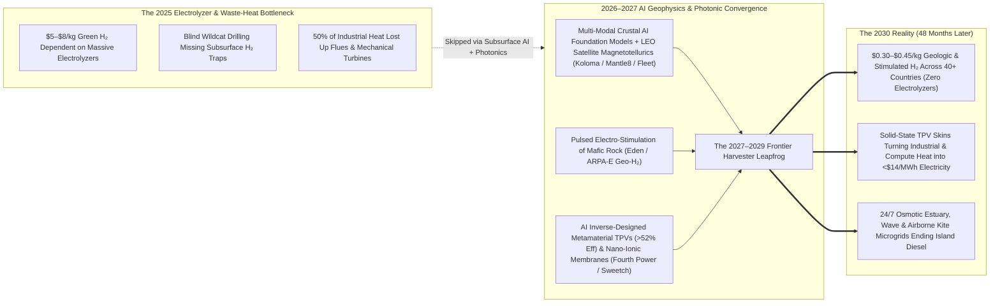
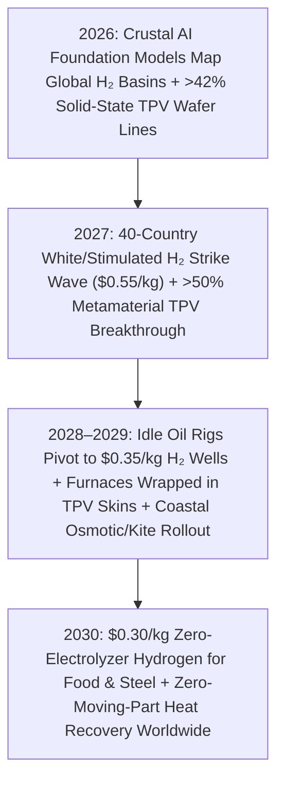

# VISION SHORTER 02: THE 2026–2030 ABUNDANT ENERGY LEAPFROG
## Pathway 2G: \$0.30/kg Geologic White Hydrogen Strikes & >50% Metamaterial TPV Skins — *How AI Subsurface Mapping and Solid-State Heat Harvesting Upended Fuel & Efficiency in 48 Months*

> **The Legacy 2040 Assumption:** *"Decarbonizing fertilizer, steel, shipping, and industrial waste heat is the slowest part of the energy transition. Green hydrogen from electrolyzers costs \$5–\$8/kg and won't get cheap until the late 2030s, natural geologic hydrogen is a rare curiosity that will take 15 years to explore, and half of all industrial and data-center energy will keep going up smokestacks as waste heat."*
>
> **The 2026–2030 Leapfrog Thesis:** Between 2026 and 2029, two AI-driven cross-pollinations blew open the chemical fuel and thermal efficiency frontier a decade ahead of schedule. First, **multi-modal AI geophysical foundation models** (*Koloma, Mantle8, Fleet Space*) trained on global satellite magnetotelluric, gravity, and seismic datasets pinpointed hundreds of shallow **Geologic "White/Gold" Hydrogen reservoirs** across 40+ countries in **2026–2027**—triggering a modern "clean oil rush" that pumps 97%-pure natural $\text{H}_2$ out of existing drilling rigs at **\$0.30–\$0.45/kg by 2028–2029** without a single electrolyzer. Second, AI-designed **near-field metamaterial Thermophotovoltaic (TPV) skins** (*Fourth Power, Antora, MIT*) crossed **>50% thermal-to-electric conversion efficiency**, wrapping industrial furnaces, microreactors, and data-center heat loops in solid-state semiconductor blankets that turn waste heat straight into cheap DC power with zero moving parts.

---

## ACT I: THE WORLD OF 2030 (4 YEARS FROM TODAY)
### Spring 2030 — The \$0.30/kg Hydrogen Wellhead & The Zero-Waste Foundry

Step onto a farming cooperative in Kansas or Mali, a green steel corridor in South Australia, or a coastal town in Portugal in **April 2030**—just 48 months from today:

1. **The \$0.30/kg "White Hydrogen" Wellhead on the Prairie (Zero Electrolyzers Needed):**
   * Out in an agricultural belt in the American Midwest—and mirrored across Brazil, West Africa, France, and Oman—sits a compact wellhead manifold occupying less space than a tennis court.
   * Drilled in **14 days** by an automated rotary rig guided by a 3D crustal AI model, the well taps a shallow fractured Precambrian iron-rich formation 900 meters underground where water reacting with ferrous rock (**serpentinization**) continuously generates **97%-pure clean hydrogen ($\text{H}_2$)**.
   * Flowing at **\$0.32 per kilogram**—one-fifteenth the cost of 2025 green electrolytic hydrogen and less than half the cost of dirty fossil methane hydrogen—it feeds a modular on-site **Haber-Bosch green ammonia unit** and a direct-reduced iron (DRI) steel plant, cutting regional farmer fertilizer costs by **55% by 2029**.
2. **Stimulated "Orange/Gold" Hydrogen Under Existing Industrial Pipelines:**
   * Where factories didn't sit directly atop a trapped natural gas cap, **Eden GeoPower** and **Mantle8** crews used pulsed high-voltage electrical stimulation and trace catalytic water/$\text{CO}_2$ injection to turn common underground peridotite rock into an **engineered subsurface hydrogen bioreactor**—mineralizing carbon into solid carbonate stone underground while harvesting continuous $\$0.40/\text{kg }\text{H}_2$ at the surface.
3. **The >52%-Efficient Metamaterial TPV Skin (Engines Without Moving Parts):**
   * Inside a nearby glassworks, cement kiln, and silicon foundry, the deafening roar of steam turbines and waste-heat boilers has vanished.
   * The exterior flues and $1,800^\circ\text{C}$ thermal storage vaults are lined with paper-thin **AI-designed photonic metamaterial Thermophotovoltaic (TPV) skins** (**Fourth Power / Antora**).
   * Operating like ultra-high-density solar panels for infrared glow—with backside gold nano-mirrors bouncing unusable low-energy photons right back into the furnace—these solid-state wafers convert **52% of radiated heat directly into DC electricity** with zero moving parts and zero maintenance.
4. **24/7 Estuarine Osmotic & Coastal Wave/Airborne Harvesters:**
   * At the river delta and island port, container-sized **Sweetch nano-fluidic osmotic stacks**, **CorPower AI-phase-locked wave buoys**, and autonomous **Windlift/Kitepower airborne wind drones** deliver weather-immune 24/7 coastal power and desalinated water—having replaced imported diesel barges in **2028**.

---

## ACT II: THE CROSS-POLLINATION CATALYSTS & "SKIP-THE-OLD-WORLD" JUMPS (2026–2028)
### How Geophysical Foundation Models and Inverse-Designed Photonics Triggered a 48-Month Sprint

### Why the 2040 Timeline Collapsed into 2026–2030
Three cross-disciplinary jumps between 2026 and 2028 bypassed the decade-long wait for cheap green fuels and industrial heat recovery:

* **Catalyst 1: Planetary Crustal Foundation Models & The 2027 "White Hydrogen Strike" Wave:**
  * For a century, oil and gas companies drilled exclusively in sedimentary basins and never calibrated mud-gas logs for hydrogen.
  * In **2026–2027**, **Koloma** (\$395M+ backed), **Mantle8**, **HyTerra**, **Gold Hydrogen**, and **Fleet Space Technologies** combined real-time low-Earth-orbit (LEO) satellite gravity/magnetic arrays with autonomous seismic nodal swarms to train a **3D Planetary Subsurface Foundation Model**.
  * Just as AlphaFold mapped the protein universe overnight, this crustal AI mapped the exact subterranean migration pathways, iron-rich cratons, and salt/shale caprock seals holding **trillions of tons of natural White Hydrogen**. Drilling dry-hole rates dropped from 80% to **under 12% in 2027**, triggering an immediate transfer of idle oil-field rigs to drill shallow hydrogen wells across North America, Australia, Europe, Africa, and South America.
* **Catalyst 2: Inverse-Designed Photonic Metamaterials Crossing >50% TPV Efficiency (2027–2028):**
  * Converting heat to electricity used to require 19th-century mechanical Rankine/Brayton steam turbines with 30%–40% efficiency and high maintenance.
  * By **2027**, generative electromagnetic inverse-design AI paired with **multi-junction III-V semiconductor foundries** (**Fourth Power, Antora, MIT**) created **sub-wavelength photonic crystal emitters and tandem InGaAsSb cells** with 98% photon recycling.
  * Crossing **52% thermal-to-electric conversion efficiency** at $>1,000\text{ W/cm}^2$ power density (100x higher flux than solar panels), solid-state TPV wafers became a mass-manufactured "electric skin" applied to every high-temperature furnace, thermal brick vault, and compact microreactor.
* **Catalyst 3: Roll-to-Roll Nano-Fluidic Membranes & Reinforcement-Learning Marine/Sky Control (2026–2028):**
  * **Sweetch Energy's** bio-cellulosic nano-porous ionic membranes (**INOD**) scaled on high-speed paper/battery coating lines in 2027, while **CorPower Ocean** and **Windlift/Kitepower** used edge reinforcement-learning chips to triple wave and high-altitude crosswind energy capture using **80%–90% less structural steel**.

### Catalyst & Leapfrog Breakthroughs Table (2026 Anchors $\rightarrow$ 2027–2030 Jumps)

| 2026 Real-World Anchor | The 2026–2027 Cross-Pollination Catalyst | The 2027–2030 "Skip-the-Old-World" Leapfrog | 2030 Cost & Output Metric |
| :--- | :--- | :--- | :--- |
| **Koloma, HyTerra, Gold Hydrogen & Mantle8** *(2025–2026 Kansas, Australia & EU Drilling Campaigns; \$395M+ Koloma Backing)* | **3D Crustal AI Foundation Model + LEO Satellite Magnetotellurics:** Pinpoints subsurface serpentinization kitchens & caprock seals globally with >88% hit rate. | **The 2027–2029 Global "White Hydrogen" Boom:** Idle oil/gas rotary rigs pivot to pumping 96%+ pure geologic $\text{H}_2$ across 40+ countries—skipping \$5/kg electrolyzers. | **\$0.30 – \$0.45 / kg $\text{H}_2$** at wellhead; **25+ Mt/yr** flowing into ammonia & steel by 2030. |
| **Eden GeoPower & ARPA-E $\text{Geo-H}_2$** *(2024–2026 \$20M+ DOE Stimulated Subsurface $\text{H}_2$ Field Trials)* | **Pulsed High-Voltage Electro-Comminution + AI Reactive Transport:** Opens micro-fractures in tight iron-rich peridotite rock without hydraulic fracking water volumes. | **On-Demand Engineered "Gold/Orange" $\text{H}_2$ Wells:** Heavy industries stimulate clean $\text{H}_2$ + permanent $\text{CO}_2$ mineralization directly beneath existing pipeline hubs. | **\$0.45 / kg Stimulated $\text{H}_2$** + **-\$15/ton** net-negative carbon sequestration credit. |
| **Fourth Power & Antora Solid-State TPV** *(2025–2026 >40% Efficiency Demo & Commercial Foundry Scaling)* | **AI Photonic Metamaterial Inverse Design + 98% Infrared Mirror Recycling:** Pushes multi-junction TPV efficiency past **52%** on automated wafer lines. | **Zero-Moving-Part Solid-State Heat Engines:** Replaces steam turbines in thermal batteries, steel/glass furnaces, and microreactors with silent semiconductor tiles. | **>52% Conversion Efficiency** \| **\$120 / kW** solid-state power block \| **<\$14 / MWh** waste-heat power. |
| **Sweetch Energy & EDF (Rhône Delta)** *(2024–2026 Barcarin France Grid-Connected Osmotic Pilot)* | **200 m/min Roll-to-Roll Bio-Nano-Fluidic Membrane Printing:** Borrows dry-battery calendering lines to print low-cost high-flux ionic membranes by the square kilometer. | **Modular Estuarine "Blue Energy" Barges:** Deployed at 50+ river mouths and desalination brine outfalls, generating continuous 24/7 baseload power with zero dams. | **\$28 – \$35 / MWh** 24/7 estuarine baseload; doubles desalination plant efficiency. |
| **CorPower Ocean & Orbital Marine** *(2024–2026 Portugal 18.5m Storm Survival & Orkney Tidal Grid Delivery)* | **Edge Reinforcement-Learning Wave Phase-Lock + Automated Composite Hulls:** Predicts incoming wave trains 30 seconds ahead via radar to amplify power capture $3.5\times$. | **Winter-Peaking Coastal Wave & Tidal Swarms:** Plug-and-play offshore buoy arrays power northern coastal grids precisely when winter solar is lowest. | **\$34 / MWh** winter coastal power; **100% storm survival** in Category 5 seas. |
| **Windlift, Kitepower & SkySails** *(2024–2026 Autonomous Containerized Crosswind Kite Microgrids)* | **Vision-Guided Autonomous Swarm Flight + Ultra-High-Modulus Carbon Tethers:** Flies synchronized figure-eight loops at 500m altitude with zero human pilots. | **24-Hour Drop-In Sky Microgrids:** Shipping-container kite units replace diesel generators at remote mines, islands, disaster zones, and cargo ships in one day. | **90% Less Steel/Mass** than wind turbines; **\$26 / MWh** portable wind power. |
| **Arkenlight & UKAEA Diamond Cells** *(2024–2026 Carbon-14 Synthetic Diamond Betavoltaic Prototypes)* | **Automated CVD Plasma synthesis of $\text{C-14}$ from Recycled Nuclear Graphite:** Prints wafer-scale betavoltaic micro-chips with 5,730-year half-life. | **50-Year Zero-Maintenance Sensor & Medical Power:** Powers pacemakers, subsea optical repeaters, and bridge sensors for decades without battery swaps. | **50+ Year Continuous Lifespan**; upcycles legacy nuclear graphite waste. |

---

## ACT III: THE 48-MONTH SPRINT ROADMAP (2026 $\rightarrow$ 2030)
### How Subsurface Hydrogen and Solid-State Heat Harvesters Scale in Four Years

Because geologic hydrogen uses **existing oil-and-gas drilling rigs, wellheads, and pipelines** (requiring zero new manufacturing supply chains), and TPV / osmotic membranes ride **existing semiconductor and roll-to-roll coating fabs**, deployment sprints across 2026–2030 without waiting for bespoke mega-construction:

| Sprint Year | Discovery & Hardware Milestone | Production & Deployment Scale | Benchmark Cost Metrics | Concrete "Skip-the-Old-World" Impact |
| :--- | :--- | :--- | :--- | :--- |
| **2026** *The AI Mapping & Pilot Year* | **Global Crustal AI Atlas Completed:** *Koloma, Mantle8, HyTerra* & *Gold Hydrogen* complete multi-well tests in US, Australia & EU; *Fourth Power* & *Antora* run >42% TPV lines; *Sweetch* operates Rhône osmotic pilot. | **50+ Exploration Wells** active **200 MW** TPV & Marine pilots | **\$0.90/kg** Geologic $\text{H}_2$ **42% Eff** Solid-State TPV | Proves natural subsurface $\text{H}_2$ flows at commercial pressure and purity; oil majors and mining giants reallocate \$15B+ of rig capex to white hydrogen. |
| **2027** *The 40-Country White $\text{H}_2$ Strike Wave* | **88% Hit-Rate Drilling & >50% Metamaterial TPV:** AI geophysical inversion triggers commercial $\text{H}_2$ strikes across 40+ countries; pulsed electro-stimulation (*Eden*) proven in mafic rock; AI-designed TPV crosses **50% efficiency**. | **800+ Producing $\text{H}_2$ Wells** **3 Mt/yr** clean $\text{H}_2$ capacity **2 GW/yr** TPV wafer output | **\$0.55/kg** Geologic $\text{H}_2$ **\$22/MWh** TPV heat recovery | Planned \$5/kg green-electrolyzer megaprojects are cancelled or converted as \$0.55/kg wellhead hydrogen undercuts fossil grey hydrogen without subsidies. |
| **2028–2029** *Fertilizer, Steel & Furnace Transformation* | **Modular Wellhead Ammonia & Industrial TPV Skins:** Containerized Haber-Bosch units & DRI green-steel mini-mills plug straight into $\text{H}_2$ wellheads; steel/glass furnaces & data centers wrap flues in >52% TPV skins; osmotic/kite microgrids scale. | **4,000+ Producing $\text{H}_2$ Wells** **12+ Mt/yr** clean $\text{H}_2$ **15 GW** TPV & Coastal arrays | **\$0.35–\$0.45/kg** $\text{H}_2$ **\$14/MWh** TPV waste-heat power **\$32/MWh** Osmotic/Kite | Global nitrogen fertilizer prices drop 50% and decouple from natural gas; heavy furnaces generate 25% of their own electricity from captured infrared heat. |
| **2030** *Ubiquitous Chemical & Gradient Abundance* | **25+ Mt/yr Subsurface $\text{H}_2$ & Zero-Waste Heat Standard:** Geologic + stimulated $\text{H}_2$ supplies 30% of global industrial hydrogen at **\$0.30/kg**; solid-state TPV blocks replace mechanical steam turbines in new thermal & microreactor plants. | **25+ Mt/yr** $\text{H}_2$ (\<\$0.35/kg) **40+ GW** TPV, Osmotic, OTEC, Wave & Kite fleet | **\$0.30/kg** Geologic $\text{H}_2$ **54% Eff** TPV \| **<\$28/MWh** Marine/Estuary | Clean chemical fuel, zero-carbon fertilizer, green steel, and coastal/island baseload become universally cheap across every continent by 2030. |

### The 48-Month Self-Compounding Flywheel: Existing Oil Rigs + Wafer Fabs Driving the Sprint
Why do geologic hydrogen and solid-state heat harvesters scale across 2026–2030 without hitting construction bottlenecks?
1. **Zero-Delay Drilling via the Global Oil & Gas Rig Fleet:**
   * Building 25 million tons per year of green electrolytic hydrogen by 2030 would have required 250 GW of dedicated solar/wind farms and \$300 billion of custom electrolyzer factories.
   * By contrast, over **1,800 onshore rotary drilling rigs** already sit operational across North America, Latin America, the Middle East, Australia, and Africa. Once AI crustal models pinpoint a shallow White Hydrogen trap, a standard rig drills and completes a production well in **10 to 14 days** at <\$2 million CAPEX per well.
2. **Semiconductor & Paper-Web Manufacturing for TPVs and Osmotic Membranes:**
   * **Fourth Power** and **Antora's** metamaterial TPV cells are fabricated on standard automated III-V semiconductor wafer lines, while **Sweetch Energy's** osmotic membranes run on 200-meter-per-minute roll-to-roll web coaters—allowing output to double every 9 months along a steep Wright's Law curve.

---

## ACT IV: IMMEDIATE HUMAN & SOCIAL DIVIDEND (BY 2030)
### How \$0.30/kg Geologic Hydrogen and Solid-State Harvesters Transform Lives in 48 Months

1. **50% Cheaper Food Fertilizer & Agricultural Sovereignty by 2028–2029:**
   * For decades, global food prices were held hostage by volatile natural gas prices because natural gas is the feedstock for ammonia nitrogen fertilizer.
   * Because AI crustal mapping revealed shallow iron-rich White Hydrogen basins directly beneath farming belts in **West and East Africa (Mali, Kenya, Tanzania), Brazil, India, Australia, and the US Midwest**, local agricultural cooperatives pump **\$0.30–\$0.45/kg clean hydrogen** right out of the ground to synthesize local carbon-free fertilizer—slashing farm input costs in half and insulating global food supplies from energy shocks before 2030.
2. **An Immediate Boom for Oil, Gas & Drilling Communities (Zero Job Loss):**
   * Instead of facing layoffs as fossil fuels decline, directional drillers, roughnecks, mud loggers, and pipeline welders in Texas, Oklahoma, Alberta, the Gulf Coast, and Western Australia experience a **2027–2030 hiring boom**.
   * Drilling a geologic or stimulated hydrogen well uses the **exact same rotary rigs, drill bits, wellheads, and compressor skills**—allowing fossil energy towns to lead the clean fuel revolution at higher pay without relocating a single family.
3. **Turning Industrial Smokestacks & Data Centers into Silent Power Plants:**
   * By wrapping cement kilns, glass furnaces, steel mills, and high-temperature thermal storage blocks in **>52%-efficient solid-state TPV skins**, heavy factories cut their net grid electricity purchases by 25%–40% within a 12-month payback period—silently turning wasted infrared glow into profit with zero moving parts.
4. **Ending Diesel Poverty for 1,000+ Island & Coastal Communities by 2029:**
   * Tropical islands and stormy northern ports no longer have to choose between paving scarce farmland with solar panels or burning \$0.45/kWh imported diesel.
   * Containerized **Kitepower/Windlift airborne drones**, **CorPower wave buoys**, **Global OTEC barges**, and **Sweetch osmotic river-mouth units** drop into place in weeks—delivering 24/7 power, desalinated drinking water, and free deep-ocean air conditioning.
5. **Upcycling Nuclear Graphite Waste into 50-Year Micro-Batteries:**
   * Automated CVD plasma reactors convert legacy Carbon-14 nuclear graphite waste into **Arkenlight synthetic diamond betavoltaic chips**—powering medical pacemakers, structural bridge sensors, and deep-sea optical repeaters for 50 years without a single battery swap.

---

### Summary for the Skeptic: Why 2030 Instead of 2040?
* **We Don't Have to Manufacture the Hydrogen—Earth Already Made It:** Just as Mali's Bourakebougou well has flowed 98%-pure hydrogen for over a decade, AI geophysical models (**Koloma, Mantle8, HyTerra**) turned wildcat luck into a repeatable science—using **existing oil rigs** that can drill a well in **14 days**, not 10 years.
* **Semiconductors Scale Faster Than Boilers:** **Fourth Power** and **Antora's** solid-state TPV cells are printed in semiconductor foundries, riding the microchip cost curve rather than heavy turbine construction schedules.
* **Zero New Supply Chains Required:** Every rig, pipe, wafer fab, and roll-to-roll coating line needed for the 2026–2030 leapfrog already exists today.
* **Every Geography Gets Sovereign Baseload:** Between subsurface hydrogen, estuarine salinity gradients, ocean thermal, and high-altitude kites, no nation on Earth remains energy-poor by 2030.

### Quick Reference: 2025 Conventional Frontier vs. 2030 Gradient & Subsurface Leapfrog
* **Clean Hydrogen Cost:** \$5.00–\$8.00/kg (Electrolyzed Green $\text{H}_2$) $\rightarrow$ **\$0.30–\$0.45/kg (AI-Pinpointed Geologic & Stimulated $\text{H}_2$)**
* **Exploration Dry-Hole Rate:** >80% (Blind Wildcat Drilling) $\rightarrow$ **<12% (3D Crustal AI Foundation Models + LEO Satellites)**
* **Waste-Heat-to-Power Conversion:** 30%–35% (Mechanical Steam Turbines) $\rightarrow$ **>52% (Zero-Moving-Part Metamaterial TPV Skins)**
* **Estuarine Osmotic Membrane Flux:** <1 $\text{W/m}^2$ (Legacy Polymer) $\rightarrow$ **15–20 $\text{W/m}^2$ (Roll-to-Roll Nano-Fluidic Cellulose)**
* **Regional Ammonia Fertilizer Cost:** Tied to Volatile Natural Gas $\rightarrow$ **-50% to -55% (On-Site Wellhead Green Ammonia)**
