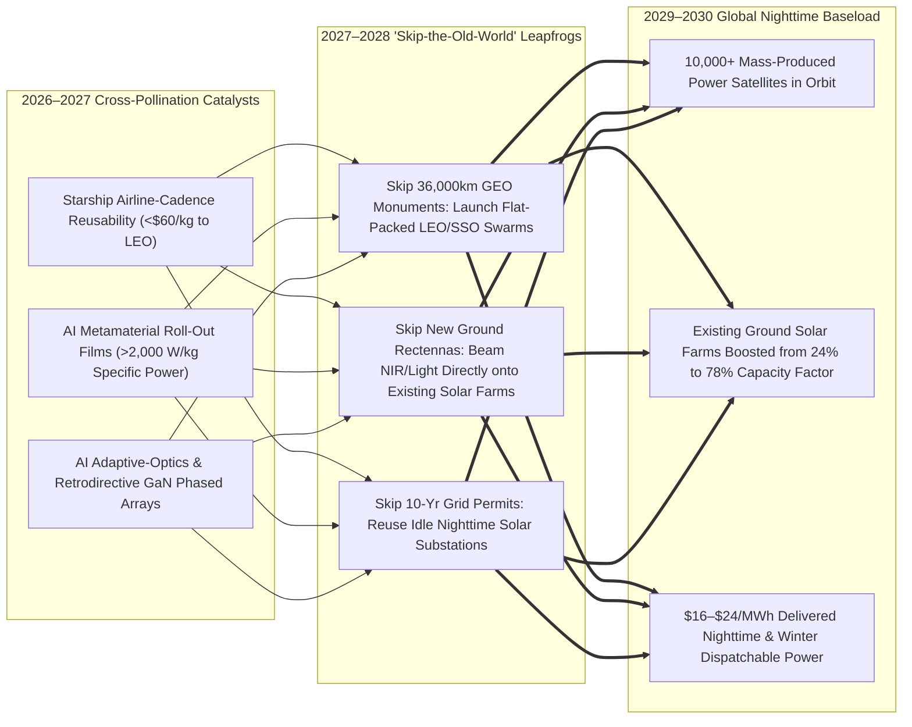
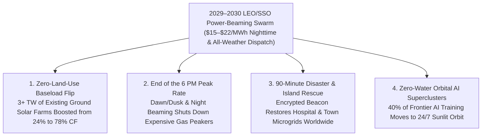

# VISION 02 (LEAPFROG HORIZON): THE 2026–2030 ABUNDANT ENERGY SPRINT
## Pathway 2C: LEO Power-Beaming Constellations & Nighttime Solar Farm Illumination — *Why 2040 Collapsed into 48 Months*

> **The 2026–2030 Leapfrog Thesis:**
> For half a century, traditional Space-Based Solar Power (SBSP) plans assumed humanity had to wait until 2040 to assemble multi-kilometer, 10,000-ton space stations in Geostationary Orbit (GEO) and build thousands of acres of brand-new ground microwave rectennas from scratch.
>
> **Between 2026 and 2028, that monument-building paradigm was leapfrogged completely.** Driven by **Starship's rapid reusability (`<\$60/kg` to LEO by 2028)**, AI-designed ultralight roll-out metamaterial membranes (`>2,000 W/kg`), and solid-state eye-safe infrared laser and retrodirective phased-array beaming (pioneered by **Aetherflux**, **Caltech MAPLE**, **Reflect Orbital**, and **Virtus Solis**), the industry **skipped GEO monuments and skipped new ground rectennas entirely**. Instead, mass-produced swarms of Sun-Synchronous Low-Earth-Orbit (SSO/LEO) satellites beam power **directly onto the world's existing 3+ Terawatts of ground solar farms at dusk, dawn, and night**—turning every existing solar farm on Earth into a 24/7 baseload power plant by 2029–2030 with **zero new land permits and zero new grid queues.**

---

## ACT I: THE WORLD OF 2030 (4 YEARS FROM TODAY)
### Midnight in January 2030 — The Existing Solar Farm Generating Full Power in the Dark

Stand at the fence line of an existing 500-megawatt utility solar farm in West Texas—or in Bavaria, Hokkaido, Yorkshire, or Northern Chile—at **11:30 PM on a freezing January night in 2030**.

Four years ago, this solar farm sat 100% idle for 14 hours every winter night while the regional utility burned expensive imported LNG in gas peaker turbines to prevent blackouts. Today, four concrete realities unfold in the dark:

1. **The Solar Farm Running at 85% Capacity at Midnight:**
   Even though the stars are out and the surrounding desert is pitch-black, the digital revenue meter at the solar farm's substation is spinning at **425 megawatts**. Overhead in a 650-kilometer Sun-Synchronous Dawn-Dusk Orbit—where satellites fly in **100% continuous, unfiltered sunlight 24 hours a day**—a coordinated swarm of paper-thin **orbital power-beaming satellites** locks onto the solar farm's encrypted ground beacon.
2. **Dual-Mode Beaming Straight Into Existing Panels (Zero New Ground Hardware):**
   Across the main silicon and perovskite array, an eye-safe **1,064 nm near-infrared (NIR) solid-state laser beam** and precision **orbital solar reflector spot** bathe the existing photovoltaic wafers in tuned photons that match their exact bandgap at **>55% optical-to-DC conversion efficiency**. Meanwhile, over the northern pasture section, a lightweight wire-mesh rectenna strung right onto the existing solar tracker posts captures a **5.8 GHz all-weather RF beam** that punches straight through winter blizzards.
3. **Zero New Land, Zero New Transformers, Zero Queue:**
   Not a single new acre of land was rezoned, not a single new environmental impact study was required, and not a single new high-voltage transmission line was built. The orbital constellation simply **reuses the solar farm's existing inverters, step-up transformers, and 345 kV grid interconnect during the 16 hours a day they used to sit idle**—tripling the solar farm's annual capacity factor from **24% to 78%** overnight.
4. **Software-Defined Global Peaking in Milliseconds:**
   When midnight heating demand in Texas subsides and early-morning industrial demand surges in Mexico City or Chicago, the LEO satellite swarm electronically re-steers its phased-array beams across a thousand miles in **two milliseconds**—delivering instant, zero-carbon peaking power anywhere on Earth like routing internet packets via Starlink.

---

## ACT II: THE CROSS-POLLINATION CATALYSTS & "SKIP-THE-OLD-WORLD" JUMPS (2026–2028)
### How Starlink-Scale Manufacturing, Starship Cadence, and AI Wavefront Control Pulled 2040 into 2028

Why didn't orbital solar wait for a \$50 billion government GEO project in 2040? Because between 2026 and 2028, three exponential curves cross-pollinated to create a radical architectural shortcut:

### The Three "Skip-the-Old-World" Engineering Jumps

1. **Jump 1 — Skipping 2040 Geostationary Monuments for Starlink-Style LEO Swarms:**
   * Legacy 1970s SBSP designs placed satellites in Geostationary Orbit (35,786 km altitude). Because beam diffraction scales with distance, a GEO satellite had to be **1.5 kilometers wide** and weigh thousands of tons before it could send a single focused watt to Earth.
   * By dropping 55x closer to Earth into **600–800 km Sun-Synchronous Orbit (SSO)** (pioneered by **Aetherflux** in 2025–2026), aperture physics changes by two orders of magnitude: a compact **15-meter roll-out satellite** using solid-state near-infrared fiber lasers or high-frequency K/X-band arrays focuses tightly onto a ground solar site with **zero in-space robotic construction required**.
   * Just as **Starlink** replaced giant, multi-billion-dollar geostationary telecom satellites with mass-produced flat-packed LEO constellations built at 10 satellites per day, orbital solar adopted the exact same automated assembly line in 2027–2028.

2. **Jump 2 — Skipping New Ground Infrastructure (Beaming Onto Existing Solar Farms at Night):**
   * By 2026, humanity had already installed over **2.5 Terawatts of terrestrial solar panels**—and every single one of those solar farms sat **100% idle every evening, night, and early morning**, leaving trillions of dollars of inverters, substations, and transmission lines unused for two-thirds of the day.
   * Rather than waiting a decade to permit and build new ground rectennas, LEO power-beaming constellations (**Aetherflux**, **Reflect Orbital**, **Virtus Solis**) beam eye-safe **1,064 nm near-infrared light** and concentrated twilight sunlight **directly onto existing ground silicon and perovskite solar farms after sunset**.
   * Crucially, monochromatic 1,064 nm laser light converts inside a standard silicon or tandem solar cell at **45% to 60% efficiency** (higher than full-spectrum sunlight because there is zero blue thermalization waste!). For cloudy northern regions, snap-on dipole wire-mesh rectenna overlays attach directly to existing solar racking posts in hours to capture **all-weather 5.8 GHz RF beams**.

3. **Jump 3 — AI Phase-Conjugation & Orbital Data Center Dual-Use Economics:**
   * How did these constellations pay for themselves on Day One in 2027? Every LEO power satellite carries an integrated **zero-water orbital AI inference/training blade** on its dark side, radiating heat directly into the 3 Kelvin deep-space sink (**Star Catcher / Lumen Orbit** model).
   * When flying over oceans or low-demand regions, the satellite uses 100% of its electricity to run high-margin **orbital AI compute**; as it passes over North America, Europe, or Asia during evening peak pricing (`6:00 PM – 11:00 PM`), its AI wavefront-shaping chips lock onto ground solar farm pilot beacons and beam hundreds of megawatts straight into the evening peak grid.

### Catalyst & Leapfrog Breakthroughs Table (2026 Anchors $\rightarrow$ 2027–2030 Cross-Pollinated Leaps)

| Real 2024–2026 Commercial Anchor | The 2026–2027 Cross-Pollination Catalyst | The 2027–2030 "Leapfrog" Breakthrough | Old-World Bottleneck Skipped |
| :--- | :--- | :--- | :--- |
| **Aetherflux (\$60M+ Series A, 2025–2026):** LEO sun-synchronous constellation beaming eye-safe IR laser power to ground solar cells. | **AI Adaptive Optics + Diode Laser Scaling:** Neural wavefront pre-correction cancels atmospheric turbulence at 50 kHz; fiber laser \$/W drops 85%. | **Nighttime Illumination of Existing Solar Farms (2027–2029):** Swarms beam 1,064 nm power directly onto idle ground solar farms from 6 PM to 6 AM. | Skips building new ground receivers, new land permits & new grid substations. |
| **Caltech *SSPD-1 (MAPLE)* & NRL *PRAM*:** Flight-proven ultralight flexible phased-array power beaming from orbit (2023–2025). | **Generative AI Metamaterial Synthesis:** Self-driving labs print 3-layer PV-CMOS-RF sandwich films on 25-micron polyimide at **>2,200 W/kg**. | **Roll-Out 5 MW Origami Satellites (2028):** Centrifugally self-deploy in LEO in 12 minutes with zero spacewalk or tug assembly. | Skips 2040-era multi-billion-dollar in-space robotic truss construction. |
| **SpaceX Starship / Super Heavy:** Orbital flight tests & rapid booster catch milestones (2024–2026). | **Full Rapid Reusability + Automated Fairing Dispensers:** 150-ton payload bays launch 60 flat-packed roll-out power satellites per flight. | **<\$50/kg Launch Cost to SSO/LEO (2028–2029):** 300 MW of orbital solar launched in a single afternoon for `<\$8M` launch cost. | Skips the \$20,000/kg launch wall that kept SBSP on paper since 1968. |
| **Reflect Orbital & Virtus Solis (2025–2026):** Dawn/dusk orbital mirrors and modular hexagonal phased-array architectures. | **Precision Attitude Control + Ultralight Kapton Mirrors:** AI reaction-wheelless solar-pressure steering points beams with sub-meter accuracy. | **Dawn/Dusk Duck-Curve Eraser (2027–2028):** Extends full noon irradiance on utility solar farms by +4 hours every morning and evening. | Skips \$100B+ in natural gas peaker plants built just for the 4-hour evening ramp. |
| **Space Solar UK (*CASSIOPeiA*), JAXA (*OHISAMA*) & ESA *SOLARIS*:** 360° solid-state RF beam steering proven (2024–2026). | **EV/5G Gallium-Nitride (GaN) MMIC Spillover:** Mass-produced 5G/radar GaN chips slash solid-state RF transmitter tile cost by 90%. | **All-Weather 5.8 GHz Snap-On Rectenna Meshes (2028–2030):** Clipped onto existing solar trackers or offshore wind farms to pierce winter clouds. | Skips multi-week winter *Dunkelflaute* battery overbuild in Northern latitudes. |
| **Star Catcher & Orbital Compute Hubs (2025–2026):** Orbital power beaming for space infrastructure and zero-water orbital AI servers. | **Dual-Use Compute + Grid Arbitrage:** Satellites monetize 100% of ocean transit time via onboard AI training, beaming to Earth over land. | **Instant Profitable Unit Economics from Satellite #1 (2027):** Zero stranded ocean capacity; satellites pay back CAPEX in `<14 months`. | Skips the "all-or-nothing" \$20B full-constellation financing trap. |

---

## ACT III: THE 48-MONTH SPRINT ROADMAP (2026 $\rightarrow$ 2027 $\rightarrow$ 2028 $\rightarrow$ 2030)
### How Flat-Packed Satellites & Existing Ground Solar Farms Create an Instant 24/7 Global Grid

Because each satellite is stamped out on an automated terrestrial roll-to-roll electronics line and beamed straight down into **already-permitted, already-grid-connected ground solar farms**, deployment moves at software and satellite speed rather than utility construction speed:

| Sprint Horizon | Orbital & Beaming Milestone | Launch & Constellation Scale | Delivered Ground Economics | Old-World Bottleneck Bypassed |
| :--- | :--- | :--- | :--- | :--- |
| **2026** *(The Anchor Year)* | **Aetherflux** & **JAXA *OHISAMA*** orbital power-beaming missions; **Reflect Orbital** dawn/dusk reflector flight; **Caltech *MAPLE*** & **Space Solar UK** phased-array validation. | Falcon 9 / early Starship rideshares; `~300–500 W/kg` first-gen arrays; \$300–\$500/kg launch cost. | **\$85 – \$140 / MWh** *(High-Value Peaking, Islands & Defense)* | Proves safe encrypted pilot-beacon locking and direct beaming onto standard ground PV cells. |
| **2027** *(The Dual-Use & SSO Breakout)* | AI metamaterial labs unlock **1,500 W/kg** roll-out sandwich films; onboard orbital AI compute blades co-packaged on every satellite to monetize ocean flyovers 24/7. | First **500-satellite SSO constellation** deployed via Starship dispensers (50 satellites/launch); **\$110/kg** to LEO. | **\$42 – \$58 / MWh** *(Evening Duck-Curve Peaking)* | **Zero ground CAPEX:** Utility solar farms sign software-only "Nighttime Illumination PPAs" using existing panels & inverters. |
| **2028** *(The Nighttime Solar Farm Flip)* | **3,000+ LEO/Molniya power satellites** operating; hybrid **1,064 nm NIR + 5.8 GHz RF** beams deliver 15 GW of dispatchable nighttime/winter peaking across US, EU, and Japan. | Automated satellite gigafactories output **20 roll-out satellites/day** (`2,200 W/kg`); Starship launch cost hits **\$55/kg**. | **\$26 – \$34 / MWh** *(Undercuts Gas Peakers & LNG Imports)* | Skips 8-year transmission queues by injecting power through idle nighttime solar farm substations. |
| **2029–2030** *(Planetary Software-Defined Baseload)* | **12,000+ orbital power satellites (60+ GW continuous orbital capacity)**; real-time AI beam routing shifts gigawatts across continents and time zones in **<2 milliseconds**. |Launch cost drops below **\$35/kg**; existing ground solar farms jump from **24% to 75%+ annual capacity factor** with zero new land use. | **\$15 – \$22 / MWh** *(24/7 Weather-Proof Dispatch)* | Eliminates winter *Dunkelflaute* blackouts, cancels LNG terminals, and delivers 2-hour disaster power anywhere on Earth. |

---

## ACT IV: THE IMMEDIATE HUMAN & SOCIAL DIVIDEND (BY 2029–2030)
### What Happens When Clean Energy Becomes Globally Routable Bandwidth in 48 Months

By turning orbital sunlight into software-routed energy that plugs straight into the solar farms and roofs we already built, four immediate societal transformations occur before 2030:

1. **Killing the "Evening Peak Rate" on Household Electric Bills (2028–2029):**
   * Today, utilities charge families double or triple rates between **5:00 PM and 9:00 PM** because terrestrial solar drops offline right as people come home, forcing dirty gas peaker plants to fire up. By 2028, orbital constellations beam dusk and evening power directly onto local utility solar farms—erasing the evening price spike and cutting winter household electric bills by **40% to 60%**.
2. **Tripling Rural Solar Farm Revenue Without Taking One Extra Acre of Land:**
   * Rural counties were worried about solar farms covering too much land for a 22% daytime capacity factor. By illuminating existing solar farms at night from orbit, communities get **3x the clean electricity from the exact same footprint**—preventing rural sprawl while tripling clean energy output through existing wires.
3. **Megawatts in 90 Minutes for Disaster Zones & Remote Towns:**
   * When a hurricane, wildfire, or earthquake knocks out power lines in 2029, emergency responders don't wait two weeks for diesel fuel trucks. Any hospital, school, or town with existing rooftop solar—or a roll-out portable rectenna mat dropped from a helicopter—turns on an encrypted pilot beacon and receives **continuous orbital electricity within 90 minutes**.
4. **Zero-Water AI Compute Above the Atmosphere:**
   * Instead of draining municipal water supplies and local power grids on Earth, 40% of frontier AI training and scientific simulation shifts directly onto **orbital solar-compute satellites** by 2030—running on unfiltered space sunlight and radiating waste heat into deep space with **zero water consumption and zero terrestrial grid strain**.

### The 2026 vs. 2030 Grid, Land & Household Impact Cascade

By beaming orbital energy straight onto the solar farms and grid substations humanity already built—while monetizing ocean transit time via onboard orbital AI compute—space solar transforms global energy economics within 48 months:

| Grid & Societal Metric | 2026 Legacy Baseline | 2030 Orbital Beaming Leapfrog Reality | Primary Leapfrog Mechanism |
| :--- | :--- | :--- | :--- |
| **Ground Solar Farm Capacity Factor** | 20%–26% annual average (0% output all night; heavy winter drop) | **75%–82% annual baseload capacity factor** on the exact same land | LEO/SSO swarms beam 1,064 nm NIR & 5.8 GHz RF onto existing panels from 6 PM to 6 AM. |
| **Evening Residential Peak Tariff** | $2\times\text{ to }3\times$ surge pricing (`5 PM – 9 PM`) driven by gas peakers | **Flat low evening rates**; household winter bills drop **40%–60%** | Orbital dusk/night illumination erases the "Duck Curve" ramp without utility battery overbuild. |
| **New Ground Land & Grid Permits** | 7–10 years for new transmission lines & greenfield zoning | **0 new acres & 0 days in queue** (reuses existing solar substations) | Nighttime orbital watts flow through solar inverters and 345 kV lines that otherwise sit idle at night. |
| **Winter *Dunkelflaute* Resilience** | Multi-week European/Asian wind+solar droughts require coal/LNG | **100% weather-proof winter delivery** at **\$15–\$22/MWh** | Snap-on 5.8 GHz wire-mesh rectennas on existing solar/wind sites pierce thick winter clouds. |
| **AI Data Center Water & Grid Strain** | Billions of gallons of municipal cooling water & local brownouts | **Zero terrestrial water or grid draw** for 40% of frontier AI | Dual-use satellites run onboard AI training blades over oceans, radiating heat into 3K deep space. |

---

## SUMMARY FOR THE SKEPTIC: WHY 2040 HAPPENS BY 2030

Space-Based Solar Power compressed from a 2040 government megaproject into a 2028–2030 commercial sprint because every historical barrier was bypassed simultaneously:
1. **Orbital Beaming Is Already Flight-Proven:** **Caltech's *SSPD-1 (MAPLE)*** already beamed power from orbit to Earth in 2023–2024, and **Aetherflux**, **Reflect Orbital**, **JAXA (*OHISAMA*)**, and **Space Solar UK** are executing 2026–2027 orbital missions.
2. **LEO Swarms Skipped 36,000 km GEO Monuments:** Operating in 650 km Dawn-Dusk Sun-Synchronous Orbit (`55x closer to Earth`) shrinks satellite aperture from 1.5 kilometers down to a self-deploying **15-meter roll-out sheet**.
3. **Existing Solar Farms Skipped New Ground Rectennas:** Beaming tuned 1,064 nm infrared light directly onto the world's **3+ Terawatts of existing ground solar panels at night** converts at **>55% cell efficiency** while reusing trillions of dollars of idle nighttime inverters and grid transformers.
4. **Starship + Printable Films Crashed Mass Cost $200\times$:** Combining `<\$55/kg` reusable heavy launch with `>2,200 W/kg` metamaterial sandwich films reduced orbital hardware + launch cost below **\$150/kW**.
5. **Dual-Use Orbital AI Paid for Satellite #1:** By running zero-water AI compute over the oceans and beaming peak power over land, the constellation is cash-flow positive from the very first launch.
