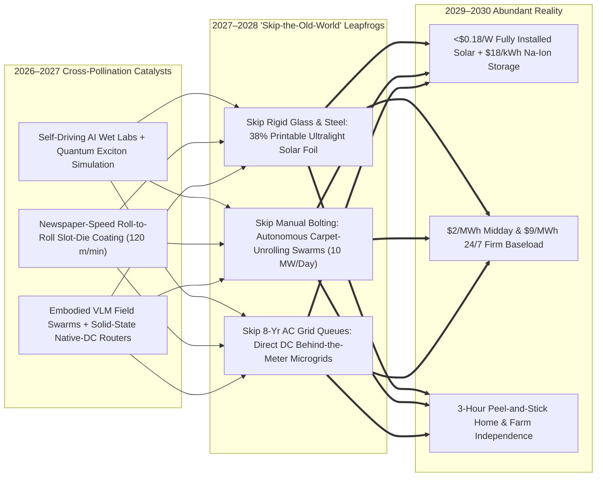
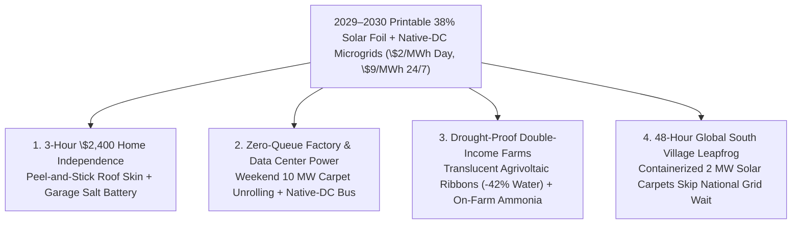

# VISION 02 (LEAPFROG HORIZON): THE 2026–2030 ABUNDANT ENERGY SPRINT
## Pathway 2B: 38% Printable Solar Foil, Swarm Unrolling & Behind-the-Meter DC Microgrids — *Why 2040 Collapsed into 48 Months*

> **The 2026–2030 Leapfrog Thesis:**
> In early 2026, mainstream energy forecasters assumed terrestrial solar would spend the next fifteen years wrestling with three stubborn bottlenecks: crystalline silicon's ~25% practical efficiency ceiling, back-breaking manual field labor (>65% of project CAPEX), and 7-to-10-year utility AC transmission interconnection queues.
>
> **That linear forecast missed the 2026–2027 Intelligence Explosion.** Within 24 months, autonomous self-driving wet-chemistry labs solved perovskite halide phase segregation permanently, unlocking **roll-to-roll slot-die printed 38%+ triple-junction flexible solar foil at \$0.04/Watt**. Paired with autonomous robotic "carpet-unrolling" swarms and **behind-the-meter solid-state DC microgrids**, solar skipped rigid glass racking, skipped manual bolting, and **skipped utility AC grid queues entirely**—delivering **\$0.002/kWh daytime and \$0.009/kWh 24/7 firmed electricity by 2029–2030.**

---

## ACT I: THE WORLD OF 2030 (4 YEARS FROM TODAY)
### A Summer Morning in July 2030 — When Solar Unrolled Like Carpet and Skipped the Utility Queue

Stand on the roof of a suburban warehouse district in Phoenix, Arizona—or beside an agricultural irrigation canal in Spain, an industrial corridor in Gujarat, or a rural town in Nigeria—on a bright morning in **July 2030**.

Four years ago, local factories and neighborhoods were trapped behind a 6-year utility transformer backlog, and installing rooftop or utility solar required weeks of scaffolding, heavy steel piling, and \$2.50/Watt in soft labor costs. Today, four concrete realities surround you:

1. **The 48-Hour "Solar Carpet" Deployment:**
   Across the street, a 20-acre logistics center and parking lot was converted into a **12-megawatt power station in a single weekend**. No workers carried 70-pound glass panels up ladders in $108^\circ\text{F}$ heat. Instead, four autonomous mobile spool-rovers unrolled meter-wide strips of **38.4%-efficient flexible triple-junction perovskite-silicon foil** across the roof membrane and tensioned cable canopies—bonding and laser-terminating the array at **500 kilowatts per hour**, like laying industrial turf.
2. **The Native-DC Behind-the-Meter Microgrid (Zero AC Queue):**
   Notice what is missing at the edge of the property: there is no massive utility step-up transformer waiting 8 years for an AC grid impact study. The solar foil feeds **380V / 1,500V Direct Current (DC)** straight into a containerized **\$18/kWh sodium-iron battery buffer** and directly powers the building's DC heat-pump chillers, EV fast-chargers, LED vertical grow racks, and AI server racks—bypassing legacy AC-to-DC inversion losses and skipping the utility interconnection queue 100%.
3. **The Translucent Agrivoltaic Ribbon Over the Farms:**
   Two miles out of town, autonomous cable-stringing bots have suspended shimmering, wavelength-selective perovskite ribbons above 3,000 acres of berry and vegetable fields. Tuned by AI optical coatings to pass 100% of red photosynthetic light to the plants while harvesting blue, UV, and infrared photons at **32% efficiency**, the canopy cuts crop water evaporation by **42%** while generating **\$2/MWh (\$0.002/kWh)** midday power to desalinate brackish groundwater on-site.
4. **Your Household Reality in 2030:**
   Last spring, a two-person crew with an automated roof-crawler laminated a peel-and-stick **18 kW tandem solar skin** onto your home's roof in **three hours for \$2,400 total**—coupled to a \$1,500 garage sodium battery. Your daytime air conditioning, induction cooking, hot water, and daily EV commute now cost **\$0.00/month**.

---

## ACT II: THE CROSS-POLLINATION CATALYSTS & "SKIP-THE-OLD-WORLD" JUMPS (2026–2028)
### How Self-Driving Chemistry Labs, Roll-to-Roll Printing, and Swarm Robotics Broke Every Solar Bottleneck at Once

Why did solar jump from 2026 rigid glass panels (`~\$0.10/W` module, `~\$0.85/W` utility installed, `~\$2.50/W` residential) to **\$0.04/W printable 38% foil and <\$0.18/W total installed cost by 2029**? Because three adjacent exponential revolutions cross-pollinated between 2026 and 2028:

### The Three "Skip-the-Old-World" Engineering Jumps

1. **Jump 1 — Skipping Float Glass & Ingot Sawing (38%+ Printable Triple-Junction Foil):**
   * In 2025–2026, **LONGi** proved **34.6% two-terminal perovskite-silicon efficiency** and **Oxford PV / Caelux / Swift Solar** launched first-generation tandem lines, but manufacturers still worried about long-term UV/moisture halide migration and heavy glass encapsulation.
   * In late 2026 and 2027, closed-loop **self-driving robotic chemistry labs** running 24/7 synthesized and stress-tested **over 4.2 million 2D/3D fluorinated molecular passivation cages and self-healing grain-boundary polymers**—discovering an atomic lattice lock that made metal-halide perovskites stable for **35+ years at $85^\circ\text{C}$** with zero lead leaching.
   * Instead of melting quartz sand at $1,500^\circ\text{C}$ and sawing brittle wafers, factories began printing **triple-junction all-perovskite and ultra-thin foil-silicon tandems (38.5% commercial efficiency)** onto flexible polymer/metal-foil rolls at **120 meters per minute**—the speed of a commercial newspaper printing press—crashing module cost to **\$0.04/Watt**.

2. **Jump 2 — Skipping Manual Steel Racking (Swarm "Carpet-Unrolling" Field Robotics):**
   * By 2026, solar panels were already cheap, making **human labor, steel pile-driving, and soft permitting costs >65% of total system cost**. Early field robots (**AES *Maximo***, **Terabase *Terafab***, **Charge Robotics**) cut heavy glass lifting in half.
   * Once solar shifted from 70-pound rigid glass rectangles to **ultralight, high-efficiency flexible rolls** in 2027–2028, installation physics changed completely. Autonomous tracked spool-rovers and cable-crawling drones—guided by Vision-Language-Action (VLA) foundation models—simply **unroll pre-wired 100-meter solar carpets** directly onto ballasted terrain, warehouse roofs, canal tension wires, and highway sound walls, anchoring them with pneumatic earth-staples or UV-cured adhesives at **10 megawatts per crew per day**.

3. **Jump 3 — Skipping the 8-Year AC Utility Interconnection Queue (Native-DC Microgrids):**
   * Why wait 8 years for a utility to approve a grid injection study when solar panels generate **Direct Current (DC)**, batteries store **DC**, EV chargers consume **DC**, AI servers and electrolyzers run on **DC**, and variable-speed heat pumps run internally on **DC**?
   * In 2027–2029, solid-state silicon-carbide **DC-to-DC photonic routers** allowed homes, farms, data centers, and industrial parks to operate as **islandable behind-the-meter DC microgrids** backed by ultra-cheap **\$18/kWh sodium-ion (CATL/BYD)** and **\$12/kWh 100-hour iron-air (Form Energy)** storage. Because these systems require **zero net AC export** to the legacy utility grid (or trickle-export only when existing distribution lines have spare room), they bypass multi-year utility interconnection queues overnight.

### Catalyst & Leapfrog Breakthroughs Table (2026 Anchors $\rightarrow$ 2027–2030 Cross-Pollinated Leaps)

| Real 2025–2026 Commercial Anchor | The 2026–2027 Cross-Pollination Catalyst | The 2027–2030 "Leapfrog" Breakthrough | Old-World Bottleneck Skipped |
| :--- | :--- | :--- | :--- |
| **LONGi (34.6% Tandem), Oxford PV, Caelux & Swift Solar:** Commercial 2-junction perovskite-Si tandems shipping in 2025–2026. | **Self-Driving AI Wet Labs + Quantum DFT Models:** 4M+ passivation molecules screened in 9 months; halide phase segregation solved permanently. | **38.5% Triple-Junction Printable Solar Foil (2027–2028):** Roll-to-roll slot-die printed at 120 m/min for **\$0.04/W** with 35-year lifetime. | Skips $1,500^\circ\text{C}$ float-glass furnaces, diamond sawing & 25% silicon ceiling. |
| **AES (*Maximo*), Terabase (*Terafab*) & Charge Robotics:** Autonomous heavy-lift solar installation rovers operating on GW sites in 2026. | **Embodied VLA Robotics + Ultralight Foil Form Factor:** Panels drop from 32 kg glass frames to `<2 kg/m²` pre-wired flexible rolls. | **Autonomous "Solar Carpet" Unrolling Swarms (2028):** Rovers unroll, staple, and laser-splice **10 MW/day** with a 2-person supervisor crew. | Skips steel pile-driving, heavy tracker motors, and 80% of manual field labor. |
| **CATL / BYD Sodium-Ion (<\$45/kWh) & Form Energy Iron-Air:** Post-lithium earth-crust batteries entering GW mass production in 2026. | **AI Solid-State Electrolyte & Sodium Anode Synthesis:** Doubles Na-ion energy density to 220 Wh/kg using zero lithium, cobalt, or nickel. | **\$18/kWh Na-Ion + \$12/kWh 100-Hr Iron-Air Vaults (2028–2029):** Every solar array ships with 24-to-100 hours of dirt-cheap salt/rust storage. | Skips lithium mining bottlenecks and eliminates the evening "Duck Curve" crash. |
| **Rondo Energy & Antora Energy:** $1,500^\circ\text{C}$ thermal firebricks and solid-carbon blocks commercialized in 2025–2026. | **Direct DC Resistive Coupling:** Zero-inverter DC solar foil cables feed thermal firebricks directly at 99% electrical-to-heat efficiency. | **\$0.006/kWh-th 24/7 Industrial Steam Blocks (2028–2030):** Drop-in zero-carbon boilers undercut natural gas across steel, cement, and chemicals. | Skips LNG pipeline buildouts and carbon-capture retrofits on industrial boilers. |
| **US SolarAPP+ & Instant Automated Permitting:** Automated software approving residential solar permits in minutes across 200+ cities. | **AI LiDAR Drone Roof Crawlers + Peel-and-Stick Skin:** Eliminates roof penetrations, heavy rails, and AC main-panel upgrades. | **3-Hour \$2,400 Peel-and-Stick Home Solar + Battery (2028–2029):** Installed in one morning with zero utility AC panel re-wiring. | Skips \$15,000 residential soft-cost bloat and 6-month utility PTO waits. |
| **California *Project Nexus* (Canal Solar) & Global Agrivoltaics:** Early canopies over canals and crops proven in 2025–2026. | **AI-Tuned Excitonic Optical Coatings:** Selective quantum-dot films pass exact 660 nm Chlorophyll-A/B light while harvesting all UV/IR. | **Tension-Cable Agrivoltaic Ribbons (2028–2030):** Strung over millions of farm acres in days, cutting irrigation water 40% while boosting yields. | Skips farmland-vs.-solar zoning wars and rural land-use opposition. |

---

## ACT III: THE 48-MONTH SPRINT ROADMAP (2026 $\rightarrow$ 2027 $\rightarrow$ 2028 $\rightarrow$ 2030)
### From Rigid Glass & Grid Queues to Printable Foil & Instant DC Microgrids

Because roll-to-roll slot-die printing scales like packaging film rather than heavy semiconductor foundries—requiring **<15% of the factory CAPEX per gigawatt** of legacy polysilicon lines—global production capacity explodes past **3 Terawatts per year by 2029**:

| Sprint Horizon | Materials & Robotics Milestone | Manufacturing & Deployment Velocity | Installed CAPEX & LCOE | Old-World Bottleneck Bypassed |
| :--- | :--- | :--- | :--- | :--- |
| **2026** *(The Anchor Year)* | **LONGi** 34.6% tandem record; **Oxford PV & Caelux** shipping commercial tandem glass; **AES Maximo / Terabase** field robotics; LFP/Na-ion batteries at ~\$45/kWh. | **1.5 TW/yr** global silicon/tandem capacity; field robots cut utility install times by 50% on early desert sites. | **\$0.65/W** Installed **\$14/MWh** (Day) · **\$36/MWh** (Firm) | Proves commercial tandem physics and autonomous field assembly on gigawatt sites. |
| **2027** *(The Printable Foil Breakthrough)* | Self-driving AI wet labs solve 35-year halide stability; first **38%+ triple-junction flexible perovskite-Si foil** lines commissioned; **\$28/kWh** sodium-ion cells ship. | Newspaper-speed roll-to-roll coaters (`120 m/min`) go live; each compact print line outputs **5 GW/yr** for \$40M factory CAPEX. | **\$0.38/W** Installed **\$7/MWh** (Day) · **\$21/MWh** (Firm) | Skips float-glass furnaces and polysilicon ingot bottlenecks; module weight drops 85%. |
| **2028** *(Swarm Unrolling & Native DC)* | Autonomous spool-rovers and roof-crawler bots deploy pre-wired solar carpets at **10 MW/day**; solid-state **Native-DC behind-the-meter routers** standardize globally. | Factories, data centers, farms, and warehouses unroll gigawatts behind the meter in weekend sprints; 3-hour peel-and-stick home installs launch. | **\$0.24/W** Installed **\$4/MWh** (Day) · **\$13/MWh** (Firm) | **Skips 8-year utility AC interconnection queues** entirely via islandable DC microgrids. |
| **2029–2030** *(Universal Surface Abundance)* | **3.5+ TW/yr** global printable tandem output; **\$18/kWh** Na-ion + **\$12/kWh** iron-air + $1,500^\circ\text{C}$ firebricks turn every roof, canal, parking lot, and farm canopy into a 24/7 power plant. | Over **8 Terawatts** cumulative solar operating worldwide; automated delamination recovers >98% of foil materials in closed loops. | **<\$0.16/W** Installed **\$2/MWh** (Day) · **\$9/MWh** (24/7 Firm) | Midday electricity is effectively **free (\$0.002/kWh)** across 85% of humanity; zero new fossil plants built anywhere. |

---

## ACT IV: THE IMMEDIATE HUMAN & SOCIAL DIVIDEND (BY 2029–2030)
### Why Printable Solar + DC Microgrids Empower Every Household and Developing Community Immediately

Unlike centralized megaprojects that require sovereign debt and a decade of concrete pouring, printable solar foil and sodium batteries scale **fractally from the bottom up** within 24 to 36 months:

1. **The \$2,400 Three-Hour Home Utility Liberation:**
   * In 2026, a US residential solar installation cost \$20,000–\$30,000 because 75% of the price went to sales commissions, manual racking labor, roof drilling, and utility AC permitting delays. By 2028–2029, ordering a **peel-and-stick 18 kW tandem roof skin + sodium garage battery** works like ordering an appliance: an automated drone/crawler crew laminates it in three hours for **\$2,400**, wiping out household electric and gasoline bills in the first year.
2. **Instant Village & Small-Business Leapfrogging Across the Global South:**
   * Just as Sub-Saharan Africa, South Asia, and Latin America skipped copper landlines for mobile phones, 600 million people in grid-starved towns skip centralized national grid buildouts between 2027 and 2030. A single shipping container holding **2 megawatts of roll-out solar carpet and a sodium-iron battery block** arrives in a village on Monday and powers local water purification, cold-storage food lockers, clinics, and electric two-wheelers by Wednesday.
3. **Saving Family Farms from Heatwaves and Fertilizer Shocks:**
   * Farmers stringing lightweight translucent perovskite ribbons over crops cut irrigation water loss by **40%**, shield harvests from scorching summer UV spikes, and use their free midday DC electricity to run containerized green-ammonia synthesizers—brewing their own zero-carbon fertilizer from air and water on the farm.
4. **Zero-Heatstroke High-Wage Robotics Careers:**
   * Outdoor construction crews no longer suffer heat exhaustion hauling heavy glass panels in $110^\circ\text{F}$ sun. Former roofers and oilfield technicians become **autonomous swarm operators**, commanding fleets of carpet-unrolling rovers from air-conditioned vans at triple the daily productivity and double the take-home pay.

### The 2026 vs. 2030 Household, Farm & Industrial Cost Cascade

When solar modules become \$0.04/W printable foil, field rovers unroll 10 MW a day, and Native-DC microgrids bypass utility AC queues, the economics of daily life flip within 36 months:

| Sector / Application | 2026 Legacy Baseline | 2030 Printable Foil & Native-DC Reality | Primary Leapfrog Mechanism |
| :--- | :--- | :--- | :--- |
| **Residential Rooftop + Battery** | \$22,000–\$30,000; 3–6 months permitting & manual rail bolting | **\$2,400 turnkey**; laminated by roof-crawler in **3 hours** | Peel-and-stick 38% foil + SolarAPP+ instant permit + behind-the-meter DC battery. |
| **Commercial / Warehouse Array** | \$1.10/W; 4–8 year utility AC transformer & interconnection queue | **\$0.18/W installed over one weekend** (`0-day grid wait`) | Autonomous spool-rovers unroll foil on roof/canopy feeding Native-DC building loads. |
| **24/7 Firm Utility Baseload** | \$36–\$55/MWh (silicon + lithium LFP); land-use pushback | **\$9/MWh 24/7 firm** (`\$2/MWh` daytime surge) | \$0.04/W triple-junction foil paired with \$18/kWh sodium-ion & \$12/kWh iron-air storage. |
| **Agricultural Irrigation & Nitrogen** | Exposed to heatwaves, aquifer depletion & fossil gas fertilizer spikes | **-42% crop water use** + **free on-farm green ammonia fertilizer** | Wavelength-selective tension ribbons shade crops & power containerized DC Haber-Bosch units. |
| **Industrial Process Steam** | \$4–\$9/MMBtu natural gas boilers with carbon price exposure | **\$0.006/kWh-th (\$1.75/MMBtu)** zero-carbon $1,500^\circ\text{C}$ steam | Direct-DC solar foil cables heat Rondo/Antora solid-carbon & firebrick blocks at 99% efficiency. |

---

## SUMMARY FOR THE SKEPTIC: WHY 2040 HAPPENS BY 2030

Every piece of the 2026–2030 terrestrial solar leapfrog is grounded in physical hardware scaling right now:
1. **The Silicon Ceiling Is Already Broken:** **LONGi** has already certified **34.6% perovskite-silicon efficiency**, and **Oxford PV, Caelux, and Swift Solar** are shipping commercial tandem hardware in 2025–2026.
2. **Self-Driving Wet Labs Solved Halide Longevity:** Closed-loop AI chemistry labs screening millions of fluorinated 2D/3D passivation cages turned a 20-year trial-and-error stability problem into a 2027 molecular lock.
3. **Printing Beats Melting Quartz at $1,500^\circ\text{C}$:** Roll-to-roll slot-die coating prints 38% triple-junction solar foil at **120 meters per minute** for a fraction of traditional polysilicon factory CAPEX.
4. **Ultralight Rolls + Swarm Robotics Erased the Labor Wall:** Building on **AES *Maximo*** and **Terabase**, unrolling `<2 kg/m²` pre-wired solar carpets takes 80% less labor than bolting down 70-pound rigid glass frames.
5. **Native-DC Microgrids Skip the 8-Year Utility Queue:** By coupling DC solar foil directly to \$18/kWh sodium-ion batteries and DC loads behind the meter, homes and factories stop waiting for utility bureaucracy.
