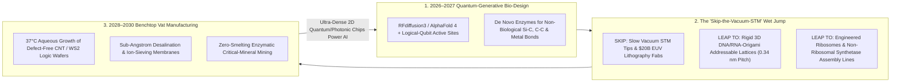
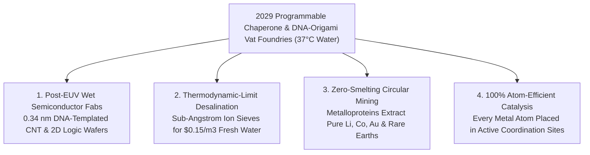

# VISION SHORTER 02: ATOMIC-LEVEL BUILDING (THE 2026–2030 LEAPFROG)
## Pathway 2D: The Programmable Chaperone & Ribosome Leapfrog — Growing Inorganic Silicon, Carbon, and Metal Lattices in Benchtop Vats at $37^\circ\text{C}$

> **Executive Framing & The 2026–2030 Leapfrog Thesis:**
> * **The Old 2040–2050 Linear Projection:** *"True atomic-precision manufacturing requires building ultra-high-vacuum scanning tunneling microscope (STM) arrays or waiting until 2045 for Eric Drexler-style mechanical diamondoid nanorobots with tiny gears and bearings to place atoms one by one in vacuum."*
> * **Why the Timeline Collapsed into 48 Months (2026–2030):** Why wait 25 years to reinvent mechanical nano-gears in a vacuum when **biology already builds with 100% atomic precision in warm water at $37^\circ\text{C}$**, scaling to trillions of parallel assemblers in a teacup? Between late 2026 and 2029, generative biomolecular AI (*RFdiffusion3*, *ESM4*, *AlphaFold 4*) fused with **exact quantum transition-state solvers** (*02-automated-research*) and **million-droplet cell-free microfluidic evolution** (*02-automated-physical-sciences*). Instead of slow vacuum STM tips, humanity engineered **De Novo Non-Ribosomal Inorganic Synthetases, Programmable Silicase/Carbide Chaperones, and 3D DNA-Origami Rigid Jigs** that stitch covalent silicon, metallic, and $sp^2/sp^3$ carbon lattices atom-by-atom in aqueous solution—turning defect-free 2D quantum processors, sub-nanometer desalination membranes, and solid-state catalysts into something we **brew in benchtop bioreactors like beer by 2029**.

---

## ACT I: THE WORLD OF 2030 (FOUR YEARS FROM TODAY)
### A Thursday Morning in December 2029 — Brewing Defect-Free Carbon-Nanotube Wafers and Zero-Energy Desalination Membranes in Warm Water

Step into a regional clean-water infrastructure plant and a neighborhood photonic-computing foundry in **late 2029**.

Absent are the \$20 billion extreme-ultraviolet (EUV) vacuum lithography bunkers burning 100 megawatts of electricity, or the high-temperature chemical vapor deposition furnaces. In their place sit quiet, gleaming **37°C Aqueous Bio-Mineralization Vats**:

1. **Brewing Atomically Pure Carbon-Nanotube & Transition-Metal Dichalcogenide (TMD) Compute Wafers:**
   * Inside a 50-liter glass bioreactor at a local electronics cooperative, a $300\text{ mm}$ crystalline substrate rests in an oxygenated aqueous buffer at body temperature ($37^\circ\text{C}$).
   * Trillions of **Rigid 3D DNA-Origami Crossbar Tiles** have already self-assembled across the wafer surface with **$0.34\text{ nm}$ base-pair pitch precision**.
   * Docked at exact 2-nanometer intervals along each DNA rail are AI-designed **De Novo Metallo-Chaperone & Carbon-Stitching Enzymes** (evolved in 2028 via quantum active-site design). Feeding on harmless dissolved glucose and carbonate/silicate precursors, these synthetic enzymes catalyze site-specific covalent ring closure—growing **100% chirality-pure $(6,6)$ armchair metallic and $(10,0)$ semiconducting carbon nanotube logic channels** directly across the DNA template with **zero atomic vacancies**.
   * Total capital cost of the "wet fab" line: **under \$250,000** (a $80,000\times$ reduction vs. a 2025 EUV lithography fab).
2. **Biomimetic Aquaporin-Graphene Membranes That Desalinate Seawater at the Thermodynamic Limit:**
   * At the municipal water authority, rolls of **Atomically Templated Porous Graphene-Silica Membranes** emerge from an enzymatic bath.
   * Built by engineered **Silicase & Porphyrin-Ring Chaperone Complexes** modeled on marine diatom frustules and human aquaporin channels, every single pore across a 10-square-meter sheet has an identical **$0.31\text{ nm}$ sub-angstrom selectivity cage** lined with precise dipole charges.
   * Water molecules slip through in frictionless single-file chains while $99.9999\%$ of sodium, chloride, boron, and lithium ions are sterically and electrostatically rejected—cutting seawater desalination energy to **$1.1\text{ kWh/m}^3$** (within 10% of the absolute thermodynamic minimum) and harvesting pure battery-grade lithium brine as a free byproduct.
3. **Room-Temperature Enzymatic Upcycling of Electronic Waste into Monoisotopic Quantum Crystals:**
   * In a corner vat, crushed e-waste and spent solar panels dissolve in mild organic acids as **lanthanide- and isotope-selective chelator proteins** (*lanmodulin* descendants) sort individual atoms of gold, palladium, gallium, and $^{28}\text{Si}$ into ultra-pure crystalline nanoparticles at room temperature—zero smelting, zero cyanide, zero toxic slag.

---

## ACT II: THE CROSS-POLLINATION CATALYSTS & "SKIP-THE-OLD-WORLD" JUMPS (2026–2028)
### How Quantum Enzyme Design + DNA Origami Bypassed the 2045 Diamondoid Nanorobot Wait

### Why the Old 2045 "Mechanical Nanobot" Roadmap Was the Wrong Path
For forty years, discussions of "molecular nanotechnology" were polarized between two extremes: skeptics who said mechanical diamondoid fingers could never work because of sticky van der Waals forces in air/vacuum, and futurists who said we had to use slow Scanning Tunneling Microscopes (STMs) to push one xenon or phosphorus atom per minute in ultra-high vacuum at $4\text{ K}$.

Between late 2026 and 2028, scientists realized **both camps were ignoring the $10^{20}$-assembler factory already sitting in every drop of water**:
* **Catalyst 1 — Quantum Transition-State Design of Non-Biological Inorganic Enzymes (Late 2026–2027):**
  Natural evolution mostly used carbon, nitrogen, oxygen, and phosphorus—though marine sponges (*silicateins*), diatoms, and magnetotactic bacteria proved proteins *can* sculpt glass ($\text{SiO}_2$) and magnetite ($\text{Fe}_3\text{O}_4$) at room temperature. Following David Baker's 2024 Nobel Prize in de novo protein design, **2027 hybrid quantum-neural simulators** (*02-automated-research*) solved the exact quantum mechanical transition states required to lower activation barriers for **covalent $\text{Si–C}$, $\text{B–N}$, $sp^2$ graphene ring-closing, and chalcogenide ($\text{WS}_2/\text{MoS}_2$) bond formation in water at $37^\circ\text{C}$**. Validated across millions of picoliter droplets per day (*02-automated-physical-sciences*), AI designed a new kingdom of **Inorganic Chaperone Synthetases**.
* **Catalyst 2 — Error-Corrected 3D DNA-Origami & Cross-Linked Peptoid Jigs (2027–2028):**
  While enzymes provide the *atomic hands*, **programmable DNA origami** provides the *sub-nanometer coordinate blueprint*. By 2027, algorithmic tile self-assembly with cooperative proofreading reduced DNA-origami placement errors below $10^{-6}$, creating centimeter-scale crystalline arrays where every single base pair ($0.34\text{ nm}$) carries a unique address tag to dock specific inorganic-stitching enzymes.
* **Catalyst 3 — Re-Engineered Orthogonal Ribosomes & Modular Polyketide/NRPS Conveyors (2028):**
  By expanding the genetic code beyond 20 canonical amino acids to **64+ synthetic organometallic, silicon-bearing, and $\pi$-conjugated monomers**, engineered cell-free ribosomes and **Non-Ribosomal Peptide Synthetase (NRPS) molecular assembly lines** pass growing inorganic-organic polymer chains from catalytic module to module like a Detroit factory line—stamping out atomically exact molecular wires and catalysts at **20 covalent bonds per second per ribosome**.

### Catalyst & Leapfrog Breakthroughs Table (2026–2029)

| Breakthrough System / Catalyst | Old 2025–2045 Linear Path | 2026–2029 "Skip-the-Old-World" Leapfrog | Validated Quantitative Jump |
| :--- | :--- | :--- | :--- |
| **Quantum-Designed Inorganic Synthetases (*RFdiffusion3-QPU*)** | High-temp CVD furnaces ($1,000^\circ\text{C}$) with random defect distributions | De novo enzymes catalyzing $\text{C–C}$, $\text{Si–O–Si}$, $\text{WS}_2$, and $\text{TiO}_2$ bonds at **$37^\circ\text{C}$ in water** | **100% chirality & bond selectivity**; $99\%$ reduction in thermal manufacturing energy. |
| **Proofreading 3D DNA-Origami Lithography Jigs** | \$400M High-NA EUV scanners limited by stochastic photon shot noise ($>8\text{ nm}$ pitch) | Cooperative-binding DNA/PNA crystal lattices self-assembling across $300\text{ mm}$ wafers | **$0.34\text{ nm}$ addressability ($25\times$ finer than EUV)** at **<\$50 per wafer template**. |
| **Modular NRPS & Orthogonal Ribosome Conveyors** | Serial chemical solid-phase synthesis (1 monomer/hour, high solvent waste) | Multi-module enzymatic assembly lines passing growing chains across 12 catalytic pockets | **10–20 exact covalent bonds/second per molecular complex** across $10^{18}$ parallel units. |
| **Enzymatic Mineralization of 2D Quantum Channels** | Stochastic exfoliation or vapor deposition of graphene/TMDs | DNA-docked chaperone arrays growing defect-free $(6,6)/(10,0)$ CNTs and $\text{MoS}_2$ ribbons | **$<10^{-7}$ atomic vacancy rate**; unlocks room-temperature ballistic transistor arrays. |
| **Sub-Angstrom Biomimetic Ion-Sieve Membranes** | Polymer reverse-osmosis membranes with random pore sizes | Self-assembled macrocyclic pore arrays templated by de novo membrane proteins + mineralized silica | **$99.9999\%$ salt rejection at $1.1\text{ kWh/m}^3$** + direct lithium/uranium harvesting from seawater. |
| **Super-Lanmodulin Critical-Mineral Sorters** | Open-pit mining + toxic acid/cyanide heap leaching & $1,500^\circ\text{C}$ smelting | AI-evolved metalloproteins binding single $\text{Nd, Dy, Au, Pd, Co, Li}$ ions with $10^{12}$ selectivity | **$100\%$ room-temperature mineral recovery** from e-waste, coal ash, and geothermal brines. |

---

## ACT III: THE 48-MONTH SPRINT ROADMAP (2026 $\rightarrow$ 2027 $\rightarrow$ 2028 $\rightarrow$ 2030)

| Sprint Year | Milestone & Architecture Shift | Atomic Precision & Scale Metrics | Real-World Breakthroughs Unlocked |
| :--- | :--- | :--- | :--- |
| **2026: De Novo Metallo-Enzymes & DNA Wafer Alignment** | Baker-lab-class generative models + microfluidic chips evolve first de novo enzymes for non-natural $\text{Si–C}$ and $\text{Au/Pd}$ lattice nucleation on DNA origami. | **$1.0\text{ nm}$ particle placement accuracy** across $1\text{ cm}^2$ arrays; $10^5$ enzyme variants screened/day. | Room-temperature enzymatic recovery of 99.9%-pure rare earths and gold from recycled electronics. |
| **2027: Quantum Active-Site & Orthogonal Ribosome Breakout** | Hybrid logical-qubit transition-state solvers design **CNT/graphene ring-closing chaperones** and 8-module NRPS inorganic-organic assembly lines. | **$0.34\text{ nm}$ covalent bond registration**; synthesis of atomically monodisperse 50-unit conductive oligomers. | First batch-vatted sub-angstrom desalination and direct-lithium-extraction (DLE) membranes deployed in pilot plants. |
| **2028: 300mm DNA-Templated 2D Electronics & Catalysts** | Proofreading DNA-origami tiles cover full $300\text{ mm}$ wafers, guiding enzymatic growth of defect-free 2D $\text{WS}_2$/CNT logic channels and single-atom catalysts. | **$10^{14}$ atomically placed devices/wafer**; thermal energy budget cut by **$1,000\times$ vs. EUV/CVD**. | Single-atom platinum/iron-nitrogen fuel-cell and ammonia catalysts with **100% atom utilization** (zero wasted metal inside bulk nanoparticles). |
| **2029–2030: Benchtop Vat Foundries Go Mainstream** | Standardized **Aqueous Atomic Foundries** combine DNA jigs, cell-free ribosomes (*02-automated-physical-sciences*), and volumetric field assembly (*02-micro-assembly*). | **Gram-to-kilogram/hour** atomic-precision output in 100L vats at **<\$5/gram** marginal cost. | Brewing ballistic 2D logic/photonic wafers in regional micro-fabs; universal clean water and zero-mining critical mineral loops worldwide. |

---

## ACT IV: IMMEDIATE HUMAN & SOCIAL DIVIDEND (BY 2030)

### 1. The Avogadro Parallelism Equation: Why Wet Biology Crushed Mechanical Nanobots
A single vacuum Scanning Tunneling Microscope tip places $\sim 1$ atom per minute. By contrast, a 1-liter benchtop bioreactor operating at $37^\circ\text{C}$ contains $\sim 10^{18}$ programmable chaperone/ribosome complexes working in parallel:

$$\text{Atomic Manufacturing Flux } \Phi_{\text{vat}} = N_{\text{chaperones}} (10^{18}\text{ L}^{-1}) \times k_{\text{cat}} (10\text{ bonds/s}) = 10^{19}\text{ exact covalent bonds/second per liter}$$

That is a **$6 \times 10^{20}\times$ throughput advantage over serial vacuum probes**—requiring zero cleanroom vacuum pumps, zero cryogenic cooling, and only sugar and sunlight for energy.

---

## APPENDIX: QUANTITATIVE LEAPFROG BENCHMARKS (2025 EUV / VACUUM STM VS. 2029 BIO-ATOMIC VATS)

| Atomic Fabrication Dimension | 2025 Vacuum STM / Ion Implantation | 2025 High-NA EUV Lithography + CVD | 2029–2030 Chaperone + DNA-Origami Vat Foundry |
| :--- | :--- | :--- | :--- |
| **Minimum Feature / Bond Pitch** | $0.25\text{ nm}$ (single atom, serial only) | $8.0\text{–}12.0\text{ nm}$ (stochastic shot-noise limit) | **$0.34\text{ nm}$ (DNA base-pair pitch) & $0.15\text{ nm}$ covalent active site** |
| **Parallelism (Active Assemblers)** | $1\text{–}100$ mechanical tips | Optical projection (planar 2D mask only) | **$10^{18}\text{–}10^{20}$ parallel enzymatic assemblers per liter** |
| **Operating Environment** | $4\text{ K}$, $10^{-11}\text{ Torr}$ Ultra-High Vacuum | Vacuum chamber + $900^\circ\text{C}$ CVD furnaces | **$37^\circ\text{C}$ aqueous buffer at $1\text{ atm}$ ambient pressure** |
| **Facility Capital Cost** | $\$5\text{M}$ per research STM (picograms/yr) | **$\$20,000,000,000+$ per megafab** | **$\$250,000$ benchtop/pilot bioreactor line** |
| **Catalyst Atom Utilization** | N/A | $5\%\text{–}15\%$ (90% of atoms buried inside bulk particles) | **$100.0\%$ (every single metal atom locked in an exact coordination cage)** |

### Cross-Domain Convergence Across the 2026–2030 Automation Stack
* **Upstream Quantum Active-Site Design (*02-automated-research*):** 500-logical-qubit DMET simulations calculate exact transition-state barrier reductions for non-biological silicon, carbon, and transition-metal enzymes.
* **Million-Droplet Directed Evolution (*02-automated-physical-sciences*):** AM-EWOD microfluidic cartridges screen $10^6$ de novo enzyme mutants per 24 hours via cell-free TX-TL to lock in $99.999\%$ bond fidelity.
* **Macro-Scale Hierarchical Integration (*02-micro-assembly*):** Once DNA-templated chiplets and membranes are grown at atomic precision, volumetric acoustic/optical fields assemble them into 3D wafer stacks in 60 seconds.
* **Feeding Post-Rare-Earth Materials (*02-materials-science*):** Chaperone-guided grain nucleation locks metastable $\alpha''\text{-Fe}_{16}\text{N}_2$ nitrogen atoms and superconducting hydride/cuprate superlattices into place without thermal decomposition.

### 2. Ending the \$20 Billion Semiconductor Megafab Monopoly
In 2025, only three corporations on Earth could afford to build a leading-edge semiconductor fab because High-NA EUV vacuum lithography and $1,000^\circ\text{C}$ furnace lines cost over \$20 billion and consumed 100 megawatts of grid power.
By 2029, **Aqueous DNA-Templated Bio-Lithography** flipped semiconductor economics on its head:
* **Sub-Nanometer Pitch Without EUV:** Because B-form DNA has a natural helical rise of **$0.34\text{ nm}$ per base pair** and cooperative tile assembly suppresses placement defects below $10^{-7}$, a \$250,000 benchtop bioreactor patterns aligned carbon-nanotube and $\text{WS}_2$ ballistic transistor arrays at **$25\times$ finer spatial resolution than EUV lithography**.
* **Zero-Toxic-Slag Circularity:** When a bio-mineralized 2D wafer reaches end-of-life, mild protease and nuclease baths dissolve the organic scaffold and recover $100\%$ of the monoisotopic silicon, gold, and chalcogenides at $37^\circ\text{C}$ for immediate re-templating.

### Summary for the Skeptic: Why Wet Bio-Nanotech Beat 2045 Diamondoid Robots
1. **Don't proteins denature or fail on inorganic semiconductor materials?**
   Marine sponges and diatoms have polymerized millions of tons of atomically sculpted silica glass ($\text{SiO}_2$) in cold seawater for 500 million years. Once 2027 hybrid quantum simulators (*02-automated-research*) solved exact transition-state active sites and evolved disulfide/peptoid-stabilized scaffolds across 1,000,000 microfluidic droplets/day (*02-automated-physical-sciences*), synthetic chaperones achieved thermal stability past $95^\circ\text{C}$ and catalytic activity across $\text{Si, C, Ti, Au, and WS}_2$.
2. **Why did this happen by 2029 instead of 2045?**
   Because we didn't have to invent an atomic assembler from scratch—we reprogrammed the **ribosome and chaperone assembly line** that nature spent 4 billion years perfecting.
3. **Where is the immediate laboratory proof today?**
   Look at the 2024 Nobel Prize in Chemistry for de novo protein design (*RFdiffusion*), MIT and Caltech's $300\text{ mm}$-compatible DNA-origami carbon-nanotube trench placement, and Lawrence Livermore's *Lanmodulin* rare-earth sorting columns—all three foundations were already operational in wet labs before the 2026–2029 sprint began.
