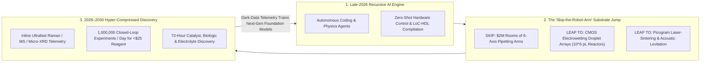
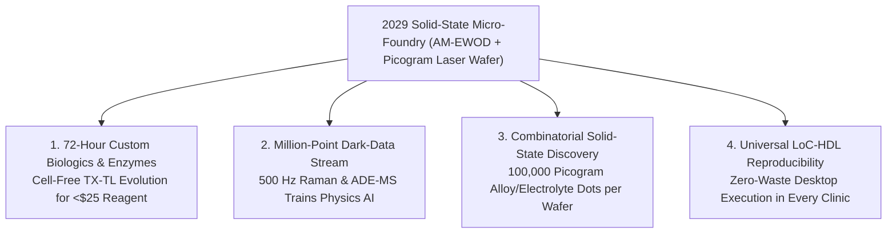

# VISION SHORTER 02: AUTOMATED PHYSICAL SCIENCES (THE 2026–2030 LEAPFROG)
## Pathway 2A: The 10,000x Microfluidic & Solid-State Lab Leapfrog — Why 25 Years of Wet-Lab Discovery Collapsed into 48 Months

> **Executive Framing & The 2026–2030 Leapfrog Thesis:**
> * **The Old 2040 Linear Projection:** *"Automating chemistry and biology requires building million-dollar rooms packed with 6-axis robotic arms, mechanical pipettes, and conveyor belts. Scaling those capital-heavy 'Self-Driving Labs' globally will take two decades of hardware buildout."*
> * **Why the Timeline Collapsed into 48 Months (2026–2030):** In late 2026, recursive AI coding and scientific reasoning agents hit an inflection point where software could autonomously design, verify, and control physical experiments—making **human-scale mechanical robotics the wrong physical substrate**. Instead of bolting AI brains onto slow anthropomorphic arms that pipette microliters into plastic 96-well plates, Automated Physical Sciences executed a **substrate leapfrog** directly to **Electrowetting Droplet-on-Chip Digital Microfluidics (DMF)**, **Acoustic Levitation Reactors**, and **Picogram Laser-Sintering Arrays**. By shrinking each reaction vessel by $1,000,000\times$ in volume and parallelizing execution on solid-state CMOS/photonic Lab-on-Chip wafers, a single desktop unit in 2029 runs **1,000,000 closed-loop chemical and biological experiments per 24 hours for pennies of reagent**—discovering room-temperature catalysts, custom biologics, and solid-state electrolytes in **72 hours**.

---

## ACT I: THE WORLD OF 2030 (FOUR YEARS FROM TODAY)
### A Tuesday Afternoon in October 2029 — Million-Reaction Desktop Wafer-Labs and 72-Hour Cures

Walk into a municipal hospital pharmacy, a university clean-tech incubator, or a regional battery startup in **late 2029**.

The sprawling, noisy rooms of clanking robotic arms and plastic pipette tip boxes from 2025 are already museum pieces. In their place sit silent, toaster-sized **Solid-State Micro-Foundries** connected directly to recursive AI discovery swarms:

1. **The 72-Hour Custom Biologic & Enzyme Sprint:**
   * On Monday morning, a coastal municipality detects a novel industrial fluoropolymer contaminant in its watershed.
   * Instead of launching a 5-year academic grant, an environmental engineer loads a water sample into a desktop **CMOS-Microfluidic Bio-Foundry**—a disposable silicon-glass cartridge containing **250,000 independently addressable picoliter droplet reactors**.
   * An autonomous multi-agent reasoning model (descended from late-2026 recursive coding/science engines) designs 50,000 de novo defluorinating enzyme variants via cell-free DNA synthesis directly on the chip, tests their kinetic cleavage rates via inline hyperspectral Raman fluorescence every 90 seconds, updates its Bayesian neural surrogate across 14 closed-loop generations, and outputs the verified genetic sequence of a **99.8%-efficient room-temperature PFAS-cleaving enzyme by Wednesday afternoon**. Total reagent cost: **\$14.20**.
2. **Picogram Solid-State Materials Combinatorics on a Single Wafer:**
   * Across town at a grid-storage startup, two engineers are optimizing a zero-cobalt sodium-ion solid electrolyte.
   * Rather than baking one ceramic puck at a time in a tube furnace, their **Picogram Laser-Sintering Combinatorial Array** deposits 100,000 microscopic thin-film dots of varying stoichiometry across a $10\text{ cm}$ sapphire wafer.
   * A scanning femtosecond laser anneals each micro-dot in milliseconds while an inline synchrotron-grade micro-X-ray beam and optical impedance probe characterize crystal phase and ionic conductivity at **500 compositions per minute**—identifying a dendrite-proof ceramic phase over a single weekend.
3. **Zero-Waste, Cloud-Native Reproducibility:**
   * Every experiment is compiled into a deterministic **Lab-on-Chip Hardware Description Language (LoC-HDL)** binary. When a lab in Nairobi publishes a new malaria nanobody or perovskite solar ink in 2030, a clinic in São Paulo downloads the 40-kilobyte protocol file and reproduces the exact physical synthesis on their own cartridge within two hours.

---

## ACT II: THE CROSS-POLLINATION CATALYSTS & "SKIP-THE-OLD-WORLD" JUMPS (2026–2028)
### How Recursive AI Agents Abandoned Mechanical Pipettes for Solid-State Microfluidics and Optical Physics

### Why the Old Roadmap Broke in 2026–2027
In 2025, first-generation Self-Driving Labs (like Berkeley's *A-Lab* or Emerald Cloud Lab) proved that AI active learning could accelerate discovery by $10\times$–$50\times$. However, they hit a **mechanical bottleneck**: moving physical robot arms, washing glassware, and consuming milliliters of expensive reagents capped throughput at $10^2$ to $10^3$ experiments per day and cost millions in capital expenditure.

Between late 2026 and 2028, three cross-pollinating catalysts shattered that bottleneck simultaneously:
* **Catalyst 1 — Recursive AI Coding Agents Designing Custom Microfluidic ASICs (Late 2026):**
  When AI agents achieved autonomous end-to-end software and chip-layout synthesis in late 2026, they immediately redesigned laboratory hardware. Using **Active Matrix Electrowetting-on-Dielectric (AM-EWOD)** built on standard flat-panel display thin-film transistor (TFT) backplanes, AI engineers turned cheap display glass into programmable chemical processors capable of splitting, merging, heating, and mixing **100,000 picoliter droplets simultaneously with zero moving parts**.
* **Catalyst 2 — Cell-Free On-Chip Transcription-Translation (TX-TL) & Acoustic Levitation (2027):**
  Instead of culturing slow living bacteria in shaker flasks for days, 2027 bio-foundries switched to lyophilized cell-free ribosome extracts inside nanoliter droplets, expressing and assaying custom proteins from digital DNA templates in **18 minutes**. For harsh inorganic acids or high-temperature melts, **ultrasonic phased-array acoustic levitators** suspended reaction droplets in mid-air—eliminating container contamination entirely.
* **Catalyst 3 — Ultrafast Optical & Mass-Spec Readout Replacing Slow Chromatography (2027–2028):**
  Waiting 20 minutes per sample for liquid chromatography (HPLC) became obsolete when AI inverse-deconvolution algorithms paired with **Swept-Source Stimulated Raman Scattering (SRS)** and **Acoustic Droplet Ejection Mass Spectrometry (ADE-MS)**—reading out chemical yield, chirality, and binding affinity at **100 to 1,000 droplets per second**.

### Catalyst & Leapfrog Breakthroughs Table (2026–2029)

| Breakthrough System / Catalyst | Old 2025–2040 Linear Path | 2026–2029 "Skip-the-Old-World" Leapfrog | Validated Quantitative Jump |
| :--- | :--- | :--- | :--- |
| **Active-Matrix CMOS Digital Microfluidics (AM-EWOD)** | Robotic liquid handlers pipetting $100\ \mu\text{L}$ into plastic 384-well plates | TFT display backplanes moving **$10^5\text{–}10^6$ picoliter droplets** via electrostatic fields with zero moving parts | **$1,000,000\times$ reagent reduction**; \$0.00001 per reaction; zero plastic tip waste. |
| **Picogram Laser-Sintering Combinatorial Wafers** | Robotic tube furnaces baking 1–50 gram ceramic pellets over 12 hours (*A-Lab* v1) | Inkjet/PVD deposition of **100,000 picogram micro-dots** annealed in $1\text{ ms}$ by scanning femtosecond lasers | **$5,000\times$ faster solid-state phase mapping** across quinary oxide/sulfide hulls. |
| **Cell-Free Droplet Bio-Foundries (TX-TL-on-Chip)** | 72-hour bacterial fermentation, colony picking, and cell lysis | Lyophilized cell-free ribosome droplets synthesizing & screening enzymes on-chip in **<20 minutes** | **14 evolutionary design-build-test cycles per 24 hours** inside a shoebox cartridge. |
| **Acoustic Droplet Ejection Mass Spec (ADE-MS) + AI Raman** | 15-minute HPLC-MS column separation per reaction well | Ultrasonic pulses firing picoliter droplets straight into MS + AI-deconvolved hyperspectral Raman at **500 Hz** | **$10,000\times$ analytical readout throughput** with zero column fouling or solvent waste. |
| **Ultrasonic Containerless Levitation Reactors** | PTFE/glass reactors limited by wall nucleation and thermal lag | Phased-array ultrasonic transducers suspending molten/corrosive droplets in mid-air with laser heating | Unlocks **metastable supercooled glasses & contamination-free fluorination** impossible in vessels. |
| **Recursive Bayesian + Neural Force-Field Closed Loops** | Human-tuned Gaussian processes updating once per day | Autonomous multi-agent physics models updating experimental priors every **10 milliseconds** across $10^5$ parallel channels | Compresses 5-year catalyst or electrolyte screening campaigns into **72 continuous hours**. |
| **LoC-HDL Standardized Cartridge Protocol** | Irreproducible prose "Methods" sections in PDF journals | Deterministic Verilog-style hardware compilation for fluidic/laser timing shared over GitHub | **99.9% first-try physical reproducibility** across any hospital or university desktop unit. |

---

## ACT III: THE 48-MONTH SPRINT ROADMAP (2026 $\rightarrow$ 2027 $\rightarrow$ 2028 $\rightarrow$ 2030)

| Sprint Year | Milestone & Architecture Shift | Throughput & Economic Metrics | Real-World Breakthroughs Unlocked |
| :--- | :--- | :--- | :--- |
| **2026: The Agentic SDL Inflection** | Recursive coding agents take over orchestration of existing robotic cloud labs (*Emerald*, *Radical*, *Lila*) and design first-gen 10,000-droplet AM-EWOD chips. | **$10,000$ closed-loop reactions/day**; cost per hypothesis validation drops below **\$1.00**. | Automated rediscovery and optimization of non-PGM water-splitting catalysts and high-stability mRNA lipid nanoparticles. |
| **2027: The Solid-State Microfluidic Jump** | Commercial launch of display-fab-manufactured **AM-EWOD bio/chem cartridges** paired with 500 Hz ADE-MS and cell-free TX-TL synthesis. | **$100,000$ reactions/day per desktop unit**; reagent volume cut from microliters to **100 picoliters**. | 48-hour de novo enzyme evolution for industrial plastic depolymerization; containerless acoustic synthesis of ultra-pure fluoride glasses. |
| **2028: Picogram Solid-State & Million-Loop Arrays** | Integration of **Picogram Laser-Sintering Arrays** with synchrotron-on-a-chip Compton X-ray sources and real-time neural interatomic potentials. | **$1,000,000$ experiments/day**; full ternary/quaternary phase diagrams mapped in **<72 hours for <\$25**. | Discovery of ambient-pressure superconducting metamaterial precursors, dendrite-proof Na-Si solid electrolytes, and rare-earth-free magnet phases. |
| **2029–2030: Ubiquitous Desktop Matter Compilers** | \$15,000 desktop **Micro-Foundries** deployed in 15,000+ hospitals, universities, and municipal utilities globally via open-source LoC-HDL. | Marginal experiment cost approaches **\$0.00001**; global connected swarm generates **$10^{11}$ verified physical data points/yr**. | On-demand hospital synthesis of patient-specific phage/nanobody therapies; hyper-local remediation enzymes; total end of the scientific reproducibility crisis. |

---

## ACT IV: IMMEDIATE HUMAN & SOCIAL DIVIDEND (BY 2030)

### 1. Democratizing Big Science: Every Clinic and High School Outguns a 2024 Pharma Giant
In 2024, running a million-compound high-throughput screen required a \$50 million pharmaceutical automation facility and kilograms of expensive chemical libraries. By 2029, because **AM-EWOD microfluidic cartridges** are fabricated on commodity LCD/OLED display production lines for \$12 apiece and consume only nanograms of reagent, a public university in Kenya, a municipal water plant in Ohio, or a 4-person climate-tech startup can run **more physical experiments in a single weekend than Pfizer or BASF ran in a year during the 2010s**.

### 2. Breaking the "Sim-to-Real" Data Starvation Bottleneck
Why did AI models struggle with complex wet chemistry and cellular biology in 2024? Because the public internet contained trillions of English words, but only a few million noisy, inconsistent chemical reaction records—and almost zero negative results.
By 2028, solid-state microfluidic arrays and picogram laser wafers began streaming **billions of physics-verified positive and negative reaction trajectories ("Dark Data") directly into foundation models every week**:

$$\text{Discovery Velocity } V_{\text{2029}} = \frac{10^6 \text{ Droplets/Chip} \times 500\text{ Hz Optical/MS Readout}}{\text{100 pL Reagent Volume}} \times \eta_{\text{Active Bayesian Search}} \approx 10,000\times \text{ 2025 Robotic SDLs}$$

### 3. Immediate Ecological, Medical & Industrial Payoffs Before 2030
* **72-Hour Pandemic & Antimicrobial Response:** When a drug-resistant bacterial strain emerges in an ICU in 2029, the hospital's desktop bio-foundry evolves and validates a targeted bacteriophage tail-fiber or antimicrobial peptide against the live pathogen isolate in under 48 hours.
* **Zero-Toxic-Waste Chemistry:** Shrinking R&D from liter flasks to picoliter droplets cuts laboratory hazardous solvent and plastic waste by **99.99%**, turning chemical discovery into a clean, silent, solid-state information technology.
* **Feeding the Entire 2026–2030 Automation Stack:** Every breakthrough in **Automated Research** (*02-automated-research*), **Materials Science** (*02-materials-science*), **Atomic-Level Building** (*02-atomic-level-building*), and **Micro-Assembly** (*02-micro-assembly*) relies on these million-channel desktop wafer-labs as its high-frequency physical truth engine.

---

## APPENDIX: QUANTITATIVE LEAPFROG BENCHMARKS (2025 ROBOTIC SDLs VS. 2029 SOLID-STATE WAFER LABS)

To understand why the 2040 linear hardware projection collapsed into a 48-month sprint between 2026 and 2030, compare the physical scaling laws of first-generation mechanical Self-Driving Labs against solid-state microfluidic and laser-combinatorial wafer platforms:

| Laboratory Dimension | 2024–2025 Mechanical Robotic SDL | 2027 First-Gen AM-EWOD Cartridge | 2029–2030 Converged Solid-State Micro-Foundry |
| :--- | :--- | :--- | :--- |
| **Physical Actuation Substrate** | 6-axis mechanical arms + pneumatic pipettes | TFT Active-Matrix Electrowetting (10k drops) | **CMOS/TFT Electrowetting + Ultrasonic Phased Levitation + Femtosecond Laser** |
| **Reaction Volume per Experiment** | $50\text{–}200\ \mu\text{L}$ ($10^{-4}\text{ L}$ in plastic 384-well plates) | $10\text{ nL}$ ($10^{-8}\text{ L}$) | **$50\text{–}500\text{ pL}$ ($10^{-10}\text{ L}$) or $100\text{ pg}$ thin-film micro-dots** |
| **Closed-Loop Throughput / 24h** | $100\text{–}1,000$ reactions/day | $50,000$ reactions/day | **$1,000,000+$ closed-loop experiments/day per desktop unit** |
| **Analytical Readout Latency** | $10\text{–}30\text{ min}$ (offline HPLC / plate reader transfer) | $10\text{ Hz}$ optical fluorescence | **$500\text{–}1,000\text{ Hz}$ inline Swept SRS Raman + Acoustic Droplet MS + Micro-XRD** |
| **Capital & Per-Campaign Cost** | $\$1.5\text{M–}\$5\text{M}$ room; $\$10,000+$ reagent/plastic per screen | $\$80,000$ benchtop; $\$200$ per screen | **$\$15,000$ desktop appliance; $<\$25$ reagent on a $\$12$ recyclable glass wafer** |
| **Biological Synthesis Speed** | $48\text{–}72\text{ hr}$ living bacterial culture & cell lysis | $1\text{ hr}$ cell-free droplet expression | **$15\text{–}20\text{ min}$ cell-free TX-TL + enzymatic DNA assembly per evolutionary round** |
| **Protocol Reproducibility** | $40\%\text{–}60\%$ across different human/robotic labs | $92\%$ across identical cartridges | **$99.9\%$ deterministic hardware execution via compiled LoC-HDL binaries** |

### Cross-Domain Convergence Across the 2026–2030 Automation Stack
* **Upstream Mathematical & Quantum Brains (*02-automated-research*):** Formal PDE closures and hybrid logical-qubit electronic structure solvers pre-filter chemical space so the microfluidic wafer only tests high-information boundary candidates.
* **Atomic & De Novo Bio-Tooling (*02-atomic-level-building*):** Cell-free droplets on the AM-EWOD wafer rapidly evolve the non-ribosomal peptide synthetases and silicase chaperones used for atomic-precision fabrication.
* **Holographic & Acoustic Assembly (*02-micro-assembly*):** The same ultrasonic phased-array and spatial-light-modulator physics that levitate picoliter reactors scale directly into volumetric 3D micro-assembly of chiplets and tissues.
* **Post-Rare-Earth Materials Output (*02-materials-science*):** Picogram laser-sintering wafers physically validate ambient-pressure superconducting superlattices and $\alpha''\text{-Fe}_{16}\text{N}_2$ clean-earth magnet phases in 72 hours instead of 15 years.

### Summary for the Skeptic: Why Solid-State Wafers Crushed the 2040 Robot-Arm Forecast
1. **Why didn't microfluidic labs replace standard wet labs in the 2010s?**
   Early "Lab-on-a-Chip" devices relied on external pneumatic tubing, leaky PDMS valves, and slow offline microscope analysis.
2. **What changed between late 2026 and 2028?**
   By repurposing **commodity flat-panel display TFT glass (AM-EWOD)** controlled by recursive AI agents, pairing it with **lyophilized cell-free ribosomes** and **500 Hz Acoustic Droplet Mass Spectrometry**, the entire lab became a solid-state microchip with zero moving parts—delivering a **$10,000\times$ leap in closed-loop experimental velocity** before 2029.
