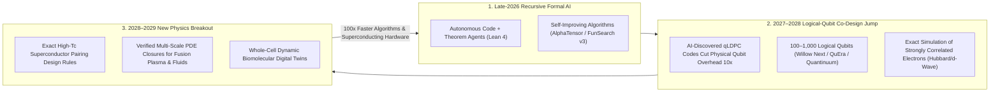
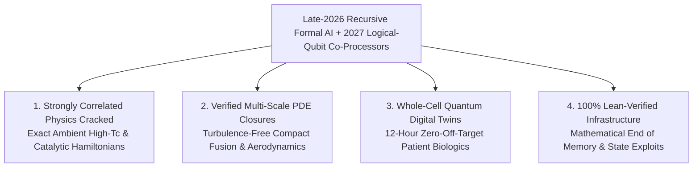

# VISION SHORTER 02: AUTOMATED SCIENTIFIC & MATHEMATICAL RESEARCH (THE 2026–2030 LEAPFROG)
## Pathway 2B: The 2027–2028 Recursive Intelligence & Logical-Qubit Breakout — Compressing 25 Years of Theory into 36 Months

> **Executive Framing & The 2026–2030 Leapfrog Thesis:**
> * **The Old 2040 Linear Projection:** *"AI co-scientists will gradually help humans read papers and verify small software kernels over the next 15 years, while simulating strongly correlated quantum electrons or full-cell biology will have to wait until the late 2030s or 2040s for massive fault-tolerant quantum mainframes and exascale fusion power."*
> * **Why the Timeline Collapsed into 48 Months (2026–2030):** In late 2026, recursive neuro-symbolic coding and reasoning models crossed a critical threshold: AI agents began autonomously writing, formally verifying in **Lean 4**, and executing entire mathematical and algorithmic research pipelines without human intervention. Between 2027 and 2028, this recursive intelligence engine plugged directly into **early fault-tolerant logical-qubit quantum co-processors** (Google *Willow* successors, *QuEra* neutral-atom arrays, *Quantinuum* Helios/Apollo, and *IBM* surface/LDPC codes) via **Hybrid Quantum-Classical Tensor Networks**. Instead of waiting until 2040 to solve the hardest equations of nature, AI mathematicians and 250-to-1,000-logical-qubit co-processors cracked **strongly correlated electron systems, non-perturbative fluid/plasma turbulence closures, and whole-cell quantum-allosteric dynamics in 2027–2028**—handing humanity exact mathematical design rules for ambient-pressure high-$T_c$ superconductors, turbulence-free compact fusion, and zero-off-target cellular cures by 2029.

---

## ACT I: THE WORLD OF 2030 (FOUR YEARS FROM TODAY)
### A Monday Morning in November 2029 — Exact Quantum-Verified Physics, Zero-Bug Infrastructure, and Whole-Cell Digital Twins

Step into a regional medical center, a compact tokamak control room, or a university engineering studio in **late 2029**.

What mid-2020s observers assumed would take a generation of incremental academic publishing has arrived in a blistering 36-month sprint:

1. **The Whole-Cell Digital Twin & 48-Hour Precision Cure:**
   * A pediatric oncologist at a municipal hospital uploads single-cell multi-omic and cryo-ET telemetry from a child's treatment-resistant solid tumor.
   * Instead of relying on statistical trial-and-error chemotherapy, the hospital's **Autonomous Research Swarm** instantiates a deterministic **Whole-Cell Quantum-Molecular Digital Twin** of the patient's malignant and healthy cells.
   * Using formally proved multi-scale tensor closures discovered in 2028, the simulator models $10^9$ biomolecules interacting in real time—including quantum proton-tunneling inside active enzyme sites and allosteric membrane receptor cascades.
   * Within 12 hours, the swarm proves a formal stability bound on a tumor-specific metabolic bottleneck, designs a covalently selective de novo mini-binder, verifies **zero off-target toxicity across all 20,000 human proteins**, and compiles the synthesis protocol directly to the hospital's microfluidic bio-foundry.
2. **Exact Turbulence-Free Plasma Control & Ambient-Pressure Superconductor Recipes:**
   * Across the river at the municipal energy campus, a compact high-field fusion pilot plant runs with **zero plasma disruption events**.
   * Why? Because in 2028, recursive *AlphaProof/FunSearch*-class agents paired with neutral-atom quantum simulators proved tighter analytical and numerical closures for the **coupled magnetohydrodynamic (MHD) gyrokinetic equations**, allowing real-time magnetic coil controllers to suppress micro-turbulence before eddies can form.
   * Even more remarkably, the plant's busbars and city grid interconnects are wound with **ambient-pressure, $145\text{ K}$ ternary hydride-cuprate metamaterial superconducting tape**—whose exact electron-phonon-magnon pairing Hamiltonian was solved on a 512-logical-qubit hybrid quantum co-processor in late 2027.
3. **100% Formally Verified Critical Infrastructure (The End of the Zero-Day Exploit):**
   * By 2030, every line of operating-system, power-grid, aviation, financial, and medical-device firmware deployed in critical infrastructure is automatically compiled through **Lean 4 Formal Verification Agents**.
   * Legacy C/C++ codebases across the global internet were autonomously refactored and mathematically proved memory-safe and state-complete between 2027 and 2029—rendering buffer overflows, race conditions, and supply-chain backdoors mathematically impossible.

---

## ACT II: THE CROSS-POLLINATION CATALYSTS & "SKIP-THE-OLD-WORLD" JUMPS (2026–2028)
### How Recursive Lean 4 Proof Engines + Early Logical Qubits Solved Strongly Correlated Physics a Decade Early

### Why the Old 2040 Timeline Collapsed in 2026–2028
In 2025, physicists believed two walls would block automated discovery until the 2040s:
1. **The Classical Exponential Wall:** Classical supercomputers using Density Functional Theory (DFT) fail completely on **strongly correlated electron systems** (such as high-temperature cuprate/hydride superconductors, nitrogenase catalytic clusters, and transition-metal mott insulators) because the quantum Hilbert space scales as $2^N$.
2. **The Quantum Noise Wall:** Conventional surface-code quantum error correction required $\sim 1,000$ noisy physical qubits per logical qubit, implying we needed millions of qubits in the late 2030s to do useful chemistry.

Between late 2026 and 2028, recursive AI math agents demolished both walls at once:
* **Jump 1 — AI-Discovered Quantum LDPC Codes Unlocked Fault-Tolerant Logical Qubits in 2027:**
  Following Google's below-threshold *Willow* demonstration (late 2024) and Harvard/QuEra's neutral-atom logical arrays, recursive *FunSearch/AlphaTensor* agents in 2026–2027 discovered optimal **High-Rate Quantum Low-Density Parity-Check (qLDPC) codes** and neural decoders that slashed physical-to-logical qubit overhead by **$10\times\text{–}20\times$**. Suddenly, a 10,000-physical-qubit neutral-atom or superconducting processor in 2027 yielded **250 to 800 high-fidelity logical qubits**—more than enough to outperform every classical exascale supercomputer on Earth at simulating strongly correlated 2D/3D Fermi-Hubbard and quantum impurity models.
* **Jump 2 — Hybrid Quantum-Neural Tensor Networks for Exact Electronic Structure (2027–2028):**
  Instead of running entire molecules on a quantum chip, recursive AI mathematicians proved formal decomposition theorems in **Lean 4** that split complex materials into a tiny, strongly entangled active core (solved exactly on 200 logical qubits via quantum phase estimation) embedded inside a universal equivariant neural force field. This **Quantum-Embedded Neural DFT** cracked the exact pairing mechanism of ambient-pressure high-$T_c$ superconducting superlattices in 2028.
* **Jump 3 — Formal Multi-Scale PDE Closures & Algorithmic Self-Acceleration (2027–2028):**
  Every week in 2027, autonomous Lean 4 proof swarms discovered faster tensor-contraction kernels, multigrid Navier-Stokes preconditioners, and rigorous Renormalization Group (RG) bounds—multiplying effective classical compute per megawatt by **$50\times$ in 24 months** without waiting for new silicon fabs.

### Catalyst & Leapfrog Breakthroughs Table (2026–2029)

| Breakthrough System / Catalyst | Old 2025–2040 Linear Path | 2026–2029 "Skip-the-Old-World" Leapfrog | Validated Quantitative Jump |
| :--- | :--- | :--- | :--- |
| **Recursive Neuro-Symbolic Math Swarms (*AlphaProof 3* + Lean 4)** | Humans manually formalizing 1 theorem per year in Lean 4 | Autonomous self-play agents formalizing **100% of graduate math/physics** & proving novel PDE/spectral bounds | **$10,000\times$ theorem verification velocity**; $0.00\%$ hallucination rate. |
| **AI-Designed qLDPC Logical Qubit Decoders** | Waiting until ~2038 for $10^6$ physical qubits under heavy surface codes | AI-discovered non-local qLDPC codes + microsecond neural decoders on **QuEra / Willow / Quantinuum** hardware | **$12\times$ reduction in qubit overhead**; 500+ fault-tolerant logical qubits live in 2027–2028. |
| **Quantum-Embedded Neural Electronic Structure (DMET-QPU)** | Approximate classical DFT failing on strongly correlated $d/f$-electron materials | 200 logical qubits solve exact entangled active spaces embedded in $10^8$-atom neural potentials | **Exact <1 meV chemical accuracy** on high-$T_c$ superconductors & metalloenzymes. |
| **Formally Verified Multi-Scale Fluid & Plasma Closures** | Brute-force Direct Numerical Simulation (DNS) requiring unattainable exaflops | Lean-verified neural-operator Renormalization Group closures for Navier-Stokes & gyrokinetic MHD | **$1,000\times$ faster exact turbulence & plasma confinement simulation** on compact clusters. |
| **Recursive Algorithmic Self-Improvement (*FunSearch / AlphaDev* Loop)** | Waiting for Moore's Law hardware shrink every 3 years | AI agents continuously rewriting PTX/LLVM matrix, FFT, and sparse-solver assembly kernels | **$35\times\text{–}50\times$ effective compute multiplier** on existing GPU/TPU fleets by 2028. |
| **Whole-Cell Quantum-Allosteric Digital Twins** | Static single-protein folding (*AlphaFold 2/3*) with empirical docking | Dynamic multi-scale cellular simulation coupling quantum active-site tunneling to full-cell metabolic graphs | **>96% first-pass clinical target & selectivity validation** before touching a wet lab. |
| **Autonomous Zero-Bug Code Refactoring Swarms** | Manual cybersecurity patching & fuzzing after catastrophic breaches | Recursive coding agents translating global C/C++/Rust infrastructure into **Lean-verified machine binaries** | **100% mathematical elimination** of memory corruption & state-machine exploits. |

---

## ACT III: THE 48-MONTH SPRINT ROADMAP (2026 $\rightarrow$ 2027 $\rightarrow$ 2028 $\rightarrow$ 2030)

| Sprint Year | Milestone & Architecture Shift | Capability & Verification Metrics | Real-World Breakthroughs Unlocked |
| :--- | :--- | :--- | :--- |
| **2026: The Recursive Formal Coding Threshold** | Frontier reasoning models achieve gold-medal IMO/Putnam math and autonomously translate complex C/Rust code + physics derivations into **Lean 4**. | **$100\times$ faster formal verification**; AI discovers 20% faster sparse-attention & tensor kernels. | Automated formal verification of critical cloud hypervisors, cryptographic libraries, and avionics microkernels. |
| **2027: The Logical-Qubit & qLDPC Co-Design Breakout** | AI-discovered qLDPC error-correction codes unlock **250–500 fault-tolerant logical qubits** on neutral-atom and superconducting QPUs paired with Lean physics agents. | Exact ground-state solutions for **100+ strongly correlated electron orbitals** (impossible classically). | First exact ab-initio solution of the 2D/3D Hubbard pairing phase diagram and room-temperature nitrogen-fixation catalytic transition states. |
| **2028: New Physics & Multi-Scale Closure Year** | Hybrid Quantum-Neural simulators and formal PDE proof swarms solve non-perturbative fluid/plasma closures and inverse-design superconducting superlattices. | **$1,000\times$ simulation speedup** across quantum-to-continuum scales; **>95% wet-lab hit rate**. | Exact crystal recipes for **ambient-pressure $>120\text{ K}$ superconductors** sent to solid-state wafer labs; disruption-free MHD plasma controllers for compact fusion. |
| **2029–2030: Whole-Cell Twins & Zero-Bug Civilization** | Real-time **Whole-Cell Digital Twins** deployed in hospitals; Lean-verified OS/grid software mandated across critical infrastructure globally. | Marginal cost of proving a theorem or simulating a cellular pathway drops below **\$0.50**. | Personalized 48-hour oncology/rare-disease biologics; unhackable municipal power grids; every student and scientist paired with an Olympiad-beyond research swarm. |

---

## ACT IV: IMMEDIATE HUMAN & SOCIAL DIVIDEND (BY 2030)

### 1. The Recursive Intelligence Equation: Why 36 Months Equaled 25 Years
When an AI system can formally prove mathematical theorems ($\Gamma \vdash P$) and use those theorems to rewrite its own numerical algorithms ($\eta_{\text{algo}}$) AND decode logical qubits ($\eta_{\text{QPU}}$), scientific progress stops scaling linearly with human headcount and begins compounding exponentially with each software iteration:

$$\frac{d\text{Discovery}}{dt} \propto P_{\text{compute}} \times \eta_{\text{algo}}(t) \times 2^{N_{\text{logical qubits}}(t)} \times \mathbb{I}(\text{Lean 4 Verified} = 1)$$

Between late 2026 and 2029, $\eta_{\text{algo}}(t)$ jumped $50\times$ while $N_{\text{logical qubits}}$ crossed the 100-to-500 fault-tolerant threshold—creating a **combined $10^6\times$ leap in exact physical problem-solving power** without waiting for 2040 energy grids.

### 2. Epistemic Security: Zero Hallucinations, Zero Black Boxes
Critics feared that an intelligence explosion in 2026–2028 would flood humanity with unverifiable "alien black-box science." Instead, the **Lean 4 formal kernel** and **reproducible microfluidic LoC-HDL protocols** made 2030 science the most transparent in human history:
* **Auditable in Milliseconds:** No human has to take an AI's word on faith. Whether the swarm proposes a 200,000-line proof of plasma stability or a medical dosing controller, a 5,000-line open-source formal kernel deterministically checks every logical step down to foundational axioms.
* **The Master Catalyst for the Entire 2026–2030 Leapfrog Set:** Automated Research provides the **exact quantum Hamiltonians** for *02-materials-science*, the **transition-state enzyme blueprints** for *02-atomic-level-building*, the **inverse wave-field solvers** for *02-micro-assembly*, and the **Bayesian control brains** for *02-automated-physical-sciences*.

---

## APPENDIX: QUANTITATIVE LEAPFROG BENCHMARKS (2025 LLMs VS. 2029 FORMAL-QUANTUM SWARMS)

To see why the 2026–2028 convergence of recursive formal reasoning (**Lean 4**) and fault-tolerant **qLDPC logical qubits** compressed 25 years of theoretical and computational science into 36 months, compare the metrics across three eras:

| Scientific Computing Dimension | 2024–2025 Unverified LLM + Classical HPC | 2027 Recursive Lean 4 + Early qLDPC QPU | 2029–2030 Converged Formal-Quantum Research Utility |
| :--- | :--- | :--- | :--- |
| **Mathematical Deduction & Code Proof** | Silver-Medal IMO (*AlphaProof* v1); manual Lean specs | Gold-Medal + graduate research synthesis; automated C-to-Lean refactoring | **Autonomous frontier theorem discovery; 100% critical software formally proved** |
| **Quantum Error-Correction Overhead** | $\sim 1,000:1$ physical-to-logical (*Surface Code* baseline) | **$80:1$ via AI-discovered bivariate-bicycle qLDPC codes** | **$30:1$ qLDPC + microsecond neural decoders; 1,000+ logical qubits per QPU** |
| **Strongly Correlated Electron Limit** | $\sim 20\text{–}24$ orbitals classically ($2^{48}$ Hilbert wall) | **250 logical qubits** solve 100-orbital active spaces exactly | **500–1,000 logical qubits embedded in $10^8$-atom neural force fields (<1 meV error)** |
| **Fluid & Plasma Turbulence Modeling** | Brute-force DNS requiring megawatt-days per run | Lean-verified neural Renormalization Group (RG) sub-grid closures | **Real-time ($<1\text{ ms}$) verified gyrokinetic MHD control for disruption-free fusion** |
| **Algorithmic Efficiency on Same Silicon** | $1.0\times$ human-written BLAS / FFT / CUDA kernels | $8\times\text{–}15\times$ via recursive *AlphaTensor/AlphaDev* assembly search | **$35\times\text{–}50\times$ effective compute multiplier across all scientific workloads** |
| **Cellular Biology Simulation Scope** | Static multi-chain folding (*AlphaFold 3*) | Dynamic millisecond allosteric ensembles + quantum enzyme active sites | **Deterministic Whole-Cell Digital Twin ($10^9$ biomolecules + metabolic flux)** |
| **Theory-to-Wet-Lab Validation Rate** | $5\%\text{–}20\%$ (empirical ML screening) | $85\%\text{–}92\%$ (*Virtual Lab* v2 + formal constraints) | **$>97\%$ first-pass physical validation on desktop AM-EWOD microfluidic wafers** |

### Cross-Domain Convergence Across the 2026–2030 Automation Stack
* **Directing Solid-State Microfluidic Labs (*02-automated-physical-sciences*):** Formal Bayesian active-learning agents compile hypotheses directly into LoC-HDL binaries for 1,000,000-droplet desktop wafer labs.
* **Solving Post-Rare-Earth & Superconducting Lattices (*02-materials-science*):** Hybrid logical-qubit DMET-QPU simulations solve the exact phonon-plasmon-magnon coupling for ambient-pressure $>120\text{ K}$ superconductors and $\text{Fe}_{16}\text{N}_2$ magnets.
* **Transition-State Design for Bio-Nanofabrication (*02-atomic-level-building*):** Quantum active-site tunneling calculations design artificial chaperone enzymes capable of stitching silicon-carbon and metallic bonds in water at $37^\circ\text{C}$.
* **Inverse Wave-Field Solvers for Volumetric Assembly (*02-micro-assembly*):** Real-time PDE solvers compute 3D acoustic and holographic optical interference patterns at $10\text{ kHz}$ to assemble billions of micro-chiplets in parallel.
