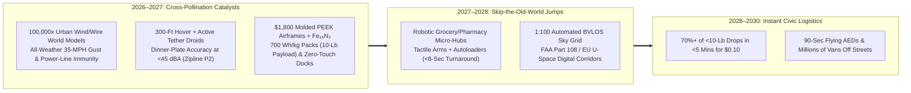
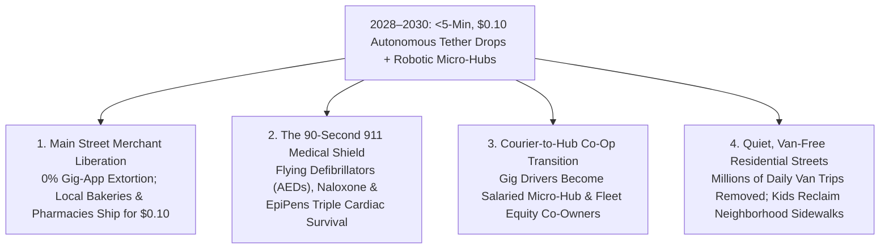

# VISION SHORTER 02: THE 2026–2030 PHYSICAL AUTOMATION LEAPFROG
## Pathway 2E: Autonomous Aerial & Sidewalk Logistics (Drone Delivery) — *Instant Neighborhood Delivery for \$0.10 in Under 5 Minutes by 2028*

> **Executive Framing & The 2026–2030 Leapfrog Thesis:**
> * **Why the 2040 Forecast Was Too Conservative:** Logistics analysts assumed autonomous drone delivery would remain a niche suburban novelty until the late 2030s—held back by manual store loading, wind/rain cancellations, and FAA line-of-sight waivers. They missed the **2026–2027 Micro-Hub & Tether-Droid Convergence**. By early 2026, Zipline, Alphabet Wing, Manna, and Meituan had already completed **2+ million commercial autonomous drops**.
> * **The Four-Fold Leapfrog Trigger (2026–2028):** When **Unified Wind-Shear & Obstacle World Models** (trained across **100,000x GPU micro-weather/urban-canyon simulators**) merged with **300-foot quiet hover + active-thruster tether droids** (**Zipline P2** architecture), **injection-molded PEEK/CNT airframes (\$1,800 BOM)**, **iron-nitride ($\text{Fe}_{16}\text{N}_2$) whisper rotors**, and **automated grocery/pharmacy robotic micro-hubs**, humanity ended the absurdity of driving a 6,000-pound steel van to deliver a 2-pound burrito or medicine bottle. By **2028–2029**, autonomous aerial tether drones and sidewalk rovers handle **70%+ of all under-10-pound neighborhood deliveries in under 5 minutes for \$0.10 per drop**—removing millions of daily delivery van trips and delivering emergency defibrillators (AEDs), EpiPens, and naloxone to any doorstep in **90 seconds**.

---

## ACT I: THE WORLD OF 2030 (4 YEARS FROM TODAY)
### A Tuesday Afternoon in Autumn 2030 — The 4-Minute, \$0.10 Neighborhood Sky Pipeline

Walk down a residential street in Dallas, Dublin, Charlotte, or Shenzhen on a rainy Tuesday afternoon in **October 2030**—just 48 months from today.

Notice what has vanished from your neighborhood since 2026: there are no double-parked delivery vans blocking bike lanes, no gig-economy cars idling on sidewalks, and no noisy quadcopters buzzing over backyards. Instead, three seamless layers of instant micro-logistics operate around the clock:

1. **The 4-Minute, \$0.10 Pharmacy & Grocery Drop (300-Foot Tether-Droid Precision):**
   Inside your kitchen, you realize you are out of fresh ginger and pediatric fever reducer. You tap your local co-op app at 4:12 PM. Half a mile away, a tactile robotic arm inside an **Automated Grocery/Pharmacy Micro-Hub** loads a 6-pound insulated pouch directly into a **Zipline P2 / Wing / Manna** autonomous aircraft via a rooftop autoloader in 8 seconds. At 4:15 PM (**3 minutes and 40 seconds later**), the aircraft hovers silently at **320 feet**—inaudible at $<45\text{ dBA}$—while its aerodynamic **tethered micro-droid** zips down a braided micro-line, uses optical-flow fan thrusters to set the pouch gently onto your **12-inch porch tile** in 30-mph wind gusts, and reels back into the clouds. Total delivery fee: **\$0.10**.
2. **The 90-Second Autonomous Emergency Medical Shield:**
   Two blocks over, a 68-year-old neighbor collapses in his driveway from sudden ventricular fibrillation. Calling 911 immediately triggers the nearest rooftop micro-hub dock: **68 seconds later**—eight minutes before a ground ambulance can navigate traffic—an autonomous medical drone lowers a voice-guided **Automated External Defibrillator (AED) and clot-stabilizing trauma kit** directly beside the spouse, saving his life.
3. **Main Street Beats Mega-Monopolies:**
   At 6:30 PM, your family orders hot ramen and fresh sourdough from a family noodle shop and bakery three miles away. Instead of losing 30% to gig-delivery apps for a lukewarm 45-minute car trip, the restaurant slips the bag into a window dock; it arrives piping hot on your patio in **4 minutes for a 10-cent municipal sky-grid fee**, paired with sidewalk wheeled-legged rovers handling heavy 60-pound bulk grocery crates.
4. **The Leapfrog Question:**
   *"In 2025, human gig-car delivery cost \$7.00+ and took 45 minutes. How did autonomous tether drones and robotic micro-hubs capture 70% of under-10-pound deliveries at \$0.10 per drop by 2028–2029?"*

---

## ACT II: THE CROSS-POLLINATION CATALYSTS & "SKIP-THE-OLD-WORLD" JUMPS (2026–2028)
### Skipping the 3,000-to-1 Van Mass Penalty and Manual Store Loading

### Step 1: Three "Skip-the-Old-World" Engineering Jumps (2026–2028)

Moving a **6,000-pound steel van** through stop-and-go traffic to deliver a **2-pound pharmacy bag** imposes a **3,000-to-1 mass penalty**. Between 2026 and 2028, three cross-pollinating breakthroughs eliminated that inefficiency forever:

* **Jump 1 — Skipping Backyard Landings via 300-Foot Quiet Hover + Active Tether Droids (2026–2027):**
  Early drones failed because descending into tree-filled yards was loud and risky. Pioneered by **Zipline Platform 2 (P2)** and refined across the industry in 2026–2027, the main 40-pound winged aircraft stays **300+ feet overhead** (where its **iron-nitride $\text{Fe}_{16}\text{N}_2$ whisper rotors** blend into background wind at $<45\text{ dBA}$) and lowers a 3-pound **active-thruster tethered droid**. Guided by a 3nm World-Action chip trained across **100,000x GPU turbulent-wind and power-line simulations**, the droid cancels out 35-mph gusts in real time to place fragile eggs or hot coffee onto a **12-inch target with zero rotor wash**.
* **Jump 2 — Skipping Human Store Loading via Tactile Robotic Micro-Hubs & Curbside Autoloaders (2027–2028):**
  A drone flight only costs pennies if ground loading is also zero-touch. In 2027, cross-pollination between **tactile warehouse arms** (**Amazon Vulcan / Physical Intelligence $\pi_0$** class) and **automated rooftop/curbside autoloaders** (**Wing Autoloader / Zipline Dock**) birthed the **Automated Neighborhood Micro-Hub**. When a customer taps an order, an indoor tactile robot arm picks the items in 45 seconds and slides the pouch directly into an exterior charging dock; the drone latches the payload and launches in **8 seconds** with zero human labor.
* **Jump 3 — Skipping Aerospace Airframe Costs via \$1,800 Injection-Molded PEEK/CNT Wings & 700 Wh/kg Cells (2027–2028):**
  Replacing hand-assembled carbon-epoxy drone bodies with **high-pressure injection-molded carbon-polymer (PEEK/CNT) airframes** and **700 Wh/kg silicon/solid-state pouch batteries** doubled payload capacity to **10 pounds (4.5 kg)** while crashing commercial delivery drone BOM from \$18,000 (2024) to **\$1,800 by 2028**.

### Step 2: Catalyst & Leapfrog Breakthroughs Table (2025 Baseline vs. 2026–2028 Leapfrog Jump)

| Logistics Subsystem | 2025 Verified Baseline | 2026–2028 Cross-Pollination Leapfrog | 2028–2030 Neighborhood Reality |
| :--- | :--- | :--- | :--- |
| **Vehicle-to-Payload Mass Ratio** | **3,000 : 1** (6,000-lb van for 2-lb burrito/Rx) | **5 : 1** (40-lb molded polymer wing + 10-lb payload via 700 Wh/kg pack) | **600x mass efficiency jump**; **0.18 kWh** energy per 4-mile round trip |
| **Last-50-Feet Delivery Mechanism** | Noisy low hover or parachute drop (**Zipline P2** launch) | **320-Ft Whisper Hover (<45 dBA) + Active-Fan Optical Tether Droid** | **<8-inch patio-tile accuracy** in 35-mph rain/wind with zero backyard noise |
| **Store & Pharmacy Loading** | Store staff walk outside to clip bags manually | **Tactile Robotic Micro-Hubs + Window/Curbside Autoloaders (<8s latch)** | **100% lights-out pick-to-launch** in under 60 seconds |
| **Airframe & Avionics BOM** | \$12,000–\$25,000 custom composite aircraft | **\$1,800 Injection-Molded PEEK/CNT Airframe + $\text{Fe}_{16}\text{N}_2$ Motors + 3nm NPU** | **\$0.036/drop hardware depreciation** over 50,000 autonomous flights |
| **Airspace & Operator Ratio** | 1 human monitor per 5–20 drones; local waivers | **FAA Part 108 / EU Automated UTM + 100,000x Sim Onboard Radar DAA** | **1 remote supervisor per 150 aircraft** across nationwide BVLOS grids |
| **Emergency Medical Response** | 8–14 minute ground ambulance delay in traffic | **Co-located 911 Flying AED / EpiPen / Naloxone Dock on Every Micro-Hub** | **<90-second life-saving medical drop** to 95% of urban/suburban homes |
| **Middle-Mile Regional Cargo** | **Elroy Air Chaparral** & **Natilus Kona** flight tests | **Autonomous 1,000-lb VTOL & Blended-Wing Cargo Feeders** | Direct farm-to-micro-hub aerial restocking (**-65% rural logistics cost**) |

---

## ACT III: THE 48-MONTH SPRINT ROADMAP (2026 $\rightarrow$ 2027 $\rightarrow$ 2028 $\rightarrow$ 2030)
### How 70% of Small-Parcel Last-Mile Trips Moved to the Sky in Four Years

| Sprint Year | Annual Autonomous Drops | Cost & Latency / Drop | Key Inflection Milestone | Urban & Societal Threshold Unlocked |
| :--- | :--- | :--- | :--- | :--- |
| **2026** *The Breakout* | **35 Million Drops** | **\$1.40 / drop** *(6–10 Mins)* | **Zipline (1.25M+ cumulative)**, **Wing (DFW Walmart/DoorDash)**, **Manna (Dublin/TX)**, & **Matternet** scale; **FAA Part 108 BVLOS** rule finalized. | Proves metro-scale safety across millions of suburban homes and hospital lab networks. |
| **2027** *The Catalyst* | **450 Million Drops** | **\$0.35 / drop** *(<5 Mins)* | **\$1,800 PEEK/CNT 10-lb payload drones** + **700 Wh/kg cells** enter mass production; **Tactile Robotic Micro-Hubs** automate store picking + dock loading. | 1:100 operator ratio achieved; major grocery, pharmacy, and restaurant chains default under-10-lb orders to aerial docks. |
| **2028** *The Flip* | **4.5 Billion Drops** | **\$0.10 / drop** *(3.5–4.5 Mins)* | **70%+ of under-10-lb deliveries** in participating metros shift to tether drones & sidewalk rovers; **90-Second 911 Flying AED Grid** mandated in 100+ cities. | Millions of daily gig-car and delivery-van trips vanish from residential streets; local Main Street merchants match Amazon speed. |
| **2029–2030** *Ubiquity* | **18 Billion+ Drops / Yr** | **\$0.08 – \$0.10 / drop** *(<4 Mins)* | Universal rooftop/window autoloader standard in apartment & commercial buildings; **Elroy/Natilus** cargo drones link rural farms to town micro-hubs. | **-75% neighborhood delivery van traffic**; cardiac arrest survival triples via 90-second AED drops; zero-clutter neighborhood tool libraries. |

### The 2028–2030 Unit Economics of the \$0.10, 4-Minute Delivery
Why does a 4-mile round-trip delivery of an 8-pound grocery or pharmacy order cost **\$0.10** by 2028 (vs. \$6.50–\$9.00 for a human gig car in 2025)?
* **Electricity (0.18 kWh Round Trip at \$0.015/kWh Solar Micro-Hub Power):** **\$0.0027** (less than three-tenths of a cent).
* **Aircraft & Dock Amortization (\$1,800 Molded PEEK Drone over 50,000 Flights):** **\$0.036 per drop**.
* **700 Wh/kg Solid-State Battery Pack & $\text{Fe}_{16}\text{N}_2$ Motor Maintenance:** **\$0.021 per drop**.
* **Automated Tactile Micro-Hub Pick/Load & 1:150 Remote Airspace Supervision:** **\$0.0403 per drop**—bringing the all-in cost to **\$0.10 per delivery**.

### Inside the \$1,800 Molded Carbon-PEEK Tether-Drone BOM (2028)
How did a commercial 10-pound-payload autonomous delivery aircraft drop from \$18,000+ in 2024 to **\$1,800** by 2028?
* **High-Pressure Injection-Molded Carbon-PEEK Wing & Fuselage Shell (45-Second Cycle):** **\$320** (replaces hand-laid carbon epoxy).
* **6 Direct-Drive Iron-Nitride ($\text{Fe}_{16}\text{N}_2$) Whisper Lift/Cruise Motors & Sculpted Propellers:** **\$290** ($<45\text{ dBA}$ at 320 ft).
* **1.4 kWh 700 Wh/kg Silicon/Quasi-Solid-State Pouch Battery Pack (24-Mile All-Weather Radius):** **\$240**.
* **Active-Fan Tethered Micro-Droid (Winch, Braided Line, Optical-Flow Camera & Maneuvering Thrusters):** **\$410**.
* **Unified 3nm World-Model Flight/DAA Chip, 4D Millimeter-Wave Radar & Automated Dock Latch:** **\$540** (**\$1,800 total turnkey BOM**).

---

## ACT IV: IMMEDIATE HUMAN & SOCIAL DIVIDEND (2027–2030)
### Saving Main Street, Rescuing Gig Couriers, and the 90-Second Cardiac Shield

### 1. Rescuing Local Restaurants & Main Street from 30% Gig-App Commissions (2027–2029)
In 2025, predatory delivery apps extracted 25% to 35% of every order from independent restaurants and local shops while charging customers \$8+ in fees and tips.
* **Open-Access Municipal Sky Docks:** By 2028, cities deploy **Common-Carrier Curbside Autoloaders** on every commercial block. A family-owned taco shop, independent pharmacist, or hardware store slides an order into the municipal dock and delivers it 4 miles away in **4 minutes for a flat \$0.10 fee**—keeping 100% of their retail margin and beating continental e-commerce giants on speed.
* **Neighborhood Library-on-Demand:** Because round-trip transit costs 20 cents and takes 4 minutes, households stop buying rarely used appliances, power drills, camping gear, and medical diagnostic kits—borrowing them instantly from the **automated neighborhood lending micro-hub**.

### 2. Elevating Gig Couriers into Micro-Hub Co-Owners (2027–2030)
* **Ending the Sub-Minimum-Wage Traffic Trap:** Instead of forcing millions of gig couriers to burn their own gas and risk traffic fatalities for \$9/hour net pay, municipal franchise charters require drone logistics networks to allocate **25% of local Micro-Hub equity and 100% of salaried Hub Technician, White-Glove Heavy Install, and Airspace Supervisor roles** to former gig and parcel drivers—doubling median take-home pay with full benefits and zero personal vehicle expenses.

### 3. Summary for the Skeptic
Using a 6,000-pound truck to deliver a 2-pound bottle of medicine was the most glaring physical inefficiency of the 2020s. Building on 2+ million verified Zipline, Wing, and Manna flights in 2026, the 2027 convergence of \$1,800 molded PEEK airframes, 300-foot active tether droids, and tactile micro-hubs delivered 4-minute, \$0.10 neighborhood logistics and 90-second emergency defibrillators by 2028–2029.

---

## APPENDIX: 48-MONTH LEAPFROG SCORECARD (2025 vs. 2027 vs. 2030)

| Core Aerial Logistics Benchmark | 2025–2026 Verified Baseline | Late 2027 Inflection Point | 2028–2030 Leapfrog Reality |
| :--- | :--- | :--- | :--- |
| **Cumulative / Annual Drops** | **2M+ Cumulative** (Zipline 1.25M+, Wing 400k+, Manna 165k+) | **450 Million Drops / Yr** | **4.5B (2028) $\rightarrow$ 18B+ Drops / Yr (2030)** |
| **Share of <10-Lb Local Deliveries** | **<1%** (Suburban Pilot Zones in DFW, Dublin, Shenzhen) | **22%** in Active Metros | **70%+ of All Under-10-Lb Neighborhood Orders** |
| **Click-to-Porch Latency & Price** | **35–50 Min / \$7.50** (Gig Car) vs. **6–10 Min / \$1.80** (Drone) | **<5 Minutes / \$0.35 per drop** | **3.5 to 4.5 Minutes / \$0.10 per drop** |
| **Drone Airframe & Droid BOM** | **\$12,000 – \$22,000** (Low-volume composite) | **\$3,200** (700 Wh/kg Pack + 10-lb Payload) | **\$1,800** (Injection-Molded PEEK/CNT + $\text{Fe}_{16}\text{N}_2$) |
| **911 Emergency AED / EpiPen Drop** | **8–14 Minutes** (Ground Ambulance in Traffic) | **<2 Minutes** in Pilot Cities | **<90 Seconds** from Every Neighborhood Micro-Hub |

### Key Verification & Leapfrog Anchors
1. **2024–2026 Commercial Launchpad:** Zipline (>1.25M commercial deliveries, 100M+ autonomous miles, Platform 2 300-ft hover + active tether droid with Walmart, Cleveland Clinic, Memorial Hermann, Panera); Alphabet Wing Autoloader network across Dallas-Fort Worth with Walmart/DoorDash; Manna Drone Delivery serving >35% of Balbriggan/Dublin homes in 3 minutes; Matternet FAA Type-Certified hospital networks; Elroy Air & Natilus middle-mile cargo.
2. **2026–2028 Cross-Pollination Accelerators:** 100,000x GPU urban wind-shear/wire avoidance world models; \$1,800 injection-molded PEEK/CNT airframes with 700 Wh/kg cells (10-lb payload); tactile robotic micro-hub picking arms; FAA Part 108 automated BVLOS UTM (1:150 human oversight).
