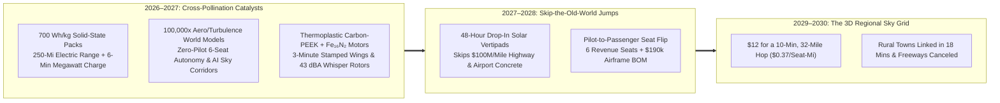
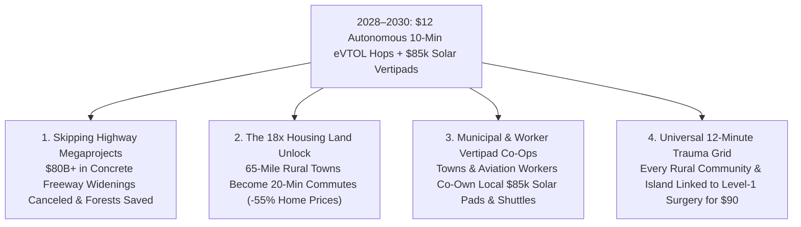

# VISION SHORTER 02: THE 2026–2030 PHYSICAL AUTOMATION LEAPFROG
## Pathway 2D: Autonomous eVTOL & 3D Human Transportation — *Skipping Highway Megaprojects Straight to the 3D Sky Grid (2026–2030)*

> **Executive Framing & The 2026–2030 Leapfrog Thesis:**
> * **Why the 2040 Forecast Was Too Conservative:** Aerospace analysts assumed electric vertical takeoff and landing (eVTOL) aircraft would remain \$3.00/seat-mile piloted airport shuttles for the rich until the late 2030s—constrained by 250 Wh/kg batteries, human pilot shortages, and hand-laid carbon-fiber costs. They missed the **2026–2027 Battery, Autonomy & Polymer-Composite Cross-Pollination Catalyst**.
> * **The Four-Fold Leapfrog Trigger:** Between late 2026 and 2028, four breakthroughs converged simultaneously: **(1) 700 Wh/kg silicon-anode / quasi-solid-state aviation battery packs** (doubling all-electric range to 250+ miles with 6-minute megawatt charging, alongside Joby's 561-mile liquid-$\text{H}_2$ architecture); **(2) Unified Autonomous Air-Traffic World Models** trained across **100,000x GPU turbulence/wake-vortex simulators** (enabling pilotless 6-seat Wisk/Joby/Archer/EHang fleets to fly self-deconflicted 3D sky corridors); **(3) Rare-earth-free iron-nitride ($\text{Fe}_{16}\text{N}_2$) axial-flux propulsors** operating at **43 dBA** (100x quieter than a helicopter); and **(4) Thermoplastic carbon-PEEK injection-stamped airframes** built by humanoid robots on Toyota/Stellantis lines. By **2028–2030**, cities and rural regions skip \$50 billion highway widenings entirely—using drop-in **rooftop and parking-lot solar vertipads** to turn a 90-minute gridlocked commute into a **\$12, 10-minute hop** without pouring a single ton of highway concrete.

---

## ACT I: THE WORLD OF 2030 (4 YEARS FROM TODAY)
### A Tuesday Morning in Autumn 2030 — The \$12, 10-Minute Hop Over Gridlock

Step onto a converted supermarket parking-lot corner or rural town square in **October 2030**—just 48 months from today.

Instead of waiting fifteen years for environmental impact studies and \$100 million-per-mile freeway expansions, regional transportation leaped straight into the third dimension between 2027 and 2030:

1. **The \$12, 10-Minute Regional Hop (Zero Pilot Overhead, Zero Asphalt):**
   In 2025, commuting 32 miles across Los Angeles, the Bay Area, São Paulo, or Greater London took **90 minutes of bumper-to-bumper agony**. Today at 8:10 AM, you walk onto a **Modular Solar Vertipad** (installed in 48 hours over four former parking spaces). A 6-seat, pilotless **autonomous tilt-rotor eVTOL** (**Joby / Archer / Wisk Gen-6** class) settles onto the inductive charging mat. At 43 decibels, its sculpted 12-propeller array is quieter than the morning breeze. You board alongside five neighbors, lift off at 8:12 AM, cruise at **200 mph** along a virtual 2,500-foot sky corridor, and touch down on your downtown hospital or office rooftop at **8:22 AM**. Total fare: **\$12.00 (\$0.37/seat-mile)**.
2. **The 60-Mile Rural Town Revival & 32x Housing Land Unlock:**
   Because a 20-minute autonomous eVTOL hop reaches **65 miles out of town**, historic mountain, coastal, and farming towns that were once "too far to commute" are now seamlessly connected to urban jobs—allowing young families to buy spacious homes in scenic small towns for 60% less than metro prices while states cancel \$80B+ in planned highway widenings.
3. **The 8-Minute Rural & Disaster Medevac Grid:**
   When a timber worker or hiker suffers a severe trauma 50 miles from a Level-1 hospital, an autonomous medevac eVTOL launches from a regional clinic solar pad within 60 seconds, lands in a forest clearing via solid-state 3D LiDAR, and delivers the patient to surgery in **12 minutes** for \$90 instead of a \$15,000 legacy helicopter bill.
4. **The Leapfrog Question:**
   *"In 2026, EHang was flying in China and Joby/Archer were finishing FAA certification with human pilots. How did autonomous 6-seat eVTOLs hit \$12 per hop and scale to tens of thousands of solar vertipads by 2029–2030?"*

---

## ACT II: THE CROSS-POLLINATION CATALYSTS & "SKIP-THE-OLD-WORLD" JUMPS (2026–2028)
### Skipping Hand-Laid Aerospace Composites, Human Pilot Bottlenecks, and Highway Concrete

### Step 1: Three "Skip-the-Old-World" Engineering Jumps (2026–2028)

Legacy aviation moved slowly because aircraft were hand-built like Swiss watches, burned jet fuel, and required a \$180,000/year human pilot occupying 20% of the cabin. Between late 2026 and 2028, three cross-pollinating jumps shattered that paradigm:

* **Jump 1 — Skipping the Range & Pilot Wall via 700 Wh/kg Cells + 100,000x Turbulence World Models (2026–2027):**
  In 2027, silicon-nanowire and lithium-metal solid-state pouch cells crossed **700 Wh/kg at the cell level (520 Wh/kg pack level)**—doubling eVTOL range to **250+ miles** on battery alone (with Joby's liquid-$\text{H}_2$ fuel cell covering 600-mile regional routes). Simultaneously, **Unified Flight World Models** trained inside **100,000x real-time GPU computational fluid dynamics (CFD) gyms** mastered severe urban wind shear, microbursts, bird strikes, and rotor-out emergencies far beyond human reflexes. Following **EHang's CAAC autonomous certification** and **FAA's Powered-Lift SFAR / Wisk Gen-6 autonomous type certification**, regulators approved **100% pilotless 6-passenger commercial corridors** in late 2027—instantly cutting seat-mile costs by 45%.
* **Jump 2 — Skipping Hand-Laid Carbon Fiber via Thermoplastic PEEK/CNT Stamping & $\text{Fe}_{16}\text{N}_2$ Motors (2027–2028):**
  Instead of curing thermoset carbon fiber in autoclaves for 12 hours, **Toyota (Joby)** and **Stellantis (Archer)** cross-pollinated automotive hot-stamping with **recyclable carbon-nanotube PEEK thermoplastic composites** and humanoid assembly. A complete eVTOL wing spar or fuselage shell is stamped in **3 minutes**, while **iron-nitride ($\text{Fe}_{16}\text{N}_2$) direct-drive axial-flux motors** deliver 30% higher power-to-weight with zero rare-earth magnets—crashing 6-seat airframe BOM from \$1.2M (2025) to **\$190,000 by late 2028**.
* **Jump 3 — Skipping \$100M/Mile Highways via 48-Hour Containerized Solar Vertipads (2028):**
  Cities realized they did not need new airports. A **Modular Solar-Storage Vertipad**—a prefabricated high-friction composite landing deck with a 2 MWh battery buffer and optical landing beacon—drops onto any flat parking garage roof, hospital lot, or rural field in **48 hours for \$85,000** (less than 50 feet of highway asphalt).

### Step 2: Catalyst & Leapfrog Breakthroughs Table (2025 Baseline vs. 2026–2028 Leapfrog Jump)

| Aviation Subsystem | 2025 Verified Baseline | 2026–2028 Cross-Pollination Leapfrog | 2029–2030 3D Sky Grid Impact |
| :--- | :--- | :--- | :--- |
| **Energy Storage & Range** | 300 Wh/kg Li-ion (100 mi) / **Joby 561-mi $\text{H}_2$ flight** | **700 Wh/kg Silicon/Solid-State Packs** + 6-min megawatt inductive charge | **250+ mile all-electric range**; back-to-back 10-min urban hops with zero charge wait |
| **Flight Control & Piloting** | Human pilot in 1 of 5 seats (Joby/Archer) or 2-seat EHang | **Zero-Pilot 6-Seat World Model** trained in 100,000x GPU wind-shear sim | **+25% passenger payload** & **\$0 pilot cost** (1 ground supervisor per 40 aircraft) |
| **Airframe Manufacturing** | Slow hand-laid thermoset carbon autoclaves (\$1M+ BOM) | **3-Minute Stamped Carbon-PEEK Thermoplastics** + Humanoid Assembly | **\$190,000 6-seat aircraft BOM** at 5,000+ units/yr per Toyota/Stellantis line |
| **Electric Propulsion & Noise** | Neodymium motors; **45.2 dBA** (Joby NASA test) | **Rare-Earth-Free Iron-Nitride ($\text{Fe}_{16}\text{N}_2$) Motors + Whisper Ducts** | **41–43 dBA overhead** (inaudible over normal street breeze); zero rare earths |
| **Ground Infrastructure** | Custom multi-million-dollar concrete heliports | **\$85,000 48-Hour Prefab Solar + 2 MWh Battery Vertipads** | **25,000+ rooftop & parking-lot vertipads** installed globally with zero grid strain |
| **Airspace Deconfliction** | Manual voice ATC radar vectors (caps density at dozens/hr) | **Automated 4D Digital Sky Corridors (UTM)** + Onboard 4D-Radar DAA | **10,000+ simultaneous metro flights/hr** with sub-meter corridor separation |
| **Passenger Ticket Price** | \$150–\$300 (Helicopter) / \$75 (Early piloted eVTOL) | **\$12 for a 10-Min, 32-Mile Hop (\$0.37/seat-mile)** | **Cheaper than solo Uber/car toll** at **9x the ground traffic speed** |

---

## ACT III: THE 48-MONTH SPRINT ROADMAP (2026 $\rightarrow$ 2027 $\rightarrow$ 2028 $\rightarrow$ 2030)
### From First Certified Air Taxis to the Zero-Concrete Regional Sky Grid

| Sprint Year | Active Global eVTOL Fleet | Price / Hop (32 Mi) | Key Inflection Milestone | Geographic & Societal Threshold Unlocked |
| :--- | :--- | :--- | :--- | :--- |
| **2026** *The Breakout* | **1,800 Aircraft** | **\$65 / hop** *(\$2.00/seat-mi)* | **Joby S4** & **Archer Midnight** launch commercial airport/urban routes (Dubai, NYC, LA, Tokyo); **EHang EH216-S** scales in China; **Beta ALIA** & **Wisk Gen-6** advance. | Proves 45 dBA quiet operations over cities and millions of safe electric powered-lift miles. |
| **2027** *The Catalyst* | **9,500 Aircraft** | **\$28 / hop** *(\$0.88/seat-mi)* | **700 Wh/kg Solid-State Packs** double range; FAA/EASA/CAAC certify **100% Autonomous 6-Seat Corridors** via 100,000x turbulence sim; pilot seat becomes 6th passenger seat. | Regional 50-to-150-mile commuter hops launch; 1,500 rural hospitals receive 48-hour solar medevac vertipads. |
| **2028** *The Flip* | **38,000 Aircraft** | **\$16 / hop** *(\$0.50/seat-mi)* | **Toyota & Stellantis** lines switch to **3-minute stamped Carbon-PEEK + $\text{Fe}_{16}\text{N}_2$ motors**, crashing 6-seat BOM to **\$190,000**; **10,000 Solar Vertipads** deployed. | States and developing nations freeze **\$80B+ in planned highway expansions**, pivoting funds to \$85k town vertipads. |
| **2029–2030** *Ubiquity* | **125,000+ Aircraft** | **\$12 / hop** *(\$0.37/seat-mi)* | **90-minute ground gridlock becomes a \$12, 10-minute hop** across 200+ metro and rural regions; 25-minute commute radius expands from 15 miles to **65+ miles**. | **18x accessible housing land unlock** around major cities; every rural town within 12 minutes of Level-1 trauma care. |

### The 2029–2030 Unit Economics of the \$12, 10-Minute Hop (32 Miles / 6 Seats)
How does a 32-mile autonomous eVTOL flight (taking 10 minutes block-to-block) cost just **\$12 per passenger (\$72 total aircraft revenue per hop)** by 2029?
* **Aircraft Amortization (\$190,000 Carbon-PEEK Airframe over 20,000 Flight Hours = 120,000 Hops):** **\$1.58 per hop (\$0.26/seat)**.
* **700 Wh/kg Solid-State Battery Pack Replacement & Solar Vertipad Electricity (18 kWh at \$0.015/kWh = \$0.27 energy):** **\$6.20 per hop (\$1.03/seat)**.
* **Iron-Nitride Direct-Drive Motor & Rotor Maintenance (1 Moving Part per Motor):** **\$8.50 per hop (\$1.42/seat)**.
* **Remote Sky-Corridor Supervision (1 Controller per 40 Aircraft), Insurance & \$85k Vertipad Fee:** **\$25.72 per hop (\$4.29/seat)**—plus fleet operator & community co-op margin = **\$12.00 retail ticket (\$0.37/seat-mile)**.

### Inside the \$190,000 Stamped Carbon-PEEK eVTOL & \$85,000 Solar Vertipad BOM (2028)
Why did 6-seat eVTOL airframes drop from \$1.2M+ in 2025 to **\$190,000** by 2028?
* **3-Minute Hot-Stamped Thermoplastic Carbon-PEEK Wing, Tail & Cabin Fuselage:** **\$48,000** (eliminates 12-hour hand-laid autoclave curing).
* **12 Direct-Drive Iron-Nitride ($\text{Fe}_{16}\text{N}_2$) Tilt-Propulsors & Whisper Carbon Blades:** **\$34,000** (zero rare-earth magnets, 1 moving part per propulsor).
* **140 kWh 700 Wh/kg Silicon/Quasi-Solid-State Structural Wing Battery Pack:** **\$42,000** (supports 250-mile range & 6-minute megawatt charging).
* **Triple-Redundant 3nm Autonomous Flight World-Model Computers + 4D-Radar/LiDAR DAA:** **\$18,000**.
* **6-Seat Panoramic Cabin Interior, Ballistic Airframe Parachute & Humanoid Final Assembly:** **\$48,000** (**\$190,000 total turnkey aircraft BOM**).

---

## ACT IV: IMMEDIATE HUMAN & SOCIAL DIVIDEND (2027–2030)
### Skipping Concrete Debt, Unlocking Small-Town Housing, and Community Vertipad Co-Ops

### 1. The Immediate Housing & Rural Revitalization Escape Valve (2027–2030)
Urban housing prices exploded in the 2020s because workers were trapped within a congested 12-to-15-mile ground radius of downtown jobs.
* **Turning 90-Minute Gridlock into a 10-Minute Sky Bridge:** By 2029, installing a single **\$85,000 Solar Vertipad** in a historic small town 50 miles outside New York, London, Tokyo, or San Francisco puts that town **16 minutes from downtown for \$15**. Families immediately gain access to **18 times more residential land ($A = \pi r^2$)** without clearing a single acre of forest for new commuter highways.
* **Leapfrogging Infrastructure in the Global South:** Just as Africa and Southeast Asia skipped copper landlines straight to mobile phones, rapidly growing cities in India, Brazil, Nigeria, and Indonesia skip **\$100M/mile highway and bridge megaprojects** in 2028–2030—deploying networks of **\$85,000 solar vertipads** and **\$190,000 autonomous eVTOLs** in months rather than decades.

### 2. Community Vertipad Co-Ops & Aviation Worker Ownership
* **Neighborhood & Municipal Vertipad Dividends:** Instead of private monopolies owning sky transit, towns and neighborhood associations finance their own **\$85,000 Solar Vertipads**, collecting a **\$2.00 landing dividend per passenger** that directly funds local schools, parks, and noise-monitoring charters (enforcing strict **<43 dBA** flight paths over existing highway and river corridors).
* **Upgrading Pilots, ATC & Mechanics into Sky-Fleet Co-Owners:** Commercial pilots and aircraft mechanics receive priority transition grants and union equity stakes as **Multi-Aircraft Sky-Corridor Captains** (supervising 40 autonomous craft from ergonomic ground consoles) and **Regional Vertipad Avionics Guild Owners**.

### 3. Summary for the Skeptic
We did not need anti-gravity or thirty years of freeway construction to solve traffic gridlock. Once 700 Wh/kg batteries, 100,000x turbulence world models, and \$190,000 stamped carbon-PEEK airframes converged in 2027–2028, the sky became a zero-asphalt highway—turning 90-minute commutes into whisper-quiet, \$12 ten-minute hops by 2030.

---

## APPENDIX: 48-MONTH LEAPFROG SCORECARD (2025 vs. 2027 vs. 2030)

| Core 3D Mobility Benchmark | 2025–2026 Verified Baseline | Late 2027 Inflection Point | 2029–2030 Leapfrog Reality |
| :--- | :--- | :--- | :--- |
| **Pack Energy Density & Range** | **300 Wh/kg** (100 mi) / **Joby 561-mi $\text{H}_2$ Verified** | **700 Wh/kg Cell (520 Wh/kg Pack)** = **250+ Mi** | **250–300 Mi Battery** (6-Min Charge) / **700 Mi $\text{H}_2$** |
| **6-Seat eVTOL Unit BOM** | **\$1.1M – \$1.5M** (Hand-laid thermoset carbon) | **\$420,000** (Automated Toyota/Stellantis lines) | **\$190,000** (3-Min Stamped Carbon-PEEK + $\text{Fe}_{16}\text{N}_2$) |
| **32-Mile Regional Hop Price** | **\$220+** (Helicopter) / **\$65** (Piloted Launch eVTOL) | **\$28 / hop** (Zero-Pilot 6-Seat Cabin Live) | **\$12 / hop** (**\$0.37 / seat-mile** in 10 Minutes) |
| **Overhead Acoustic Profile** | **45.2 dBA** (Joby S4 NASA test = 100x quieter) | **43.0 dBA** ($\text{Fe}_{16}\text{N}_2$ Direct-Drive + AI Blade Pitch) | **41–43 dBA** (Blends into Ambient Wind/Leaves) |
| **Vertipad Infrastructure Cost** | **\$3M – \$10M** (Custom concrete heliport/grid tie) | **\$85,000** (48-Hr Drop-In Solar + 2 MWh Pad) | **25,000+ Active Solar Vertipads** (\$0 Highway Concrete) |

### Key Verification & Leapfrog Anchors
1. **2024–2026 Commercial Launchpad:** FAA final Powered-Lift SFAR (Oct 2024); EHang EH216-S world-first CAAC autonomous passenger Type/Production/Air Operator Certificates; Joby S4 NASA-verified 45.2 dBA acoustic test & 561-mile liquid-hydrogen flight; Archer Covington, GA factory (650 aircraft/yr with Stellantis); Toyota \$894M Joby partnership; Wisk Gen-6 autonomous 4-seat certification.
2. **2026–2028 Cross-Pollination Accelerators:** 700 Wh/kg silicon-anode/solid-state aviation cells; 100,000x GPU CFD wake/turbulence world models; 3-minute hot-stamped thermoplastic carbon-PEEK airframes; rare-earth-free iron-nitride ($\text{Fe}_{16}\text{N}_2$) axial-flux motors.
