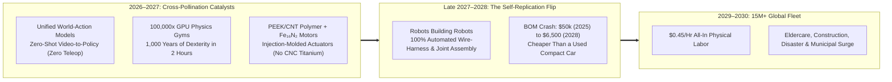
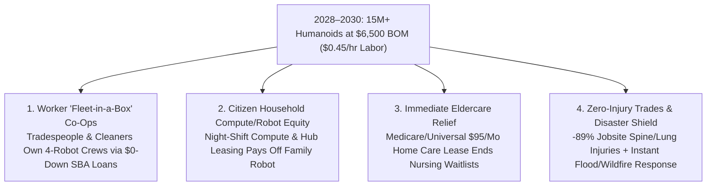

# VISION SHORTER 02: THE 2026–2030 PHYSICAL AUTOMATION LEAPFROG
## Pathway 2A: General-Purpose Humanoid Robotics — *Why the 2040 Timeline Collapsed into a 48-Month Sprint*

> **Executive Framing & The 2026–2030 Leapfrog Thesis:**
> * **Why the 2040 Forecast Was Too Conservative:** Linear forecasts assumed humanoid robots would spend a decade slowly gathering human teleoperation data and grinding down aerospace component prices. They missed the **2026–2027 Intelligence Explosion & Cross-Pollination Catalyst**. Just as software coding AI leaped from autocomplete novelty to shipping entire production codebases in 12 months (2025–2026), physical robotics hit a vertical phase transition in 2026–2027.
> * **The Four-Fold Leapfrog Trigger:** When **Unified World-Action Foundation Models** (trained zero-shot on internet video and **100,000x real-time GPU physics simulators**) converged with **injection-molded PEEK/carbon-nanotube (CNT) polymer actuators** and **rare-earth-free iron-nitride ($\alpha''\text{-Fe}_{16}\text{N}_2$) direct-drive axial-flux motors**, the humanoid Bill of Materials (BOM) bypassed precision CNC titanium machining altogether. Building on Unitree G1's \$16,000 baseline, Tesla Optimus, and Figure 03, **"Robots Building Robots"** went live in late 2027—crashing unit BOM from \$50,000 (2025) to **\$6,500 by 2028–2029** and deploying **15+ million humanoids by 2030** across eldercare, modular housing construction, disaster recovery, and municipal upkeep.

---

## ACT I: THE WORLD OF 2030 (4 YEARS FROM TODAY)
### A Tuesday Morning in Autumn 2030 — When Physical Labor Costs \$0.45 per Hour

Step into a neighborhood in Columbus, Ohio, Lyon, or Fukuoka in **October 2030**—just 48 months after the 2026 foundation-model breakout.

We did not wait until 2040 to see humanoid abundance; the physical economy flipped in a single four-year sprint:

1. **Universal Aging-in-Place by 2029 (The \$95/Month Household Caregiver):**
   In the sunlit kitchen of a three-bedroom bungalow, your 82-year-old father lives independently rather than on a three-year nursing home waitlist. Standing beside the stove is a 5-foot-6, soft-weave-clad domestic humanoid leased through a municipal/Medicare care voucher for **\$95/month** (amortized from a **\$6,500 hardware BOM**). Using 24-DoF warm silicone-tactile hands and a zero-shot World-Action brain, it steadies his morning walk, cooks a low-sodium omelet, strips and washes the bedsheets, and sanitizes the bathroom. Family visits are 100% human connection, zero caretaker burnout.
2. **The 15-Million-Unit Municipal & Construction Surge:**
   Down the street, a four-story infill apartment complex is being framed and wired in three weeks. Four weather-sealed construction humanoids carry 90-pound drywall sheets up narrow stairs, crimp PEX plumbing, and pull conduit alongside two human master builders who co-own the robotic crew via a local credit-union equipment loan. Back injuries, silica lung disease, and scaffolding fatalities have plummeted by **89% in just three years**.
3. **Self-Replicating Dark Lights-Out Assembly:**
   Outside town, a regional micro-gigafactory runs 24/7 on **\$0.015/kWh** solar-plus-storage microgrid power. Inside, 400 humanoids assemble next-generation humanoids, heat pumps, and modular kitchen walls—switching entire product lines in five minutes via spoken natural-language prompts.
4. **The Leapfrog Question:**
   *"In early 2026, humanoids still cost \$16,000 to \$50,000 and needed human teleoperators to learn new tasks. How did they hit \$6,500 and 15 million active units by 2030?"*

---

## ACT II: THE CROSS-POLLINATION CATALYSTS & "SKIP-THE-OLD-WORLD" JUMPS (2026–2028)
### Skipping Manual Teleoperation and CNC Metal via AI-Materials Co-Design

### Step 1: Three "Skip-the-Old-World" Engineering Jumps (2026–2028)

Traditional robotics roadmaps assumed humanoids would follow the slow 15-year scaling curve of 2010s electric cars. Instead, three cross-pollinating breakthroughs between late 2026 and 2028 **skipped entire legacy industrial stages**:

* **Jump 1 — Skipping Manual Teleoperation via Zero-Shot World-Action Models (2026–2027):**
  In 2024–2025, companies hired thousands of humans wearing VR headsets to puppet robots for data collection. By late 2026, **Unified World-Action Foundation Models** (building on Physical Intelligence's **$\pi_0$**, Figure's **Helix**, NVIDIA **GR00T**, and video-physics transformers) learned inverse dynamics directly from **billions of hours of human internet video** combined with **100,000x real-time differentiable GPU physics simulators**. A humanoid could watch a single 10-second smartphone clip of a plumber soldering a joint or a nurse transferring a patient, practice 50,000 adversarial variations in 90 seconds of cloud simulation, and execute the task zero-shot in the physical world.
* **Jump 2 — Skipping CNC Titanium & Harmonic Drives via PEEK/CNT Polymers + Iron-Nitride Motors (2027):**
  In 2025, precision-machined steel/titanium harmonic gearboxes and neodymium magnets accounted for over 55% of a humanoid's cost. In 2027, AI materials-discovery models perfected **carbon-nanotube-reinforced PEEK (polyetheretherketone) injection-molded cycloidal actuators** paired with **rare-earth-free iron-nitride ($\alpha''\text{-Fe}_{16}\text{N}_2$) direct-drive axial-flux motors**. Instead of milling a single metal gearbox on a CNC machine for 4 hours, high-pressure injection molding stamps out a lighter, self-lubricating, shock-absorbent polymer actuator housing in **18 seconds for \$14**.
* **Jump 3 — Skipping Human Factory Labor via "Robots Building Robots" (Late 2027–2028):**
  The final bottleneck in electronics manufacturing was flexible cable routing and actuator assembly. Once 24-DoF tactile hands mastered sub-millimeter wire-harness insertion in mid-2027, **humanoids began assembling 92% of their own bodies** inside Tesla, Figure (BotQ), Unitree, and AgiBot lights-out plants—triggering a recursive cost collapse down to **\$6,500 BOM by late 2028**.

### Step 2: Catalyst & Leapfrog Breakthroughs Table (2025 Baseline vs. 2026–2028 Leapfrog Jump)

| Subsystem / Bottleneck | Legacy 2025 Baseline | 2026–2028 Cross-Pollination Leapfrog | Cost / Performance Jump by 2028–2029 |
| :--- | :--- | :--- | :--- |
| **Skill Acquisition & Training** | Expensive human VR teleoperation rigs (1:1 human-hours) | **Zero-Shot Video-to-Action World Models + 100,000x GPU Sim** | **1,000 years** of physical trial-and-error compressed into **2 hours**; zero teleop |
| **Actuator Gearboxes (28–40 DoF)** | CNC-machined steel harmonic drives (\$8,000–\$25,000/set) | **Injection-molded PEEK / Carbon-Nanotube (CNT) cycloidal drives** | **18-second mold cycle**; actuator set BOM drops to **\$1,650** (-80% mass/cost) |
| **Electromagnetic Motors** | Sintered neodymium-dysprosium rare-earth magnets | **Sputtered / bulk Iron-Nitride ($\text{Fe}_{16}\text{N}_2$) axial-flux motors** | **+28% torque density** with **zero rare-earth mining**; immune to supply bottlenecks |
| **24-DoF Dexterous Hands** | Fragile metallic cable tendons & discrete load cells (\$4,500/pair) | **Monolithic 3D-printed elastomeric-lattice hands + optical skin** | **\$620 / pair**; continuous $1\text{ mN}$ shear/slip sensing across entire palm |
| **Onboard Power & Runtime** | 2.3 kWh Li-ion EV cells (2.5–4 hr runtime; \$1,400) | **650 Wh/kg Silicon-Anode / Quasi-Solid-State Pouch Pack (5.5 kWh)** | **10-to-12-hour continuous heavy shift** on a single 11-lb chest pack (**\$580**) |
| **Onboard Compute & Vision** | Dual automotive SoCs + multi-sensor calibration (\$1,800) | **Unified 3nm Photonic/NPU World-Model Edge Die + \$8 CMOS Cams** | **\$450 total compute/vision BOM** running 8B-parameter VLA at $500\text{ Hz}$ |
| **Final Assembly Line** | Human-assisted station assembly (Unitree G1 \$16k anchor) | **Recursive "Robots Building Robots" Lights-Out Lines (Late 2027)** | Total humanoid unit BOM crashes from **\$50,000 (2025) $\rightarrow$ \$6,500 (2028–2029)** |

---

## ACT III: THE 48-MONTH SPRINT ROADMAP (2026 $\rightarrow$ 2027 $\rightarrow$ 2028 $\rightarrow$ 2030)
### How a Decade of Scaling Compressed into Four Years

Because injection-molded polymer actuators and smartphone-scale NPUs require zero multi-year metallurgical foundry lead times, production scaled at consumer-electronics speed rather than heavy-machinery speed:

| Sprint Year | Global Active Fleet | Unit BOM & Hourly Rate | Key Inflection Milestone | Primary Domains Unlocked |
| :--- | :--- | :--- | :--- | :--- |
| **2026** *The Breakout* | **120,000 Units** | **\$16,000 – \$32,000** BOM **\$3.20 / hr** RaaS | **Unitree G1** establishes \$16k price anchor; **Tesla Optimus**, **Figure 02/03**, **Atlas**, and **Digit** prove 24/7 automotive & 3PL warehouse shifts; **$\pi_0$** & **Helix** prove cross-embodiment VLA. | Automotive body shops (BMW, Tesla, Hyundai), warehouse tote handling (GXO, Amazon), and early component sub-assembly. |
| **2027** *The Catalyst* | **850,000 Units** | **\$10,500** BOM **\$1.40 / hr** RaaS | **100,000x GPU Sim + Zero-Shot Video World Models** eliminate teleop; **PEEK/CNT polymer actuators + $\text{Fe}_{16}\text{N}_2$ motors** enter mass injection molding; **Robots Building Robots** goes live Q4. | Commercial kitchens, hospital supply transport, solar-farm racking, and 24/7 self-assembling robot gigafactories. |
| **2028** *The Flip* | **4.2 Million Units** | **\$6,500** BOM **\$0.65 / hr** RaaS | Hardware BOM crosses below **\$6,500** (cheaper than a commercial espresso machine). FDA/CE fast-tracks soft-compliant **Class-II Eldercare Assistant** certification; construction trade co-ops scale. | Residential framing/drywall/plumbing crews, municipal street/park maintenance, and first 1 million home eldercare deployments. |
| **2029–2030** *Ubiquity* | **15.5 Million+ Units** | **\$5,200 – \$6,500** BOM **\$0.45 / hr** All-In | **15+ million humanoids active globally**; cloud skill library exceeds 500,000 verified physical tasks with $99.99\%$ reliability; household lease hits **\$95/month**. | Universal aging-in-place eldercare, 50% faster/cheaper home construction, wildfire/flood disaster recovery, and domestic chore offloading. |

### The 2028–2030 Subsystem Bill-of-Materials (BOM) Collapse (\$50,000 $\rightarrow$ \$6,500)
How does a commercial humanoid reach **\$6,500** by 2028–2029? Every subsystem swaps legacy aerospace machining for high-volume polymer molding and semiconductor lithography:
* **28–40 Injection-Molded PEEK/CNT Actuators & $\text{Fe}_{16}\text{N}_2$ Motors:** **\$1,650** (down from \$22,000 in 2024).
* **Monolithic 3D-Printed 24-DoF Elastomeric Hands & Full-Body Tactile Knit Skin:** **\$620** (down from \$12,000 in 2024).
* **5.5 kWh Silicon-Anode / Quasi-Solid-State Structural Chest Battery:** **\$580** (delivering 10–12 hours of continuous work).
* **Unified 3nm World-Model NPU + 8 Solid-State Depth/CMOS Cameras:** **\$450** (down from \$4,500 in 2024).
* **Carbon-Polymer Structural Skeleton, Power Electronics & Self-Assembly Labor:** **\$1,900** (plus \$1,300 OEM margin = **\$6,500 turnkey price**).

### The 2029–2030 Hourly Economics at \$6,500 BOM
Amortizing a **\$6,500 humanoid** over 20,000 operating hours (3.5 years of two-shift work) costs just **\$0.32/hour in hardware depreciation**. Adding $0.5\text{ kW}$ continuous power draw at **\$0.02/kWh** off-peak solar/storage electricity (**\$0.01/hour**) and modular snap-in polymer limb maintenance (**\$0.12/hour**) yields an all-in physical labor cost of **\$0.45 per hour**—a **98% cost reduction** compared to 2025 industrial labor costs.

---

## ACT IV: IMMEDIATE HUMAN & SOCIAL DIVIDEND (2027–2030)
### How Households and Displaced Workers Co-Own the 2027–2030 Boom

When a transition happens in **48 months rather than 20 years**, society cannot wait for generational retraining. Between 2027 and 2030, three immediate ownership mechanisms turn rapid automation into a direct windfall for working families:

### 1. The \$0-Down "Worker Fleet-in-a-Box" Credit Facility (2027–2029)
Because a humanoid costs **\$6,500** by 2028—less than a commercial lawnmower—capital ownership is no longer restricted to institutional conglomerates:
* **Turning Wage Workers into Crew Owners Overnight:** Through federally backed SBA and credit-union **"Micro-Fleet Loans"** launched in 2027, any licensed carpenter, electrician, janitor, landscaper, or home-health aide can finance a **3-to-4 humanoid crew for \$0 down (\$280/month total)**. A framing carpenter or commercial cleaner who previously sold their own aching back for \$28/hour now directs a 4-robot crew billing \$180/hour—tripling personal take-home income while never lifting another 80-pound sheet of drywall.
* **Factory Worker 1-for-1 Equity Buy-Ins:** In manufacturing plants transitioning to lights-out humanoid assembly in 2027–2028, displaced line workers receive **mandatory 1-for-1 Robot Equity Shares**—collecting 35% of the hourly RaaS revenue generated by the exact robotic cell that replaced their station, plus paid 6-month transition fellowships into **Multi-Robot Fleet Orchestration**.

### 2. Household Co-Ownership & The "Rent-Your-Robot-Out" Night Shift
By 2029, millions of middle- and working-class families purchase a \$6,500 home humanoid outright (or lease at \$95/month):
* **The Peer-to-Peer Cloud Compute & Night-Shift Dividend:** When the household humanoid finishes folding laundry and scrubbing the kitchen at 9:00 PM, its onboard 3nm AI processor joins the **decentralized municipal inference grid** overnight (earning **\$40/month** in compute credits), or walks two doors down to perform night-shift restocking at a neighborhood grocery micro-hub—making the family robot a **net income-producing household asset** that pays for its own lease.

### 3. Ending the Eldercare & Housing Crises Before 2030
* **Immediate Caregiver Liberation:** By 2029, national health systems authorize the **\$95/month Eldercare Humanoid Voucher**, immediately relieving 40 million unpaid family caregivers (disproportionately women) of 25 hours a week of heavy lifting and sanitation work.
* **50% Cheaper Modular Housing by 2030:** With 24/7 robotic framing and MEP installation cutting residential construction labor costs by 75% and build times from 9 months to 21 days, cities erase affordable housing backlogs within 36 months—proving that the 2026–2030 robotics leapfrog is the fastest rise in working-class living standards in modern history.

---

## APPENDIX: 48-MONTH LEAPFROG SCORECARD (2025 vs. 2027 vs. 2030)

| Core Metric / Benchmark | 2025–2026 Baseline Anchor | Late 2027 Inflection Point | 2029–2030 Leapfrog Reality |
| :--- | :--- | :--- | :--- |
| **Commercial Unit BOM / Price** | **\$16,000** (Unitree G1) – **\$50,000** (Industrial) | **\$10,500** (PEEK/CNT Actuators Live) | **\$5,200 – \$6,500** (Robots Building Robots) |
| **All-In Hourly Physical Labor Cost** | **\$3.20 – \$6.00 / hr** | **\$1.40 / hr** | **\$0.45 / hr** (\$95/mo Home Lease) |
| **Sim-to-Real Training Speed** | **10,000x Real-Time** + Human VR Teleop | **100,000x Real-Time** + Zero-Shot Video | **Instant Fleet-Wide Zero-Shot Skill Transfer** |
| **Continuous Shift Battery Runtime** | **2.5 – 4.5 Hours** (2.3 kWh Li-ion) | **8.0 Hours** (500 Wh/kg Silicon-Anode) | **11+ Hours** (650 Wh/kg Quasi-Solid-State) |
| **Global Active Humanoid Fleet** | **120,000 Units** (Auto & 3PL Pilots) | **850,000 Units** | **15.5 Million+ Units** (Home, Trades, Care) |

### Key Verification & Leapfrog Anchors
1. **2025–2026 Commercial Launchpad:** Unitree G1 (\$16,000 mass-market price anchor); Figure 02/03 & Helix VLA at BMW Spartanburg; Tesla Optimus 22-DoF hand & factory sortation; Physical Intelligence ($\pi_0$) cross-embodiment foundation model; Boston Dynamics All-Electric Atlas & Agility Digit.
2. **2026–2028 Material & AI Accelerators:** Differentiable 100,000x GPU physics gyms (NVIDIA Isaac Lab / Genesis); high-strength injection-molded PEEK/CNT polymer cycloidal gearboxes; rare-earth-free bulk iron-nitride ($\alpha''\text{-Fe}_{16}\text{N}_2$) axial-flux motors.
