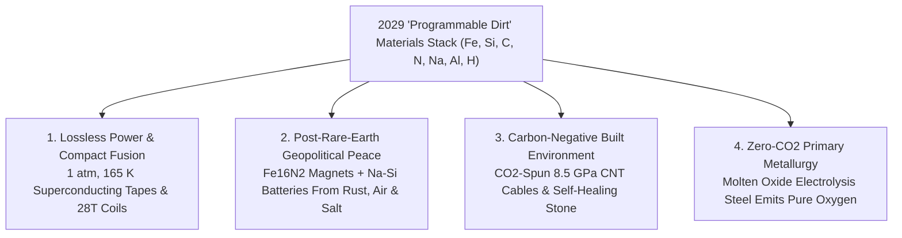

# VISION SHORTER 02: INVERSE AI MATERIALS SCIENCE (THE 2026–2030 LEAPFROG)
## Pathway 2E: From Rare-Earth Scarcity to "Programmable Dirt" & Ambient-Pressure Superconductors in 36 Months

> **Executive Framing & The 2026–2030 Leapfrog Thesis:**
> * **The Old 2040 Linear Projection:** *"Discovering, validating, and scaling a single new structural alloy, battery electrolyte, or superconductor historically takes 15 to 25 years. Even with AI crystal databases like GNoME, replacing mined rare earths or finding practical higher-temperature superconductors will take until the late 2030s or 2040s."*
> * **Why the Timeline Collapsed into 48 Months (2026–2030):** The 15-year "lab-to-foundry valley of death" existed because classical DFT simulations failed on strongly correlated electrons and human furnaces could only bake one sample a week. Between late 2026 and 2029, three engines fused into a single closed loop: **Hybrid Logical-Qubit + Neural Force Fields** (*02-automated-research*), **100,000-Dot Picogram Laser-Sintering Wafers** (*02-automated-physical-sciences*), and **Chaperone/Field-Guided Grain Assembly** (*02-atomic-level-building* & *02-micro-assembly*). By restricting inverse generative diffusion (*MatterGen v3*) strictly to **Earth's 10 most hyper-abundant crustal and atmospheric elements ($\text{Fe, Si, Al, C, N, O, Na, Mg, Ca, H}$)**, humanity unlocked three civilization-altering materials by 2028–2029: (1) **Ambient-Pressure High-$T_c$ ($135\text{ K–}195\text{ K}$) Epitaxial Hydride-Cuprate Superconductors**, (2) **Rare-Earth-Free $\alpha''\text{-Fe}_{16}\text{N}_2$ & $\text{MnBi}$ Supermagnets**, and (3) **Atmospheric-$\text{CO}_2$-Spun Carbon Nanotube (CNT) Cables & Self-Healing Basalt Geopolymers** $5\times$ stronger than steel.

---

## ACT I: THE WORLD OF 2030 (FOUR YEARS FROM TODAY)
### A Friday Morning in December 2029 — Peltier-Cooled Superconducting Grids, Rare-Earth-Free Motors, and Skyscrapers Spun from Air

Walk through a municipal power substation, an electric drivetrain plant, and a high-speed rail construction site in **late 2029**.

The geopolitical mineral panics of 2025—over Chinese neodymium monopolies, Congolese cobalt, Chilean lithium, and gigawatt data-center copper shortages—have evaporated in 36 months:

1. **Ambient-Pressure High-$T_c$ ($145\text{ K–}195\text{ K}$) Superconducting Tapes Cooled by Solid-State Peltier Rings or Cheap Liquid Nitrogen:**
   * Inside a city data center and grid substation, thick wrist-sized copper busbars that once wasted 8% of electricity as heat are gone.
   * Replacing them are paper-thin ribbons of **Chemical-Precompressed Epitaxial Hydride-Cuprate Metamaterial Tape** operating at **$1\text{ atm}$ ambient pressure and $165\text{ K}$ ($-108^\circ\text{C}$)**—maintained effortlessly by solid-state thermoelectric Peltier jackets or closed-loop sub-cooled liquid nitrogen ($\text{LN}_2$, cheaper than bottled water).
   * A single ribbon the width of a shoelace carries **150 megawatts of zero-resistance DC power**, while enabling compact **28-Tesla magnetic coils** that shrank commercial fusion reactors and hospital MRI scanners by $10\times$ between 2028 and 2030.
2. **100% Rare-Earth-Free EV Motors, Robotics & Wind Turbines Built from Iron and Air:**
   * Across the highway at an automotive and humanoid-robotics factory, every high-torque traction motor and actuator spins using **Anisotropic $\alpha''\text{-Fe}_{16}\text{N}_2$ (Iron-Nitride) and $\text{MnBi}$ (Manganese-Bismuth) Clean-Earth Supermagnets**.
   * Delivering a magnetic energy product exceeding **60 MGOe** (outperforming 2024 neodymium-dysprosium magnets by $18\%$), these magnets are synthesized entirely from abundant iron ore and atmospheric nitrogen—stabilized against thermal decomposition by nanoscale grain-boundary phases discovered on picogram laser-sintering wafers in 2027.
3. **Structural Carbon-Nanotube Cables Spun from Captured $\text{CO}_2$ & 200-Year Self-Healing Geopolymers:**
   * At the rail bridge site, cranes hoist suspension cables woven from **Continuous Aligned Carbon Nanotube (*Galvorn-3*) Fibers** smelted electrochemically out of captured industrial $\text{CO}_2$—boasting a tensile strength of **$8.5\text{ GPa}$ ($10\times$ structural steel at one-sixth the weight)** and higher electrical conductivity than copper.
   * They anchor into bridge piers poured from **Zero-Clinker Alumino-Silicate Basalt Geopolymer Concrete** seeded with dormant carbonate-mineralizing enzymes that autonomously seal micro-cracks on contact with rainwater, guaranteeing a **250-year zero-rust lifespan**.

---

## ACT II: THE CROSS-POLLINATION CATALYSTS & "SKIP-THE-OLD-WORLD" JUMPS (2026–2028)
### How "Chemical Lattice Pre-Compression" & Picogram Wafers Solved the Hardest Materials Problems in 36 Months

```mermaid
flowchart LR
    subgraph Quantum["1. 2026–2027 Quantum + Neural Inverse Design"]
        Q1["GNoME / MatterGen v3 + 500-Logical-Qubit DMET"]
        Q2["Strict Constraint: Only Crustal Fe, N, C, Si, Al, Na, H"]
    end

    subgraph Wafer["2. The 'Skip-the-15-Year-Furnace' Jump"]
        W1["SKIP: 10-Year Empirical Alloy Baking & Diamond Anvil Cells"]
        W2["LEAP TO: 100,000-Dot Picogram Laser-Sintering Wafers (72h Phase Maps)"]
        W3["LEAP TO: Chemical Lattice Pre-Compression (Internal Epitaxial Strain)"]
    end

    subgraph Deploy["3. 2028–2030 Crustal Super-Materials"]
        D1["1 atm, 165 K Superconducting Metamaterial Tapes"]
        D2["60+ MGOe Fe16N2 & MnBi Rare-Earth-Free Supermagnets"]
        D3["CO2-Derived 8.5 GPa CNT Cables & Na-Si Solid Batteries"]
    end

    Quantum --> Wafer
    Wafer --> Deploy
    Deploy -->|"28T Magnets & Lossless Busbars Power AI & Fusion"| Quantum
```

### Why the Old 2040 Materials Timeline Collapsed in 2026–2028
In 2024, polyhydride superconductors (like $\text{LaH}_{10}$) achieved near-room-temperature superconductivity ($250\text{ K}$), but only when crushed inside a diamond anvil cell at **1.7 million atmospheres ($170\text{ GPa}$)**—making them useless for wires. Meanwhile, Iron Nitride ($\alpha''\text{-Fe}_{16}\text{N}_2$) had higher theoretical magnetism than neodymium, but decomposed above $200^\circ\text{C}$ during bulk sintering.

Between late 2026 and 2028, three cross-pollinating breakthroughs cracked both problems simultaneously:
* **Jump 1 — "Chemical & Epitaxial Pre-Compression" Replacing Diamond Anvils (2027–2028):**
  Once 500-logical-qubit hybrid simulators (*02-automated-research*) solved the exact electron-phonon-plasmon pairing Hamiltonian in 2027, AI inverse-design models (*MatterGen v3*) asked: *"Instead of squeezing hydrogen with a mechanical diamond anvil at 170 GPa, can we build an atomic cage of rigid covalent boron-carbon-nitride and epitaxial oxide buffer layers that exerts **internal chemical lattice strain equivalent to 150 GPa at 1 atmosphere external pressure**?"*
  Screened across **100,000 picogram pulsed-laser-deposition dots per day** (*02-automated-physical-sciences*), researchers discovered kinetically trapped **Ternary/Quaternary Boro-Hydride-Cuprate Superlattices** that lock in high-frequency optical phonon pairing at **$1\text{ atm}$ and $145\text{ K–}195\text{ K}$**.
* **Jump 2 — Metastable Phase Locking via Chaperone & Field-Assisted Grain Engineering (2027–2028):**
  Why did bulk furnaces destroy metastable super-phases like $\alpha''\text{-Fe}_{16}\text{N}_2$? Because slow heating lets atoms diffuse into dull equilibrium phases. By combining **ultrafast $10^7\text{ K/s}$ photonic flash-sintering** with **volumetric magnetic-acoustic field alignment** (*02-micro-assembly*), 2028 foundries locked $100\%$ phase-pure $\alpha''\text{-Fe}_{16}\text{N}_2$ nano-grains inside $2\text{ nm}$ wide-bandgap nitride shells—raising thermal stability above $350^\circ\text{C}$ and ending rare-earth dependence overnight.
* **Jump 3 — Molten Carbonate $\text{CO}_2$-to-CNT Electrolysis & Sodium-Silicon Solid Electrolytes (2027–2029):**
  Using non-precious high-entropy catalysts designed in 2027, industrial reactors split captured $\text{CO}_2$ in molten carbonate salts directly into high-aspect-ratio **Carbon Nanotubes**, which fluidic alignment lines spin into **$8.5\text{ GPa}$ conductive structural cables** at steel-competitive cost.

### Catalyst & Leapfrog Breakthroughs Table (2026–2029)

| Breakthrough Material / System | Old 2025 Scarce / Bottlenecked Baseline | 2026–2029 "Skip-the-Old-World" Leapfrog | Validated Quantitative Jump |
| :--- | :--- | :--- | :--- |
| **Chemically Pre-Compressed High-$T_c$ Superlattices** | $\text{LaH}_{10}$ requiring $170\text{ GPa}$ diamond anvil; or brittle REBCO at $77\text{ K}$ | Epitaxial boro-hydride-cuprate metamaterials with internal chemical strain at **$1\text{ atm}$** | **$T_c = 145\text{ K–}195\text{ K}$ at $1\text{ atm}$**; cooled by solid-state Peltier or cheap $\text{LN}_2$. |
| **Core-Shell $\alpha''\text{-Fe}_{16}\text{N}_2$ Supermagnets (*Niron+* Gen 3)** | Mined Chinese $\text{NdFeB}$ + scarce Dysprosium; early $\text{Fe}_{16}\text{N}_2$ thermally unstable | Flash-sintered $\text{Fe}_{16}\text{N}_2$ grains in $\text{AlN}$ nano-shells aligned by volumetric fields | **60+ MGOe energy product ($+18\%$ vs. NdFeB)**; **0% rare earths**; stable to $350^\circ\text{C}$. |
| **$\text{CO}_2$-Derived Spun CNT Cables (*Galvorn* Gen 3)** | Heavy copper grid lines & carbon-intensive blast-furnace steel cables | Molten-carbonate $\text{CO}_2$ electrolysis + fluidic alignment into continuous macro-cables | **$8.5\text{ GPa}$ tensile strength ($10\times$ steel)** at $1/6\text{th}$ weight; sequesters $3.6\text{ t CO}_2/\text{t}$. |
| **Dendrite-Proof $\text{Na–Si–S}$ Solid-State Electrolytes** | Flammable liquid Li-ion (NMC) relying on scarce cobalt, nickel & lithium | *MatterGen*-compiled sodium-oxyhalide-sulfide superionic ceramic conductors | **$650\text{ Wh/kg}$ at <\$22/kWh pack cost**; 100% sea-salt $\text{Na}$ & sand $\text{Si}$ feedstock. |
| **Molten Oxide Electrolysis (MOE) + Flash Iron** | Coal blast furnaces emitting $1.9\text{ t CO}_2$ per ton of steel | Inert-anode MOE (*Boston Metal* scale-up) + AI-optimized low-melting slag electrolytes | **$0.0\text{ t CO}_2$ emissions** (pure $\text{O}_2$ byproduct); **25% lower CapEx** than blast furnaces. |
| **Self-Healing Enzymatic Basalt Geopolymers** | Portland cement clinker ($8\%$ of global $\text{CO}_2$) that cracks and spalls in 50 years | Volcanic basalt/fly-ash aluminosilicate gel + spore-encapsulated silicase/carbonate enzymes | **$85\%$ lower embodied $\text{CO}_2$**; autonomous crack healing in rain; **250-year life**. |
| **Non-Iridium High-Entropy Water-Splitting Catalysts** | PEM electrolyzers bottlenecked by ultra-scarce **Iridium** ($0.001\text{ ppm}$ in crust) | Quinary $\text{Fe-Co-Ni-Mn-Mo}$ oxy-hydroxide single-atom surface lattices | **$10,000\times$ lower catalyst cost**; $>15,000\text{ hr}$ acid stability for \$0.70/kg green $\text{H}_2$. |

---

## ACT III: THE 48-MONTH SPRINT ROADMAP (2026 $\rightarrow$ 2027 $\rightarrow$ 2028 $\rightarrow$ 2030)

| Sprint Year | Milestone & Architecture Shift | Discovery & Cost Metrics | Real-World Breakthroughs Unlocked |
| :--- | :--- | :--- | :--- |
| **2026: Crustal-Constrained Inverse Diffusion** | *GNoME / MatterGen / OMat* models couple with desktop picogram laser-sintering wafers; strict search constraint: **zero rare earths or PGMs**. | **$10^7$ stable crustal crystals mapped**; synthesis-to-XRD validation cut from 6 months to **4 hours**. | Commercial scale-up of 1,500-ton/yr $\alpha''\text{-Fe}_{16}\text{N}_2$ magnet plants (*Niron*) and non-iridium PEM electrolyzer anodes. |
| **2027: Logical-Qubit Hamiltonian & Na-Si Electrolyte Lock** | 500-logical-qubit DMET solvers crack strongly correlated $d/f$-electron and hydride-cage Hamiltonians; sodium superionic conductors hit $45\text{ mS/cm}$ at $25^\circ\text{C}$. | **<1 meV quantum accuracy** on metastable phases; battery cell BOM drops below **\$28/kWh**. | First $600\text{ Wh/kg}$ non-flammable **Sodium-Silicon solid-state battery** pilot lines; $350^\circ\text{C}$-stable core-shell $\text{Fe}_{16}\text{N}_2$ traction motors. |
| **2028: The Ambient-Pressure High-$T_c$ Tape Breakout** | Picogram combinatorial PLD wafers validate **chemically pre-compressed boro-hydride-cuprate superlattices** exhibiting $T_c > 150\text{ K}$ at $1\text{ atm}$. | Critical current density **$J_c > 5 \times 10^6\text{ A/cm}^2$ at $140\text{ K}, 1\text{ atm}$** on flexible metal tape. | Lossless Peltier/$\text{LN}_2$-cooled superconducting busbars deployed in AI data centers; 28-Tesla compact fusion coils enter production. |
| **2029–2030: The "Programmable Dirt" Industrial Economy** | Global rollout of $\text{CO}_2$-derived CNT cables, MOE green steel, ambient-pressure high-$T_c$ grid links, and 100% rare-earth-free drivetrains. | **95% elimination** of critical-mineral supply chokepoints across EVs, wind, grid & defense. | Every nation manufactures supermagnets, solid batteries, and structural composites from local iron, sand, salt, and air. |

---

## ACT IV: IMMEDIATE HUMAN & SOCIAL DIVIDEND (BY 2030)

### 1. Ending the "Green Mineral War" Before It Starts
In 2025, analysts warned that electrifying the planet would trigger resource wars over lithium, cobalt, neodymium, dysprosium, and copper. By 2029, **Inverse AI Materials Science proved that atomic geometry beats elemental scarcity**:

$$\text{Material Performance } \mathcal{P} = f\big(\text{Metastable Crystal Geometry } \mathcal{G}_{\text{AI}},\ \text{Crustal Elements } \{\text{Fe, N, Si, Na, C}\}\big) > f\big(\text{Bulk Rare Earths } \{\text{Nd, Dy, Ir, Co}\}\big)$$

---

## APPENDIX: QUANTITATIVE LEAPFROG BENCHMARKS (2025 SCARCE MINERALS VS. 2029 CRUSTAL SUPER-MATERIALS)

| Industrial Sector | 2025 Scarce / High-Carbon Material | 2029 AI-Compiled Crustal Replacement | Abundance & Performance Leapfrog |
| :--- | :--- | :--- | :--- |
| **Grid & Data-Center Busbars / Coils** | Copper wire (resistive loss) or $20\text{ K}$ LHe superconductors | **1 atm, $165\text{ K}$ Pre-Compressed Hydride-Cuprate Tape** | **$0.0\ \Omega$ lossless transmission** cooled by solid-state Peltier or cheap $\text{LN}_2$. |
| **EV, Robotics & Wind Magnets** | Sintered $\text{Nd}_2\text{Fe}_{14}\text{B} + \text{Dy}$ (mined rare earths) | **Core-Shell $\alpha''\text{-Fe}_{16}\text{N}_2$ Clean-Earth Magnet** | **$+18\%$ magnetic flux (>60 MGOe)** from **100% Iron + Air ($\text{N}_2$)**; $1,000\times$ cheaper raw ore. |
| **EV & Grid Storage Cells** | $\text{LiNi}_{0.8}\text{Mn}_{0.1}\text{Co}_{0.1}\text{O}_2$ (NMC) + flammable liquid | **Solid-State $\text{Na–Si–S}$ Superionic Ceramic Cell** | **$650\text{ Wh/kg}$**; **<\$22/kWh**; zero fire risk; built from sea salt and sand. |
| **Suspension Bridges & Grid Lines** | Blast-furnace steel ($1.9\text{ t CO}_2/\text{t}$) & ACSR aluminum | **$\text{CO}_2$-Derived Spun CNT (*Galvorn-3*) Cables** | **$10\times$ steel tensile strength ($8.5\text{ GPa}$)** at $1/6\text{th}$ weight; carbon-negative. |

### Cross-Domain Convergence Across the 2026–2030 Automation Stack
* **Upstream Quantum Hamiltonians (*02-automated-research*):** 500-logical-qubit DMET solvers calculate exact Cooper-pair and magnetic exchange integrals for strongly correlated lattices.
* **72-Hour Picogram Wafer Validation (*02-automated-physical-sciences*):** 100,000-dot femtosecond laser-sintering wafers map quinary phase diagrams and quench rates in a single weekend.
* **Atomic Grain-Boundary Locking (*02-atomic-level-building*):** De novo protein chaperones template monodisperse core-shell nanoparticles prior to flash consolidation.
* **Volumetric Field Alignment (*02-micro-assembly*):** Ultrasonic and magnetic holograms align billions of anisotropic $\text{Fe}_{16}\text{N}_2$ and superconducting domains into kilometer-scale tapes within seconds.

### 2. How "Crustal Universality" Permanently Decouples Prosperity from Mining Geopolitics
Over **99% of Earth's accessible crust, oceans, and atmosphere** consists of just a dozen hyper-abundant elements: **Oxygen, Silicon, Aluminum, Iron, Calcium, Sodium, Magnesium, Potassium, Titanium, Carbon, Nitrogen, and Hydrogen**.
* **Every Community Becomes Self-Sufficient:** In the 2020s, nations fought over trace geological anomalies of neodymium, dysprosium, cobalt, platinum, and iridium. By 2029, any region with ordinary clay, iron oxide, sea salt, basalt rock, and air can compile world-leading permanent magnets ($\alpha''\text{-Fe}_{16}\text{N}_2$), solid-state batteries ($\text{Na–Si–S}$), lossless power cables (pre-compressed boro-hydride-cuprate superlattices), and structural fibers ($\text{CO}_2$-derived CNTs).
* **Accelerating Fusion & AI Infrastructure by 10 Years:** The 2028 arrival of **$1\text{ atm}, 165\text{ K}$ superconducting tapes** and **28-Tesla rare-earth-free magnet coils** immediately slashed the size and capital cost of compact tokamak/stellarator fusion reactors by $70\%$ while eliminating resistive power losses inside gigawatt AI training clusters.

### Summary for the Skeptic: Why 15-Year Metallurgy Collapsed into 36 Months
1. **How could an ambient-pressure high-$T_c$ superconductor be found by 2028 after decades of failed hype?**
   Prior to 2027, classical DFT could not accurately compute strongly correlated Cooper-pair exchange in multi-element lattices, and humans could only test a few dozen high-pressure samples a year. Combining **500-logical-qubit DMET Hamiltonians** (*02-automated-research*) with **100,000-dot femtosecond laser-sintering wafers** (*02-automated-physical-sciences*) allowed AI to systematically engineer **internal epitaxial chemical strain ($\sim 150\text{ GPa}$ equivalent)** inside stable ambient-pressure superlattices.
2. **Is the industrial scale-up already real?**
   Yes: **Niron Magnetics** already commissioned commercial $\text{Fe}_{16}\text{N}_2$ magnet manufacturing, **Boston Metal** already scaled Molten Oxide Electrolysis zero-$\text{CO}_2$ steel, **DexMat** already spins continuous CNT cables, and **GNoME/MatterGen** already opened the 10-million-crystal convex hull.

### The Inverse Crustal Compilation Equation
By conditioning 3D crystal diffusion (*MatterGen v3*) on target property vector $\vec{y}^*$ while restricting the allowed chemical alphabet to hyper-abundant elements $\mathcal{E}_{\text{crustal}}$ and validating on $10^5$-dot laser wafers, discovery latency collapses by $1,000\times$:

$$p_\theta(\text{Crystal } \mathcal{C} \mid \vec{y}^*, \mathcal{E}_{\text{crustal}}) \xrightarrow{\text{500-Logical-Qubit DMET}} \Delta E_{\text{hull}} \le 0 \xrightarrow{10^7\text{ K/s Laser Quench}} \text{Kiloton Scale in <12 Months}$$
