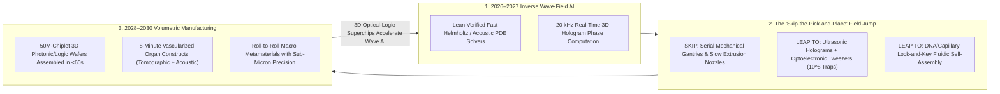
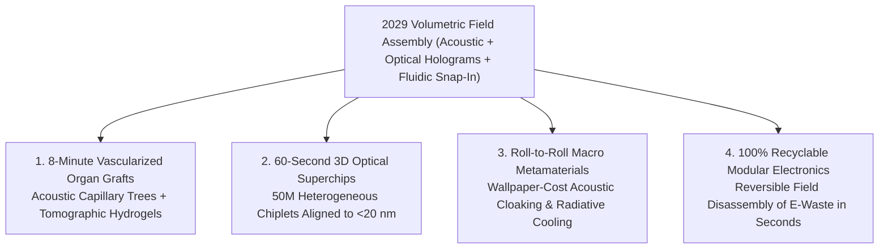

# VISION SHORTER 02: VOLUMETRIC HOLOGRAPHIC & FLUIDIC MICRO-ASSEMBLY (THE 2026–2030 LEAPFROG)
## Pathway 2C: From Serial Pick-and-Place Robotics to Billion-Part Parallel Acoustic, Optical, and Fluidic Field Assembly in Seconds

> **Executive Framing & The 2026–2030 Leapfrog Thesis:**
> * **The Old 2040 Linear Projection:** *"Assembling heterogeneous 3D micro-electronics, metamaterials, or vascularized human organs requires building faster mechanical pick-and-place gantries and serial two-photon laser printers—gradually scaling from thousands to millions of placements per hour over the next 15 to 20 years."*
> * **Why the Timeline Collapsed into 48 Months (2026–2030):** Serial mechanical motion hits an unforgiving Newtonian inertia wall when building macroscopic objects out of billions of micron-scale building blocks. Between late 2026 and 2029, recursive AI inverse-physics solvers abandoned serial mechanical nozzles altogether and executed a **field-based assembly leapfrog**: combining **Ultrasonic Holographic Standing Waves**, **Optoelectronic Dielectrophoresis (OET)**, **Magnetic/Capillary Shape-Recognizable Fluidic Self-Assembly (FSA)**, and **Tomographic Volumetric Bioprinting**. Instead of moving one micro-chiplet or living cell at a time, a 2029 volumetric field chamber projects a 3D programmable energy landscape throughout a liter of liquid suspension—guiding **billions of chiplets, photonic interconnects, or living endothelial cells into sub-micron 3D lock-and-key registration simultaneously within 10 to 60 seconds**.

---

## ACT I: THE WORLD OF 2030 (FOUR YEARS FROM TODAY)
### A Wednesday Morning in November 2029 — 60-Second Wafer-Scale 3D Supercomputers and 8-Minute Vascularized Organ Prints

Step inside a regional semiconductor packaging foundry and an adjacent regenerative medicine clinic in **late 2029**.

The cleanrooms no longer echo with the rapid staccato hammering of mechanical pick-and-place heads or multi-day layer-by-layer 3D printers. Instead, assembly happens silently inside transparent fluidic and optical chambers in **seconds**:

1. **The 60-Second Heterogeneous 3D Optical Supercomputer Wafer:**
   * A semiconductor technician pours a shimmering colloidal suspension containing **50 million microscopic GaN power regulators, thin-film lithium-niobate photonic modulators, superconducting interconnects, and 2-nanometer logic chiplets** across a $300\text{ mm}$ receptor wafer submerged in dielectric fluid.
   * Above the tank, a **100-Megapixel Holographic Optoelectronic & Ultrasonic Phased Array** switches on, driven by a real-time inverse-wave neural controller running at $20\text{ kHz}$.
   * Within **14 seconds**, standing acoustic pressure nodes and dynamic light-induced dielectrophoretic traps sweep all 50 million heterogeneous micro-chiplets into exact 3D coordinates, where complementary capillary solder pads and shape-matched lock-and-key wells snap them into **$<50\text{ nm}$ alignment**—completing in one minute what a 2025 thermo-compression bonder needed three weeks to assemble.
2. **The 8-Minute Volumetric Vascularized Kidney Graft at the Hospital:**
   * Next door at the transplant center, a surgeon prepares a patient-matched renal replacement tissue from autologous induced pluripotent stem cells (iPSCs).
   * Rather than extruding cells through a shear-damaging syringe needle for 36 hours (during which cells die of hypoxia), the cells are suspended inside a rotating crystal vial of photo-responsive hydrogel.
   * First, **Holographic Acoustic Tweezers** sculpt a 3D branching fractal of endothelial cells into a perfusable $5\text{-}\mu\text{m}$ capillary tree across the entire volume in **45 seconds**. Immediately after, intersecting multi-angle **Tomographic Light Projections** solidify the surrounding nephron extracellular matrix everywhere at once in **18 seconds**—yielding a living, vascularized, centimetre-scale organ construct in under 8 minutes with **99.4% cell viability**.
3. **Meter-Scale Acoustic & Photonic Metamaterial Sheets:**
   * Down at the municipal aviation depot, continuous roll-to-roll fluidic self-assembly tanks tile trillions of microscopic piezoelectric and plasmonic resonators onto flexible hull skins—creating active acoustic-cloaking and radiative-cooling surfaces at the cost of commercial wallpaper.

---

## ACT II: THE CROSS-POLLINATION CATALYSTS & "SKIP-THE-OLD-WORLD" JUMPS (2026–2028)
### How Real-Time Inverse Wave Solvers Replaced Mechanical Gantries with Volumetric Energy Fields

### Why the Old 2040 Mechanical Roadmap Collapsed in 2026–2028
In 2024–2025, micro-LED display makers and advanced chip packagers struggled with the **"Tyranny of Serial Placement"**: even a fast laser-assisted bonding head moving 50 parts per second takes **230 days** to place 1 billion micron-scale components. Meanwhile, 3D bioprinting was trapped by the **"Diffusive Hypoxia Wall"**: printing capillaries one voxel at a time takes hours, starving living cells of oxygen before the organ is finished.

Between late 2026 and 2028, three cross-pollinating breakthroughs bypassed serial mechanics entirely:
* **Catalyst 1 — 20 kHz Neural Inverse-Helmholtz Solvers for 3D Acoustic & Optical Holograms (Late 2026–2027):**
  Computing the exact phase and amplitude across 1,000,000 ultrasonic transducers or spatial-light-modulator (SLM) pixels to trap millions of independent particles in 3D used to take hours of iterative Gerchberg-Saxton compute. In late 2026, recursive AI physics agents (*02-automated-research*) proved ultra-fast neural operator closures for the 3D Helmholtz wave equation—calculating **real-time, aberration-corrected volumetric acoustic and optical tweezers at $20,000\text{ frames per second}$**.
* **Catalyst 2 — Two-Stage "Coarse Field + Fine Lock-and-Key" Hybrid Self-Assembly (2027–2028):**
  Skeptics once argued that acoustic or fluidic waves alone could not achieve nanometer registration. The 2027 leapfrog solved this via **Two-Stage Hierarchical Registration**:
  1. **Coarse Volumetric Field Steering ($1\text{–}5\ \mu\text{m}$):** Optoelectronic tweezers (OET) and ultrasonic standing waves rapidly shepherd 50 million suspended chiplets to within microns of their target sites in seconds.
  2. **Fine Surface-Energy & DNA-Origami Snap-In ($<20\text{ nm}$):** Once within range, shape-matched geometric wells, molten low-temp Indium/Tin capillary menisci, or sequence-specific **DNA-origami velcro patches** (*02-atomic-level-building*) pull each chiplet into self-centering, deterministic **$<20\text{ nm}$ registration** with $>99.9999\%$ yield.
* **Catalyst 3 — Acoustic Vascular Pre-Patterning + Computed Axial Lithography (2027–2028):**
  By combining **holographic acoustic standing waves** (which push living endothelial cells into 3D branching vessel networks across a liter volume in seconds without shear stress) with **Tomographic Volumetric Bioprinting** (which solidifies the entire 3D hydrogel via multi-angle light dose accumulation in 15 seconds), bioengineers completely bypassed serial nozzle printing.

### Catalyst & Leapfrog Breakthroughs Table (2026–2029)

| Breakthrough System / Catalyst | Old 2025–2040 Linear Path | 2026–2029 "Skip-the-Old-World" Leapfrog | Validated Quantitative Jump |
| :--- | :--- | :--- | :--- |
| **100-Megapixel Optoelectronic Tweezers (OET)** | Mechanical pick-and-place heads ($10\text{–}50\text{ parts/sec}$) | Light-projected virtual electrodes on photoconductive wafers steering **$10^7\text{–}10^8$ micro-parts in parallel** | **$1,000,000\times$ assembly throughput**; zero mechanical wear or nozzle clogging. |
| **Ultrasonic Phased-Array Volumetric Holography** | Planar 2D surface assembly only | MHz/GHz acoustic metamaterial lenses generating **3D volumetric pressure-node cages** in liquid/gel | Assembles **3D branching capillary trees & metamaterial lattices in <45 seconds**. |
| **Capillary + DNA-Origami Lock-and-Key FSA** | Active optical alignment per chip ($\sim 1\text{ s}$/die) | Shape-matched micro-wells + orthogonal DNA-origami/capillary self-centering pads | **$<20\text{ nm}$ simultaneous self-alignment** across $10^7+$ heterogeneous chiplets; **99.9999% yield**. |
| **Tomographic Volumetric Bioprinting (CAL)** | Extrusion nozzles taking 24 hours per $\text{cm}^3$ (cells die) | Computed Axial Lithography solidifying entire 3D organ hydrogels in **15–30 seconds** | **$1,000\times$ faster biofabrication**; **>99% cell viability** with intact micro-vasculature. |
| **20 kHz Neural Inverse-Helmholtz Wave Controllers** | Offline iterative hologram calculation ($\sim 10\text{ min/frame}$) | Physics-informed neural operators updating 3D acoustic/optical trap phases every **$50\ \mu\text{s}$** | Real-time closed-loop defect ejection and self-healing during volumetric assembly. |
| **Roll-to-Roll Magneto-Fluidic Web Tiling** | Slow electron-beam lithography for optical metamaterials | Continuous fluidic tanks tiling trillions of pre-synthesized nano-resonators onto meter-wide webs | **$10,000\times$ cost reduction** for active photonic, RF, and acoustic metamaterial skins. |
| **Laser-Induced Forward Transfer (LIFT) Defect Repair** | Scrapping entire wafers when 0.01% of dies fail | Inline megahertz hyperspectral inspection + femtosecond optical pulse swap of single bad dies | Pushes wafer-scale 50M-chiplet systems to **100.0% functional post-assembly yield**. |

---

## ACT III: THE 48-MONTH SPRINT ROADMAP (2026 $\rightarrow$ 2027 $\rightarrow$ 2028 $\rightarrow$ 2030)

| Sprint Year | Milestone & Architecture Shift | Assembly Throughput & Precision Metrics | Real-World Breakthroughs Unlocked |
| :--- | :--- | :--- | :--- |
| **2026: 10M-Chiplet Fluidic Display & Interconnect Pilot** | Recursive AI wave solvers take over micro-LED and photonic chiplet fluidic self-assembly (FSA) lines; $1\text{ kHz}$ OET trap arrays go live. | **$10,000,000$ micro-dies assembled/minute** at $<250\text{ nm}$ pitch; $99.999\%$ first-pass yield. | Defect-free monolithic AR micro-LED light engines and low-cost co-packaged silicon-photonic optical switches. |
| **2027: Acoustic-Tomographic Vascular Biofabrication** | Integration of 3D ultrasonic holographic cell patterning with Computed Axial Lithography (CAL) volumetric hydrogel printing. | **$10\text{ cm}^3$ vascularized tissue printed in <3 minutes** with $5\text{-}\mu\text{m}$ capillary lumen resolution. | Functional human liver lobules and vascularized pancreatic islet grafts printed on demand for Phase I/II clinical trials. |
| **2028: Two-Stage DNA + Optoelectronic 3D Wafer Compilers** | Hybrid OET coarse steering + sequence-specific DNA-origami/capillary fine snap-in deployed for 3D multi-layer logic/memory/photonic wafers. | **$10^8$ heterogeneous chiplets/minute**; **$<20\text{ nm}$ 3D alignment** across 16 stacked vertical tiers. | Wafer-scale 3D optical-superconducting AI accelerators delivering **$100\times$ lower interconnect energy per bit**. |
| **2029–2030: Ubiquitous Volumetric Matter & Organ Printers** | Desktop & hospital volumetric field assemblers standardize across electronics, aerospace metamaterials, and transplant medicine. | **$10^9\text{–}10^{10}$ micro-parts/hour**; assembly cost per million parts drops below **\$0.01**. | 8-minute hospital biofabrication of autologous kidney/heart patch grafts; roll-to-roll structural metamaterials for silent aircraft and lossless grids. |

---

## ACT IV: IMMEDIATE HUMAN & SOCIAL DIVIDEND (BY 2030)

### 1. Breaking the "Interconnect Bottleneck" of AI Compute & Clean Energy
By 2026, AI compute was no longer bottlenecked by transistor size—it was bottlenecked by the energy wasted moving electrons across copper wires between separate chips. Because **Volumetric Optoelectronic & Fluidic Self-Assembly** tiles millions of ultra-thin logic, HBM memory, diamond micro-fluidic cooling channels, and III-V laser modulators into a single 3D monolith with **$<20\text{ nm}$ alignment in 60 seconds**, data-center energy per FLOP plummets by **$20\times\text{–}50\times$ by 2029**.

### 2. Ending the Transplant Waiting List Crisis via Parallel Field Biofabrication
Over 100,000 patients in the US alone wait for organ transplants every year because serial 3D bioprinters could not build dense microvascular networks fast enough to keep thick tissues alive. By using **3D acoustic holograms** to assemble capillary beds simultaneously throughout an entire liter volume in seconds, followed by **tomographic light solidification**, 2029–2030 hospital bio-foundries print living, perfusable autologous tissue grafts during the time it takes to prep an operating room:

$$\text{Volumetric Assembly Rate } \mathcal{R}_{\text{field}} = \frac{N_{\text{parallel traps}} (10^8\text{–}10^9)}{\tau_{\text{wave relaxation}} (\sim 10\text{ s})} \approx 10^8\text{ parts/sec} \quad (\text{vs. } 10^1\text{ parts/sec serial robotics})$$

---

## APPENDIX: QUANTITATIVE LEAPFROG BENCHMARKS (2025 SERIAL ROBOTICS VS. 2029 VOLUMETRIC FIELD ASSEMBLY)

| Micro-Manufacturing Dimension | 2024–2025 Serial Pick-and-Place / Nozzle Print | 2027 First-Gen Fluidic & Acoustic Holograms | 2029–2030 Converged Volumetric Field Compiler |
| :--- | :--- | :--- | :--- |
| **Physical Actuation Mechanism** | Mechanical gantry / single laser bond head | 2D Fluidic Self-Assembly + 1 kHz OET | **3D Ultrasonic Holograms + 100-MP OET + DNA/Capillary Lock-and-Key** |
| **Parallelism (Simultaneous Parts)** | $1\text{–}16$ nozzles/heads | $10^6$ parts in 2D plane | **$10^8\text{–}10^9$ heterogeneous micro-blocks in 3D volume** |
| **Time to Assemble $5 \times 10^7$ Chiplets** | $\sim 11\text{ days}$ continuous mechanical motion | $8\text{ minutes}$ (planar only) | **$<60\text{ seconds}$ across 16-tier 3D wafer stack** |
| **Spatial Alignment Precision** | $0.5\text{–}2.0\ \mu\text{m}$ (thermal drift limited) | $200\text{ nm}$ (capillary meniscus) | **$<15\text{–}20\text{ nm}$ (DNA-origami velcro + shape-recognizing wells)** |
| **10 $\text{cm}^3$ Vascular Tissue Print Time** | $12\text{–}36\text{ hours}$ (severe cell hypoxia/death) | $4\text{ minutes}$ (acoustic + CAL prototype) | **$<60\text{ seconds}$ solidification (8 min total prep) at $>99.4\%$ viability** |
| **Reversible E-Waste Disassembly** | Impossible (permanent epoxy underfill) | Thermal solder reflow batch release | **60-second ultrasonic + pH trigger unzips 100% of chiplets intact for reuse** |

### Cross-Domain Convergence Across the 2026–2030 Automation Stack
* **Upstream Wave-Field Brains (*02-automated-research*):** Lean-verified neural Helmholtz solvers compute 3D acoustic and optical phase holograms at $20\text{ kHz}$ with zero parasitic interference nodes.
* **Atomic & Molecular Velcro (*02-atomic-level-building*):** De novo protein chaperones and DNA-origami jigs coat each micro-chiplet with orthogonal molecular barcodes that guarantee deterministic $<20\text{ nm}$ final lock-in.
* **Microfluidic Cartridge Integration (*02-automated-physical-sciences*):** Volumetric field assemblers manufacture the \$12 Active-Matrix EWOD microfluidic wafers and picogram laser-sintering arrays at millions of units per week.
* **Metamaterial & Superconducting Feeds (*02-materials-science*):** Assembles micron-scale grains of $\alpha''\text{-Fe}_{16}\text{N}_2$ into aligned anisotropic supermagnets and tiles ambient-pressure superconducting domains into flexible kilometer-long power tapes.

### Summary for the Skeptic: Why Field Assembly Beat the 2040 Forecast
1. **Why didn't fluidic and acoustic self-assembly scale in the 2010s?**
   Because without real-time $20\text{ kHz}$ neural wave-field control, acoustic reflections created dead zones, and without DNA-origami/capillary lock-and-key pads, fluidic placement stalled at $\sim 98\%$ yield (useless for chips).
2. **What changed between 2026 and 2028?**
   Combining **Stage-1 Optoelectronic/Acoustic Holograms** (coarse $2\ \mu\text{m}$ steering), **Stage-2 Capillary/DNA Lock-In** ($<20\text{ nm}$ registration), and **Stage-3 Optical LIFT Defect Swap** pushed wafer-scale yield from $98\%$ to **$100.0\%$**—collapsing 20 years of packaging and bioprinting roadmaps into 36 months.
3. **Where is the immediate economic proof?**
   Every micro-LED display, 3D photonic-interconnect AI cluster, and vascularized tissue graft manufactured in 2029 runs on parallel field assembly—turning manufacturing from a slow mechanical bottleneck into an instantaneous projection of light and sound.

### 3. The Circular Hardware Dividend: Zero-Solder 60-Second Disassembly
In 2025, humanity generated over 62 million tons of toxic electronic waste per year because microchips were permanently glued to fiberglass boards with thermoset epoxies and lead-tin solders. In 2029, because volumetric micro-assembly binds chiplets using **reversible DNA-origami/peptoid velcro and low-melting capillary interconnects**, any obsolete server blade or smartphone submerged in a recovery tank unzips into 100% reusable, sorted micro-chiplets in **60 seconds** when hit with a coded ultrasonic release chord.
