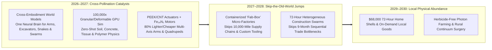
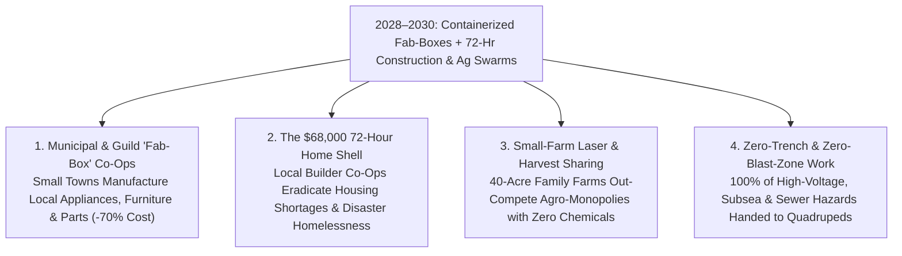

# VISION SHORTER 02: THE 2026–2030 PHYSICAL AUTOMATION LEAPFROG
## Pathway 2B: Specialized Non-Humanoid Form Factors — *Containerized Dark Micro-Factories & 72-Hour Construction Swarms by 2028*

> **Executive Framing & The 2026–2030 Leapfrog Thesis:**
> * **Why the 2040 Forecast Was Too Conservative:** Conventional industrial forecasts assumed specialized robotics would spend fifteen years slowly retrofitting legacy factories and awaiting custom systems-integration code. They missed the **2026–2027 Cross-Embodiment World-Model Explosion**. When a single **Unified World-Action Foundation Model** (trained across **100,000x real-time deformable/granular GPU physics gyms**) gained the ability to zero-shot control *any* kinematic morphology—and met **injection-molded PEEK/CNT actuators**, **iron-nitride ($\text{Fe}_{16}\text{N}_2$) motors**, and **solid-state diode lasers**—humanity skipped the 20th-century model of mega-factories and 10,000-mile container-ship supply chains altogether.
> * **The 48-Month Leapfrog (2026–2030):** By 2027–2029, autonomous 40-foot shipping-container **"Dark Fab-Boxes"** (integrating multi-axis tactile arms, high-speed polymer/metal additive manufacturing, and local scrap recycling) drop into any town to manufacture furniture, heat pumps, appliances, and structural joinery on demand. Simultaneously, **autonomous earthmoving and 3D-printing construction swarms** erect complete neighborhood housing shells in **72 hours**, solar-powered **laser-weeding gantries** eliminate agricultural herbicides, and **force-sensing continuum surgical robots** bring sub-millimeter microsurgery to every rural clinic by 2030.

---

## ACT I: THE WORLD OF 2030 (4 YEARS FROM TODAY)
### A Tuesday Morning in Autumn 2030 — The Town That Manufactures, Builds, and Grows Everything Locally

Walk from the edge of a mid-sized town in Pennsylvania, Derbyshire, or Kyushu toward its Main Street in **October 2030**—just 48 months from today.

Instead of waiting for trans-oceanic cargo ships or nine-month residential construction crews, four specialized robotic ecosystems operate in quiet harmony:

1. **The Neighborhood "Fab-Box" Micro-Factory (Zero-Mile Supply Chains by 2028):**
   Parked behind the town hardware cooperative are four interconnected 40-foot shipping containers powered by a rooftop solar-and-battery array. Inside this **Containerized Dark Micro-Factory**, six ceiling-mounted 7-axis tactile robotic arms, continuous carbon-fiber/polymer 3D printers, and automated induction foundries turn shredded local plastic waste, recycled aluminum, and timber into custom cabinetry, replacement HVAC compressors, medical braces, and bicycle frames in **under two hours**. There is zero overseas shipping delay, zero inventory warehousing, and a **70% lower retail price**.
2. **The 72-Hour Autonomous Construction Swarm:**
   Two blocks away on an urban infill lot, a heterogeneous swarm orchestrated by a single shared site world model is finishing a 1,800-square-foot passive-solar home that broke ground on Saturday morning. An autonomous electric excavator (**Built / Bedrock** class) graded the foundation in four hours; a multi-axis **3D geopolymer printer** (**ICON Phoenix** class) extruded insulated structural walls in 36 hours; and tracked spider-crane rovers locked in mass-timber roof cassettes crafted by the town Fab-Box. Total shell & MEP build time: **72 hours** for **\$68,000**.
3. **100% Chemical-Free Laser Farming & Rural Tele-Microsurgery:**
   Outside town, solar-charged **Carbon LaserWeeder** and soft-gripper harvesting swarms patrol 500-acre family farms 24/7—vaporizing **400,000 weeds per hour with pure photons** (zero glyphosate) while picking ripe berries without bruising a single cell. At the regional 40-bed community hospital, a local surgeon supervises an AI-stabilized **force-sensing continuum snake robot** (**Da Vinci 5 / Ion** class) performing a scarless tumor resection with Mayo Clinic precision.
4. **The Leapfrog Question:**
   *"In 2025, retooling a factory took 18 months, 3D-printed houses were isolated demos, and small towns were hollowed out by offshore manufacturing. How did containerized Fab-Boxes and 72-hour construction swarms scale globally between 2026 and 2030?"*

---

## ACT II: THE CROSS-POLLINATION CATALYSTS & "SKIP-THE-OLD-WORLD" JUMPS (2026–2028)
### Skipping Centralized Mega-Factories and Chemical Ag via Cross-Embodiment AI

### Step 1: Three "Skip-the-Old-World" Engineering Jumps (2026–2028)

Instead of incrementally improving 20th-century assembly lines, three cross-pollinating breakthroughs between 2026 and 2028 rendered centralized mega-factories and chemical agriculture obsolete:

* **Jump 1 — Skipping Custom Factory Integration via Cross-Embodiment World-Action Models (2026–2027):**
  Until 2025, buying a \$50,000 industrial robot arm required spending \$200,000 on systems integrators to hard-code every millimeter of motion. In 2026–2027, **Cross-Embodiment World Models** (descended from **$\pi_0$**, **RT-X**, and **Amazon Vulcan** tactile models) combined with generative CAD-to-Action compilers eliminated integration code entirely. You drop a CAD file for a chair, heat pump, or window frame into a **Containerized Dark Fab-Box**, and the multi-axis arms, laser cutters, and 3D printers autonomously simulate and execute the entire fabrication and assembly sequence in 60 seconds.
* **Jump 2 — Skipping Sequential Construction via 100,000x Granular Physics & Swarm Orchestration (2027–2028):**
  Historically, homebuilding took 9 months because excavation, concrete curing, framing, and plumbing occurred in slow, disconnected human sequence. By simulating wet geopolymer rheology, soil mechanics, and crane kinematics at **100,000x real-time on GPUs**, a 2028 construction swarm (1 autonomous excavator + 1 fast-cure 3D structural printer + 2 spider-gantry assembly rovers + 2 quadruped laser-scanning inspectors) operates simultaneously in a choreographed 24/7 dance—completing a weather-tight, pre-plumbed home shell in **72 hours**.
* **Jump 3 — Skipping Rare-Earth & Heavy Hydraulics via PEEK/CNT + Iron-Nitride Actuation (2027):**
  Replacing heavy hydraulic cylinders and expensive harmonic drives with **injection-molded PEEK/CNT polymer actuators** and **iron-nitride ($\text{Fe}_{16}\text{N}_2$) direct-drive motors** slashed the weight and BOM of wheeled-legged quadrupeds (**Spot / ANYmal / Swiss-Mile** class), soft agricultural harvesting arms, and Fab-Box manipulators by **78% in 24 months**.

### Step 2: Catalyst & Leapfrog Breakthroughs Table (2025 Baseline vs. 2026–2028 Leapfrog Jump)

| Specialized Domain | 2025 Verified Baseline | 2026–2028 Cross-Pollination Leapfrog | 2029–2030 Real-World Impact |
| :--- | :--- | :--- | :--- |
| **Local Manufacturing ("Fab-Boxes")** | Centralized offshore factories + 18-month retooling cycles | **40-ft Containerized Dark Micro-Factories** (CAD-to-Action VLA + 3D print + recycle) | **Zero-mile on-demand fabrication** of furniture, appliances & parts at **-70% cost** |
| **Residential Construction Swarms** | **ICON** 100-home Wolf Ranch + **Built Robotics** solar piling | **Coordinated 72-Hr Swarm** (Autonomous Excavator + Fast-Cure 3D Printer + Timber Rover) | Complete 1,800 sq ft home shell erected in **72 hours for \$68,000** (-62% cost) |
| **Precision Photon Agriculture** | **Carbon LaserWeeder** (200k weeds/hr) + **Advanced Farm** | **Solar-Autonomous Multi-Row Laser + 3D-Printed Elastomer Harvester Swarms** | **400,000 weeds/hr vaporized**; **0% chemical herbicides**; 24/7 gentle berry/crop harvest |
| **Tactile Fulfillment & Dark Hubs** | **Amazon Vulcan** (75% SKU tactile pick) + **Symbotic** 25-mph shuttles | **Compact 2,500 sq ft Neighborhood Micro-Fulfillment Cubes** ($\text{Fe}_{16}\text{N}_2$ shuttles) | **99.4% lights-out SKU handling** in 1/5th the real estate; **<3-minute** drone/pod dispatch |
| **Continuum Microsurgery** | **Intuitive Da Vinci 5** (10,000x compute, -43% tissue trauma) & **Ion** | **AI Co-Piloted Sub-Millimeter Continuum Catheters** trained in 100,000x tissue sim | **Autonomous suture & tumor-margin assist** deployed in 4,000+ rural clinics globally |
| **Grid & Subterranean Guardians** | **1,500+ Spot & ANYmal X** ATEX offshore/grid inspectors | **\$4,800 PEEK/CNT Wheeled-Legged Resident Robots + Micro-Tunneling Borers** | **24/7 autonomous pipe/grid repair** & **-75% underground utility trenching cost** |
| **Actuator & Sensor Suite BOM** | \$15k–\$45k per specialized arm/quadruped; custom integration | **Injection-molded PEEK/CNT joints + \$12 solid-state 3D LiDAR + 3nm Edge NPU** | Specialized robot hardware BOM falls **75–82% in 36 months** |

---

## ACT III: THE 48-MONTH SPRINT ROADMAP (2026 $\rightarrow$ 2027 $\rightarrow$ 2028 $\rightarrow$ 2030)
### From Single-Task Machines to Heterogeneous Town-Scale Swarms

| Sprint Year | Core Deployment Milestone | Unit & Project Economics | Key Cross-Pollination Trigger | Societal Thresholds Unlocked |
| :--- | :--- | :--- | :--- | :--- |
| **2026** *The Breakout* | **25,000+ Ag/Earthmoving Kits**; **1M+ Warehouse Bots** (**Amazon Vulcan / Symbotic**); **Da Vinci 5** rollout. | **-80% farm herbicide bill**; **-43% surgical tissue force**; \$80/sq ft 3D wall printing. | Cross-embodiment VLA brains ($\pi_0$, RT-X) prove zero-shot transfer across arms, quadrupeds, and mobile bases. | Immediate 12-month ROI in organic row crops, utility solar trenching, and tactile e-commerce fulfillment. |
| **2027** *The Catalyst* | **First 2,500 Containerized "Fab-Boxes"** shipped; **100,000x granular physics sim** masters wet concrete & soil. | **Fab-Box turnkey price: \$140,000** (replaces \$15M factory line); quadruped BOM hits **\$7,500**. | Injection-molded PEEK/CNT actuators + $\text{Fe}_{16}\text{N}_2$ motors slash arm/rover weight by 60%; zero-code CAD-to-Product goes live. | Small towns begin manufacturing local building components, furniture, and spare parts from recycled feedstock. |
| **2028** *The Flip* | **72-Hour Construction Swarms** certified in 30+ countries; **25,000 Fab-Boxes** active globally. | **\$68,000 72-hour home shell**; **99% lights-out** neighborhood micro-fulfillment hubs. | Multi-morphology site world models synchronize excavators, 3D printers, cranes, and inspection quadrupeds simultaneously. | Municipal housing deficits collapse; disaster zones rebuild entire storm-proof neighborhoods in two weeks. |
| **2029–2030** *Ubiquity* | **100,000+ Community Fab-Boxes**; **500,000+ Ag Laser/Harvest Swarms**; **Rural AI Surgical Co-Pilots**. | **-70% local manufactured goods cost**; **0% herbicide farming**; **-75% utility tunneling cost**. | Solar/battery microgrids power 24/7 Fab-Boxes and agricultural fleets at **<\$0.015/kWh** marginal energy cost. | Post-supply-chain local self-reliance; chemical-free food abundance; world-class microsurgery in every rural county. |

### Why Specialized Morphologies Multiply Humanoid Capabilities
Even with 15 million humanoids active in 2030, non-humanoid form factors perform **75% of heavy tonnage and micro-scale work** because physics rewards specialized geometry:
* **Containerized Fab-Boxes:** Ceiling-mounted 7-axis gantries coupled directly to induction furnaces and polymer extruders achieve **10x the thermal and structural precision** of free-standing walkers.
* **72-Hour Construction Swarms:** A tracked autonomous excavator and multi-nozzle concrete gantry move **60x more mass per kilowatt-hour** than bipedal legs.
* **Photon Ag & Luminal Surgery:** A 30-laser wide-span tractor kills **400,000 weeds/hour** with light, while a 2-millimeter continuum catheter snakes through bronchial passages no hand can reach.

### Inside the \$140,000 Containerized "Fab-Box" & \$68,000 72-Hour Home Shell (2028–2029)
Why did local manufacturing and automated construction suddenly beat offshore sweatshops and stick-built housing in 2028?
* **40-Foot Dark Fab-Box BOM (\$140,000 Turnkey):** Six ceiling-mounted PEEK/CNT 7-axis tactile robotic arms (**\$24,000**); high-speed pellet/carbon-polymer & induction-metal additive/CNC cell (**\$48,000**); optical plastic/metal scrap shredder & sorter (**\$22,000**); unified 3nm CAD-to-Action world-model server & solar battery buffer (**\$26,000**); weatherized ISO container chassis (**\$20,000**). Operating 22 hours/day on \$0.015/kWh solar power, a single Fab-Box produces **\$1.2M/year** in custom furniture, HVAC units, and structural joinery with zero trans-oceanic freight.
* **The \$68,000 72-Hour Home Shell Breakdown:** Autonomous electric site grading & trenching (**6 hours, \$3,500**); fast-curing carbon-negative geopolymer 3D-printed insulated walls (**36 hours, \$24,000**); Fab-Box pre-cut mass-timber roof cassettes & window pods set by spider-cranes (**18 hours, \$22,500**); plug-and-play MEP (plumbing/electrical/heat-pump) core module (**12 hours, \$18,000**).

---

## ACT IV: IMMEDIATE HUMAN & SOCIAL DIVIDEND (2027–2030)
### How Small Towns, Farmers, and Trades Co-Own the Fab-Box & Swarm Economy

### 1. The Hometown Manufacturing Renaissance (Community "Fab-Box" Co-Ops)
For forty years, globalization shut down small-town factories because centralized megaplants had lower unit labor costs. Between 2027 and 2030, the **\$140,000 Containerized Dark Fab-Box** reverses that equation overnight:
* **Local Machinist & Maker Guild Ownership:** Financed through municipal green bonds and credit unions at **\$1,800/month**, a group of five displaced factory machinists or local entrepreneurs can drop a Fab-Box onto a vacant parking lot. Feeding it local recycled HDPE plastic, scrap aluminum, and regional timber, they manufacture custom kitchen cabinets, heat-pump housings, agricultural implements, and replacement auto parts on demand—keeping **100% of the manufacturing margin inside the local community**.
* **Open-Source Municipal Hardware Libraries:** Cities and rural counties subscribe to shared global CAD-to-Action repositories—meaning a broken water-pump impeller, hospital wheelchair bracket, or insulated window frame can be printed and assembled locally in 90 minutes for the cost of raw feedstock.

### 2. Empowering Builders, Farmers, and Rural Clinicians (2027–2030)
* **72-Hour Builder Cooperatives:** Instead of corporate developers monopolizing construction, regional trade unions and independent contractors lease **72-Hour Earthmoving & 3D-Printing Swarms** on a per-lot basis—turning a 4-person building crew into a high-margin neighborhood developer completing **80 custom homes a year** with zero crushed discs or trench collapses.
* **Fractional Laser-Ag Co-Ops for Family Farms:** Rural electric cooperatives rent solar-powered **LaserWeeder and soft-harvesting rovers** to 50-acre family farms for **\$18/acre**—eliminating \$40,000/year in chemical herbicide bills and seasonal labor shortages while restoring living topsoil within two growing seasons.
* **Democratized Rural Microsurgery & Zero-Hazard Utilities:** AI-stabilized continuum catheters allow rural community hospitals to perform complex oncology and vascular procedures locally, while **\$4,800 ATEX quadrupeds** permanently remove human utility workers from toxic sewers, subsea pipelines, and live high-voltage substations.

### 3. Summary for the Skeptic
We did not need twenty years to rebuild industrial supply chains. Once a single foundation brain learned to orchestrate multi-axis container factories, 72-hour earthmoving/3D-printing swarms, and agricultural laser arrays, physical abundance decentralized to the neighborhood level in 48 months—giving small towns, family farms, and local trade guilds direct ownership of the means of production.

---

## APPENDIX: 48-MONTH LEAPFROG SCORECARD (2025 vs. 2027 vs. 2030)

| Sector & Benchmark | 2025–2026 Verified Baseline | Late 2027 Inflection Point | 2029–2030 Leapfrog Reality |
| :--- | :--- | :--- | :--- |
| **Local On-Demand Manufacturing** | 10,000-mile offshore container supply chains | **First 2,500 Containerized Dark Fab-Boxes** (\$140k/unit) | **100,000+ Town Fab-Boxes** (-70% local goods cost, <2-hr build) |
| **Residential Shell Construction** | **ICON** 100-home Wolf Ranch; 3–6 week shell | **100,000x Granular Sim** syncs Excavator + 3D Printer + Crane | **72-Hour Complete Home Shell** (**\$68,000 cost**, -62% vs. 2025) |
| **Precision Ag Weed & Harvest** | **200,000 weeds/hr** (Carbon Robotics 30-laser array) | **Solar-Autonomous Laser + PEEK Soft-Gripper Swarms** | **400,000 weeds/hr**; **100% Herbicide-Free** Co-Op Farming |
| **Industrial Quadruped & Inspector BOM** | **\$35,000 – \$75,000** (Spot / ANYmal X ATEX) | **\$7,500** (Injection-Molded PEEK/CNT + $\text{Fe}_{16}\text{N}_2$ Motors) | **\$4,800 Resident Grid/Pipe Guardians** (Zero human hazard entry) |
| **Surgical Continuum Precision** | **Intuitive Da Vinci 5** (10,000x compute, -43% force) | **100,000x Deformable Tissue Sim** trains AI suture co-pilot | **Universal Scarless Microsurgery** in 4,000+ rural clinics |

### Key Verification & Leapfrog Anchors
1. **2025–2026 Commercial Launchpad:** ICON 100-home Wolf Ranch 3D-printed community & multi-story Phoenix printer; Built Robotics & Bedrock Robotics autonomous excavators; Carbon Robotics LaserWeeder (200k weeds/hr); Amazon Vulcan tactile stowing robot; Intuitive Surgical FDA-cleared Da Vinci 5 & Ion; Boston Dynamics Spot & ANYbotics ANYmal X.
2. **2026–2028 Cross-Pollination Accelerators:** Cross-embodiment VLA foundation models ($\pi_0$, Open X-Embodiment); 100,000x GPU granular/deformable physics simulation; containerized CAD-to-Action micro-factories; PEEK/CNT polymer actuators & $\text{Fe}_{16}\text{N}_2$ axial-flux motors.
3. **2028–2030 Hometown & Swarm Economics:** \$140,000 turnkey 40-ft Dark Fab-Box container factories; \$68,000 72-hour autonomous residential shells; \$18/acre co-op photon weeding & soft harvesting.

