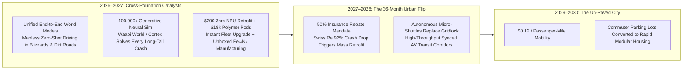
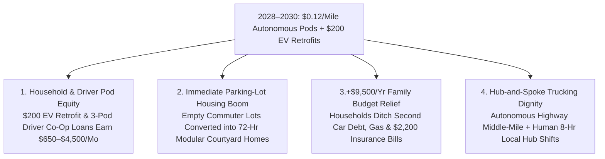

# VISION SHORTER 02: THE 2026–2030 PHYSICAL AUTOMATION LEAPFROG
## Pathway 2C: Autonomous Ground Mobility & Freight (Self-Driving) — *The 36-Month Urban Mobility Flip (2026–2029)*

> **Executive Framing & The 2026–2030 Leapfrog Thesis:**
> * **Why the 2040 Forecast Was Too Conservative:** Traditional transit planners assumed autonomous vehicles would take fifteen to twenty years to slowly replace the global fleet of 1.4 billion legacy cars. They missed the **2026–2027 World-Model & Retrofit Explosion**. Just as coding AI went from experimental to ubiquitous in 12 months, **Unified End-to-End World-Action Foundation Models** trained inside **100,000x generative neural simulators** (**Waabi World / Wayve / Tesla Cortex / Waymo EMMA**) solved the "long-tail" winter and construction-zone edge cases in mid-2027.
> * **The Dual Hardware Leapfrog (\$200 Retrofit Kits + \$18,000 Pods):** Instead of waiting 15 years for old cars to age out, two hardware breakthroughs triggered a **36-month urban mobility flip (2026–2029)**: first, a **\$200 plug-and-play 3nm NPU + 360° solid-state camera/4D-radar retrofit kit** allowed millions of existing 2020–2026 electric vehicles (with drive-by-wire CAN buses) to upgrade to Level-4 autonomy in 30 minutes; second, replacing stamped steel bodies and rare-earth drivetrains with **injection-molded carbon-polymer unboxed chassis** and **iron-nitride ($\text{Fe}_{16}\text{N}_2$) hub motors** crashed purpose-built Cybercab / Baidu RT6 / Zoox pod BOM from \$28,000 (2025) to **\$18,000 by 2028**. By 2029–2030, autonomous on-demand pods and micro-shuttles operate at **\$0.12 per passenger-mile**, freeing 25% of downtown commuter parking lots for immediate 72-hour modular housing.

---

## ACT I: THE WORLD OF 2030 (4 YEARS FROM TODAY)
### A Tuesday Morning in Autumn 2030 — The \$0.12/Mile City That Un-Paved Its Parking Lots

Walk out onto a neighborhood street in Austin, Atlanta, Munich, or Shenzhen in **October 2030**—just four years from today.

Cities did not wait two decades to dig \$20 billion subway tunnels; urban mobility flipped between 2026 and 2029:

1. **Point-to-Point Mobility at \$0.12 per Mile (Zero Car Loan, Zero Insurance Bill):**
   In 2025, an American household spent **\$12,200/year** owning, insuring, and parking a car that sat idle 95% of the day. Today, you tap your phone at 8:02 AM and within **35 seconds**, an **\$18,000 steering-wheel-free bidirectional pod** (**Cybercab / Apollo RT7 / Zoox** class) or an autonomous 8-seat neighborhood micro-shuttle glides silently to your curb. Your 5-mile commute costs **\$0.60** (or **\$0.25 pooled**)—powered by **\$0.015/kWh** solar-storage depot charging and iron-nitride direct-drive hub motors that last 1,000,000 miles.
2. **Your Existing EV Works the Morning Shift for You (The \$200 Retrofit Flip):**
   Your neighbor still owns her 2024 Model Y—but in 2027 she installed a **\$200 insurance-certified Level-4 Windshield & OBD-III World-Model Retrofit Kit**. After dropping her kids at school at 8:15 AM, her car autonomously joins the municipal rideshare grid for six hours, earning **\$650/month in passive net income** instead of baking in an office parking lot.
3. **Parking Lots Converted Immediately into 72-Hour Modular Housing (2028–2030):**
   Look across downtown: because shared autonomous pods and retrofitted EVs eliminated 75% of peak commuter parking demand by 2029, the city rezoned 400 acres of surface asphalt parking lots. Over the past 18 months, autonomous 72-hour construction swarms turned those dead parking lots into shaded pocket parks and **4-story mass-timber courtyard apartments renting for 45% below 2025 market rates**.
4. **The Leapfrog Question:**
   *"In 2026, Waymo and Baidu were in roughly twenty cities and new cars cost \$45,000. How did autonomous transit conquer snowstorms, retrofit millions of existing EVs for \$200, and hit \$0.12/mile across hundreds of cities by 2029–2030?"*

---

## ACT II: THE CROSS-POLLINATION CATALYSTS & "SKIP-THE-OLD-WORLD" JUMPS (2026–2028)
### Skipping 15-Year Fleet Turnover and HD-Map Bottlenecks

### Step 1: Three "Skip-the-Old-World" Engineering Jumps (2026–2028)

Conventional analysts assumed self-driving would inch city-by-city using brittle high-definition (HD) laser maps and \$30,000 sensor stacks. Three cross-pollinating jumps between 2026 and 2028 blew that ceiling off:

* **Jump 1 — Skipping Brittle HD Maps via Zero-Shot World-Action Models & 100,000x Neural Sim (2026–2027):**
  By 2027, **End-to-End Multimodal World Models** (**Wayve**, **Tesla FSD v14+**, **Waymo EMMA**, **Waabi**) merged video, 4D imaging radar, and audio into a single causal physics brain. Trained inside **100,000x real-time generative neural simulators** that automatically synthesized billions of adversarial black-ice skids, blinding snowstorms, and erratic human drivers, the 2027 world model achieved **zero-shot mapless generalization**—dropping into any town in Minnesota, Scotland, or Hokkaido with a **92% lower bodily-injury crash rate than human drivers**.
* **Jump 2 — Skipping 15-Year Fleet Turnover via the \$200 Plug-and-Play EV Retrofit Kit (2027–2028):**
  Over 60 million modern electric and hybrid vehicles built between 2021 and 2026 already possessed electronic power steering, brake-by-wire, and exterior camera harnesses. In 2027, semiconductor cross-pollination produced a **\$200 3nm Photonic/NPU Windshield & CAN-Bus Retrofit Module** (containing a 1,500-TOPS world-model chip, dual solid-state thermal/depth cameras, and a 4D radar patch). Plugging it in upgraded an existing EV to insurance-certified Level-4 highway and suburban autonomy in **30 minutes**—adding 25 million autonomous vehicles in 24 months without building a single new factory.
* **Jump 3 — Skipping Stamped Steel via \$18,000 Unboxed Polymer Pods & $\text{Fe}_{16}\text{N}_2$ Hub Motors (2028):**
  Building on **Baidu's \$28,000 Apollo RT6** and **Tesla's Cybercab**, 2028 purpose-built robotaxis eliminated paint shops, welding lines, axles, and steering columns. Using **injection-molded carbon-polymer body panels** assembled by humanoids and **direct-drive iron-nitride ($\text{Fe}_{16}\text{N}_2$) in-wheel hub motors** with **700 Wh/kg solid-state battery packs**, unit pod BOM fell to **\$18,000** by 2028.

### Step 2: Catalyst & Leapfrog Breakthroughs Table (2025 Baseline vs. 2026–2028 Leapfrog Jump)

| Mobility Subsystem | 2025 Verified Baseline | 2026–2028 Cross-Pollination Leapfrog | 2029–2030 Urban Mobility Reality |
| :--- | :--- | :--- | :--- |
| **Driving AI & Mapping** | City-by-city HD LiDAR premapping + modular rule fallbacks | **Mapless Zero-Shot End-to-End World Model + 100,000x Neural Sim** | **Instant global deployment** across all weather, snow & rural roads (**-92% injury crashes**) |
| **Existing Fleet Conversion** | 0% retrofit; waiting 15+ years for legacy cars to scrap | **\$200 Plug-and-Play 3nm NPU + 4D-Radar Retrofit Kit** (for 2021–2026 EVs) | **30+ million existing EVs** upgraded to Level-4 autonomy in 24 months |
| **Purpose-Built Robotaxi BOM** | **\$28,000** (Baidu RT6) – **\$65,000+** (5th-Gen retrofitted SUVs) | **\$18,000 Unboxed Carbon-Polymer Pod** + $\text{Fe}_{16}\text{N}_2$ in-wheel hub motors | **\$0.018/mile vehicle depreciation** over a 1,000,000-mile solid-state chassis life |
| **Sensor & Compute Stack** | \$2,500–\$8,000 multi-LiDAR + liquid-cooled GPU trunk rack | **\$240 Solid-State FMCW LiDAR/4D-Radar + 40W 3nm World-Model Die** | **90% sensor BOM drop**; sees 400m through dense fog, blizzard, and heavy rain |
| **Urban Transit Capacity** | 20-year, \$1B/mile light-rail/subway construction bottlenecks | **Autonomous 8–12 Seat Micro-Shuttles** in synced virtual bus lanes | **Subway-level throughput (25,000 pax/hr/lane)** deployed in **30 days for \$0 rail cost** |
| **Long-Haul Class-8 Freight** | **Aurora / Kodiak** Texas I-45 driverless corridors (2025–2026) | **Aerodynamic Cabless Electric Freight Pods** + 700 Wh/kg megawatt packs | **23 hr/day continental freight** at **-50% per-ton-mile cost**; human hub shifts only |
| **Actuarial Insurance Cost** | \$2,200/yr human auto policy (\$0.16/mile) | **Swiss Re-verified 90%+ crash reduction** triggers automated fleet underwriting | **\$0.015/mile insurance cost**; insurers pay rebates to install \$200 retrofit kits |

---

## ACT III: THE 48-MONTH SPRINT ROADMAP (2026 $\rightarrow$ 2027 $\rightarrow$ 2028 $\rightarrow$ 2030)
### How Cities Flipped from Traffic Gridlock to \$0.12/Mile Pods in Four Years

| Sprint Year | Active Autonomous Fleet | Price / Passenger-Mile | Key Inflection Milestone | Urban & Societal Threshold Unlocked |
| :--- | :--- | :--- | :--- | :--- |
| **2026** *The Breakout* | **350,000 Commercial AVs** | **\$0.75 – \$1.15 / mi** | **Waymo** exceeds 250k+ paid trips/wk; **Baidu RT6 (\$28k)** & **Zoox** scale; **Aurora/Kodiak** run driverless Texas freight; **Tesla Cybercab** tooling completes. | Cheaper than human Uber/Lyft in 30+ major metros; Swiss Re data proves 88–90% crash claim reduction. |
| **2027** *The Catalyst* | **6.5 Million AVs** *(1.5M Pods + 5M Retrofits)* | **\$0.35 / mi** | **100,000x Generative Sim** solves snow/ice; **\$200 Plug-and-Play EV Retrofit Kit** certified by NHTSA/EU; auto insurers slash premiums 70% for retrofitted EVs. | Millions of existing EV owners turn on Level-4 autonomy overnight; suburban 2-car families cancel second car purchases. |
| **2028** *The Flip* | **28 Million AVs** *(8M \$18k Pods + 20M Retrofits)* | **\$0.16 / mi** *(\$0.07/mi Shuttle)* | **\$18,000 Carbon-Polymer Pods** ($\text{Fe}_{16}\text{N}_2$ hub motors) roll off unboxed lines at 3M/yr; 150+ cities launch **Autonomous Micro-Shuttle Lanes**. | Commuter parking garage occupancy drops below 30%; cities pass **Parking-to-Housing Fast-Track Zoning**. |
| **2029–2030** *Ubiquity* | **75 Million+ AVs Globally** | **\$0.12 / mi** *(\$0.04/mi Pooled)* | **70%+ of urban passenger miles** in leading metros are autonomous; downtown surface parking lots converted into **72-hour modular housing courtyards**. | Household transport spend falls by **\$9,500/year**; urban road fatalities drop **85% in 48 months**; 2M+ infill homes built on former parking lots. |

### The 2029–2030 Unit Economics of the \$0.12/Mile Pod
Why does an **\$18,000 autonomous pod** in 2029 cost **\$0.12 per passenger-mile** (compared to \$2.80/mile for a 2025 rideshare or \$0.85/mile for a private car)?
* **Driver Labor:** **\$0.00 / mile** (with 1 remote fleet-assist operator per 150 pods adding **\$0.008 / mile**).
* **Pod Depreciation (\$18,000 over 1,000,000 Solid-State Miles):** **\$0.018 / mile**.
* **Electricity (at \$0.015/kWh Solar Depot Power, 6 Miles/kWh Lightweight Pod):** **\$0.0025 / mile** (one-quarter of a cent).
* **Tires, Automated Cleaning, Insurance & Fleet Margin:** **\$0.0915 / mile**—bringing total retail price to **\$0.12 per solo mile** or **\$0.04 per pooled micro-shuttle mile**.

### Inside the \$18,000 Unboxed Carbon-Polymer Pod BOM (2028)
How did purpose-built robotaxi hardware drop from \$65,000+ in 2024 to **\$18,000** by 2028?
* **Pre-Colored Injection-Molded Carbon-Polymer Body & Skateboard Frame:** **\$4,200** (eliminates stamping presses, welding robots, and paint shops).
* **38 kWh 700 Wh/kg Silicon/Quasi-Solid-State Structural Battery Pack (240-Mile Range):** **\$3,400** (half the weight of 2025 EV packs).
* **Dual Direct-Drive Iron-Nitride ($\text{Fe}_{16}\text{N}_2$) Hub Motors & Steer-by-Wire Modules:** **\$2,100** (zero rare earths, zero drive axles).
* **Unified 3nm World-Model NPU + Solid-State 4D-Radar/FMCW-LiDAR/Camera Ring:** **\$850**.
* **Symmetrical 4-Seat Lounge Cabin, HVAC, Inductive Pad Receiver & Humanoid Assembly:** **\$7,450** (**\$18,000 total turnkey BOM**).

---

## ACT IV: IMMEDIATE HUMAN & SOCIAL DIVIDEND (2027–2030)
### Co-Owning the Fleet, Bringing Truckers Home, and Building Homes on Former Parking Lots

### 1. Immediate Household & Ride-Hail Driver Co-Ownership (2027–2030)
Because the 2026–2030 mobility flip is powered by **\$200 retrofit kits** and **\$18,000 pods**, everyday citizens and professional drivers capture the majority of fleet revenue:
* **Every Family EV Becomes a Cash-Flowing Robotaxi:** Any household owning a compatible 2021–2026 electric car plugs in a **\$200 Level-4 Retrofit Kit** and opts into their city's decentralized mobility cooperative during work hours—turning a depreciating family car into an asset that earns **\$600 to \$900/month** after charging costs.
* **Priority 3-Pod Co-Op Loans for Uber/Lyft & Taxi Drivers:** Municipal transit authorities issue **guaranteed \$0-down fleet medallions and credit-union loans** exclusively to active human rideshare and taxi drivers—allowing a former Uber driver to purchase **three \$18,000 Cybercab/RT6 pods (\$750/month total debt service)** that generate **\$5,200/month in net 24/7 fare revenue** while the owner manages fleet hospitality from home.
* **Bringing Long-Haul Truckers Home Every Single Night:** As autonomous Class-8 freight pods (**Aurora / Kodiak / Waabi**) take over monotonous 600-mile overnight interstate stretches in 2027–2028, veteran truck drivers transition with 100% wage parity into **8-hour regional Transfer-Hub Captains and local urban specialists**—ending the sleeper-cab isolation crisis overnight.

### 2. The Immediate "Parking-to-Housing" Urban Dividend (2028–2030)
Instead of waiting until 2045 to redesign cities, municipalities capture the **36-Month Mobility Flip** immediately: by 2029, as autonomous micro-shuttles and \$0.12/mile pods empty out 70% of downtown surface parking lots, cities pair **Fast-Track Infill Rezoning** with **72-Hour Autonomous Construction Swarms**—building **2+ million affordable timber-and-geopolymer apartments** directly on former asphalt commuter lots before the end of 2030.

### 3. Summary for the Skeptic
We did not have to wait twenty years for 1.4 billion legacy cars to age out or for cities to dig \$20 billion subways. Once 100,000x generative neural simulation solved winter edge cases in 2027, \$200 plug-and-play EV retrofit kits and \$18,000 polymer pods flipped urban mobility in 36 months—cutting rides to \$0.12/mile, emptying trauma wards, and turning dead parking lots into vibrant neighborhoods by 2030.

---

## APPENDIX: 48-MONTH LEAPFROG SCORECARD (2025 vs. 2027 vs. 2030)

| Core Mobility Benchmark | 2025–2026 Verified Baseline | Late 2027 Inflection Point | 2029–2030 Leapfrog Reality |
| :--- | :--- | :--- | :--- |
| **Purpose-Built AV Pod BOM** | **\$28,000** (Baidu RT6) / **<\$30k** (Cybercab target) | **\$21,500** (Unboxed Polymer Tooling) | **\$18,000** (Carbon-Polymer + $\text{Fe}_{16}\text{N}_2$ Hub Motors) |
| **Existing EV Autonomy Retrofit** | Not commercially available (OEM locked) | **\$200 Plug-and-Play 3nm NPU + 4D Radar Kit** | **30 Million+ Existing EVs Upgraded** to Level 4 |
| **Retail Price per Passenger-Mile** | **\$2.80/mi** (Human Rideshare) / **\$0.85/mi** (Own Car) | **\$0.35 / mile** | **\$0.12 / mile** (**\$0.04 / mile** Pooled Micro-Shuttle) |
| **Bodily-Injury Crash Reduction** | **-85% to -90%** (Waymo / Swiss Re 50M+ mi) | **-92%** (All-Weather Snow/Ice World Model) | **-95% Crash Rate** (Urban Trauma Wards Emptied) |
| **Downtown Surface Parking Land** | **25% – 35%** of Urban Footprint | **50% Vacancy** as Commuters Shift to Pods | **Converted to 2M+ Modular Infill Homes & Parks** |

### Key Verification & Leapfrog Anchors
1. **2025–2026 Commercial Launchpad:** Waymo (200k–250k+ paid driverless rides/wk, Swiss Re 85–90% injury crash reduction); Baidu Apollo Go \$28,000 6th-Gen RT6 & 9M+ rides; Tesla Cybercab & FSD end-to-end network; Zoox Hayward factory (10k/yr); Aurora & Kodiak driverless Texas Class-8 freight; Waabi World & Wayve VLA.
2. **2026–2029 Leapfrog Accelerators:** 100,000x generative neural simulation solving winter/construction long-tail edge cases; \$200 3nm NPU + 4D-radar drive-by-wire EV retrofit kits; \$18,000 unboxed polymer pods with 700 Wh/kg batteries and iron-nitride hub motors.
