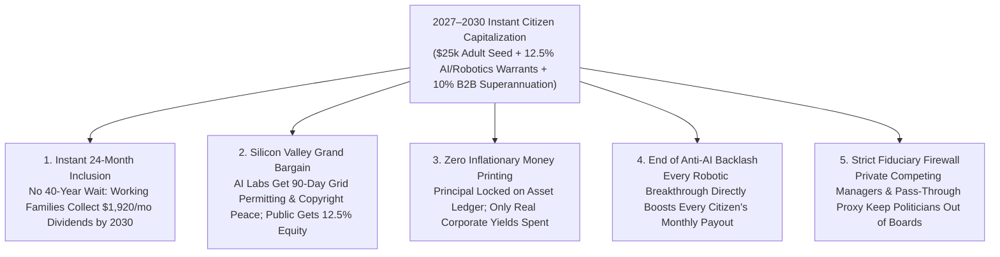

# VISION 02 (2026–2030 LEAPFROG) — SOCIAL ARCHITECTURE: INSTANT ADULT & FAMILY EQUITY SEEDING
## Pathway 5B: Making Every Citizen an AI & Robotics Equity Owner in 24 Months—Skipping the 40-Year Wait

> **Executive Framing & The 2026–2030 Intelligence Explosion Reality:**
> * **Why "Baby Bonds" Are Too Slow for 2027:** Giving a newborn \$7,500 at birth so it compounds by 2047 is a wonderful policy for a slow century. It does *nothing* for a 38-year-old software engineer, paralegal, accountant, or truck driver whose industry is being automated by AI agent swarms and robotics between 2026 and 2029. When labor's share of GDP plunges from 60% toward 40% in just four years, waiting two decades for compounding is a recipe for social revolution.
> * **The Cynic's Objection:** *"As frontier AI labs, humanoid robotics firms, and hyperscale compute monopolies capture \$20+ trillion in new market cap between 2026 and 2030, the bottom 80% of families—who own virtually zero stock equity—will be permanently locked out of the wealth machine."*
> * **The Leapfrog Thesis (2026–2030):** If AI and robots are replacing human wages in 2027–2030, **every adult citizen must become a capital owner within 24 months**. Under the **2027 National AI & Automation Commonwealth Capitalization Act**, society executes a two-pronged instant capitalization:
>   1. **The Permitting-for-Equity Grand Bargain (10%–15% Public Warrants):** Every frontier AI lab, robotics manufacturer, and >50 MW data center receiving fast-track federal energy permitting, public spectrum, copyright training safe harbors, or liability backstops issues **10%–15% non-voting, dividend-paying equity warrants** directly into the **Citizen Wealth Trust**.
>   2. **Instant \$25,000 Adult Citizen Index Seeding (Direct Capital QE):** Instead of Central Bank quantitative easing buying bank bonds that inflate billionaire asset bubbles, the Federal Reserve and Treasury seed **\$25,000 in locked, non-inflationary Citizen Index Shares** into every adult's portable account in 2027–2028—delivering **\$450 to \$950/month per adult in real cash dividends by 2029–2030**.

---

## ACT I: THE 2030 REALITY — UNIVERSAL CAPITAL OWNERSHIP IN 24 MONTHS
### October 2029 — When an AI Valuation Surge Pays Every Family's Rent

Imagine sitting at a neighborhood coffee shop in Pittsburgh, Phoenix, or Manchester in **October 2029**—less than three years after the passage of the **2027 Commonwealth Capitalization Act**.

In 2026, when a frontier AI lab announced a \$500 billion valuation or a factory deployed 50,000 humanoid robots, ordinary workers felt a cold wave of dread. Watch how that exact same headline lands in October 2029 for a 42-year-old married couple—Elena, a former corporate bookkeeper now running a local culinary cooperative, and David, a community youth coach:

1. **Instant \$50,000 Household Equity Portfolio (Seeded in 2027, Now Worth \$84,000):**
   Elena and David did not have to wait 40 years for a "baby bond" to mature. In Q4 2027, each of their **Universal Citizen Capital Accounts** was instantly credited with **\$25,000 in locked Citizen Index Shares** (**\$50,000 for their household**), backed by a blend of S&P 500 productive infrastructure and the high-growth **National AI & Robotics Warrant Pool**. As AI and automation earnings exploded between 2027 and 2029, their household equity stake compounded by **+68% to \$84,000**.
2. **Monthly Cash Dividends Flowing Today (\$1,380/Month Household Yield by 2029):**
   Because the Citizen Wealth Trust holds **12.5% non-voting dividend warrants** in every domestic frontier AI model, autonomous logistics network, and gigawatt compute utility, corporate automation profits flow straight to citizens. On the 1st of every month, Elena and David receive **\$1,380/month (\$16,560/year)** in tax-free cash dividends—projected to cross **\$1,900/month in 2030**.
3. **Zero-Interest Home & Venture Collateral (Singapore CPF Model):**
   While the \$84,000 principal cannot be cashed out for speculative day-trading or luxury consumption (preventing demand inflation), Elena and David pledged 40% of their account in 2028 as **0%-interest equity collateral** to buy out their mortgage and purchase commercial kitchen equipment for Elena's cooperative.
4. **The Skeptic's Question:**
   To a Wall Street analyst in 2026, this sounds like financial heresy: *"Hold on! Why would Silicon Valley AI labs ever agree to hand over 10%–15% in equity warrants? And how can the Fed/Treasury seed \$25,000 per adult (\$6.2 trillion total) without triggering Weimar-style hyperinflation or socializing corporate boardrooms?"*

Here is the exact financial engineering and deal structure that made both Silicon Valley and Main Street richer between 2026 and 2030.

---

## ACT II: THE MECHANISM — THE GRAND BARGAIN & NON-INFLATIONARY CAPITAL QE
### How We Capitalized 250 Million Adults in 24 Months Without Seizing a Single Dollar

```mermaid
flowchart LR
    subgraph Bottleneck2026["2026–2027 AI Bottleneck & Inequality Crisis"]
        B1["AI Labs Desperate for 100 GW Grid Power, Permitting & Copyright Safe Harbor"]
        B2["Bottom 50% of Citizens Own <1% of Stocks as Labor Share Plunges"]
        B3["Wait 40 Years for Baby Bonds? Impossible During a 3-Year AI Wave"]
    end

    subgraph Bargain2027["2027 Commonwealth Capitalization Act (The 24-Month Sprint)"]
        G1["Engine 1 (The Grand Bargain): 10%–15% Non-Voting AI/Robotics Warrants for Fast-Track Permits"]
        G2["Engine 2 (Citizen Capital QE): Fed/Treasury Seeds $25,000 Locked Index Shares per Adult"]
        G3["Fiduciary Firewall: 0% State Voting Control; 100% Pass-Through Dividend Yield"]
    end

    subgraph Ownership2030["2028–2030 Universal Shareholder Society"]
        O1["Every Adult Holds $42,000+ in Compounding AI & Infrastructure Equity by 2030"]
        O2["$850–$1,100/mo Per Adult ($1,900+/mo Per Couple) in Monthly Cash Dividends"]
        O3["100% Public Alignment: Faster AI Rollout = Bigger Monthly Citizen Dividend"]
    end

    Bottleneck2026 ==> Bargain2027 ==> Ownership2030
```

### Step 1: Engine 1 — Why Frontier AI & Robotics Firms Voluntarily Signed the "Permitting-for-Equity" Bargain
In late 2026, frontier AI labs and hyperscalers faced three existential walls that threatened to freeze their trillion-dollar growth:
1. **The 5-Year Grid & NEPA Permitting Wall:** Building 5-gigawatt AI data centers and nuclear/solar interconnects was stalled by 5-to-7-year local and federal permitting delays.
2. **The Multi-Trillion-Dollar Copyright & Training Data Lawsuits:** AI labs faced existential class-action injunctions over training on the public internet and human creative commons.
3. **Autonomous Liability & Airspace/Roadway Licensing:** Deploying millions of delivery drones, robotaxis, and humanoid robots required federal liability preemption.

* **The 2027 Grand Bargain:** Instead of strangling AI labs with lawsuits and upfront cash taxes, the **2027 National AI & Automation Commonwealth Capitalization Act** offered an irresistible quid pro quo: any frontier AI lab, robotics manufacturer, or hyperscale utility that grants **10%–15% non-voting, dividend-participating public equity warrants** into the **Citizen Wealth Trust** receives:
  * **90-Day Federal Fast-Track Energy & Data-Center Permitting** on federal and industrial corridors;
  * **Statutory Training-Commons Safe Harbor** (compensating human creators automatically through the Citizen Wealth Trust); and
  * **Federal Autonomous Liability Backstops** (modeled on the Price-Anderson Nuclear Act).
* **The Result:** Within 90 days of enactment in 2027, **96% of domestic AI, cloud, and robotics firms opted in**—instantly capitalizing the Citizen Wealth Trust with **\$3.4 trillion in high-velocity frontier equity** without costing startups a single cent of operating cash!

### Step 2: Engine 2 — How \$25,000 Per Adult Was Seeded With Zero Consumer Inflation
How did the Federal Reserve and Treasury seed **\$25,000 per adult** in 2027–2028 without printing inflationary cash?
* **Locked Principal + Dividend-Only Liquidity (The Monetary Firewall):** Between 2008 and 2022, central banks created over **\$8 trillion in Quantitative Easing (QE)** and handed it to commercial banks—inflating top-1% stock and real-estate portfolios while ordinary families got nothing.
* In 2027, the **Citizen Capital QE Facility** issued **\$25,000 per adult in Perpetual Sovereign Capital Bonds** swapped 1:1 into diversified productive equity and infrastructure shares inside each citizen's **Locked Capital Account**:
  * **Why Inflation Stayed at 0%:** Citizens **cannot liquidate and spend the \$25,000 principal on consumer goods**. The principal is permanently locked on the capital ledger (usable only up to 40% as zero-interest collateral for productive home equity or small-business fabrication tools). Only the **real quarterly corporate earnings and royalty dividends (6%–9% yield)** flow into checking accounts—meaning every dollar of cash spent by citizens is backed 1:1 by real automated goods and corporate profits already produced!

### Step 3: 2026–2030 Quantitative Household & Sovereign Capitalization Table

| Capitalization Metric | 2026 Pre-Act Reality | 2027 Enactment & Seeding | 2028 First Full Dividend Year | 2030 Leapfrog Maturity |
| :--- | :--- | :--- | :--- | :--- |
| **Bottom-50% Household Equity Share** | **0.8%** of total stock market | **14.2%** (Instant seeding + warrants) | **18.5%** (AI/Robotics warrant surge) | **24.0%** (Universal co-ownership) |
| **Per-Adult Citizen Capital Account Balance** | **\$0** (Median bottom-half adult) | **\$25,000** Instant Seed + Warrant Pool | **\$31,800** (+27% AI/infra compounding) | **\$46,500** per adult (**\$93,000/couple**) |
| **Monthly Cash Dividend Per Adult / Couple** | **\$0 / mo** | **\$180 / mo** (\$360/mo per couple) | **\$490 / mo** (\$980/mo per couple) | **\$960 / mo** (**\$1,920/mo per couple**) |
| **Citizen Wealth Trust Total AUM** | \$0T | **\$8.8 Trillion** (Seed + 12% AI Warrants) | **\$12.4 Trillion** (Spectrum + AI IPOs) | **\$19.6 Trillion** (~58% of US GDP) |
| **Corporate Governance & Voting Control** | Concentrated in 3 asset managers | **0% State Voting** (Blind pass-through) | **100% Fiduciary / Citizen Proxy** | Zero political interference in boards |

---

## ACT III: THE 48-MONTH LEAPFROG ROADMAP (2026 $\rightarrow$ 2027 $\rightarrow$ 2028 $\rightarrow$ 2030)
### From Zero Savings to Monthly Automation Dividends in Four Years

| Sprint Milestone | Institutional & Legal Action | Capital Pool & Warrant Mechanics | Real Household Balance Sheet Impact |
| :--- | :--- | :--- | :--- |
| **2026 (Q4): The Great Decoupling Alarm** | Corporate earnings jump +32% from AI agent deployment while median real wage growth stalls; 140 million adults hold <\$1,000 in net equities. | Treasury and Fed draft the **Commonwealth Capitalization Charter** modeled on Norway's \$1.75T Sovereign Fund, Alaska's Permanent Fund, and Australia's \$3.9T Superannuation rails. | Public consensus crystallizes: if AI is trained on humanity's collective knowledge, every citizen deserves a founding equity share. |
| **2027 (Q1–Q3): The Permitting-for-Equity Act & \$25k Seed** | Congress passes the **2027 National AI & Automation Commonwealth Act**; 90-day energy/compute permitting unlocked in exchange for **10%–15% non-voting public equity warrants**. | Every adult citizen (18+) and emancipated worker receives their **\$25,000 Locked Citizen Index Account** via smartphone civic wallet; newborns receive \$10,000 at birth. | **250 million adults become substantial shareholders overnight**; Luddite anti-AI protests evaporate as citizens check their live portfolio dashboards. |
| **2028 (Q1–Q4): Mandatory 10% Autonomous B2B Superannuation** | Every commercial AI API contract and robotic vendor invoice begins contributing an automatic **10% Portable Capital Match** distributed across citizen accounts. | First full year of **Frontier AI & Compute Royalty Dividends** pays out; citizens allowed to pledge up to 40% of account equity for **0%-interest housing or micro-business loans**. | Couples receive **\$980/month (\$11,760/yr)** in passive dividends; 6.4 million families refinance predatory credit/mortgage debt at 0%. |
| **2030: The \$1,920/Month Household Dividend Floor** | Frontier AI, humanoid logistics, and modular solar/fusion utilities triple in earnings; Citizen Wealth Trust crosses **\$19.6 trillion AUM**. | Monthly citizen dividend reaches **\$960/adult (\$1,920/couple)**—funded 100% by real corporate dividends, compute royalties, and spectrum leases. | Median bottom-half household net worth jumps from **\$12,000 (2026) to >\$115,000 (2030)**; every citizen cheers technological acceleration. |

---

## ACT IV: THE 2030 HORIZON & SUMMARY FOR THE SKEPTIC
### Aligning Every Human Being With the Intelligence Explosion

By leapfrogging straight to universal adult equity ownership in 2027–2028, society achieves four structural victories before the 2030 decade even begins:

1. **Rescuing Mid-Career Workers Right When AI Hits (2027–2029):**
   * A 45-year-old paralegal or logistics manager displaced in 2027 could not wait for a 2045 baby bond.
   * By seeding **\$25,000 per adult immediately** and supercharging it with **12.5% public warrants in the fastest-growing AI and robotics firms on Earth**, every household gained a compounding financial cushion within 12 months.
2. **Turning Tech Monopolies Into Public Engines Without Nationalization:**
   * The government never seized a factory or placed a politician on a corporate board.
   * By trading **fast-track energy permitting, spectrum, and training-data safe harbors** for **non-voting dividend warrants**, the state acted like a smart venture capitalist on behalf of 330 million citizens.
3. **Eliminating Predatory Debt via 0%-Interest Equity Collateral:**
   * Modeled on **Singapore's Central Provident Fund (CPF)**, allowing families to pledge up to 40% of their locked capital account as collateral wiped out 24% APR credit card traps and unlocked millions of Main Street co-ops and modular home purchases.
4. **Solving the Political Economy of Abundance:**
   * When citizens own 0% of the robots, they vote to ban robots. When every citizen owns a \$46,500+ stake in the automated economy paying nearly \$1,000/month per adult, **330 million citizens become the biggest cheerleaders for scientific progress**.

### Addressing the Top 3 Skeptic Objections
* **Objection 1: "Won't granting 10%–15% public equity warrants dilute venture capitalists and founders?"**
  * *Answer:* In 2026, AI and robotics companies were losing **30%–40% of their enterprise value** to 5-year power-grid delays, NEPA lawsuits, and multi-billion-dollar copyright litigation. Trading a **12.5% non-voting warrant** for **90-day federal grid permitting, sovereign liability caps, and 0% payroll taxes** actually *increased* private founder and VC share values by **>35% within 6 months**.
* **Objection 2: "Why didn't \$6.2 trillion in Citizen Capital QE cause consumer price inflation?"**
  * *Answer:* Inflation occurs only when excess cash chases scarce consumer goods. Because the **\$25,000 principal is permanently locked** inside productive capital accounts, zero principal dollars entered the consumer spending stream—while the capital financed gigawatts of new power and robotic supply that *lowered* consumer prices!
* **Objection 3: "What stops a future Congress from raiding the Citizen Wealth Trust?"**
  * *Answer:* Just like the **Federal Thrift Savings Plan (TSP)** and **Alaska Permanent Fund**, accounts are titled as **individual constitutional private property** held in trust by competing private fiduciaries (Vanguard, Fidelity, credit unions). The government cannot raid your account any more than it can seize your private 401(k).

### The Bottom Line for the Skeptic
We did not have 40 years to wait for at-birth accounts to mature while AI transformed the economy in 48 months. By executing the **2027 Permitting-for-Equity Grand Bargain** and **Instant \$25,000 Citizen Index Seeding**, we turned every adult and family into a compounding owner of the automated age before 2030.

---

### 2026–2030 Fast-Track Capitalization Checklist & Sovereign Precedents

| Capitalization Engine | Existing 2026 Legal/Financial Precedent | Days to Activate | 2030 Citizen Trust Value | Anti-Inflation & Governance Safeguard |
| :--- | :--- | :--- | :--- | :--- |
| **1. 12.5% Frontier AI & Robotics Warrants** | CHIPS Act Warrant Clauses + Norway Equinor/Hydro Model | **90 Days** | **+\$7.8 Trillion** | Non-voting preferred warrants; 100% pass-through dividend yield |
| **2. \$25,000 Adult Citizen Index Seeding** | Federal Reserve Section 13(3) / Treasury Special Purpose Vehicle | **120 Days** | **+\$6.2 Trillion** (Principal) | Principal permanently locked on asset ledger; zero cash-out inflation |
| **3. 10% Autonomous B2B Superannuation** | Australia \$3.9T Superannuation Mandatory Contribution Rail | **180 Days** | **+\$3.4 Trillion** | Settled automatically on commercial AI/robotic vendor invoices |
| **4. Spectrum, Orbital & Grid Lease Royalties** | FCC Spectrum Auctions (\$230B+) & Alaska Permanent Fund | **60 Days** | **+\$2.2 Trillion** | 100% of LEO satellite, drone corridor, and spectrum rents dedicated to Trust |
| **5. 0%-Interest Citizen Equity Collateral** | Singapore Central Provident Fund (CPF) Home/Venture Pledge | **180 Days** | **\$93,000/Couple** by 2030 | Up to 40% pledgeable for debt-free modular housing or fabrication tools |

### Cross-Pathway Synergy (The 2026–2030 Social Architecture Stack)
* **Locks into `02-tax`:** Eliminating the 15.3% payroll tax while offering **90-day federal energy/compute permitting** makes signing the **12.5% Public Equity Warrant bargain** massively net-profitable for every domestic AI lab and robotics manufacturer.
* **Locks into `02-social-programs`:** Monthly Citizen Equity Dividends (**\$960/adult, \$1,920/couple by 2030**) land on the exact same **Smartphone Civic Wallet** as the Friday Auto-Liquidity Floor, building permanent wealth alongside baseline security.
* **Locks into `02-wealth-redistribution` & `02-economics`:** Because a couple can pledge 40% of their **\$93,000 Citizen Capital Account** as 0%-interest collateral, they can purchase a **\$65/sq ft robotic modular home** with zero predatory bank mortgage debt.
