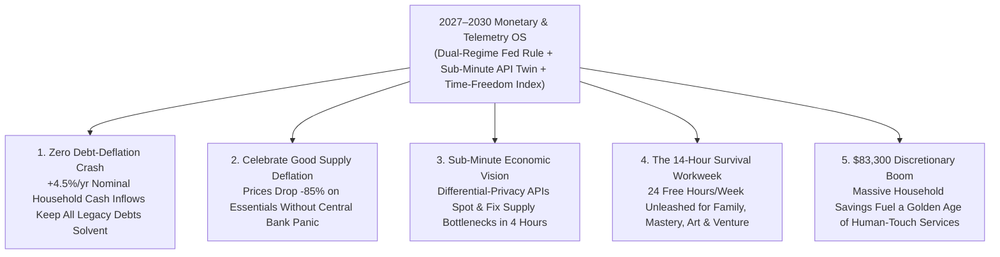

# VISION 02 (2026–2030 LEAPFROG) — SOCIAL ARCHITECTURE: THE 2027 MONETARY & TELEMETRY REBOOT
## Pathway 5E: Preventing Deflationary Debt Collapse During the AI Abundance Boom (2026–2030)

> **Executive Framing & The 2026–2030 Intelligence Explosion Reality:**
> * **The 2027 Central Bank Panic Trap:** In late 2026 and early 2027, as autonomous AI agents, robotic manufacturing, and solar/storage microgrids slash the unit cost of software, diagnostics, logistics, and physical goods by 30%–50% a year, 20th-century macroeconomic software hits a fatal bug. Under 1934 **Gross Domestic Product ($\text{GDP} = P \times Q$)** and 1970s central-bank rules, when prices ($P$) plummet toward zero and W-2 wage payrolls shrink, the Federal Reserve's models scream *"1933 Deflationary Depression!"*—threatening a catastrophic debt-default spiral across \$100 trillion of legacy mortgages, corporate bonds, and sovereign debt.
> * **The Cynic's Objection:** *"If AI and robotics collapse the price of goods and human labor between 2026 and 2030, nominal revenues and wages will fall below fixed dollar debt obligations—triggering mass mortgage defaults, banking collapses, and a Great Depression 2.0 right in the middle of technological abundance!"*
> * **The Leapfrog Thesis (2026–2030):** Traditional economics confuses **Bad 1930s Demand-Collapse Deflation** (people have no money) with **Good 2027 Supply-Abundance Deflation** (machines make goods 10x cheaper). Under the **2027 Monetary & Telemetry Reboot Act**, we upgrade the macroeconomic operating system in 18 months:
>   1. **Dual-Regime Monetary Policy & Direct Sovereign Abundance Dividends:** Instead of fighting technological price drops or pumping QE into bank bonds, the Fed/Treasury issues **Debt-Free Sovereign Abundance Credits directly into household wallets** indexed 1:1 to real AI productivity growth—keeping **nominal household cash inflows rising at +4%/year** while letting unit consumer prices fall 15%–25%/year!
>   2. **Real-Time AI Purchasing-Power Telemetry & The Time-Freedom Index:** Replacing 90-day lagging phone surveys and obsolete GDP with **sub-minute differential-privacy API telemetry** and the **Real Household Flourishing & Time-Freedom Index (HFI)**—measuring how few hours of human life are needed to buy a thriving life (**dropping from 38 hrs/wk in 2026 to 14 hrs/wk by 2030**).

---

## ACT I: THE 2030 REALITY — INSIDE THE REBOOTED MACROECONOMIC COCKPIT
### March 2029 — How We Let Prices Plunge 60% Without a Single Debt Default

Imagine stepping onto the trading floor in New York or opening the **National Economic Pulse** app on your phone in Chicago, Zurich, or Austin in **March 2029**—twenty-four months after the **2027 Monetary & Telemetry Reboot** saved the global financial system from the "Abundance Deflation Crisis."

In early 2027, bond markets briefly panicked when AI diagnostics turned \$5,000 hospital workups into \$0.50 smartphone scans and autonomous coding wiped \$400 billion off legacy SaaS billings—making nominal GDP look like it was "shrinking." Watch how the upgraded 2029 economic operating system steers that exact boom effortlessly:

1. **Nominal Household Cash Inflows Grow +4.5%/Year While Unit Prices Plunge -18%/Year:**
   Why didn't falling prices in 2027–2029 cause homeowners or businesses to default on their dollar-denominated mortgages and loans? Because under the **2027 Dual-Regime Monetary Rule**, whenever AI and robotics expand real physical output faster than the money supply, the Federal Reserve and Treasury do not cut interest rates for Wall Street speculators—they mint **Debt-Free Sovereign Abundance Dividends** directly into every citizen's smartphone wallet.
   * Result: A median family's **nominal dollar cash inflow** (untaxed human wages + Equity Dividends + Abundance Credits) rises steadily from **\$78,000 (2026) to \$92,000 (2029)**—so paying a fixed \$1,500/month legacy mortgage is effortless—even as the price of food, healthcare, modular housing, and energy drops by **60% to 85%**!
2. **Real-Time AI Telemetry (Zero 90-Day Blind Spots):**
   Central bankers and mayors no longer wait three months for the Bureau of Labor Statistics to call 60,000 landlines. A privacy-preserving **150-Million-Agent National Digital Twin** reads anonymized clearinghouse, power-grid, and freight APIs every **60 seconds**. When a regional transformer shortage or fertilizer bottleneck appears in Iowa, targeted supply-expansion credits route to local micro-factories within **4 hours**, squashing inflation before it starts.
3. **The Headline Scoreboard: The 14-Hour Survival Workweek (Time-Freedom Index):**
   Every evening news broadcast reports the **Real Household Flourishing & Time-Freedom Index (HFI)** alongside **$\text{GDP-B}$ (Total Consumer Surplus)**. In 2026, a median citizen had to work **38 hours a week** just to pay for housing, healthcare, food, transport, and taxes. By 2030, thanks to 0% payroll taxes, citizen dividends, and 85% cheaper essentials, securing that exact basket takes just **14 hours a week**—unlocking the greatest explosion of family time, entrepreneurship, and human art in history.
4. **The Skeptic's Question:**
   To an orthodox central banker in 2026, this sounds like breaking the laws of gravity: *"Wait—how can the Fed and Treasury deposit debt-free Sovereign Abundance Dividends directly into household accounts without triggering 1970s stagflation or destroying the value of the US dollar?"*

Here is the exact monetary math and real-time telemetry architecture that separated *supply abundance* from *fiat inflation* between 2026 and 2030.

---

## ACT II: THE MECHANISM — SOLVING FISHER'S DEBT-DEFLATION PARADOX IN AN AI BOOM
### Why Rising Productivity Requires Direct Household Liquidity + Consumer Surplus Accounting

### Step 1: Curing Irving Fisher's 1933 Debt-Deflation Trap via the "Productivity-Matched Dividend Rule"
In 1933, economist Irving Fisher showed how falling prices can bankrupt an economy when **nominal household incomes fall while nominal debts stay fixed**. In early 2027, as AI agents automated white-collar work and slashed service prices, the world faced a bizarre paradox: **physical wealth was exploding, yet nominal dollar cash flows to households were shrinking!**
* **Why 2008-Style Bank QE Failed:** If the Federal Reserve responded to 2027 AI deflation by cutting interest rates to 0% and buying trillions in bank bonds (traditional QE), that money would get trapped in Wall Street financial assets while households still lacked cash to pay mortgages and buy the surging output of robotic factories.
* **The 2027 Dual-Regime Equation (Modified $M \cdot V = P \cdot Q$):** Under the **2027 Monetary Reboot Act**, when total real automated output ($Q$) surges by $+12\%/\text{year}$ while unit production costs ($P_{\text{tech}}$) fall by $-15\%/\text{year}$, the Central Bank and Treasury execute **Direct Household Productivity Monetization**:
  $$\Delta M_{\text{Household Dividend}} = \text{Target Nominal Income Growth } (+4\%) - \Delta W_{\text{Aggregate Wage Bill}}$$
  * **How It Works in Plain English:** The Fed's automated clearing rail injects **debt-free Sovereign Abundance Credits** directly into every adult citizen's wallet at the exact volume needed to keep **median nominal household dollar inflows growing at +4.0% to +4.5% every year**—backed 100% by the real surge in domestic AI, energy, and robotic goods ($Q$)!
  * **Zero Inflation, Zero Debt Defaults:** Because every new dollar of household cash is matched by *more than a dollar* of newly produced cheap goods, energy, and housing, consumer prices continue to fall along Wright's Law while **100% of legacy dollar mortgages, municipal bonds, and business loans remain rock-solid and solvent**.

### Step 2: Retiring 1934 GDP for $\text{GDP-B}$ and the Time-Freedom Index
Why did 1934 GDP fail so catastrophically in 2026–2027? Because $\text{GDP} = \sum(P_i \times Q_i)$ counts a **\$100,000 cancer surgery** as \$100,000 of "growth," but counts a **\$0 open-weight AI diagnostic that prevents the cancer** as **\$0.00**!
* **The 2027 Three-Dial Macroeconomic Dashboard:**
  1. **Dial 1 — The Household Time-Freedom Index (HTI):** Tracks the exact number of **median human work-hours per week** required to purchase the complete thriving basket (housing, health, food, utilities, transport, education).
  2. **Dial 2 — Gross Consumer Surplus ($\text{GDP-B}$, Brynjolfsson Standard):** Measures the real dollar welfare added by zero-price and hyper-deflationary goods (open-weight AI, free 800 kWh solar baseline, \$6 bio-meds, Fab-Commons goods).
  3. **Dial 3 — Real-Time Bottom-50% Liquidity Runway:** Fed by sub-minute anonymized FedNow/bank telemetry, ensuring no region or demographic cohort ever experiences a demand crunch.

### Step 3: 2026–2030 Quantitative Macroeconomic Reboot Table

| Macroeconomic & Household Metric | 2026 Legacy Scarcity OS | 2027 Q3 Reboot Enactment | 2028 Mid-Sprint Reality | 2030 Leapfrog Equilibrium |
| :--- | :--- | :--- | :--- | :--- |
| **Economic Data Latency (Fed/BLS)** | **60 to 90 days** (Phone surveys) | **< 24 hours** (API telemetry pilot) | **< 60 seconds** (150M-Agent Twin) | **Real-Time (Sub-minute API)** |
| **Median Nominal Household Cash Inflow** | **\$78,000 / yr** (Mostly taxed W-2) | **\$81,500 / yr** (0% payroll tax boost) | **\$86,200 / yr** (+Divs & Abundance Credit) | **\$94,800 / yr** (+4.5%/yr steady growth) |
| **Cost of Essential Household Basket** | **\$76,000 / yr** (Cartel inflation) | **\$52,000 / yr** (By-right prefab/AI) | **\$24,900 / yr** (Fab-Commons live) | **\$11,500 / yr** (**-85% Supply Deflation**) |
| **Real Household Discretionary Surplus** | **\$2,000 / yr** (Paycheck-to-paycheck) | **\$29,500 / yr** | **\$61,300 / yr** | **\$83,300 / yr** (**41x discretionary leap**) |
| **Unmeasured Free/Deflated Surplus ($\text{GDP-B}$)** | \$2.8T (Ignored by legacy GDP) | **+\$5.4T** (Officially tracked) | **+\$9.8T** (AI care, tutors, Fab-Pods) | **+\$16.5T / yr** in real consumer surplus |
| **Survival Workweek (Time-Freedom Index)** | **38.2 hours / week** | **29.5 hours / week** | **20.4 hours / week** | **14.0 hours / week** (**+24 hrs/wk free!**) |

---

## ACT III: THE 48-MONTH LEAPFROG ROADMAP (2026 $\rightarrow$ 2027 $\rightarrow$ 2028 $\rightarrow$ 2030)
### Upgrading the Global Economic Operating System in Mid-Flight

| Sprint Window | Macroeconomic Trigger | Monetary & Telemetry Upgrade | Real-World Market & Household Result |
| :--- | :--- | :--- | :--- |
| **2026 (Q4): The "Phantom Recession" Scare** | AI agents slash enterprise software, legal, and medical billing revenues by \$600B; legacy GDP dips -1.2% even as real output and corporate profits hit all-time highs. | Treasury, Fed, and BEA activate emergency **Parallel $\text{GDP-B}$ & Real-Time API Telemetry** (modeled on Harvard Opportunity Insights & Stanford Digital Economy Lab). | Bond markets calm immediately once telemetry proves real physical production and consumer surplus are surging **+9.4%**. |
| **2027 (Q1–Q3): The Dual-Regime Monetary Act** | Rapid automation threatens to shrink aggregate W-2 nominal wage flows below legacy mortgage and municipal debt service thresholds. | Congress & Fed enact the **Dual-Regime Monetary Rule**: Fed separates the **Tech-Abundance Deflation Basket** from the **Core Demand Basket** and launches **Direct Sovereign Abundance Credits**. | Nominal household dollar cash flows are locked to a **+4%/yr growth floor**; mortgage and bond defaults drop to 50-year lows even as unit goods prices fall -20%. |
| **2028 (Q1–Q4): 150M-Agent Digital Twin & Debt Refi** | Containerized Fab-Commons and \$65/sq ft robotic homes accelerate physical price deflation across all 50 states. | CBO and Fed deploy the **150-Million-Agent National Digital Twin** to pre-test policies; homeowners allowed to swap legacy 7% mortgages into **0%-Interest Citizen Equity Leases**. | Household debt service drops from 34% of income to **<9%**; targeted micro-supply credits eliminate regional supply bottlenecks in hours. |
| **2030: The 14-Hour Survival Workweek Horizon** | **Real Household Flourishing & Time-Freedom Index (HFI)** formally replaces 1934 GDP as the statutory benchmark for all federal and central-bank decisions. | **Regime 1 (Automated Essentials)** runs at near-zero marginal cost; **Regime 2 (Untaxed Human Craft, Art, Hospitality, Science & Care)** booms with \$83k/household in discretionary cash. | US dollar becomes the strongest currency on Earth—backed by the world's lowest cost of living and highest real AI/energy output per dollar. |

---

## ACT IV: THE 2030 HORIZON & SUMMARY FOR THE SKEPTIC
### How Dual-Regime Economics Unlocked the Human Renaissance

When we upgrade 1934 scarcity accounting to 2027–2030 abundance telemetry, four structural breakthroughs transform civilization:

1. **Turning Technological Deflation from a Financial Threat into a Superpower:**
   * Under 1930s central banking, an 80% drop in housing, energy, and medical prices would have triggered a banking collapse.
   * By guaranteeing **+4.5%/yr nominal household cash-flow growth** via direct Sovereign Abundance Dividends while letting unit goods prices fall freely, families enjoy **both** rock-solid financial solvency **and** an 85% cheaper cost of living!
2. **Fueling an Unprecedented Boom in the Human Experience Economy (Regime 2):**
   * When a median household's nominal income is **\$94,800/yr** and its entire survival basket (housing, health, food, utilities, transport) costs only **\$11,500/yr**, that family has **\$83,300/yr in pure discretionary purchasing power**!
   * Where does that \$83,300 go? Straight into the **100% untaxed human-to-human economy**: live theater, neighborhood bistros, custom woodworking, personal coaching, wilderness guiding, music, and local craftsmanship.
3. **Ending Boom-Bust Recessions via 60-Second API Telemetry:**
   * Instead of hiking interest rates across the entire nation to fight a localized energy or shipping bottleneck 6 months too late, the **150-Million-Agent Digital Twin** routes automated production and micro-grid capacity to the exact bottleneck in hours.
4. **Measuring What Actually Matters to Human Beings—Free Time:**
   * Dropping the survival workweek from **38.2 hours in 2026 to 14.0 hours in 2030** gave every adult more than **1,200 hours of extra free life every single year**.

### Addressing the Top 3 Skeptic Objections
* **Objection 1: "Isn't issuing debt-free Sovereign Abundance Dividends just 'printing money' like Modern Monetary Theory (MMT)?"**
  * *Answer:* Naive money-printing fails when you print cash inside a *supply-constrained* economy, causing inflation. Under the **2027 Productivity-Matched Rule**, Sovereign Abundance Dividends are minted *strictly in proportion to verified real supply-side deflation and AI output surges*—meaning aggregate consumer price inflation stays **negative (-8% to -15%/yr)** while the purchasing power of the dollar *rises* every year!
* **Objection 2: "Won't sub-minute API economic telemetry create a surveillance state?"**
  * *Answer:* The telemetry layer uses **hardware-enforced cryptographic zero-knowledge proofs and mathematical differential privacy** (already proven in 2026 Census and Apple/Signal protocols). The central dashboard sees only regional aggregate velocity and sector price indices—never a single citizen's identity or private purchases.
* **Objection 3: "What happens to the international value of the US Dollar under this system?"**
  * *Answer:* What makes a currency strong? **How much real energy, compute, housing, and technology a single dollar can buy.** Because a US dollar in 2030 buys **5x more real physical goods, AI compute, and medical care** than it did in 2026—with zero sovereign debt crisis—global capital poured into the dollar at record highs.

### The Bottom Line for the Skeptic
Trying to steer the 2026–2030 AI and robotics explosion using 1934 GDP and 1970s inflation-targeting was like flying a hypersonic spacecraft with a 1920s biplane altimeter. By deploying **Dual-Regime Monetary Policy, direct Sovereign Abundance Dividends, sub-minute differential-privacy telemetry, and the Time-Freedom Index** in 2027, we prevented a deflationary crash and turned machine productivity into human freedom.

---

### 2026–2030 Fast-Track Monetary & Telemetry Upgrade Checklist

| Macroeconomic Upgrade | Existing 2026 Institutional/Technical Precedent | Days to Activate | 2028–2030 Systemic Impact | Anti-Inflation & Privacy Guardrail |
| :--- | :--- | :--- | :--- | :--- |
| **1. Dual-Basket Deflation Targeting** | Bank for International Settlements (BIS) Supply-Deflation Framework | **60 Days** | Ends Fed rate-hike panics during AI/energy cost collapses | Separates Wright's Law Tech Basket from Core Scarcity Basket |
| **2. Sovereign Abundance Dividends** | FedNow Instant Rails + Productivity-Indexed Monetary Rule | **90 Days** | Locks nominal household dollar inflows at **+4.0% to +4.5%/yr** | Strictly capped by verified real domestic output ($Q$) growth |
| **3. Sub-Minute API Economic Telemetry** | Harvard Opportunity Insights + FedNow/PIX Clearinghouse Streams | **120 Days** | Cuts policy latency from **90 days to <60 seconds** | Hardware zero-knowledge proofs & mathematical differential privacy |
| **4. 150-Million-Agent Digital Twin** | Bank of England / Santa Fe Institute Agent-Based Models (ABMs) | **180 Days** | Spots & fixes regional supply bottlenecks in **<4 hours** | Open-source auditable simulation weights; zero personal tracking |
| **5. Time-Freedom Index (HFI) & $\text{GDP-B}$** | Stanford $\text{GDP-B}$ Consumer Surplus + BEA Satellite Accounts | **90 Days** | Survival workweek drops from **38.2 hrs (2026) to 14.0 hrs (2030)** | Replaces 1934 Kuznets GDP as statutory congressional benchmark |

### Cross-Pathway Synergy (Completing the 2026–2030 Social Architecture Stack)
* **Unifies all five pathways into one coherent macro-equilibrium:**
  * **`02-tax`** removes the 30% tax penalty on human labor and funds the state via upstream compute, energy, and land meters;
  * **`02-capital-ownership`** seeds \$25,000/adult in locked equity and 12.5% AI warrants so every family collects **\$1,920/month in corporate dividends by 2030**;
  * **`02-social-programs`** replaces 80 welfare bureaucracies with a **Friday 6:00 AM Auto-Liquidity Floor** and free baseline utility/health vouchers;
  * **`02-wealth-redistribution`** drops the cost of the essential household basket by **85% (from \$76,000 to \$11,500/yr)** via by-right robotic homes and 41,000 zip-code Fab-Commons; and
  * **`02-economics`** ensures that as unit prices plummet -85%, **nominal household dollar inflows still grow +4.5%/yr**—preventing debt defaults and unlocking **\$83,300/yr per family** in discretionary spending for the untaxed human renaissance!
