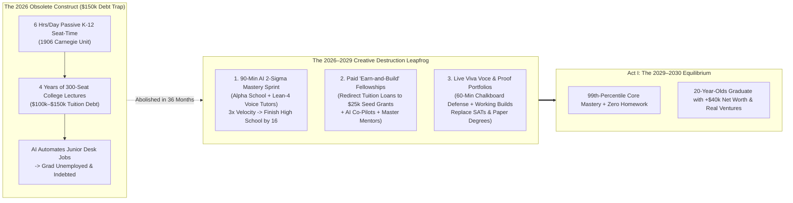
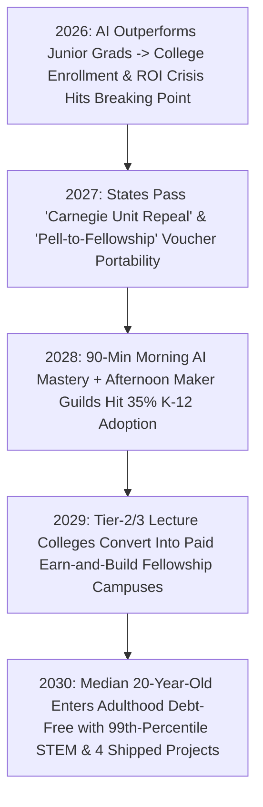

# VISION 02 (THE 2026–2030 LEAPFROG HORIZON): SOCIAL TRANSFORMATION SPRINT
## Pathway 2B: Killing the \$150,000 Lecture-and-Debt Trap — *90-Minute AI Mastery Sprints, Paid "Earn-and-Build" Fellowships, and Live Oral Defenses by 2029*

> **Executive Framing & The Core Leapfrog Thesis:**
> * **The 2026 Absurdity:** *"Why are 19-year-olds sitting in 300-person lecture halls taking out \$100,000 to \$150,000 in non-dischargeable student loans for 4-year junior coding, accounting, and business degrees that frontier AI models already outperform at 1/10,000th the cost in 2026?"*
> * **The 2026–2030 Leapfrog Thesis:** We do not have 15 years to reform education gradually while four more high school and college cohorts graduate into obsolete white-collar debt traps. Because the **1906 Carnegie Unit (seat-time credit)**, the **300-seat freshman lecture hall**, and the **\$150,000 degree credential** are 100% artificial human constructs, they undergo rapid **creative destruction between 2026 and 2029**. By collapsing two crises at once—(1) obsolete passive schooling and (2) entry-level white-collar job displacement—we leapfrog to a three-pillar architecture in 36 months: **(1) 90-Minute Daily 1-on-1 AI Mastery Sprints** (compressing Alpha School's proven 2-hour 99th-percentile model), **(2) Replacing Tuition Debt with Paid \$25,000 "Earn-and-Build" Civic & Venture Fellowships** for 16-to-22-year-olds, and **(3) Live Oral Defenses (*Viva Voce*) & Verified Proof Portfolios** that abolish standardized testing and degree gatekeeping overnight.

---

## ACT I: THE 2029–2030 LEAPFROG REALITY (48 MONTHS FROM TODAY)
### A Tuesday in October 2029 — How a 17-Year-Old and a 19-Year-Old Learn, Build, and Earn Debt-Free

Step inside the **Austin-Travis Guild & Fellowship Foundry** (housed inside a converted former corporate office atrium) on a Tuesday morning in **October 2029**. Both the K–12 factory bell and the 4-year tuition-debt treadmill have vanished:

1. **8:30 AM – 10:00 AM: The 90-Minute Hyper-Targeted AI Mastery Sprint (Ages 8–16):**
   Fourteen-year-old Leo sits in an acoustic timber pod for his **only 90 minutes of screen time all day**. Building directly on the 2024–2026 **Alpha School** empirical breakthrough—and accelerated by 2027 multimodal **Lean-4 formal-verification Socratic tutors**—Leo's AI co-pilot maps his exact cognitive frontier in real time.
   * There are zero passive video lectures and zero multiple-choice guessing games. The tutor guides Leo through differential equations and molecular thermodynamics via Socratic voice dialogue and interactive visual proofs, holding him in his optimal **85% flow zone** until he achieves **95% verified mastery**.
   * In **90 minutes each morning**, Leo masters a full year of K–12 STEM and literacy at **$3.0\times$ the speed of 2026 public schools**, scoring in the **99th percentile nationally** on historical benchmarks—and at 10:00 AM sharp, his tablet locks into an oak charging vault for the rest of the day.
2. **10:00 AM – 3:30 PM: Screen-Free Socratic Seminars & Physical Maker Guilds:**
   From 10:00 AM to noon, Leo and 11 peers debate constitutional law, Thucydides, and AI ethics face-to-face with their human **Master Guide** (a former corporate litigator now earning \$130,000/year coaching adolescent character and rhetoric). All afternoon, they build physical hardware, weld solar micro-grids, and run profitable community micro-enterprises.
3. **The 16-to-22 Leapfrog: Paid \$25,000 "Earn-and-Build" Fellowships Replace Tuition Debt:**
   Across the courtyard is Leo's 19-year-old sister, Maya. In 2026, Maya would have been taking out \$38,000/year in student loans to sit in crowded university auditoriums writing chatbot-generated essays.
   * Instead, after completing her K–12 Mastery Graph at age 16, Maya entered a **2-Year Paid Civic & Venture Fellowship**. Rather than charging her \$150,000 in tuition, the regional **Youth Capital & Apprenticeship Pool** (funded by redirecting defunct federal student-loan subsidies and state university bureaucracy budgets) pays Maya a **\$1,500/month stipend plus a \$25,000 Milestone Seed Grant**.
   * Paired with an AI engineering co-pilot and a human **Master Builder Mentor**, Maya's 4-person fellowship team has spent the past 14 months retrofitting 18 local commercial buildings with autonomous greywater-recycling cores (`02-housing`), generating \$210,000 in real revenue while earning equity.
4. **4:00 PM: The Live Oral Defense (*Viva Voce*) Instead of the Paper Diploma:**
   Today at 4:00 PM, Maya defends her thermodynamics and systems-engineering mastery—not with a Scantron exam, but by standing at a physical chalkboard before three industry Master Guides and municipal engineers for 60 minutes of unscripted, high-pressure questioning alongside her live hardware telemetry. When she passes, her **Cryptographic Competency Portfolio** updates globally—triggering three immediate \$115,000/year project-lead offers with **zero student debt**.

---

## ACT II: COLLAPSING TWO CRISES INTO ONE 36-MONTH LEAPFROG (2026–2029)
### Why the 4-Year Lecture University Collapsed Faster Than Anyone Predicted

In 2026, two crises collided simultaneously:
* **Crisis A (The Credential Collapse):** Higher education costs had inflated **1,400% since 1980**, burying 43 million Americans under **\$1.77 trillion in student debt**, even as 2026 frontier AI models instantly outperformed fresh B.A./B.S. graduates on standardized coding, legal research, financial modeling, and copywriting tasks.
* **Crisis B (The Youth Agency Crisis):** Teenagers and 20-somethings were trapped in 16 years of passive desk-sitting and homework drudgery, graduating with high anxiety and zero experience building real physical or civic systems.

Instead of spending a decade trying to "regulate AI homework cheating," pioneers between 2026 and 2028 **inverted the entire institutional stack**:

### Concrete 2026 Foundations Already Proving the 2026–2030 Sprint
Every component of this 4-year leapfrog was already operating in live cohorts by 2026:

| Leapfrog Pillar | 2025–2026 Live Baseline & Proof | Verified Performance Metric | 2027–2030 Aggressive Scaling Mechanism |
| :--- | :--- | :--- | :--- |
| **1. 90-Minute AI 2-Sigma Mastery Sprints** | **Alpha School** (Austin, Brownsville, Miami), **2 Hour Learning**, & **Synthesis Tutor** | Students complete all core academics in **1.5–2 hrs/morning** with zero teachers lecturing; learn **$2.4\times\text{–}3.0\times$ faster**; score in **top 1% nationally on NWEA MAP**. | Open-weight multimodal Socratic + **Lean 4 proof-verification tutors** compress daily core screen time to **90 minutes** across 25,000+ microschools and public districts by 2029. |
| **2. Abolishing the 4-Year Tuition Trap via Venture Fellowships** | **Thiel Fellowship**, **Emergent Ventures (Mercatus)**, **1517 Fund**, & **Swiss *Berufslehre*** | Grants of **\$10k–\$100k + mentorship** to 17–22-year-olds produced \$500B+ in frontier ventures and **<3% youth unemployment** in Switzerland. | Federal/state **"Pell-to-Build" Conversion Acts (2027)** allow any 16–22-year-old to convert \$30,000 of tuition/loan eligibility into a **\$25k Earn-and-Build Fellowship Grant**. |
| **3. Teacher-to-Master Guide & Mentor Reallocation** | **Alpha School "Guides"** (\$100k+ salaries) & **Acton Academy** (300+ global campuses) | Eliminating lesson-planning and worksheet grading raises educator satisfaction and student agency scores above **92%**. | Displaced senior engineers, scientists, and artisans from the 2026–2028 corporate AI wave (`02-unemployment`) enter guilds as **\$120k/yr Master Guides**. |
| **4. Live Oral Defense (*Viva Voce*) & Proof Portfolios** | **Oxford/Cambridge Tutorial System**, **Renaissance Guild Masterpieces**, & **YC Demo Days** | Live 60-minute chalkboard questioning + physical prototype verification has a **0.0% AI-cheating vulnerability**. | Major employers and state licensing boards drop B.A. degree requirements in **2027–2028** in favor of recorded **Viva Voce Defenses + GitHub/Hardware Proof Ledgers**. |

---

## ACT III: THE 48-MONTH SPRINT ROADMAP (2026 $\rightarrow$ 2027 $\rightarrow$ 2028 $\rightarrow$ 2030)

### Quantitative 48-Month Sprint Table: Education & Youth Launch (2026 vs. 2030)

| Metric / Institutional Dimension | 2026 Status Quo (Prussian Factory + Debt University) | 2027–2028 Mid-Sprint Inflection | 2030 Leapfrog Equilibrium |
| :--- | :--- | :--- | :--- |
| **Daily K–12 Core Academic Seat-Time** | **6.0 hours/day** of passive 1-speed classroom lectures + **2.5 hours** evening homework. | **2.0 hours/day** adaptive AI mastery morning; afternoon studios expand in 5,000+ schools. | **90 minutes/day (8:30–10:00 AM)** 1-on-1 Socratic AI flow state; **zero homework** nationwide. |
| **Median Cohort Academic Velocity & Percentile** | **$1.0\times$ baseline** (50th percentile median; 65% of 8th graders below proficiency). | **$2.2\times$ velocity** across early-adopter districts; remedial summer school abolished. | **$3.0\times$ velocity** (**98th–99th percentile** mastery); teens complete high school STEM by **age 15–16**. |
| **Daily Screen vs. Embodied Human Time** | **7–9 hours/day** on laptops/phones across class, homework, and passive scrolling. | Mandatory **10:00 AM Oak Screen Vaults** enacted across public and charter networks. | **Max 90 mins academic screen time**; **4.5 hours/day** of screen-free Socratic debate, craft, and grit. |
| **Ages 16–22 Post-Secondary Pathway** | **4-Year Lecture Degree**: 300-seat halls, textbook memorization, **\$100k–\$150k tuition/debt**. | Top 500 employers abolish degree screens; **Paid Venture & Civic Fellowships** scale to 1M youth. | **Paid 2-Year "Earn-and-Build" Fellowships**: youth receive **\$25k seed grants + \$18k/yr stipends**. |
| **Assessment & Credentialing Standard** | SAT/ACT Scantrons, AI-faked take-home essays, and seat-time transcripts. | Hybrid competency graphs + proctored live project demonstrations. | **60-Minute Live Chalkboard *Viva Voce* Defense** + verified working hardware/civic portfolio. |
| **Financial Position of a 21-Year-Old** | **-\$38,000 to -\$120,000 net worth** (student loans) + zero real-world build track record. | Student loan originations fall **60%** as youth opt into Earn-and-Build Fellowships. | **+\$35,000 to +\$60,000 positive net worth** (saved stipends + venture/guild equity) at age 21. |

### The Three Institutional Hacks That Make This Happen in 4 Years (Not 40)
1. **The "Universal Education Savings Account (ESA) + Pell Portability" Hack (2027):**
   * We don't wait for legacy school boards or university faculties to vote themselves out of existence. In 2026–2027, 30+ states expand Universal ESAs (already live in Arizona, Florida, Texas, and Iowa at **\$8,000–\$10,000/child**) and amend federal Title IV / Pell rules so **existing \$17,000/yr K–12 per-pupil funds and \$30,000 college grants automatically follow the student** into certified 90-Minute AI Mastery Guilds and Paid Earn-and-Build Fellowships.
2. **Repurposing Empty Office & Tier-3 College Floors into Maker Foundries (2027–2028):**
   * Instead of spending 5 years building new schools, fellowships lease vacant Class-B commercial office floors (`02-housing`) and struggling regional college campuses for pennies on the dollar—converting lecture halls into robotics bays, wet bio-labs, woodshops, and Socratic seminar cloisters in **60 days**.
3. **Turning Displaced Corporate Mid-Managers into \$120k Master Guides (`02-unemployment`):**
   * The exact 35-to-55-year-old engineers, project leads, and researchers displaced by corporate AI automation between 2026 and 2028 are fast-tracked in 6-week guild intensives to become **Afternoon Fellowship Mentors and Master Guides**—solving the youth mentorship shortage and white-collar displacement in a single stroke.

---

## ACT IV: ANSWERING THE SKEPTIC ON THE 2026–2030 SPRINT

1. **"Can a 17-year-old really build real civic or commercial value instead of sitting in college?"**
   * Throughout human history—until the artificial post-1970 credential inflation bubble—17-to-20-year-olds apprenticed in Renaissance workshops, captained ships, and built industrial machinery. Armed with a 2027 AI engineering co-pilot, a \$25,000 seed grant, and a veteran human mentor, a 4-person team of 18-year-olds can prototype medical devices, deploy neighborhood solar-water microgrids (`02-wars`), or build local agro-ecological businesses faster than a 2020s corporate department.
2. **"What about pure academic research—medicine, theoretical physics, and deep humanities?"**
   * Freed from running remedial freshman lecture factories for 20,000 unmotivated undergraduates, elite research universities return to their true mission: **intensive laboratory and philosophical fellowships** where 17-year-olds who already passed their 99th-percentile *Viva Voce* in calculus and biology work directly alongside Nobel-caliber scientists (`02-longevity`) from Day One.
3. **"How do we prevent kids from becoming socially isolated screen addicts?"**
   * By enforcing the **10:00 AM Oak Vault Rule**. Because 90 minutes of 1-on-1 Socratic AI tutoring replaces 6 hours of school lectures and 3 hours of laptop homework, young people in 2030 spend **80% less time staring at screens** than students did in 2026.

### Anatomy of a 19-Year-Old's Financials: 2026 Tuition Debt vs. 2029 Earn-and-Build Fellowship

| Financial & Career Line Item (Ages 18–21) | 2026 Traditional 4-Year University Track | 2029 Paid "Earn-and-Build" Fellowship Track | Net 4-Year Leapfrog Delta |
| :--- | :--- | :--- | :--- |
| **1. Tuition & Mandatory Campus Fees** | **-\$112,000** (\$28k/yr public-private blended avg) | **\$0** (100% replaced by portable Pell/ESA builder vouchers) | **+\$112,000 Saved** |
| **2. Room, Board & Debt Interest Carry** | **-\$64,000** (dorm markup + 7.5% compounding student loan interest) | **-\$28,000** (co-op loft in converted office tower at \$600/mo share) | **+\$36,000 Saved** |
| **3. Stipend, Seed Grant & Project Revenue** | **+\$12,000** (part-time minimum-wage barista/campus jobs) | **+\$61,000** (\$25k Milestone Seed Grant + \$1,500/mo Fellowship Stipend) | **+\$49,000 Earned** |
| **4. Shipped Equity & Verified Proof Assets** | **0 working builds**; generic B.A. resume filtered out by AI | **4 shipped hardware/civic systems** + live 60-min *Viva Voce* defense | **3 Immediate \$100k+ Offers** |
| **NET WORTH AT AGE 21** | **-\$164,000 Total Cost (-\$65k–\$120k Debt)** | **+\$42,000 to +\$65,000 Liquid Equity & Savings** | **>\$200,000 Wealth Swing** |

### What a 60-Minute Live Chalkboard *Viva Voce* Defense Actually Looks Like
To understand why employers and licensing boards drop the 4-year college degree requirement between 2027 and 2029, follow the three mandatory phases of a 60-minute **Cryptographic *Viva Voce* Defense**:
1. **Minutes 0–20: The First-Principles Chalkboard Derivation (Zero Notes, Zero Screens):**
   * The candidate stands inside an electromagnetic Faraday-shielded seminar room with three human Master Guides and a piece of chalk.
   * The panel selects a random node from the candidate's claimed Mastery Graph (e.g., fluid boundary-layer turbulence, constitutional separation of powers, or feedback control loops) and asks the candidate to derive the governing proof from scratch on the slate board while explaining every assumption aloud.
2. **Minutes 20–40: The Live Hardware / Community Stress-Test:**
   * The candidate brings the physical artifact or live civic system their 4-person Fellowship team built over the past 6 months—such as an autonomous agricultural soil-sensor mesh or a neighborhood greywater heat-recovery unit.
   * The panel deliberately injects a live fault (disconnecting a sensor lead, spiking load current, or challenging unit economics) and watches the candidate diagnose and repair the system under real-time pressure.
3. **Minutes 40–60: Socratic Ethical & Adversarial Cross-Examination:**
   * The panel cross-examines the candidate on failure modes, historical precedents, and moral trade-offs. Passing requires unanimous sign-off from all three Master Guides, which mints a tamper-proof **Viva Voce Verification Credential** anchored to the candidate's public portfolio.

### Cross-Domain Synergies Across the 2026–2030 Leapfrog Architecture
* **Link to `02-housing` (Office-to-Loft Conversions):** Every converted downtown commercial office tower reserves its 2nd and 3rd podium floors for a **Neighborhood 90-Minute Mastery School & Fellowship Foundry**, eliminating school bus commutes and turning dead business districts into intergenerational campus villages.
* **Link to `02-unemployment` & `02-existing-unemployed-bridge`:** Over 600,000 displaced corporate engineers, attorneys, and project managers transition in 6-week guild intensives into **\$120,000/year Master Guides and Afternoon Fellowship Mentors**.
* **Link to `02-religion` & `02-longevity`:** Afternoon guilds pair 17-year-old Earn-and-Build Fellows with biologically rejuvenated 75-year-old master artisans (`02-longevity`) inside neighborhood Sanctuary Cloisters (`02-religion`) forComing-of-Age Rites of Passage and moral philosophy.

### Summary for the Skeptic
> *"Why would any parent in 2028 pay \$150,000 for their child to sit in a 300-person lecture hall memorizing slides for a job AI already does, when 90 minutes a day of 1-on-1 AI tutoring delivers 99th-percentile mastery by age 16—and a Paid Earn-and-Build Fellowship pays them \$25,000 to spend the next four years building real technology, civic infrastructure, and debt-free wealth?"*

