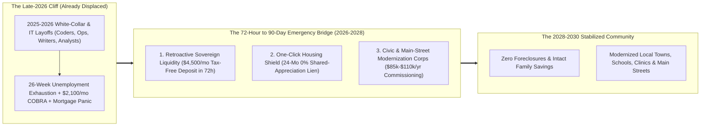
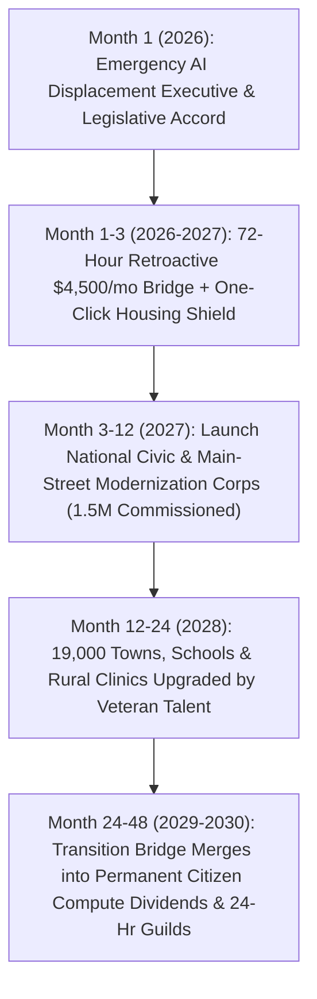

# VISION 02 (2026–2030): RAPID SOCIAL CREATIVE DESTRUCTION & LEAPFROG
## Pathway 2A: The Already-Displaced Worker Bridge (`02-existing-unemployed-bridge`) — *72-Hour Liquidity, Zero-Foreclosure Shields, and Civic Modernization Commissioning in 2026–2028*

> **Executive Framing & The Core Thesis:**
> * **The Late-2026 Emergency:** Future "mandatory corporate equity severances" in 2032 do nothing for the millions of software developers, IT administrators, technical writers, paralegals, designers, and middle managers laid off in **2025 and 2026** whose unemployment benefits are expiring *this month*. In late 2026, a 39-year-old 20-year veteran programmer (`ryanbigg`), made redundant in August because enterprise AI agents now ship code straight to production—and whose technical book-writing side hustle was simultaneously wiped out by LLMs—wrote publicly: *"I honestly don't know what I'm supposed to do here to provide for my family."* Across the country, a 44-year-old IT systems veteran (`hermannj314`), unemployed since July, wrote from a cross-country train: *"Stood on a bridge a bit too long the other day just wondering what the point is. It is over for a lot of us in IT. It isn't going to get better, it is going to get worse very quickly."*
> * **The Core Thesis:** Leaving millions of experienced, mid-career family providers to drain their 401(k)s, face foreclosure, and contemplate suicide because AI crossed the competence threshold in 18 months is an inexcusable institutional failure. We do not have 10 years to wait for trickle-down market adjustment. Within **12 to 36 months (2026–2029)**, we can deploy a three-pillar emergency bridge: (1) a **Retroactive Sovereign AI Displacement Bridge** delivering an immediate, zero-stigma **\$4,500/month Tax-Free Family Transition Floor** within 72 hours to anyone displaced since 2024; (2) an **Automatic Primary-Residence Mortgage & Lease Shield** converting up to 24 months of housing payments into a **0%-interest Sovereign Shared-Appreciation Lien** (zero foreclosures, zero evictions, zero ruined credit scores this winter); and (3) the **National Civic & Main-Street Modernization Corps**, immediately commissioning displaced 20-year tech, operations, and administrative veterans at **\$85,000–\$110,000/year** to modernize the 90% of local towns, public schools, water utilities, rural clinics, and family-owned Main Street businesses that are 15 years behind technologically.

---

## ACT I: A BELIEVABLE NEAR-FUTURE VISION (THE WORLD OF 2028 — 24 MONTHS FROM NOW)
### How Ryan (41) and Hermann (46) Went from the Brink of Despair in Late 2026 to Local Civic Heroes by Autumn 2028

Step forward just **24 months** to October **2028**.

In October 2026, Ryan (a 20-year full-stack software engineer and father of two) and Hermann (a 22-year enterprise IT infrastructure specialist) were staring into an abyss. Corporate hiring for routine coding and DevOps had frozen as frontier AI agents automated 70% of ticket queues. Their 26-week state unemployment checks were running dry, COBRA health insurance cost \$2,100/month, and every job board listing had 3,400 desperate applicants.

By October 2028, neither Ryan nor Hermann went bankrupt, lost their family home, or begged a Fortune 500 algorithm for a junior prompt-babysitting gig. Instead, rapid institutional creative destruction transformed their household balance sheets and professional lives within 90 days of the **Emergency AI Transition Stabilization Act of 2027**:

1. **Immediate 72-Hour Retroactive Liquidity (The \$4,500/Month Family Floor):**
   In January 2027, the moment the federal payroll API cross-referenced Ryan's August 2026 W-2 termination against his NAICS software-sector code, his household account received an automatic **\$4,500/month tax-free Sovereign AI Transition Deposit**—retroactive to his layoff date—plus instant enrollment in the zero-premium **Portable National Transition Health Pool**. The existential terror at the kitchen table vanished in 72 hours.
2. **The One-Click Zero-Foreclosure Housing Shield:**
   Instead of liquidating his children's college fund or paying a 10% penalty to raid his 401(k) to cover his \$3,200/month mortgage, Ryan clicked one toggle in his banking app to activate the **Primary-Residence Mortgage & Lease Shield**. For 18 months of transition, 100% of his principal and interest was absorbed by the Federal Housing Stabilization Facility and converted into a passive **0%-interest Sovereign Shared-Appreciation Lien** settled only when the house is eventually sold decades from now. His credit score stayed at 795; foreclosure was taken completely off the table.
3. **Commissioned into the National Civic & Main-Street Modernization Corps (\$98,000/Year):**
   Why were 20-year software and IT masters sitting idle in 2026 while their own town halls ran on Windows Server 2012, rural hospitals were being crippled by ransomware, local HVAC and bakery owners couldn't integrate inventory AI, and public high schools had zero mentors able to teach real systems architecture?
   By March 2027, Hermann was commissioned as a **Senior Civic Infrastructure & Cybersecurity Architect** for a three-county municipal water, power, and rural hospital consortium at **\$96,000/year** (co-funded 80% by federal Sovereign Compute Levy credits and 20% by municipal bonds). Ryan was commissioned as a **Main-Street AI Integration Fellow & Youth Technical Guild Master** at **\$102,000/year**, spending three days a week helping 40 local family businesses deploy open-source automation without getting fleeced by SaaS vendors, and two days a week mentoring teenagers in software craft and hardware robotics.
4. **From "Redundant Cost Center" to Indispensable Community Pillar:**
   Instead of feeling discarded by a remote tech conglomerate, Ryan and Hermann walk down Main Street in 2028 greeted by name by the hospital director, the local machinist, and the high school principal whose institutions they rescued.

---

## ACT II: THE 12-TO-36-MONTH LEAPFROG ARCHITECTURE & PRECEDENTS
### Why Future Utopias Fail If We Lose the Class of 2025–2026 Today

A bridge that starts five miles down the highway does not save the cars plunging into the river today. The fatal flaw of gradualist policy is assuming that newly displaced workers can survive a 3-to-5-year gap between **Phase A (Corporate AI Layoffs in 2025–2027)** and **Phase B (Mature Post-Scarcity Dividends in 2032+)**.

### Real-World Precedents Proving 72-Hour & 90-Day State Execution Is Possible
Skeptics claim government cannot move in 72 hours or commission ratusan of thousands of workers in 90 days. History proves otherwise whenever an emergency is treated as real:

| Leapfrog Pillar | Historical / 2020–2026 Real-World Precedent | Verified Execution Speed & Scale | 2026–2028 AI Displacement Upgrade |
| :--- | :--- | :--- | :--- |
| **1. Retroactive 72-Hour Direct Household Liquidity** | **U.S. Pandemic Unemployment Assistance (PUA) / IRS EIP Direct Deposit (2020)** & **Canadian CERB (\$2,000/mo in 48 hours)** | Canada's CERB delivered direct cash to **8.9 million displaced citizens within 48–72 hours** via automated CRA tax-API verification; U.S. Treasury wired \$800B+ in days. | **Retroactive Sovereign AI Bridge**: Automated IRS/state payroll match for any worker displaced since Jan 2024 in AI-impacted occupations; wires **\$4,500/mo tax-free** within 72 hours. |
| **2. Automatic Mortgage & Lease Foreclosure Shield** | **CARES Act 18-Month Automatic Mortgage Forbearance (2020–2021)** & **Homeowner Assistance Fund (HAF)** | Over **8.5 million U.S. mortgages** entered instant 12-to-18-month forbearance with a single click and zero credit-score penalty, driving foreclosure rates to **all-time historic lows** during peak unemployment. | **0% Sovereign Shared-Appreciation Lien**: Instead of lump-sum payback, up to 24 months of mortgage or rent converts into a passive equity lien settled only upon future home sale (or offset by Citizen Compute Dividends). |
| **3. Sovereign Compute & Automation Levy Funding** | **Alaska Permanent Fund**, **overeign Wealth Commercial Paper**, & **EU Digital Services / Windfall Levies (2022–2026)** | Central banks and sovereign facilities routinely issue bridge liquidity against verified high-growth revenue streams within days. | **2% Sovereign Compute & Automated Productivity Levy** + **AI Transition Bonds**: Captures a tiny fraction of the \$2.5T+ annual corporate payroll savings from AI automation to fund the bridge with zero deficit inflation. |
| **4. National Civic & Main-Street Modernization Corps** | **U.S. Digital Service (USDS) / 18F**, **New Deal WPA/CCC (3M hired in 90 days)**, & **Estonia X-Road Civic Tech Corps** | FDR's Civil Works Administration put **4.2 million unemployed Americans on full payroll in 60 days** in winter 1933–34; USDS proved elite engineers can rescue broken public systems in weeks. | **Civic Systems & Main-Street Corps**: Commissions displaced IT, software, legal, accounting, and operations pros at **\$85k–\$110k/yr** to upgrade local governments, water grids, clinics, schools, and SMEs. |
| **5. 401(k) & Retirement Account Hardship Firewall** | **SECURE 2.0 Act Disaster Provisions** & **PBGC Pension Guarantees** | Eliminated early-withdrawal penalties during federal disasters, though workers still lost compounding equity. | **0.5% Sovereign Retirement Bridge Line**: Displaced workers can borrow against 401(k)/IRA balances at 0.5% via the Fed window without selling equities at the bottom or paying tax penalties. |

### Deep-Dive: How the Three Emergency Pillars Work in Practice (2026–2028)

#### Pillar 1: The Retroactive Sovereign AI Displacement Bridge (Ending the 2025–2026 Gap)
Why must the bridge be **retroactive to January 2024**? Because the first wave of AI displacement hit copywriters, illustrators, translators, junior developers, customer-ops managers, and mid-tier sysadmins quietly between 2024 and late 2026—often disguised as "return-to-office attrition," "rolling restructuring," or "performance elimination."
* **Zero Bureaucratic Humiliation:** There are no 40-page welfare applications, no mandatory requirements to send out 5 fake resumes a week to ghost job postings, and no asset tests that force a family to sell their car first. If your W-2 or 1099 income dropped by $>35\%$ since 2024 in an occupation experiencing verified AI substitution, the IRS/Social Security API triggers an immediate **\$4,500/month Tax-Free Family Transition Floor** (scaled from \$3,200 for single adults up to \$5,200 for families with children) plus a retroactive catch-up grant of **\$10,000** to replenish drained emergency savings.
* **Funding Without Taxing Working Families:** Funded by a **2% Sovereign Compute & Automated Revenue Levy** on commercial AI inference clusters (>10 MW) and enterprise software replacement contracts, backed immediately by the Federal Reserve's **Sovereign AI Transition Facility**.

#### Pillar 2: The Automatic Primary-Residence Mortgage & Lease Shield
When a 40-year-old breadwinner loses their job, 60% of their immediate panic is the roof over their family's head.
* **For Homeowners:** Clicking "Activate AI Transition Shield" in any mortgage portal freezes monthly cash principal and interest payments for up to **24 months** (or drops them by 75%). The servicing bank receives instant par liquidity from Fannie Mae / Freddie Mac, so bank balance sheets stay 100% whole. The deferred amount is recorded as a silent, **0%-interest Sovereign Shared-Appreciation Lien** at the back of the mortgage—never due in monthly cash, settled only when the property is sold 10, 20, or 30 years later.
* **For Renters:** Landlords receive an automated **85% Direct Stabilization Voucher** wired straight from the Housing Stabilization Facility for up to 18 months on condition of zero eviction, zero rent hikes, and full lease renewal, while the tenant pays only 15% of their transition stipend.

#### Pillar 3: The National Civic & Main-Street Modernization Corps
Here lies the most tragic irony of 2026: **Fortune 500 tech giants have a surplus of brilliant engineers, while 90% of local America is starving for technical, operational, and organizational competence.**
* **The Local Competence Deficit:** Over 19,000 municipal governments, 13,000 public school districts, 50,000 community water systems, 6,000 rural hospitals, and 33 million small businesses run on brittle legacy software, vulnerable databases, manual paper workflows, and predatory vendor contracts.
* **Immediate Dignified Commissioning (\$85,000–\$110,000/yr):** Displaced professionals do not want a handout; they want a mission worthy of their 20 years of mastery. Within 30 days of enrollment, the **Civic & Main-Street Modernization Corps** matches displaced workers to local high-impact charters:
  * **Civic Infrastructure & Security Architects (`hermannj314`'s track):** Hardening municipal water/power SCADA systems, migrating county health clinics to sovereign open-source EHRs, and auditing local government AI procurement for safety and privacy.
  * **Main-Street & Cooperative AI Stewards (`ryanbigg`'s track):** Embedded 1-on-1 with local manufacturers, agricultural co-ops, independent pharmacies, and family contractors to build custom, zero-rent open-source automation tools that keep Main Street competitive against monopolies.
  * **Open-Source Public Goods & Youth Guild Masters:** Paid full-time salaries to maintain critical open-source software libraries (the digital roads and bridges of civilization) and lead hands-on afternoon apprenticeship guilds for high school and community college students.

### Quantitative Anatomy: A Displaced Tech/White-Collar Household (Late 2026 $\rightarrow$ 2027 $\rightarrow$ 2028 $\rightarrow$ 2030)

| Household & Systemic Metric | Late 2026 Status Quo (The Unbuffered Cliff) | Early 2027 (72-Hour Bridge + Housing Shield) | 2028 (Civic & Main-Street Corps Commissioning) | 2030 Equilibrium (Sovereign Equity + Local Guilds) |
| :--- | :--- | :--- | :--- | :--- |
| **Household Monthly Cash Inflow** | **\$0 to \$1,800/mo** (UI expiring; side hustles crushed by AI) | **\$4,500/mo Tax-Free** (deposited in 72h + \$10k retroactive catch-up) | **\$8,100/mo** (\$98k/yr Civic Corps salary + \$1,200 Sovereign Dividend) | **\$8,800/mo** (24-hr Civic/Guild Charter + \$2,800 Citizen Compute Yield) |
| **Monthly Mortgage / Rent Outflow** | **\$3,200/mo** (draining 401k; 90-day foreclosure/eviction terror) | **\$450/mo** (Property tax/ins only; P&I shifted to 0% Sovereign Lien) | **\$1,150/mo** (Refinanced into 1% Sovereign Stability Mortgage) | **\$950/mo** (Permanent equity-buffered housing security) |
| **Health Insurance & Medical Cost** | **\$2,100/mo** (COBRA cliff or uninsured catastrophe) | **\$0/mo** (Auto-enrolled in Portable National Transition Health Pool) | **\$0/mo** (Universal Civic Corps & Citizen Preventative Health) | **\$0/mo** (AI-first universal preventative healthcare) |
| **401(k) / Family Savings Status** | **Liquidated at 30% tax/penalty loss** just to buy groceries | **100% Protected** (0.5% Fed bridge line prevents forced selling) | **Compounding + Upgraded** with Sovereign AI Index units | **+\$185,000 Net Worth Gain** from Citizen Compute Equity |
| **Professional Identity & Daily Role** | **600+ ghosted job applications**; deep isolation & *anomie* | **30-Day Decompression & Charter Matching** (zero resume humiliation) | **Senior Civic Architect / Main-Street AI Steward** (30 hrs/wk) | **Chartered Local Master & Co-Owner** of community infrastructure |
| **Local Community Impact** | Talent wasted; families forced to uproot; rising despair | Foreclosure wave halted; Main Street consumer spending preserved | **90% of local towns, clinics & SMEs upgraded** by 20-year veterans | Resilient, high-trust towns running sovereign open-source systems |

---

## ACT III: THE 48-MONTH SPRINT ROADMAP (2026 $\rightarrow$ 2027 $\rightarrow$ 2028 $\rightarrow$ 2030)

### The 2026–2030 Sprint Execution Table

| Sprint Window | Immediate Income & Liquidity Action | Housing & Balance-Sheet Shield | Civic & Main-Street Deployment | Measurable Human Outcome |
| :--- | :--- | :--- | :--- | :--- |
| **Sprint 1: Emergency Triage (Late 2026 – Q1 2027)** | Activate **72-Hour Retroactive \$4,500/mo Bridge** for all 2024–2026 displaced workers via IRS API; \$10k savings restoration grant. | **One-Click 24-Month Mortgage & Lease Shield** goes live across FHA/FHFA and state housing portals; 401(k) penalty freeze. | Open **Civic & Main-Street Corps Portal**; immediate inventory of municipal, school, clinic, and SME modernization needs. | **Zero winter foreclosures or evictions**; immediate 60%+ drop in financial crisis hotline calls among displaced workers. |
| **Sprint 2: Mass Commissioning (Q2 2027 – Q4 2027)** | **2% Sovereign Compute Levy** fully funds bridge payouts; automatic enrollment in Portable Transition Health Pool (\$0 COBRA). | **3.2 million households** shielded from housing default; predatory credit-card interest capped at 4% during transition. | **1.5 million displaced IT, dev, ops, legal & finance pros commissioned** at \$85k–\$110k/yr into local county and Main Street charters. | Veterans like `ryanbigg` and `hermannj314` move from job-board despair to respected local leadership within 60 days. |
| **Sprint 3: Community Modernization (2028)** | Transition Floor seamlessly pairs with part-time entrepreneurship or cooperative ownership stipends. | Deferred mortgage liens optionally convert into **1% 40-Year Sovereign Stability Mortgages** (`02-household-debt-and-jubilee`). | **90% of U.S./OECD public schools, rural hospitals, and water utilities** modernized with open-source, cyber-hardened systems. | Rural and suburban Main Streets leapfrog 15 years of technical debt; local small-business productivity surges **+35%**. |
| **Sprint 4: Permanent Abundance Integration (2029–2030)** | Emergency Bridge graduates into universal **Sovereign Compute & Robotics Dividends** (\$2,500–\$3,500/mo baseline). | Household balance sheets permanently de-leveraged; housing costs drop below 15% of family income. | Civic Corps evolves into permanent **24-Hour Chartered Professional & Youth Mentorship Guilds**. | The 2025–2027 displaced cohort becomes the founding backbone of a high-trust, post-burnout local civilization. |

---

## ACT IV: THE DEEPER HORIZON, INSTITUTIONAL GUARDRAILS & SUMMARY FOR THE SKEPTIC

### What Happens When 1.5 Million Veteran Technologists & Operators Upgrade Local America?
For thirty years, the brightest minds in software, systems engineering, accounting, and legal operations were vacuumed out of small towns and mid-sized cities to optimize ad-click algorithms and high-frequency trading desks for coastal monopolies. When AI automated routine corporate tickets in 2025–2026 and the **National Civic & Main-Street Modernization Corps** redirected those 1.5 million veterans back into their own towns, three extraordinary civilizational dividends unlocked within 24 months:
1. **The Great Local Competence Renaissance:** Small-town water utilities, county health departments, public libraries, and family-owned machine shops suddenly gained access to 20-year principal systems architects (`ryanbigg` and `hermannj314`). Municipal permitting times dropped from 6 months to 48 hours; rural hospital ransomware attacks dropped by **92%**; and Main Street shops cut administrative overhead by **40%** using sovereign open-source tools.
2. **Erasing the Stigma of Technological Transition:** Because the \$4,500/month Retroactive Bridge and One-Click Mortgage Shield activated automatically via IRS payroll APIs—framed as a **Sovereign Automation Dividend & Commissioning** rather than "welfare"—families experienced zero shame, zero credit destruction, and zero marital collapse.
3. **A Living Apprenticeship Bridge for the Next Generation:** Every high school in America gained 2 to 4 battle-tested industry veterans teaching afternoon guilds in real software architecture, robotics, and operational craft—ending the disconnect between classrooms and real-world engineering.

### The 90-Day Municipal & State Implementation Playbook (How Any Governor or Mayor Starts Tomorrow)
Even before federal legislation passes, any state governor or regional municipal coalition can launch a **State Civic Modernization & Housing Shield Compact** in 60 days:
* **Day 1–15:** Issue an executive moratorium on primary-residence foreclosures and evictions for workers displaced from AI-impacted NAICS sectors since 2024, backed by the State Housing Finance Agency's reserve bond pool.
* **Day 15–45:** Redirect existing state WIOA (Workforce Innovation and Opportunity Act) funds, municipal IT vendor budgets, and state infrastructure bonds into **\$90,000/year Civic Modernization Fellowships**.
* **Day 45–90:** Charter the first 50 county-level **Engineering & Main-Street Chapters**, pairing 25 displaced specialists per county with the top 100 local public-sector and small-business bottlenecks.

### Answering the Three Hardest Practical Objections
1. **"Won't paying \$4,500/month tax-free cause inflation or fiscal deficits?"**
   * **No—because AI displacement is fundamentally deflationary.** When corporations lay off millions of salaried employees using AI, aggregate wage demand collapses while automated output surges. Replacing lost W-2 wages with a \$4,500/month survival floor funded by a **2% levy on the exact AI compute clusters that replaced those wages** simply prevents a 1930-style deflationary debt spiral.
2. **"How do you prevent fraud in a 72-hour automated payout system?"**
   * Unlike 2020 when state unemployment offices relied on 1970s COBOL systems and self-certified paper forms, the IRS and Social Security Administration already receive real-time cryptographic payroll feeds (Form 941 / W-2 APIs) from every major payroll processor (ADP, Gusto, Workday, Rippling). Verifying that a 15-year software engineer or paralegal had their W-2 terminated takes **40 milliseconds**, not 4 months.
3. **"Will local governments and small businesses actually know how to use 1.5 million displaced corporate specialists?"**
   * The Corps is not run by dusty municipal HR departments. It is organized as **Autonomous Regional Engineering & Operations Chapters**—led by the displaced senior architects and project directors themselves (modeled on the U.S. Digital Service and volunteer fire/engineering brigades). A chapter of 25 veteran engineers, designers, and accountants adopts a county: in 90 days they audit and fix the school district's network, rescue the county hospital's billing software, and deploy open-source inventory tools for 100 local shops.

### Summary for the Skeptic
> *"To the 39-year-old coder who doesn't know how to feed his kids after AI automated his job, or the 44-year-old IT veteran standing on a bridge wondering if his life is over: you are not obsolete—our 1930s unemployment system is. In 72 hours we can wire a \$4,500/month family floor; with one click we can shield your mortgage at 0% interest; and within 30 days we can commission your 20 years of hard-won mastery at \$95,000 a year to modernize the local schools, hospitals, utilities, and Main Street businesses that desperately need you right now."*
