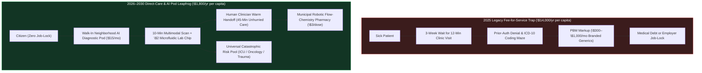
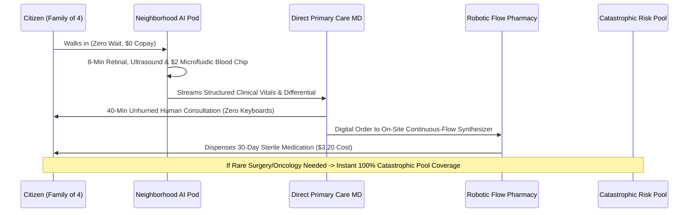

# 02 — Healthcare & Insurance Leapfrog: Bypassing the \$1.2 Trillion Billing Complex (2026–2030)

> [!IMPORTANT]
> **The 2026–2030 Leapfrog Thesis:** Developing nations did not modernize telecommunications by laying copper landlines to every village; they leapfrogged straight to cellular towers. Between 2026 and 2030, humanity will not fix healthcare by tweaking 70,000 ICD-10 billing codes or begging Pharmacy Benefit Managers (PBMs) for mercy. Instead, we **starve and bypass the \$1.2 trillion administrative-insurance middleman entirely**—replacing fee-for-service bureaucracy with **\$15/month Neighborhood AI Diagnostic Pods**, **on-site robotic continuous-flow drug synthesis**, and **W-2-decoupled Direct Primary Care + Universal Catastrophic Pools**.

---

## 1. Why Incremental Healthcare Reform Failed—and Why the 2026–2029 Bypass Works

In 2026, nearly 30% of every healthcare dollar in the United States—over \$1.2 trillion annually—is consumed not by doctors, nurses, or medicines, but by billing clerks, prior-authorization denial algorithms, coding compliance, and PBM spread pricing. Worse, tying health coverage to full-time W-2 corporate employment paralyzes workforce mobility right as AI restructures the labor market.

Rather than fighting a 20-year legislative trench war against insurance lobbies to reform billing codes, the **2026–2030 Healthcare Leapfrog** collapses the cost of primary diagnostics and generic pharmaceuticals by **85% to 92%**, making routine care so inexpensive that third-party insurance claims become as obsolete as filing an auto-insurance claim for a \$15 oil change.

---

## 2. Three Pillars of the 2026–2030 Healthcare Leapfrog

### Pillar I: Neighborhood AI Diagnostic Pods & \$2 Microfluidic Lab Chips
Instead of waiting weeks for a rushed 12-minute appointment to get a basic lab requisition, citizens walk into decentralized **Neighborhood Diagnostic Pods** hosted in community pharmacies, libraries, workplaces, and converted strip-mall storefronts:
- **Multimodal Clinical Sensing:** Inside a private, soundproofed acoustic cabin, ambient medical AI combines high-resolution retinal OCT imaging, dermatoscopic skin scanning, non-invasive cuffless optical blood pressure, digital auscultation, and portable solid-state pocket ultrasound (POCUS).
- **Single-Drop Microfluidic Blood & Saliva Panels:** A painless capillary finger-stick or saliva swab feeds a **\$2 lab-on-a-chip cartridge** that runs 45 metabolic, endocrine, inflammatory, lipid, and infectious-disease assays plus early circulating tumor DNA (ctDNA) methylation markers in **8 minutes**.
- **Unburdened Human Clinicians:** Because the AI Pod handles 100% of intake charting, routine triage, and lab interpretation at board-specialist accuracy, human physicians and nurse practitioners are liberated from keyboards—spending **45 minutes face-to-face** with complex or emotionally vulnerable patients.

### Pillar II: Open-Source Robotic Continuous-Flow Drug Compounding
Why does a vial of insulin, a GLP-1 metabolic peptide, or a generic sterile antibiotic cost \$300 to \$900 when its active pharmaceutical ingredients (APIs) cost \$1.80? Because supply chains are bottlenecked by opaque PBM rebates and offshore batch factories.
- **Hospital & Municipal Micro-Foundries (Civica Rx + DARPA Pharmacy-on-Demand):** Building directly on DARPA's battlefield continuous-flow chemical synthesizers and non-profit hospital consortia like **Civica Rx**, regional health cooperatives deploy automated, FDA-pre-validated **Robotic Continuous-Flow Compounding Units**.
- **Pennies-Per-Dose Essential Medicines:** Using open-source chemical synthesis cartridges and cell-free biologic expression modules, municipal pharmacies synthesize sterile insulin, GLP-1 agonists, oncology generics, and pediatric antibiotics on-demand for **\$2 to \$8 per monthly course**, completely bypassing PBM middlemen.

### Pillar III: Direct Primary Care (DPC) + Universal Catastrophic Pool
To end the terror of losing family healthcare during a layoff or career pivot, the 2026–2030 transition splits health financing into two transparent layers:
1. **Universal Direct Primary Care Membership (\$45–\$65/month):** Every citizen holds a portable DPC + AI Pod subscription (funded via tax credits, sovereign compute dividends, or portable employer stipends) covering 100% of primary care, mental health coaching, preventive diagnostics, and generic flow-compounded drugs with **zero copays, zero deductibles, and zero insurance claims**.
2. **Sovereign Catastrophic & Rare-Disease Pool:** True insurance is restored to its actual mathematical purpose—pooling rare, high-cost tail events (trauma surgery, ICU stays, gene therapies, complex oncology). By eliminating primary-care billing overhead, total catastrophic pool premiums drop by **60%**.

---

## 3. Real-World Precedents & 2026–2030 Leapfrog Economics

| Healthcare Dimension | 2025 Legacy System | Real-World Seed Precedent (2024–2026) | 2028–2030 Leapfrog Standard | Cost / Time Compression |
| :--- | :--- | :--- | :--- | :--- |
| **Routine Diagnostics & Labs** | \$450 clinic + Quest bill; 14-day turnaround | Forward CarePods; Prenuvo; Butterfly iQ POCUS; microfluidic point-of-care | **Neighborhood AI Pod + \$2 Lab-on-Chip** in 10 minutes | **94% cost drop**; instant results |
| **Primary Care Access** | 26-day average wait; 12-min rushed visit; 2 hrs of EHR clerical work per 1 hr of care | Direct Primary Care (DPC) clinics (2,500+ US clinics); ambient AI scribes | **Zero-billing DPC + AI Pod triage**; 45-min human clinician visits | **Zero insurance claims**; 3.5x face-to-face time |
| **Essential Drugs & Biologics** | PBM spread pricing; \$300–\$1,000/mo GLP-1s & biologics | **Civica Rx** (1,500+ hospitals); Mark Cuban Cost Plus Drugs; MIT/DARPA flow reactors | **Municipal Robotic Continuous-Flow Micro-Foundries** | **85%–95% price reduction** |
| **Prior Authorization & Billing** | \$1.2T/yr admin waste; 14% claim denial rate; weeks of delay | Real-time automated clinical guideline APIs; cash-pay surgical centers (Surgery Center of Oklahoma) | **Bundled Transparent Pricing** + Instant Clinical Protocol Auto-Approval | **~0% billing friction**; \$800B+/yr saved |
| **Employment Mobility** | COBRA costs \$2,200/mo for a family; millions trapped in dead-end W-2 jobs | ICHRA portable health stipends; Singapore Medisave + MediShield Life | **100% Portable Citizen Health Account** + Universal Catastrophic Backstop | **Zero job-lock** during AI transition |

---

## 4. The 48-Month Sprint Roadmap (2026 $\rightarrow$ 2027 $\rightarrow$ 2028 $\rightarrow$ 2030)

### **2026: The Great Bypass Ignites (Months 1–12)**
- **Federal & State "Direct-Care Safe Harbor" Compacts:** States pass two-page model legislation clarifying that **Direct Primary Care + AI Diagnostic Pod memberships are not insurance**, exempting them from archaic insurance-commission mandates and allowing HSA, Medicaid, and employer pre-tax dollars to pay the \$50/month membership directly.
- **FDA Predetermined Change Control Plans (PCCP) for Pod Diagnostics:** The FDA fast-tracks class-wide clearance for autonomous multimodal diagnostic pods paired with human-in-the-loop clinician sign-off for high-risk findings.
- **PBM Transparency & Bypass Blitz:** Every hospital system joining the **Civica-OpenFlow Consortium** installs its first modular continuous-flow generic compounding reactor, immediately cutting inpatient and outpatient generic drug spend by 70%.

### **2027: Scaling Neighborhood Pods & Ending Employer Job-Lock (Months 13–24)**
- **50,000 Neighborhood AI Pods Live Nationwide:** Installed in YMCA centers, rural post offices, grocery pharmacies, and community colleges. A laid-off worker or gig parent can walk in with their child at 8:00 PM for an ear-infection scan, strep microfluidic test, and automated amoxicillin dispense in **14 minutes for \$10 total**.
- **Universal Portable Health Vouchers:** Any worker displaced by AI or shifting to part-time/fractional work automatically receives a portable **\$75/month Direct Care Voucher** plus automatic enrollment in the **State/Federal Catastrophic Backstop Pool**—permanently ending the COBRA cliff.

### **2028: The Collapse of the Prior-Authorization Complex (Months 25–36)**
- **Transparent Bundled Surgical Marketplaces:** Following the *Surgery Center of Oklahoma* model scaled nationally via AI quality-outcome registries, 70% of elective orthopedic, cardiac, and obstetric procedures move to all-inclusive, upfront bundled cash/pool pricing (e.g., \$4,800 total for a knee replacement vs. \$42,000 billed to legacy insurers).
- **Retraining 600,000 Medical Billing Clerks into Community Health Navigators:** As insurance coding and denial bureaus shrink by half, displaced billing specialists enter 6-week paid transition sprints to become **High-Touch Community Health & Longevity Coaches**, guiding elderly and chronic-care patients through nutrition, mobility, and home biomonitoring.

### **2029–2030: The Post-Billing Healthcare Equilibrium (Months 37–48)**
- **90% of Primary & Preventive Care Occurs Outside Legacy Insurance:** By 2030, filing an insurance claim for a doctor's visit, blood panel, ultrasound, or generic prescription is viewed as an absurd 20th-century relic.
- **Population Health Outcomes Surge:** With zero financial fear delaying early checkups and \$5/month access to continuous metabolic/cardiovascular coaching and flow-synthesized therapeutics, preventable ER visits drop by **48%**, stage-IV late cancer diagnoses fall by **35%**, and household medical bankruptcies drop to **near zero**.

---

## 5. How Institutional Resistance Is Overcome (Creative Destruction in Action)

1. **Defeating Hospital & Insurance Cartel Blocking via "Cash-Price Parity Laws":**
   - *The Problem:* Legacy hospital monopolies use opaque chargemasters to charge uninsured or direct-pay patients 5x what insurers pay.
   - *The 2026 Fix:* A simple statutory mandate: **No provider may charge a direct-pay citizen or catastrophic pool more than the lowest negotiated Medicare/commercial rate, minus 15% for saved billing overhead.**
2. **Solving Physician Malpractice Fear via "AI-Co-Pilot Safe Harbor":**
   - *The Problem:* Defensive medicine drives \$200B/year in unnecessary CTs and referrals.
   - *The 2027 Fix:* Clinicians who utilize open-source, peer-audited multimodal AI diagnostic second-opinions receive automatic statutory safe harbor against standard-of-care malpractice suits, slashing malpractice premiums by 70%.
3. **Turning Doctors Back into Healers:**
   - Physicians and nurses become the fiercest champions of the leapfrog once they realize **Direct Care + AI Pods** increases their net take-home pay while cutting their weekly administrative keyboard hours from **22 hours down to zero**.

---

## 6. Household & Municipal Financial Ledger (2025 vs. 2029 Family of Four)

To understand why the **Direct Care + AI Pod + Catastrophic Pool** model wins rapid, overwhelming bipartisan adoption between 2026 and 2029, compare the actual cash-flow ledger of a median family of four:

| Annual Healthcare Cost Item | 2025 Employer/ACA Insurance Model | 2029 Direct Care + AI Pod Leapfrog | Net Annual Household / Employer Savings |
| :--- | :--- | :--- | :--- |
| **Employee + Employer Premium Share** | \$25,500 / yr (\$6,500 worker + \$19,000 employer) | \$0 legacy insurance premium | **+\$25,500 / yr liberated for wages** |
| **Direct Primary Care + AI Pod Pass** | Included only after \$4,500 deductible | **\$1,800 / yr** (\$150/mo family unlimited access) | Unlimited zero-wait primary & diagnostic care |
| **Universal Catastrophic Pool Contribution** | Embedded in bloated commercial premium | **\$2,400 / yr** (pure tail-risk ICU/oncology/trauma pool) | 100% protection against medical bankruptcy |
| **Microfluidic Labs & Imaging (4x/yr)** | \$1,600 out-of-pocket co-insurance | **\$40 / yr** (\$2 microfluidic chips + pod scans) | **97.5% diagnostic savings** |
| **Chronic & Acute Prescriptions (GLP-1, Insulin, Antibiotics)** | \$2,800 / yr copays & PBM deductible tiers | **\$140 / yr** (municipal robotic flow compounding) | **95% pharmaceutical savings** |
| **TOTAL ANNUAL COST (All-In)** | **\$29,900 / year** (plus 18 hrs of billing phone stress) | **\$4,380 / year** (zero claims, zero prior-auth) | **\$25,520 / year saved per family (85% reduction)** |

---

## 7. The 90-Day Municipal & Employer Action Playbook (Starting Today)

Any city mayor, county health department, labor union, or mid-sized employer can initiate this leapfrog in **90 days** without waiting for federal healthcare gridlock to clear:

### **Days 1–30: Redirect Self-Insured Health Plan Spend**
1. **Carve Out Primary Care & Generics:** Self-insured municipalities, school districts, and employers (who already bear 100% of their workers' medical risk under ERISA) cancel their bloated carrier administrative contracts and enroll every employee family directly into a local **Direct Primary Care + Neighborhood AI Pod Network** for \$50/adult/month, paired with a low-cost stop-loss catastrophic wrapper.
2. **Adopt Cash-Price Surgical Bundles:** Offer employees a **\$1,500 cash bonus** whenever they choose a transparent, center-of-excellence bundled surgical center (where a \$5,000 bundled procedure replaces a \$38,000 hospital chargemaster claim).

### **Days 31–60: Deploy Neighborhood Diagnostic Pods in Civic Spaces**
1. **Public Library & Pharmacy Pod Leases:** Cities lease 80-square-foot corners inside public libraries, community centers, and transit hubs for \$1/year to accredited **Open-Protocol AI Diagnostic Pod Cooperatives**.
2. **24/7 Walk-In Triage:** Residents scan their municipal health pass (or pay \$10 cash) for instant pediatric ear/throat checks, retinal cardiovascular screening, portable ultrasound, and 8-minute microfluidic blood panels—diverting 45% of non-emergency visits away from overcrowded hospital ERs within the first 60 days.

### **Days 61–90: Join the Municipal Flow-Pharmacy Purchasing Alliance**
1. **Pool Municipal & Hospital Generic Demand:** City hospitals and county clinics sign a joint purchasing agreement with **Civica Rx** and install a modular **Continuous-Flow Sterile Compounding Unit** at the central county hospital pharmacy.
2. **At-Cost Citizen Dispensing:** Essential generic medications—insulin, asthma inhalers, cardiovascular statins, antibiotics, and metabolic peptides—are dispensed directly to residents at **production cost + \$2 dispensing fee**, permanently breaking local PBM monopoly pricing.

