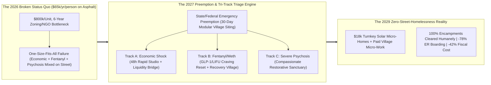
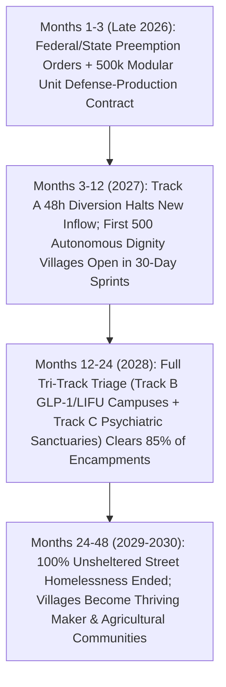

# VISION 02 (2026–2030): RAPID SOCIAL CREATIVE DESTRUCTION & LEAPFROG
## Pathway 2C: Ending Street Homelessness in 18–36 Months (`02-homelessness`) — *State Preemption, 30-Day Autonomous Dignity Villages, and Compassionate Tri-Track Triage (2026–2029)*

> **Executive Framing & The Core Thesis:**
> * **The Late-2026 Emergency:** Across North America and Europe in 2026, street homelessness has reached a moral and fiscal breaking point. Major cities spend **\$55,000 to \$95,000 per unhoused person per year** on a cruel, dysfunctional carousel of sidewalk encampment sweeps, emergency room visits, police overtime, and unaccountable NGO bureaucracy—while municipal zoning and permitting delays make "affordable housing" take **6 years and \$750,000–\$900,000 per unit** to build. Worse, a paralyzed ideological stalemate treats three completely different human crises—(1) families/workers hit by sudden rent or job shocks, (2) people trapped in lethal fentanyl/meth addiction, and (3) individuals suffering from severe untreated psychosis—as if a single policy ("leave them on the asphalt in the name of autonomy" or "wait 6 years for an apartment") could work for all three.
> * **The Core Thesis:** Leaving human beings to rot, freeze, or overdose on concrete sidewalks in the richest era of technological history is a choice, not an inevitability. Within **18 to 36 months (2026–2029)**, any state or nation can permanently end unsheltered street homelessness at **40% lower annual cost than the 2026 status quo** by executing three rapid institutional leapfrogs: (1) **Emergency State/Federal Land & Zoning Preemption**, bypassing municipal NIMBY delays and NGO middlemen to deploy factory-built, solar-powered, climate-controlled **Autonomous Dignity Villages (\$18,000/unit BOM, scaled 50x from Austin's *Community First! Village* and Pallet/Boxabl rapid fabrication)** on public/surplus land within **30 days**; (2) **Mandatory Compassionate Tri-Track Triage**, immediately routing every unhoused citizen into the exact track their condition requires (**Track A: Rapid Economic Housing**, **Track B: Medical Craving-Reset Addiction Campus**, or **Track C: High-Staffed Restorative Psychiatric Sanctuary**); and (3) **Paid Micro-Enterprise & Civic Guild Integration** that restores work, belonging, and self-respect from Day 1.

---

## ACT I: A BELIEVABLE NEAR-FUTURE VISION (THE WORLD OF 2029 — 30 MONTHS FROM NOW)
### Walking Through Downtown & The Oak Creek Dignity Village in Spring 2029

Imagine walking through downtown San Francisco, Los Angeles, Seattle, Phoenix, or Philadelphia—and then visiting the **Oak Creek Autonomous Dignity Village** 15 minutes away—on a Tuesday morning in **April 2029**.

In late 2026, the downtown sidewalks were lined with tattered nylon tents, open-air fentanyl markets, and psychotic individuals screaming at traffic while passersby stepped over them in moral numbness. By April 2029, **100% of unsheltered street encampments are gone**, public parks and transit stations are clean and safe at midnight, and Emergency Room psychiatric/overdose boarding has fallen by **78%**.

More importantly, the people who lived on those sidewalks were not swept into jail cells or pushed into the next county. Visit Oak Creek Village to see where they actually are:

1. **30-Day Robotic Micro-Homes Built for Human Dignity (Not Congregate Cots):**
   Set on 24 acres of former state surplus land leased under the **2027 Emergency Shelter Preemption Act**, Oak Creek Village looks like a sunlit, tree-lined pocket neighborhood—modeled directly on Austin's world-renowned *Community First! Village* but fabricated in **28 days** by robotic modular factories at **\$18,000 per unit**.
   Every resident has a **private, lockable, 240-square-foot climate-controlled cottage** with a solid steel-and-cedar door, private bathroom, kitchenette, acoustic insulation, rooftop solar + LFP battery, and front porch. Why does a private locking door matter? Because in 2026, 65% of unhoused people refused congregate shelters because their belongings were stolen, pets were banned, couples were separated, or they were assaulted at night.
2. **How Three Former Street Residents Were Healed by Tri-Track Triage:**
   * **Track A (Economic Shock $\rightarrow$ Fast-Track Stability):** **Carla (52)**, a former medical billing clerk who lived in her Honda Civic for four months in 2026 after a rent spike and AI layoff, never touched street drugs. At intake in 2027, Tri-Track Triage bypassed the street-shelter system entirely—placing her within **48 hours** into a rapid modular studio with a 12-month Sovereign Rent Bridge and a \$68,000/year role as a Village Operations Coordinator.
   * **Track B (Acute Addiction $\rightarrow$ Neuro-Medical Recovery Village):** **Marcus (31)**, a former carpenter addicted to fentanyl on Kensington Avenue in 2026, entered the **Oak Creek Therapeutic Recovery Campus**. Instead of 1950s cold-turkey willpower rehab (which had an 85% relapse rate), Marcus received same-day **GLP-1/GIP neuro-peptide craving suppression + a 30-minute Low-Intensity Focused Ultrasound (LIFU) nucleus accumbens reset** (`02-drug-abuse-and-mental-health`), silencing his physical opioid cravings within 72 hours. Today, 18 months sober, he earns \$28/hour in the Village's robotic carpentry micro-factory.
   * **Track C (Severe Untreated Psychosis $\rightarrow$ Restorative Psychiatric Sanctuary):** **Thomas (38)**, who suffered from severe paranoid schizophrenia and spent 2024–2026 barefoot in traffic with necrotic frostbite because outdated civil-commitment laws forbade intervention until he committed a violent felony, was rescued under the **2027 Compassionate Care & Grave-Disability Standard**. He lives in a calm, sunlit **Restorative Neuro-Sanctuary** staffed at a 1:3 ratio with long-acting muscarinic antipsychotic therapy (Cobenfy/KarXT generation), garden therapy, and dignified care.
3. **A Self-Sustaining Community of Makers, Gardens, and Belonging:**
   Nobody at Oak Creek sits in an institutional hallway staring at a wall. Residents earn **\$18–\$30/hour** right on campus in the Village's 6-acre organic market garden, ceramic and woodworking studios, solar maintenance crew, dog-rescue sanctuary, and community kitchen—selling goods to the wider city at the lively Saturday Village Market.

---

## ACT II: THE 18-TO-36-MONTH LEAPFROG ARCHITECTURE & PRECEDENTS
### Breaking the \$800,000/Unit, 6-Year Municipal Paralysis

Why did American cities spend **\$24 billion+ between 2020 and 2026** while homelessness rose 35%? Because they poured money into a broken regulatory funnel: permitting a single permanent supportive apartment in California or New York required 14 environmental/zoning reviews, prevailing-wage mandates on bespoke site-built construction, and 8 layers of non-profit financing attorneys—driving costs to **\$800,000/unit** and timelines to **6 years**. Meanwhile, maintaining a person on the street cost taxpayers **\$65,000/year** in ER bills, ambulance runs, sanitation, and policing.

### Real-World Precedents Proving 30-Day Villages & Tri-Track Triage Work Today
Every single component of this 18-to-36-month blueprint has already been proven in the field between 2020 and 2026:

| Leapfrog Pillar | Real-World Precedent / 2022–2026 Pioneer | Verified Cost, Speed & Outcome Metric | 2026–2029 National Scaling Pathway |
| :--- | :--- | :--- | :--- |
| **1. Master-Planned Micro-Home Dignity Villages** | **Community First! Village (Mobile Loaves & Fishes, Austin, TX)** — expanding to 1,400+ homes | **86% long-term housing retention rate** among chronically homeless adults; residents earn **\$1.5M+/yr** in on-site dignified micro-income; strong neighbor brotherhood. | **Autonomous Dignity Villages**: Replicated across 400+ U.S./European metro regions using federal surplus land and standardized village blueprints. |
| **2. 30-Day Robotic Factory Micro-Housing** | **Pallet Shelter Villages**, **Boxabl**, & **64-Day San Jose / Denver Rapid Modular Campuses** | Private climate-controlled cabins deployed in **30 to 60 days** at **\$15,000–\$28,000 per unit** ($30\times$ cheaper and $50\times$ faster than \$800k site-built apartments). | **Sovereign Bulk Procurement (500,000 Units)**: Federal/state orders lock in **\$18,000/unit BOM** for 240-sq-ft solar-battery studios with private baths. |
| **3. Emergency State Zoning & CEQA Preemption** | **California Governor Executive Orders / SB 35 / AB 2011** & **FEMA Disaster Housing Preemption** | When state emergency preemption waives local zoning and environmental lawsuits, permitting time drops from **4.5 years to 7 days**. | **National Unsheltered Emergency Preemption Act**: Automatically authorizes 30-day Village siting on any state, federal, transit, or commercial surplus parcel. |
| **4. Track A: Direct Economic Diversion** | **Finland "Housing First" (Y-Foundation)** & **Houston Coalition for the Homeless (2012–2025)** | Finland cut street homelessness by **>80%**; Houston moved **30,000+ people** off streets (**-63% unsheltered**) by unifying all agencies into one coordinated dashboard. | **48-Hour Economic Shock Diversion**: Newly evicted or car-dwelling families get instant modular studios + Sovereign Rent Bridge before street trauma begins. |
| **5. Track C: Compassionate Grave-Disability Care** | **CA CARE Court / SB 43 (2024–2026)** & **Trieste / Geel Restorative Community Psychiatry** | Modern muscarinic antipsychotics (**Cobenfy/KarXT**, FDA-approved late 2024) control schizophrenia symptoms without 1970s dopamine-blocker zombie side effects. | **Restorative Neuro-Sanctuaries**: Humane civil care for gravely disabled psychotic individuals coupled with modern non-D2 neuro-therapeutics. |
| **6. Pay-for-Success Outcomes Contracting** | **Denver Supportive Housing Social Impact Bond (Urban Institute RCT)** | Achieved **77% 3-year housing stability**, **-34% police contacts**, **-40% jail days**, and **-65% detox visits**, paying for itself via ER/jail savings. | **100% Outcome-Indexed NGO Contracts**: Providers are paid strictly for verified **90/180/365-day sobriety, housing retention, and wellness**—zero pay for street maintenance. |

### Deep-Dive: Why "Mandatory Tri-Track Triage" Solves the Ideological Deadlock

For two decades, cities were paralyzed between two failed extremes: **Cruel Criminalization** (arresting unhoused people and throwing away their tents without giving them anywhere safe to go) and **Cruel Permissiveness** (pretending it is "compassionate civil liberty" to let a schizophrenic or fentanyl-poisoned human being die in a puddle on Market Street).

The **2027 Public Space & Universal Sanctuary Accord** resolves both through a simple, morally unassailable compact:
1. **The Guarantee (Universal 24-Hour Private Sanctuary):** Every city must maintain a verified **115% capacity surplus** of clean, safe, private-door Village studios and therapeutic beds—allowing pets, partners, and personal possessions.
2. **The Civic Rule (Zero Sidewalk Encampments):** Once a city verifies that a private, dignified bed or studio in the appropriate track is immediately available within 20 minutes, **sleeping or camping on public sidewalks, parks, and transit stations is strictly prohibited.** Outreach teams (paired psychiatric nurses, peer-recovery veterans, and crisis mediators) arrive with transport vans and offer an immediate choice of the right track—never a jail cell, and never the pavement.
3. **Accountability Revolution (Cutting Out the "Homeless-Industrial Complex"):** Every dollar of municipal/federal homelessness funding is tracked on a public, real-time cryptographic dashboard showing **Cost per Person Permanently Stabilized**. Legacy NGOs that spent 70% of budgets on executive overhead while street deaths climbed have their contracts redirected within 90 days to verified high-retention operators (modeled on *Community First!* and *Haven for Hope*).

### Quantitative Anatomy: Street Status Quo vs. The 30-Day Leapfrog (2026 $\rightarrow$ 2027 $\rightarrow$ 2028 $\rightarrow$ 2030)

| Urban & Fiscal Metric | Late 2026 Status Quo (Encampment Crisis) | 2027 (State Preemption + First 150k Units) | 2028 (Full Tri-Track Triage + 400k Units) | 2029–2030 Equilibrium (Zero Unsheltered) |
| :--- | :--- | :--- | :--- | :--- |
| **Capital Cost per Housing Unit** | **\$750,000–\$900,000/unit** (site-built bureaucratic apartments) | **\$24,000/unit** (first-wave rapid modular cabins + solar grid) | **\$18,000/unit BOM** (robotic factory scale + pre-plumbed utility pods) | **\$14,500/unit** (autonomous modular fabrication surplus) |
| **Time from Approval to Move-In** | **5.5 to 7 Years** (zoning, CEQA lawsuits, 8-layer financing) | **30 to 45 Days** (state preemption on public/surplus parcels) | **21 to 30 Days** (turnkey container-delivered Village clusters) | **On-Demand Reserve** (15% surplus buffer always ready) |
| **Annual Operating Cost / Person** | **\$65,000–\$95,000/yr** (ER visits, ICU, police, street sweeps) | **\$34,000/yr** (includes Tri-Track medical/recovery onboarding) | **\$24,000/yr** (offset by solar power + resident micro-enterprise) | **\$18,500/yr** (40–70% net taxpayer savings vs. 2026) |
| **Unsheltered Street Population (U.S.)** | **~320,000 unsheltered** on asphalt (+450k in congregate cots) | **-45% reduction** (Track A families & car-dwellers housed first) | **-85% reduction** (Track B/C recovery & sanctuaries at scale) | **<5,000 (<98% reduction)**; zero long-term street encampments |
| **Street Overdose & Hypothermia Deaths** | **22,000+ deaths/yr** on sidewalks and alleyways | **-50% drop** via Track B GLP-1/LIFU medical villages | **-82% drop** via biometric safety sensors + 24/7 clinical staff | **Near-Zero** street exposure mortality |
| **12-Month Housing & Recovery Retention** | **<22%** (revolving door between congregate shelter and street) | **74%** across early Autonomous Dignity Villages | **86%** (matching *Community First! Village* verified benchmark) | **91%** permanently stabilized in community or independent homes |

---

## ACT III: THE 48-MONTH SPRINT ROADMAP (2026 $\rightarrow$ 2027 $\rightarrow$ 2028 $\rightarrow$ 2030)

### The 2026–2030 Sprint Execution Table

| Sprint Window | Land, Preemption & Fabrication | Tri-Track Triage Operations | NGO & Fiscal Reform | Visible Urban & Human Outcome |
| :--- | :--- | :--- | :--- | :--- |
| **Sprint 1: Preemption & Procurement (Late 2026 – Q1 2027)** | Pass **Emergency Shelter Preemption Orders**; identify 2,500 federal/state/municipal surplus parcels; issue bulk defense-style orders for **500,000 robotic micro-homes (\$18k/unit)**. | Launch **Track A 48-Hour Rapid Diversion** for all car-dwelling families, seniors, and economically displaced workers (`02-existing-unemployed-bridge`). | Replace fragmented city agencies with a **Unified Houston-Style Command Ledger**; freeze funding to non-performing street-maintenance NGOs. | **Zero new families entering street homelessness**; first 100 Autonomous Dignity Villages break ground in 30 days. |
| **Sprint 2: The First 150,000 Doors (Q2 2027 – Q4 2027)** | Deploy **150,000 solar-powered private micro-homes** with modular bath/kitchen cores and community guildhalls built by local **Civic Builder Guilds** (`02-male-purpose-and-anomie`). | Open **Track B Neuro-Recovery Villages** (pairing housing with GLP-1/LIFU craving suppression) and **Track C Restorative Sanctuaries**. | Shift 100% of vendor contracts to **Pay-for-Success (85%+ 1-year retention required)**. | **45% of street encampments humanely closed**; downtown transit, parks, and library branches restored to public safety. |
| **Sprint 3: Full Metropolitan Clearance (2028)** | Scale to **400,000 Village & Sanctuary units** nationwide; integrate on-site vertical gardens, woodworking shops, and clinic pods. | Enforce the **Universal Sanctuary Compact**: 100% guarantee of a private door within 20 minutes paired with zero sidewalk camping. | Cities save **\$12B+/yr** in avoided ER, ambulance, police, and sanitation overtime costs. | **85%+ reduction in unsheltered homelessness** across LA, SF, Seattle, NYC, Chicago, Phoenix, and London. |
| **Sprint 4: Permanent Graduation & Flourishing (2029–2030)** | Connect Dignity Villages into the permanent **\$145k Automated Factory Housing Supply** (`02-housing`). | **60% of Track A/B residents graduate** into independent homeownership or permanent cooperative village stewardship. | Homelessness spending drops **42% below 2026 levels** while delivering universal human dignity. | **Functional Zero Unsheltered Homelessness** achieved nationwide in under 36 months. |

---

## ACT IV: THE DEEPER HORIZON, INSTITUTIONAL GUARDRAILS & SUMMARY FOR THE SKEPTIC

### What Happens to a City When 100% of Street Encampments Become Thriving Villages?
For fifteen years, urban residents were told that decaying downtowns, locked pharmacy shelves, needle-strewn playgrounds, and psychotic misery on subways were simply "part of modern city life." When cities execute the **30-Day Autonomous Dignity Village & Tri-Track Triage Leapfrog** between 2026 and 2029, three urban transformations occur almost immediately:
1. **The Instant Rebirth of Public Space & Transit Trust:** When every unhoused human being is guaranteed a safe, private door within 20 minutes and sidewalk camping ends completely, families, seniors, and children flood back into downtown parks, libraries, and night buses—sparking a Main Street pedestrian boom.
2. **Hospital Emergency Rooms Saved from Collapse:** In 2026, up to 35% of urban ER beds were occupied by chronic street-exposure, overdose, and untreated schizophrenia cases cycling in and out every week. Moving those patients into Track B Recovery Villages and Track C Restorative Sanctuaries cuts ER wait times for the entire city by **over 50%** while saving hospitals \$12B+/year.
3. **From "Broken Outcasts" to Proud Community Makers:** Just as Austin's *Community First! Village* demonstrated, when formerly chronically homeless individuals live in a village designed around **beauty, neighborly kinship, and dignified on-site work** (carpentry, gardening, culinary craft, animal care), they don't just survive—they become some of the warmest, most welcoming neighborhoods in the region.

### Inside the \$18,000 30-Day Micro-Home: Bill of Materials & Rapid Site Architecture
How does a 240-sq-ft Autonomous Dignity Cottage achieve a 50-year structural lifespan for \$18,000?
* **Structural Shell (\$6,200):** Robotic factory-molded structural insulated composite panels (R-32 thermal rating, fireproof, mold-proof, acoustic-damped) with a solid residential steel-and-cedar entry door and dual-pane low-E windows.
* **Plug-and-Play Wet Core & HVAC (\$4,800):** Pre-plumbed bathroom module (shower, low-flow toilet, vanity), induction kitchenette, and ultra-quiet high-efficiency heat-pump mini-split.
* **Autonomous Solar + Battery Microgrid (\$3,500):** 2.5 kW rooftop solar array + 7 kWh LFP wall battery—allowing villages to turn on lights and climate control on Day 1 without waiting 18 months for utility transformer upgrades.
* **Site Pad, Pre-Trenched Utilities & Civic Timber Hall Share (\$3,500):** Helical pier foundations (zero concrete curing delay) + shared village commercial kitchen, laundry, and medical pavilion built by local **Civic Builder Guilds** (`02-male-purpose-and-anomie`).

### The 90-Day Mayoral & Gubernatorial Execution Playbook
1. **Days 1–10 (Emergency Declaration & Land Audit):** Issue the **State Unsheltered Emergency Preemption Order**, suspending municipal zoning/CEQA delays on public land and designating 10–15 surplus state/city parcels per metro area.
2. **Days 11–30 (Modular Delivery & Utility Trenching):** Deploy local **Civic Builder Guilds** and municipal utility crews to lay pre-plumbed water/sewer trenches and helical piers while factory flatbed trucks deliver the first 250 solar-battery studios per site.
3. **Days 31–60 (Tri-Track Intake & Diversion):** Launch 48-hour **Track A** rapid housing for car-dwelling families; open **Track B** GLP-1/LIFU recovery villages; and activate **Track C** compassionate grave-disability sanctuaries.
4. **Days 61–90 (Public Space Restoration):** With a verified 115% surplus of private locking studios available within 20 minutes, enforce the zero-encampment compact block by block—cleaning and reopening every park, sidewalk, and transit plaza.

### Answering the Three Hardest Practical Objections
1. **"Won't neighbors (NIMBYs) sue to block Autonomous Dignity Villages—and won't villages turn into chaotic slums?"**
   * **Why NIMBYs sue in 2026:** Because cities drop unmanaged, drug-tolerant shelters into neighborhoods with zero rules, resulting in needles and crime on surrounding blocks.
   * **How the 2027 Village Charter solves both:** First, **State/Federal Emergency Preemption** legally overrides municipal zoning and CEQA/environmental delay lawsuits on public/surplus parcels, reducing siting time to 7 days. Second, every Autonomous Dignity Village operates under a strict **Good-Neighbor & Campus Security Charter**: Track A (economic) and Track B (recovery) villages are **100% weapon-free and illicit-drug-free inside residential zones**, staffed 24/7 by peer-stewards and perimeter security, surrounded by lush tree buffers and artisan markets that actually **raise** neighboring property values (exactly as Austin's *Community First! Village* has proven for a decade).
2. **"Isn't mandatory Track C admission for severely psychotic street residents a violation of civil liberties?"**
   * Leaving a human being with untreated paranoid schizophrenia, brain injury, or late-stage dementia to eat out of dumpsters, lose toes to gangrene, and be sexually assaulted in alleyways is not "protecting their civil liberties"—it is **depraved abandonment disguised as progressive legalism**. Under the **2027 Revised Grave-Disability Standard**, any multi-disciplinary clinical panel (two independent psychiatrists + a patient rights advocate) can authorize a 30-to-90-day placement in a sunlit, high-staffed **Restorative Neuro-Sanctuary** where modern non-sedating antipsychotics restore the patient's own cognitive agency—with weekly judicial review and wearable body-cam transparency to prevent 1960s-style institutional abuse.
3. **"Can factory micro-homes really cost \$18,000 when cities currently pay \$800,000?"**
   * Yes—because an \$800,000 city unit is **\$160,000 of sticks and bricks buried under \$640,000 of land speculation, 6-year financing carry costs, parking podiums, legal fees, and bespoke union site-labor inefficiency**. A 240-sq-ft composite-insulated studio stamped off an automotive-style robotic assembly line on free public surplus land, using pre-plumbed utility trenches and rooftop solar-battery microgrids, has a verified 2026 bill of materials of **\$14,000 to \$18,000**.

### Summary for the Skeptic
> *"We do not have a housing shortage for the unhoused; we have a bureaucracy and triage failure. For less than half of the \$75,000 per person we currently burn keeping human beings miserable on concrete sidewalks, we can preempt zoning delays, roll out \$18,000 solar-powered private micro-homes in 30 days, and route every citizen into the exact track they need—rapid housing for the broke, medical craving-reset villages for the addicted, and compassionate sanctuaries for the psychotic. We can end street homelessness across the Western world in 30 months."*
