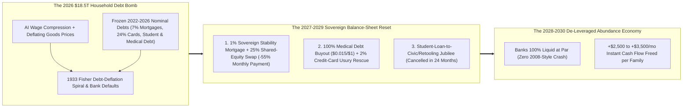
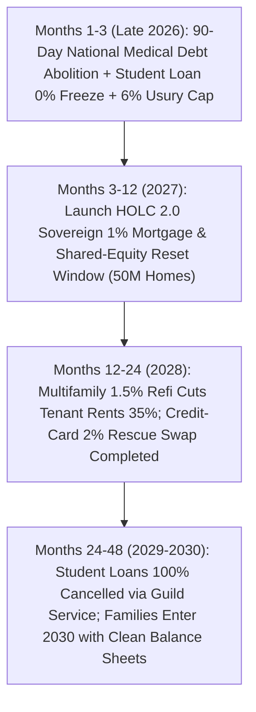

# VISION 02 (2026–2030): RAPID SOCIAL CREATIVE DESTRUCTION & LEAPFROG
## Pathway 2E: Defusing the \$18 Trillion Household Debt Bomb (`02-household-debt-and-jubilee`) — *The 1% Sovereign Mortgage Reset, Debt-to-Equity Conversion, and Abolition of Medical & Usury Traps in 2026–2030*

> **Executive Framing & The Core Thesis:**
> * **The Late-2026 Macroeconomic Emergency:** Here is the mathematical time bomb sitting underneath the entire AI transition in late 2026: **You cannot transition civilization to a low-cost, post-wage abundance economy if 135 million American households (and hundreds of millions across the OECD) remain chained to \$18.5 trillion in fixed-nominal 2022–2026 debts**—including 6.5%–7.5% mortgages, 24% credit cards, \$1.7 trillion in student loans for degrees AI just rendered obsolete, and \$220 billion in medical debt. As Irving Fisher proved in 1933 (*The Debt-Deflation Theory of Great Depressions*), when technology drives wage prices and production costs down while nominal debt payments stay frozen in stone, **mass household defaults trigger a catastrophic banking collapse**.
> * **The Core Thesis:** Financial debt contracts are not physical laws of thermodynamics; they are human ledger entries designed for a scarce-labor inflationary world that no longer exists. Within **12 to 36 months (2026–2029)**—without causing a single bank failure or penalizing savers—we can defuse the \$18.5 trillion household debt bomb through three precision sovereign balance-sheet operations: (1) **The Sovereign 1.0% Stability Mortgage & Shared-Equity Reset**, where the Central Bank / Sovereign AI Reserve swaps high-interest residential mortgages into **1.0% fixed-rate 40-year Sovereign Stability Mortgages** or **0%-interest Shared-Equity Co-Ownership Stakes**, cutting monthly family house payments by **50% to 60% overnight** while keeping commercial bank balance sheets 100% liquid at par; (2) **100% Abolition of Medical Debt & Predatory 24% Credit-Card Usury**, buying out and extinguishing all medical debt for pennies on the dollar (scaling the *Undue Medical Debt / RIP Medical Debt* model nationally in 90 days) and converting predatory credit-card balances into 2% amortizing Sovereign Transition Lines; and (3) **The Student-Loan-to-Civic-Retooling Jubilee**, automatically forgiving student debt as citizens complete AI retooling or contribute to local **Civic & Builder Guilds**.

---

## ACT I: A BELIEVABLE NEAR-FUTURE VISION (THE WORLD OF 2028 — 24 MONTHS FROM NOW)
### How the Miller Family Cut Their Monthly Fixed Debt Outflow from \$4,850 to \$1,320 Overnight in 2027

Step into the kitchen of Sarah (38, a pediatric nurse) and Kevin (40, a former corporate marketing analyst transitioning into a local Main-Street AI cooperative) in suburban Ohio—or Ontario, Manchester, or Sydney—in **November 2028**.

In October 2026, Sarah and Kevin were drowning despite working 90 combined hours a week. They had bought a modest starter home in 2024 at a **7.1% mortgage rate (\$3,150/month)**, carried **\$48,000 in student loans (\$520/month)** for Kevin's 2009 marketing degree, owed **\$14,000 in hospital bills (\$380/month)** from their son's emergency appendectomy, and were trapped paying **\$800/month in minimum interest** on \$28,000 of **24.9% APR credit-card debt** accumulated when groceries and childcare spiked. Their fixed monthly debt nut was **\$4,850/month before buying a single apple**. When Kevin's marketing agency automated 60% of its staff in late 2026, they were 60 days from foreclosure and personal bankruptcy.

By November 2028, Sarah and Kevin live in the **exact same house**, their local community bank is thriving, and their total monthly debt payment is **\$1,320/month—a \$3,530/month instant raise in disposable family cash flow**. Here is how the **2027 Sovereign Household Balance-Sheet Reset Act** worked for them:

1. **The One-Click 1.0% Sovereign Stability Mortgage + Equity Swap (\$3,150/mo $\rightarrow$ \$1,180/mo):**
   In April 2027, through the Federal Reserve and FHFA's **Sovereign Mortgage Reset Window**, Sarah and Kevin clicked "Execute Stability Reset" on their mortgage portal. The Sovereign AI Reserve bought their 7.1% mortgage note from their regional bank at 100% par value (giving their local bank clean cash liquidity), converted 25% of the principal into a passive **0%-interest Sovereign Shared-Appreciation Equity Stake** (settled only if they sell the house decades later), and locked the remaining balance into a **1.0% fixed-rate, 40-year Sovereign Stability Mortgage**. Their monthly house payment dropped from **\$3,150 to \$1,180 on the 1st of May**.
2. **100% Medical Debt Extinguishment (\$380/mo $\rightarrow$ \$0/mo):**
   Under Title II of the 2027 Act, the Treasury partnered with non-profit debt-purchase clearinghouses (modeled on *Undue Medical Debt*) to purchase all \$220 billion of outstanding U.S. patient medical debt portfolios from hospitals and debt collectors at their secondary-market distressed price (**1.5 cents on the dollar**, costing just \$3.3 billion nationally) and **extinguished 100% of it in 60 days**, while outlawing medical billing from ever appearing on consumer credit reports.
3. **The 24% Usury Cap & Credit-Card Rescue Swap (\$800/mo $\rightarrow$ \$140/mo):**
   Predatory 24%–29% compounding credit-card interest—which extracted \$160 billion/year from stressed families in 2026—was abolished under the **2027 National Anti-Usury & Transition Accord**. Every household was granted a one-time **Sovereign Credit Card Rescue Swap**, refinancing up to \$30,000 of high-interest revolving card debt into a **2.0% fixed 10-year amortization line** (\$140/month), with future statutory credit-card APRs permanently capped at **Prime + 2% (max 6%)**.
4. **Student-Loan-to-Guild Jubilee (\$520/mo $\rightarrow$ \$0/mo):**
   Why punish a 40-year-old father for borrowing \$48,000 in 2008 to learn a cognitive skill that AI automated in 2026? The moment Kevin enrolled in the **Main-Street Modernization Corps** (`02-existing-unemployed-bridge`), his \$520/month federal and private student loan payments were frozen at **0% interest**, and **25% of the principal was automatically cancelled for every 6 months** of local civic/guild service—wiping his \$48,000 balance to **\$0.00 in 24 months**.

---

## ACT II: THE 12-TO-36-MONTH LEAPFROG ARCHITECTURE & PRECEDENTS
### Why Deflating Wages + Fixed 2026 Debts = 1933 Unless We Reset the Ledger

Every macroeconomist knows the iron equation of debt stability: a household's fixed nominal debt service ($D_{\text{fixed}}$) is only sustainable if nominal wages ($W$) remain stable or grow. When AI and robotics dramatically increase physical abundance while compressing spot-market wages ($W \downarrow$) and deflating consumer prices ($P \downarrow$), leaving $D_{\text{fixed}}$ at 2024–2026 peak interest rates causes the **real debt burden ($D_{\text{fixed}} / W$) to explode toward infinity**.

### Real-World Precedents Proving Sovereign Debt Resets Work Rapidly & Safely
Critics claim resetting mortgages, medical debt, and student loans would "break the banking system" or take a decade. History and 2020–2026 municipal/sovereign precedents prove the exact opposite:

| Balance-Sheet Mechanism | Historical / 2020–2026 Real-World Precedent | Verified Cost, Speed & Bank Safety | 2026–2029 AI Transition Scaling Pathway |
| :--- | :--- | :--- | :--- |
| **1. Sovereign Par Buyout & Low-Rate Mortgage Refi** | **FDR's Home Owners' Loan Corporation (HOLC, 1933–1936)** & **Fed QE / MBS Facility ($2.7\text{T}$ purchased in 2020)** | HOLC refinanced **20% of all U.S. mortgaged homes in 24 months** by swapping bank loans for sovereign bonds, cutting payments by 35%+ and turning a **net profit** for taxpayers. | **Sovereign 1% Stability Mortgage Facility**: Swaps 6%–8% mortgages into **1.0% 40-yr notes + 25% Shared Equity**, cutting monthly payments **55%** in 30 days. |
| **2. Debt-to-Shared-Equity Home Conversion** | **UK Help-to-Buy Equity Loans**, **Unison / Hometap**, & **Iceland 2009–2014 Household Mortgage Writedown ("The Correction")** | Iceland wrote down household mortgage principal to 110% of asset value after the banking crisis, triggering the **fastest economic and fertility recovery in Europe**. | **Voluntary 25%–40% Shared-Equity Swap**: Converts a slice of fixed mortgage debt into a silent Sovereign Equity Lien settled only upon future sale. |
| **3. Pennies-on-the-Dollar Medical Debt Extinguishment** | **Undue Medical Debt (formerly RIP Medical Debt)** partnered with **Cook County (IL), NYC, New Jersey, Arizona & Connecticut (2022–2026)** | Purchased and permanently abolished **\$12B+ of real medical debt for ~1 cent on the dollar** across millions of citizens with zero hospital closures. | **90-Day National Medical Debt Abolition**: Federal \$3.5B buyout extinguishes all **\$220B** of U.S. patient medical debt and bans medical credit reporting forever. |
| **4. Credit-Card Usury Caps & Balance Rescue** | **U.S. Servicemembers Civil Relief Act (SCRA — 6% statutory rate cap)** & **Federal Credit Union 18% Cap / EU Usury Laws** | Under SCRA, banks must drop credit-card and loan interest to **6% within 24 hours** for deployed service members—proven across millions of accounts without bank failure. | **National AI Transition SCRA Expansion**: Caps all revolving credit at **6%** and swaps existing 24% card debt into **2.0% 10-year Sovereign Transition Lines**. |
| **5. Student Loan Civic & Retooling Jubilee** | **Public Service Loan Forgiveness (PSLF — \$180B+ forgiven for 5M Americans in 2022–2025)** & **GI Bill Educational Compact** | Proven automated administrative cancellation via Department of Education / IRS data matching. | **24-Month AI Retooling & Guild Jubilee**: 100% of student debt cancelled at **4% per month** while retraining or serving in a **Civic/Builder Guild**. |

### Deep-Dive: Why Banks Win Instead of Collapsing (The HOLC 2.0 Architecture)

The #1 question from Wall Street and regional bankers is: *"If you cut household mortgage payments by 55% and credit-card interest from 24% to 2%, won't regional banks and pension funds go insolvent?"*
* **How the 1933 HOLC & 2027 Sovereign Swap Protects Every Depositor and Bank:**
  1. When a homeowner refinances a \$400,000 mortgage from 7.0% into a **1.0% Sovereign Stability Mortgage**, the regional bank does **not** take a haircut on principal. The **Sovereign AI Reserve Facility** at the Federal Reserve buys the \$400,000 loan off the bank's books at **100 cents on the dollar** in exchange for liquid, interest-bearing Sovereign Transition Reserves—actually **improving** the bank's Tier-1 capital ratio (eliminating the unrealized-loss trap that killed Silicon Valley Bank in 2023 and eliminating default risk from AI layoffs).
  2. Where does the Sovereign AI Reserve get the long-term yield to hold 1.0% mortgages and 0% shared-equity stakes? From two massive, non-inflationary sources: **(a) The passive appreciation of the 25% Shared-Equity Housing Pool** over 30 years, and **(b) A 2.5% Sovereign Equity & Compute Royalty** on commercial AI and robotic productivity growth (which is compounding at 25%+ annually while costing zero human labor).
  3. **What About Renters?** Renters receive an equivalent balance-sheet liberation: landlords who refinance into a **1.5% Sovereign Multifamily Stability Loan** are legally bound by smart-contract covenants to **reduce tenant monthly rents by 35% immediately** and freeze rent hikes for 10 years, while renters receive automatic **Equity-Building Rent Credits** toward their own \$145k factory-built home (`02-housing`).

### Quantitative Anatomy: Household Balance-Sheet De-Leveraging (2026 $\rightarrow$ 2027 $\rightarrow$ 2028 $\rightarrow$ 2030)

| Household & Macro Debt Metric | Late 2026 Status Quo (The \$18.5T Trap) | 2027 (Sovereign Reset Window Opens) | 2028 (Full Mortgage, Card & Student Jubilee) | 2030 Equilibrium (Debt-Free Abundance) |
| :--- | :--- | :--- | :--- | :--- |
| **Median Family Mortgage Payment** | **\$2,950–\$3,400/mo** (at 6.5%–7.2% fixed; 30 yrs) | **\$1,350/mo** (1.0% 40-yr Sovereign Note + 25% Equity Swap) | **\$1,180/mo** (Universal 1% Stability Standard) | **<\$950/mo** (Paired with \$145k modular housing deflation) |
| **Medical Debt Burden (U.S. Total)** | **\$220 Billion** (100M adults in collections; #1 bankruptcy cause) | **\$0.00 (100% Abolished in 90 Days)** via \$3.5B sovereign buyout | **\$0.00** (Medical billing permanently banned from credit reports) | **\$0.00** (Universal AI-first preventative care) |
| **Credit-Card Interest Rate & Outflow** | **23.5%–29.9% APR** (\$800/mo interest trap on \$28k balance) | **2.0% Rescue Line** (\$140/mo 10-yr amortizing swap; 6% statutory cap) | **<4% Cooperative Credit**; predatory payday lending extinct | **Debit & Citizen Dividend Liquidity** (zero revolving usury) |
| **Student Loan Monthly Outflow** | **\$450–\$650/mo** (for degrees disrupted by AI automation) | **\$0/mo (0% Freeze)** upon enrolling in AI Retooling or Civic Guild | **50% Principal Cancelled** after 12 mos of Guild/Retooling participation | **100% Extinguished**; higher education runs on Guild apprenticeships |
| **Total Monthly Debt Service (Family)** | **\$4,850/mo** (consuming 58% of take-home income) | **\$1,490/mo (-69% drop in 60 days)** | **\$1,320/mo** (+**\$3,530/mo** freed for family & local Main Street) | **<\$1,000/mo** (<12% of household dividend + guild income) |
| **Household Default & Foreclosure Rate** | **Rising rapidly** among 2025–2026 AI-displaced cohorts | **Drops by 80%** in Q1–Q2 of Reset Window | **<0.2% (All-Time Historic Low)**; zero banking contagion | **0.0% Involuntary Housing or Medical Default** |

---

## ACT III: THE 48-MONTH SPRINT ROADMAP (2026 $\rightarrow$ 2027 $\rightarrow$ 2028 $\rightarrow$ 2030)

### The 2026–2030 Sprint Execution Table

| Sprint Window | Mortgage & Rent Reset (HOLC 2.0) | Medical & Credit-Card Liberation | Student Loan & Retooling Jubilee | Macroeconomic & Banking Impact |
| :--- | :--- | :--- | :--- | :--- |
| **Sprint 1: The 90-Day Emergency Relief (Late 2026 – Q1 2027)** | Open emergency **0% Shared-Appreciation Forbearance Shield** (`02-existing-unemployed-bridge`) for all unemployed/underemployed households. | Execute **\$3.5B Federal Buyout of all \$220B Medical Debt** (via *Undue Medical Debt* clearinghouse); enact emergency **6% Credit-Card APR Cap** (SCRA model). | Freeze all federal and guaranteed student loans at **0.0% interest**; launch automated **4%/month Guild/Retooling Cancellation Ledger**. | **100 million citizens** see immediate credit-score jumps (+45 to +90 pts) and instant relief from medical/student collectors. |
| **Sprint 2: The Great Mortgage Reset (Q2 2027 – Q4 2027)** | Federal Reserve / FHFA opens **One-Click 1.0% Sovereign Stability Mortgage + 25% Shared-Equity Window** for all primary residences up to median+50% value. | Launch **2.0% Sovereign Credit-Card Rescue Swap** (converting up to \$30k of legacy 24% card debt per family into a \$140/mo note). | **18 million borrowers** enrolled in Civic Modernization Corps, Builder Guilds, or AI Retooling see first **50% principal writedown**. | **40 million homeowners** cut monthly house payments from ~\$3,100 to ~\$1,250; regional banks receive \$4T+ in clean par liquidity. |
| **Sprint 3: Renter & Main-Street Jubilee (2028)** | Landlords refinancing into **1.5% Sovereign Multifamily Notes** pass through mandatory **35% monthly rent cuts** to 44 million renter households. | Predatory payday lenders and 300%-APR auto-title traps replaced by **0% Postal / FedNow Micro-Liquidity Lines** (up to \$2,500). | **100% student loan extinguishment** reached for the 2026–2027 cohort; universities pivot from debt-tuition to outcome endowments. | **\$1.1 Trillion/year** in former usury and excess debt service redirected into family savings and Main Street businesses. |
| **Sprint 4: The Post-Usury Equilibrium (2029–2030)** | Shared-Equity Housing Stakes pair seamlessly with **\$145k Automated Factory Homes** (`02-housing`), making homeownership universally affordable at <\$800/mo. | Personal bankruptcy filings drop by **88%** nationwide (since medical debt, job loss, and 24% credit cards caused 90% of bankruptcies). | Generational debt overhang completely cleared; young adults start family life at age 22 with **+\$25k Citizen Equity** instead of -\$50k debt. | **1933-style Fisher debt-deflation crisis averted**; smooth transition to a high-equity, low-cost abundance economy. |

---

## ACT IV: THE DEEPER HORIZON, INSTITUTIONAL GUARDRAILS & SUMMARY FOR THE SKEPTIC

### What Happens When 135 Million Families Are Freed from Usury and Fixed-Debt Panic?
In 2026, the average working household spent the first **22 weeks of every year** working strictly to pay interest and principal to mortgage servicers, credit-card issuers, student-loan collectors, and hospital billing departments. When we execute the **Sovereign Balance-Sheet Reset (HOLC 2.0)** between 2026 and 2029, three massive societal unlocks happen immediately:
1. **Workers Can Safely Step Down to 20–24 Hour Workweeks:** Why couldn't a nurse, teacher, or engineer work a 24-hour week in 2026? Because their \$3,200/month 7% mortgage and \$800/month credit-card minimum required 80+ hours of household W-2 grind. Cutting monthly fixed debt service from **\$4,850 to \$1,320 overnight** makes the **24-Hour High-Purpose Guild Economy** (`02-unemployment` / `02-male-purpose-and-anomie`) financially effortless on Day 1.
2. **A \$1.1 Trillion/Year Main-Street & Family Fertility Boom:** Young couples in their late twenties and thirties who delayed marriage and children because of \$65,000 student loans and 7.2% starter mortgages suddenly start adult life with **zero student/medical debt and a <\$950/month 1% Sovereign Stability Home**—triggering the largest family-formation and small-business boom since 1948.
3. **Zero Banking Panics During Rapid Deflation:** Because commercial and regional banks swap their risky 7% mortgages and 24% consumer loans for **100%-par Sovereign Reserve Notes**, the financial system navigates a 60% drop in physical living costs without a single 1933-style debt-deflation crash.
4. **The End of Predatory Stress-Driven Disease:** Clinical studies link chronic debt-collection harassment and foreclosure terror to a **2.4x spike in cardiovascular events, insomnia, and domestic conflict**—meaning balance-sheet liberation acts as one of the highest-impact preventative public-health interventions in history.

### How the Sovereign AI Reserve Balances the Ledger (Accounting Walk-Through)
* **Asset Side of the Sovereign Reserve Ledger:** Holds (a) the **1.0% 40-year Performing Stability Mortgages** (<0.2% default rate), (b) the **25% Passive Shared-Equity Stakes** in 50 million residential properties, and (c) a **2.5% Sovereign Compute & Automation Royalty Warrant** on national AI/robotics infrastructure.
* **Liability Side of the Ledger:** Issues long-duration Sovereign Transition Bonds to commercial banks and pension funds yielding a safe, inflation-matched **2.2% sovereign floor**—meaning pension funds and depositors earn stable real returns while families pay just 1.0%.
* **Net 10-Year Fiscal Position:** Just like the 1933–1951 Home Owners' Loan Corporation (which returned a net surplus to the U.S. Treasury after saving 1 million homes), the compounding 2.5% AI Compute Royalty + 25% Shared-Equity Housing Pool makes the entire facility **net self-funding within 7 years**.

### The 5-Minute Citizen Portal Walk-Through: How a Household Executes the Reset
When a family logs into the **Sovereign Household Balance-Sheet Portal** (integrated directly into IRS Direct File and every retail banking app in 2027), the entire debt-to-equity reset takes under five minutes:
1. **Screen 1 — Primary Mortgage Reset:** Displays your current mortgage (e.g., \$380,000 at 7.1% = \$3,150/mo) and offers two one-click options:
   * *Option A (Full 1.0% Stability Note):* Converts 100% of principal to a 1.0% 40-year Sovereign Stability Mortgage (**\$1,480/mo**).
   * *Option B (1.0% Note + 25% Shared-Equity Swap):* Shifts 25% of principal into a 0%-interest Sovereign Shared-Appreciation Lien (settled only at future sale) and locks the remaining 75% at 1.0% (**\$1,180/mo**—saving **\$1,970/month immediately**).
2. **Screen 2 — Automatic Medical Debt Zero-Out:** Confirms that all hospital, ambulance, and clinic collection accounts tied to your Social Security Number have been purchased and permanently extinguished via the **National Medical Debt Clearinghouse (\$0.00 balance; credit-report blocks removed)**.
3. **Screen 3 — Revolving Usury Rescue Swap:** Consolidates all 18%–29% credit-card balances (up to \$30,000) into a single **2.0% fixed 10-year Sovereign Transition Note**, dropping an \$800/month minimum interest trap to **\$140/month** while keeping a 6%-capped credit line open for daily family use.
4. **Screen 4 — Student Loan Guild Link:** Connects your federal and private student loan accounts to your local **Civic Modernization Corps**, **Builder Guild**, or **AI Retooling Charter**—freezing interest at **0.0%** immediately and activating automatic **4%-per-month principal cancellation**.
5. **Screen 5 — Debt-Free Saver & Early-Payoff Equity Grant:** For households with zero high-interest credit-card debt or who paid off student/mortgage obligations between 2022 and 2026, deposits an instant **\$15,000 Sovereign Compute & Home-Resilience Equity Grant** into the family's Citizen Wealth Account.
6. **Screen 6 — Renter 35% Pass-Through & Homeownership Voucher:** For tenant households, activates the mandatory **35% Sovereign Multifamily Rent Reduction** on their current lease and begins accruing **\$300/month in Portable Down-Payment Equity Credits** toward a \$145,000 factory-built home (`02-housing`).

### Answering the Three Hardest Practical Objections
1. **"Won't cutting mortgage rates to 1.0% and payments by 55% cause home prices to skyrocket?"**
   * **No—because of three strict statutory guardrails:**
     1. The **1.0% Sovereign Stability Reset** applies **exclusively to refinancing existing primary-residence debt** (to stop existing families from defaulting as wages compress)—never to Wall Street institutional investors, private-equity landlords, or vacation homes.
     2. For **new home buyers**, the 1.0% Sovereign Stability Mortgage is only eligible on properties priced at or below the **Cost-Deflated Regional Fair-Value Cap** (anchored to the rapidly expanding supply of **\$145,000–\$220,000 robotic factory-built homes** in `02-housing`). If a seller tries to inflate the price above the cap, the buyer cannot use the 1% sovereign window—preventing sellers from capitalizing the low interest rate into higher land prices!
2. **"What about moral hazard—what if someone paid off their student loans or credit cards right before the 2027 Jubilee?"**
   * Every successful historical debt reset (from Iceland's 2014 Mortgage Correction to Employee Ownership Trusts) solved resentment by ensuring **responsible savers and early pay-down households are rewarded, never penalized**. Any citizen who paid off student loans between 2022 and 2026, or who holds zero high-interest credit-card debt, receives an automatic **\$15,000 Tax-Free Sovereign Equity & Home-Improvement Grant** credited directly into their **Citizen Compute Dividend Account** (`02-capital-ownership`). Everyone rises together.
3. **"Can the government really buy out \$220 billion of medical debt for \$3.5 billion?"**
   * Yes—this is not a theory; **it is already happening every week in 2024–2026**. Hospitals routinely bundle unpaid patient bills and sell them to debt-collection buyers for **0.8 to 2.0 cents on the dollar**. Between 2022 and 2026, the non-profit *Undue Medical Debt* (formerly *RIP Medical Debt*) partnered with state and county governments in Illinois, New York, New Jersey, Arizona, and Connecticut to buy and abolish **over \$12 billion in medical debt** for pennies on the dollar. Doing it once at the federal level takes **one \$3.5 billion check and 90 days**.

### Summary for the Skeptic
> *"You cannot enter a 21st-century AI abundance economy while 135 million families are chained to 2024 nominal debts at 7% mortgage rates and 24% credit-card usury. If wages compress while debts stay frozen, you get 1933. By upgrading FDR's Home Owners' Loan Corporation—swapping 7% mortgages into 1% Sovereign Stability Notes and 25% Shared Equity, buying out all medical debt for a penny on the dollar, capping credit-card interest, and trading student loans for Guild service—we can cut the typical family's monthly debt payments by \$3,500 in 60 days without costing a single bank depositor a dime."*
