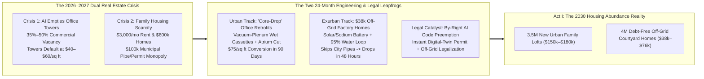
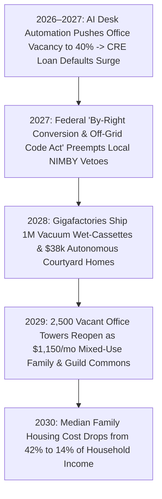

# VISION 02 (THE 2026–2030 LEAPFROG HORIZON): SOCIAL TRANSFORMATION SPRINT
## Pathway 2C: Collapsing Two Crises at Once — *90-Day "Core-Drop" Office-to-Loft Conversions & \$38,000 Off-Grid Courtyard Homes (2026–2030)*

> **Executive Framing & The Core Leapfrog Thesis:**
> * **The 2026 Absurdity:** *"How can metropolitan downtowns have 35% to 50% empty commercial office towers—billions of square feet of heated steel and concrete sitting vacant as AI automates routine desk work—while two miles away, young families are crushed by \$3,200/month rents and \$600,000 starter homes?"*
> * **The 2026–2030 Leapfrog Thesis:** In `vision-01`, solving housing took 15 years of gradually scaling new construction. In `vision-shorter-02`, we **collapse two acute 2026–2028 crises—(1) the AI-driven commercial office real-estate crash and (2) the family housing affordability emergency—into a single 36-month leapfrog**. Instead of waiting for slow municipal rezoning or digging \$120,000 per lot in new water/sewer trenches, we execute a two-pronged blitz between 2026 and 2030: **(1) Modular "Core-Drop" Office-to-Residential Conversions** that use factory wet-wall plumbing/HVAC cassettes and robotic interior framing to turn distressed Class-B/C office floors into sunlit family lofts at **\$75/sq ft in 90 days** (unlocked by federal by-right preemption), and **(2) \$38,000 Autonomous Off-Grid Courtyard Homes** with integrated solar, sodium batteries, 95% closed-loop water recycling, and thermal bio-digesters that **bypass municipal utility hookups entirely**, dropping onto inexpensive suburban or rural land in **48 hours**.

---

## ACT I: THE 2029–2030 LEAPFROG REALITY (TWO HOMES IN 48 MONTHS)
### Scene A: Inside a Converted 22nd-Floor Downtown Family Loft (\$1,150/Month Equity Co-Op)

Visit Elena and Marcus in **November 2029** on the 22nd floor of **The Meridian Commons** in downtown Chicago (or San Francisco, Atlanta, London, or Frankfurt).
* **Three Years Ago (2026):** This 1980s Class-B glass office tower sat **62% vacant** after accounting and claims-processing tenants automated their back offices. The building defaulted on its commercial loan, trading at **\$42 per square foot**—less than the replacement cost of its structural steel. Traditional developers claimed converting deep-floorplate office towers into apartments was "impossible" because drilling hundreds of new plumbing stacks through post-tensioned concrete slabs cost \$350/sq ft and took three years.
* **The 90-Day "Core-Drop" Conversion (2028):** Under the **2027 Federal Commercial-to-Housing By-Right Preemption Act**, a conversion syndicate acquired the tower and executed a **zero-core-drilling modular retrofit in 84 days**:
  1. **Daylight Atrium Carve:** Autonomous wire-saw robots cut two vertical lightwells down the dark center of the deep floorplate, turning windowless interior space into a sunlit, four-season sky-courtyard on every third floor—while transferring the removed square footage to rooftop penthouse modules.
  2. **Prefabricated "Wet-Wall" Cassettes:** Instead of drilling 200 vertical plumbing holes through concrete floors, cranes slid factory-built **kitchen/bath/heat-pump mechanical cassettes** onto each floorplate, routing pressurized micro-manifold greywater and vacuum-drain lines horizontally through the existing raised IT floor plenum.
  3. **Robotic Acoustic Framing:** Mobile layout and drywall robots framed triple-insulated acoustic mass-timber partitions in **4 days per floor**.
* **The Bottom Line:** All-in acquisition plus conversion cost **\$117/sq ft** (vs. \$550/sq ft for new high-rise construction). Elena and Marcus now own a sunlit **1,450 sq ft, 3-bedroom sky-courtyard loft for \$169,000 total (\$1,150/month all-in)**—with a K–12 Learning Guild (`02-education`) on the 2nd floor and a neighborhood Sanctuary Commons (`02-religion`) on the ground plaza.

### Scene B: The \$38,000 Autonomous Off-Grid Courtyard Home (Dropped in 48 Hours)
Thirty miles outside town, Elena's brother David and his wife Priya wanted two acres of wooded hill country—land that cost only **\$15,000** in 2026 because it had **zero city water mains, zero sewer pipes, and a \$95,000 utility trenching quote**.
* In **October 2029**, two flatbed trucks delivered three precision-milled **Mass-Timber & Composite Structural Modules** built on an automated automotive-style assembly line for **\$38,000 base (\$76,000 double-courtyard 1,600 sq ft family edition)**:
  * **Zero Utility Trenching (100% Closed-Loop Autonomy):** The home's integrated **Appliance-in-a-Box Utility Core** combines a 12 kW perovskite-silicon solar roof, a 45 kWh fireproof **sodium-ion battery**, an atmospheric water condenser + **95% membrane water recycler** (supplying 600 gallons/day of ultra-pure water while needing only 12 gallons of make-up moisture from air/rain), and a **supercritical thermal/bio-digester toilet system** that turns all waste into sterile garden mineral ash.
  * **48-Hour Helical-Pile Drop:** Anchored on six adjustable steel helical ground screws (zero concrete foundation pouring) and permitted instantly via **AI Digital-Twin Code Verification**, David and Priya moved into a debt-free homestead **48 hours after truck arrival**—paying **\$0/month in electric, water, or sewer bills forever**.

---

## ACT II: COLLAPSING TWO CRISES INTO ONE ENGINE (2026–2029)

### Real-World 2025–2026 Technologies That Make the 2026–2030 Blitz Possible
Every piece of hardware required to execute 90-day office conversions and \$38,000 off-grid homes is already in commercial production in 2025–2026:

| Leapfrog Subsystem | 2025–2026 Commercial Pioneer / Precedent | Verified Cost & Technical Metric | 2027–2030 Rapid Scaling Mechanism |
| :--- | :--- | :--- | :--- |
| **1. Zero-Core-Drilling Vacuum & Plenum Plumbing** | **Wavin / Viega Prefab Wet Pods**, **Acorn / Evac Vacuum Drainage** (used on cruise ships, hospitals & London/NYC retrofits) | Vacuum drainage routes wastewater **horizontally or uphill** through 2-inch pipes in raised office floors, slashing MEP retrofit labor by **70%**. | Standardized **Drop-In Kitchen/Bath Wet Cassettes** mass-produced at 500,000 units/yr, snapping into existing office floor plenums in **3 hours**. |
| **2. Deep-Floorplate Office-to-Housing Conversions** | **Calgary Downtown Strategy** (\$150M incentive, 17+ towers converted) & **NYC Pearl House (160 Water St)** | Calgary proved direct $/sq ft grants + **eliminating discretionary rezoning hearings** cuts office conversion timelines by **>50%**. | Federal **Distressed CRE-to-Housing Tax Credit & By-Right Act (2027)** unlocks 1.8 billion sq ft of vacant US/EU Class-B/C office space. |
| **3. \$38k–\$50k Factory Foldable/Modular Homes** | **Boxabl (*Casita* / *Baby Box*)**, **Vessel / Cosmic Buildings**, **BYD / Broad Group Modular**, & **Sweden Lindbäcks** | Automated panel/volumetric lines produce 400–800 sq ft finished modules in **<4 hours of factory time** at **\$35k–\$55k** wholesale. | Defense-scale **Housing Gigafactories** pair automotive stamping with cross-laminated timber (CLT) to hit **\$38k (800 sq ft)** and **\$76k (1,600 sq ft)**. |
| **4. 95% Closed-Loop Water + Atmospheric Harvest** | **Hydraloop**, **Epic Cleantec** (SF high-rise greywater reuse), & **Source / Akvo Atmospheric Water** | On-site membrane + UV-C systems recycle **85–95% of domestic water**, cutting external make-up demand to **<15 gal/day per family**. | Mass-manufactured **\$4,800 Closed-Loop Water Appliance** makes any roofed home 100% independent of municipal water mains. |
| **5. Pipe-Free Thermal & Bio-Digester Sanitation** | **Cinderella Incineration Toilets** (100k+ Nordic homes), **Gates Foundation *Reinvented Toilet***, & **HomeBiogas** | High-efficiency thermal mineralization and anaerobic membrane reactors process waste on-site into **sterile ash and pure water** with zero sewer pipe. | National **Off-Grid Sanitation Performance Code (2027)** legalizes closed-loop appliances on all residential parcels, erasing \$60k sewer fees. |
| **6. Ultra-Cheap Solar + Sodium-Ion Storage** | **CATL / BYD Sodium-Ion Batteries (\$40/kWh)** & **Utility/Rooftop Solar** | Sodium-ion batteries use zero lithium or cobalt, operate from $-40^\circ\text{C}\text{ to }60^\circ\text{C}$, and drop below **\$35/kWh pack cost** by 2027. | Every \$38k factory home ships with a built-in **10 kW solar + 40 kWh sodium battery core** for under \$3,200 BOM cost. |

---

## ACT III: THE 48-MONTH SPRINT ROADMAP (2026 $\rightarrow$ 2027 $\rightarrow$ 2028 $\rightarrow$ 2030)

### Side-by-Side Economics: How Housing Costs Drop 70% in 36 Months (2026 vs. 2029–2030)

| Cost & Timeline Dimension | 2026 Status Quo (Stick-Built / Manual High-Rise) | 2029 Track A: "Core-Drop" Office Loft (1,450 sq ft) | 2029 Track B: Autonomous Off-Grid Courtyard Home (1,600 sq ft Double-Module) |
| :--- | :--- | :--- | :--- |
| **1. Shell / Acquisition Cost** | **\$220,000** (manual outdoor framing or poured concrete core) | **\$60,900** (distressed Class-B office acquired at \$42/sq ft) | **\$42,000** (two CNC mass-timber/composite modules off factory line) |
| **2. MEP, Kitchen, Bath & Utility Core** | **\$135,000** (4 manual trades + \$65k city water/sewer/grid trenching) | **\$52,000** (drop-in vacuum wet-wall cassette + heat pump) | **\$19,000** (integrated Solar + 45 kWh Sodium Battery + 95% Water Loop + Thermal Toilet) |
| **3. Land, Zoning & Permitting Soft Costs** | **\$195,000** (scarce piped urban lot + 18-month paper permit delay) | **\$4,100** (by-right AI digital-twin permit in 24 hrs; zero new land needed) | **\$15,000** (2-acre non-piped rural/exurban lot + instant AI permit; \$0 hookup fee) |
| **4. Interior Framing & Finishes** | **\$70,000** (manual drywall, taping, painting, 25% waste) | **\$52,000** (robotic acoustic timber partitions + atrium cut: \$75/sq ft total retrofit) | **Included in factory module** (arrives 98% finished on flatbed truck) |
| **TOTAL TURNKEY PRICE** | **\$620,000** (\$3,950/mo mortgage + utilities) | **\$169,000** (\$1,150/mo all-in equity co-op) | **\$76,000** (\$38,000 for 800 sq ft starter) \| **\$510/mo & \$0 Utility Bills** |
| **Permitting-to-Move-In Timeline** | **18 to 30 Months** | **90 Days per Tower Floor** | **48 Hours On-Site Assembly** |

---

## ACT IV: SOLVING THE THREE HARDEST SKEPTIC OBJECTIONS

1. **"Wait—everyone says deep-floorplate 1980s office towers have windows too far from the core to become apartments!"**
   * That was only true when developers tried to cram tiny, dark studio corridors around a central elevator shaft while preserving 100% of gross rentable floor area. When you buy a defaulted office tower at **\$42/sq ft** (an 85% discount to replacement cost), you can afford to **wire-saw 20% of the dark interior slab out** to create a breathtaking 10-story sunlit internal courtyard—turning deep 120-foot floorplates into dual-aspect, cross-ventilated family lofts where every bedroom has natural light and courtyard trees.
2. **"Why wouldn't suburban NIMBY city councils block \$38,000 factory homes and off-grid toilets?"**
   * Because the **2027 Federal & State Housing Emergency Preemption Compact** ties all federal highway, municipal bond, and infrastructure funding to **Objective Physics-Based Digital Twin Permitting**. Just as Japan's national by-right zoning law prevents local councils from blocking compliant homes, any factory module certified to **ISO/UL Closed-Loop Water & Structural Standards** is legal by statutory right on any parcel in America and Europe.
3. **"Won't crashing commercial real estate and home prices trigger a 2008-style banking crisis?"**
   * In 2026–2027, commercial office loans were *already* defaulting because the offices were empty! Leaving them empty guaranteed bank wipeouts. Converting dead \$42/sq ft office towers into thriving \$169,000 residential equity lofts—backed by **Federal Conversion Bridge Bonds** and household **Automation Equity Buffers** (`02-unemployment`)—rescues regional bank balance sheets while cutting family shelter costs by two-thirds.

### Inside the \$19,000 "Appliance-in-a-Box" Autonomous Utility Core (Bill of Materials)

How does a \$38,000 starter module (or \$76,000 1,600 sq ft family courtyard home) completely sever the \$120,000 umbilical cord to municipal electric grids, city water mains, and underground sewer pipes by 2028? Because mass-manufacturing turns four infrastructural utilities into a single **6-foot-wide plug-and-play mechanical cartridge**:

| Autonomous Subsystem | 2028 Gigafactory Hardware Spec | Daily Family Output | Factory BOM Cost | Municipal Infrastructure Replaced |
| :--- | :--- | :--- | :--- | :--- |
| **1. Power & Thermal Core** | **12 kW Perovskite-Silicon Solar Roof** + **45 kWh CATL Sodium-Ion Battery Pack** + reversible air-to-water heat pump. | **65 kWh/day** electricity + 100% heating/cooling down to $-30^\circ\text{C}$. | **\$6,400** | Replaces **\$35,000** grid transformer/trenching hookup + **\$3,000/yr** utility bills. |
| **2. 95% Water Recycling Loop** | **Membrane Bioreactor + Nanofiltration + RO + UV-C Quartz Sterilizer** (scaled from *Hydraloop* & *Epic Cleantec*). | Recycles **95% of shower, laundry & sink flow** (**500 gal/day** effective supply). | **\$4,800** | Cuts external water need from 300 gal/day down to just **12–15 gal/day**. |
| **3. Atmospheric & Rain Harvester** | **2.2 kW Solid-State Desiccant Atmospheric Water Condenser** + 1,500-gal food-grade sub-deck rainwater cistern. | Harvests **20–35 gal/day** from ambient night humidity (even in 25% desert air). | **\$3,600** | Replaces **\$45,000** municipal water-main trenching & tap impact fees. |
| **4. Pipe-Free Thermal Sanitation** | **Supercritical Thermal Mineralizer & Micro-Anaerobic Digester** (scaled from *Cinderella* & *Gates Reinvented Toilet*). | Vaporizes pathogens at $600^\circ\text{C}$; outputs **1 cup/week of sterile mineral garden ash**. | **\$4,200** | Replaces **\$40,000** municipal sewer main connection or septic leach-field excavation. |
| **TOTAL UTILITY CARTRIDGE** | **Single 72" x 36" Snap-In Mechanical Module** (15-year warranty; 20-minute crane swap) | **100% Off-Grid Power, Water & Sanitation Autonomy** | **\$19,000** | **Eliminates \$120,000+ in Pipe/Grid Fees & Unlocks 90% of Non-Piped Land** |

### Week-by-Week Engineering Schedule of a 90-Day "Core-Drop" Office Tower Conversion
Why did traditional 2024 office-to-residential conversions take 30 months while a 2028 **Core-Drop Retrofit** finishes a 20-story Class-B office floor in **90 days at \$75/sq ft**?
1. **Days 1–15 (Digital-Twin Scan & Robotic Strip):**
   * LiDAR drones scan the vacant floorplate to 1-millimeter accuracy; the **National By-Right AI Code Engine** issues the building permit in 24 hours. Autonomous demolition bots strip legacy acoustic ceiling tiles and carpet while preserving the steel raised IT floor plenum.
2. **Days 16–40 (Diamond Wire-Saw Atrium Carve):**
   * Automated diamond wire-saws cut two $30\text{ ft}\times 40\text{ ft}$ vertical lightwells through the dark interior core slabs, lowering concrete blocks via internal hoist to be crushed into recycled geopolymer courtyard pavers. Every future bedroom now sits within 25 feet of natural daylight.
3. **Days 41–65 (Crane "Core-Drop" of Vacuum Wet-Cassettes):**
   * One facade glass panel per floor is temporarily popped out. Tower cranes slide pre-inspected **Kitchen/Bath/Heat-Pump Wet Cassettes** directly onto the floorplate. Plumbers snap 2-inch pressurized **Evac/Wavin vacuum-drain lines** into the 8-inch raised IT floor plenum in 3 hours per unit—requiring **zero core-drilling** through structural concrete slabs.
4. **Days 66–90 (Robotic Acoustic Mass-Timber Framing & Co-Op Move-In):**
   * Pre-cut **Cross-Laminated Timber (CLT) and triple-acoustic mineral-wool wall panels** click into ceiling tracks via robotic manipulators with zero drywall mudding or sanding dust. Families move into \$169,000 sky-courtyard lofts on Day 90.

### Cross-Domain Synergies Across the 2026–2030 Leapfrog Architecture
* **Link to `02-homelessness` & `02-social-programs`:** Cities purchase bulk runs of the **\$38,000 single-module Courtyard Home** to stand up dignified, private, clinical-wrap-around villages in **30 days** at 1/15th the cost of legacy \$750,000/unit supportive housing.
* **Link to `02-education` & `02-religion`:** Under **2027 YIGBY (Yes In God's Backyard) Preemption**, churches, temples, and regional colleges place clusters of \$38,000 factory courtyard homes on empty asphalt parking lots, creating multi-generational Sanctuary Villages overnight.
* **Link to `02-wars`:** The exact same containerized solar + sodium-battery + closed-loop water technology that powers off-grid homes scales up to 40-foot ISO containers to give border towns immunity against energy and water blockades.

### The 2026–2030 Statutory & Financing Playbook (How Cities & Banks Execute the Flip)
1. **The "Distressed CRE-to-Loft" Tax-Exempt Bridge Bond (2027):**
   * Rather than letting regional banks fail on \$1.2 trillion of maturing commercial office loans in 2026–2028, the Treasury and Federal Reserve authorize **2.5% Commercial-to-Residential Conversion Bridge Bonds** for any Class-B/C office building that converts at least 70% of its floor area into sub-\$180,000 family equity lofts and 20% into neighborhood Learning Guilds or childcare commons.
2. **National UL/ISO Certification for Autonomous Utility Cores:**
   * Just as an automobile certified by NHTSA does not need to be re-inspected by every county sheriff in America, any factory housing module equipped with a **UL-2027 Certified Closed-Loop Water & Thermal Sanitation Core** is automatically exempt from local septic-field size minimums and municipal sewer connection mandates nationwide.
3. **Homeowner Equity Protection via Shared-Appreciation Swaps:**
   * Existing middle-class homeowners who bought stick-built homes at peak 2024–2026 prices receive automatic **Property-Tax Abatements and Citizen Automation Trust Credits (`02-capital-ownership`)** plus by-right authorization to drop a **\$38,000 Off-Grid Courtyard Unit** into their own backyard as a debt-free rental or multi-generational suite—turning housing deflation into immediate household cash flow.
4. **Municipal Infrastructure Relief Dividend:**
   * Because every \$38,000 off-grid home and 95%-water-recycling office conversion relieves overburdened municipal sewage treatment plants and electrical substations, cities pay a **\$7,500 Grid-Relief Rebate** directly to the homebuyer at closing.

| Housing Leapfrog Track | 2026 Bottleneck Broken | 2029 Turnkey Price | Move-In Speed | Monthly Utility Bill |
| :--- | :--- | :--- | :--- | :--- |
| **Track A: Urban Core-Drop Office Loft (1,450 sq ft)** | 45% empty Class-B towers + concrete slab core-drilling | **\$169,000** (\$1,150/mo) | **90 Days** | **-\$65% vs. 2026** |
| **Track B: Off-Grid Courtyard Home (800 / 1,600 sq ft)** | \$120k city water/sewer/grid trenching monopoly | **\$38,000 / \$76,000** | **48 Hours** | **\$0 / Month Forever** |

### Summary for the Skeptic
> *"We didn't have a shortage of steel, glass, or land in 2026—we had half-empty downtown office towers sitting two miles from families paying \$3,500 a month in rent, and millions of acres of scenic land locked out by a municipal sewer-pipe monopoly. By dropping vacuum wet-cassettes into vacant office floors in 90 days and shipping \$38,000 self-powered, water-recycling homes from gigafactories in 48 hours, we solved the commercial real estate crash and the housing crisis with the exact same move."*

