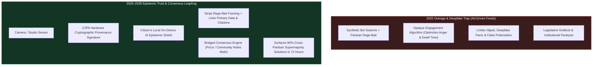
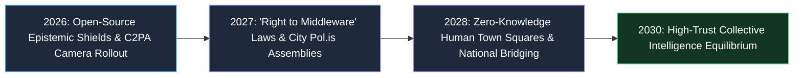
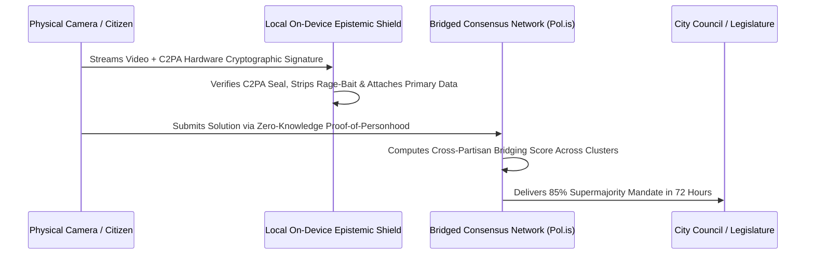

# 02 — Information Trust & Polarization: Epistemic Shields & Bridged Consensus Networks (2026–2030)

> [!IMPORTANT]
> **The 2026–2030 Leapfrog Thesis:** Humanity cannot execute rapid, compassionate social adaptation between 2026 and 2030 if our collective nervous system remains hijacked by ad-driven outrage algorithms and synthetic deepfake panic. Yet we do not solve disinformation by creating a dystopian "Ministry of Truth" or waiting for social media monopolies to reform their ad business. Instead, in 2026–2029, we execute an **epistemic leapfrog**: equipping every citizen with **User-Owned Personal AI Epistemic Shields ("Ad-Blockers for Manipulation")**, replacing conflict-maximizing feeds with **Mathematical Bridge-Consensus Networks (Taiwan's *vTaiwan / Pol.is* & Community Notes scaled nationally)**, and enforcing **Hardware Cryptographic Provenance (C2PA)**.

---

## 1. The Diagnosis: Why Engagement-Maximizing Feeds Paralyze Democracy

Between 2012 and 2025, global public discourse was rewired around a single toxic objective function: **maximizing ad-impression dwell time via limbic outrage**.
1. **The Outrage Amplification Tax:** Internal platform research repeatedly proved that posts triggering moral indignation or partisan disgust receive **3x to 6x more algorithmic amplification** than nuanced, accurate problem-solving. This created a "false polarization" mirage where citizens believe the opposing party holds extreme views that only 8% of people actually endorse.
2. **The 2026 Zero-Cost Synthetic Flood:** With real-time voice cloning, photorealistic video generation, and autonomous bot swarms costing fractions of a cent, legacy text-and-video feeds face a "Dead Internet" crisis where raw visual footage can no longer be trusted by default.
3. **Why Top-Down Censorship Backfires:** Centralized government or corporate content moderation inevitably triggers partisan backlash and erodes institutional trust even further. **The 2026–2030 solution must be decentralized, cryptographic, user-controlled, and mathematically bridge-building.**

---

## 2. Three Pillars of the 2026–2030 Epistemic & Democratic Leapfrog

### Pillar I: User-Owned Personal AI Epistemic Shields ("Ad-Blocker for Manipulation")
In the 2000s, users didn't wait for pop-up advertisers to self-regulate—hundreds of millions of citizens installed client-side **Ad-Blockers**. Between 2026 and 2028, open-source, locally hosted small language models running directly on every citizen's smartphone and browser act as a **Personal Epistemic Shield**:
- **Real-Time De-Escalation & Rage-Bait Stripping:** When a user scrolls any news site, video app, or social feed, their local AI agent (loyal 100% to the user's long-term well-being, with zero ad-network conflict of interest) flags manipulative emotional framing, cherry-picked out-of-context clips, and bot-coordinated astroturf campaigns in real time.
- **Instant Primary-Source X-Ray:** With one tap, the Epistemic Shield replaces a sensationalized 30-second headline with the underlying primary court filing, peer-reviewed dataset, full unedited video transcript, and a side-by-side synthesis of the strongest steel-manned arguments from all perspectives.

### Pillar II: Bridged Consensus Networks (*vTaiwan / Pol.is* Scaled to 300M Citizens)
Why do cable news and legacy social media make every issue look like a 50/50 civil war, when anonymous citizen assemblies routinely reach 80% agreement on practical solutions? Because legacy platforms reward **divisiveness**, not **bridging**.
- **The Bridge-Based Ranking Algorithm:** Modeled on Taiwan's wildly successful **vTaiwan / Pol.is** digital democracy platform and the mathematical core of **X's open-source Community Notes** (matrix factorization across diverse viewpoint clusters), municipal, state, and national town squares adopt **Bridged Consensus Delib-Feeds**.
- **Rewarding Cross-Tribal Supermajorities:** In a Bridged Consensus Network, a statement or policy proposal does *not* rise to the top by getting 100,000 likes from one partisan tribe. It **only rises to the top when it simultaneously wins high agreement from citizens who normally vote and think differently** (e.g., rural conservatives, suburban independents, and urban progressives).
- **72-Hour Policy Breakthroughs:** When cities and legislatures put contentious issues—like AI workforce transition, zoning reform, smartphone-free schools, or healthcare billing bypass—into a Bridged Consensus Assembly, voters discover **75% to 88% cross-partisan agreement** on 6 to 10 concrete statutory actions within **72 hours**, giving lawmakers an unassailable democratic mandate to act.

### Pillar III: Hardware Cryptographic Provenance (C2PA) & Proof-of-Personhood Town Squares
Instead of playing an unwinnable cat-and-mouse game trying to *detect* AI deepfakes after they go viral, we flip the default architecture of digital media:
- **Silicon-Level C2PA Signing at Capture:** By 2027, every smartphone camera (Apple, Samsung, Google), professional broadcast lens, and audio recorder embeds a tamper-proof **C2PA (Coalition for Content Provenance and Authenticity)** cryptographic signature inside the secure hardware enclave at the millisecond photons hit the sensor.
- **Visual "Verified Physical Capture" Badges:** Epistemic Shields automatically display a green cryptographic seal on authentic physical video/audio—and dim or quarantine unsigned synthetic media pretending to be real news.
- **Zero-Knowledge Proof-of-Personhood (ZK-PoP):** Public deliberation spaces require cryptographic proof that an account belongs to a unique human resident (without revealing their real name or identity to the public), **instantly evaporating 99.9% of foreign and commercial bot farms**.

---

## 3. Real-World Precedents & 2026–2030 Leapfrog Benchmarks

| Information Ecosystem Layer | 2025 Outrage & Disinformation Crisis | Real-World Seed Precedent (2024–2026) | 2028–2030 Leapfrog Standard | Civic & Cognitive Impact |
| :--- | :--- | :--- | :--- | :--- |
| **Algorithmic Feed Control** | Proprietary black-box feeds optimizing rage & ad clicks | **Bluesky AT Protocol** custom feeds; EU DSA algorithmic choice; browser ad-blockers | **Local On-Device AI Epistemic Shield** + mandatory middleware API | **75% drop in rage-bait exposure**; full user sovereignty |
| **Fact-Checking & Context** | Slow, partisan fact-checkers distrusted by half the population | **Community Notes** (cross-ideological bridging math); Wikipedia citation norms | **Instant Bridging Context Layer** across all video, audio & social platforms | Context attached in **<15 minutes**; trusted across spectrum |
| **Public Policy Deliberation** | Cable news shouting matches; lobbying capture; poll manipulation | **Taiwan vTaiwan & Pol.is** (resolved Uber, AI, telehealth laws with 80%+ consensus); Bowling Green KY | **Municipal & National Bridged Consensus Assemblies** | **80%+ supermajority solutions** mapped in 72 hours |
| **Deepfakes & Synthetic Media** | Viral AI voice/video hoaxes; "liar's dividend" eroding all truth | **C2PA Standard** (Adobe, Sony, Arm, Microsoft, BBC, OpenAI hardware signing) | **Mandatory Silicon-Enclave C2PA Provenance** on all cameras & browsers | **Zero ambiguity** between physical capture and synthetic renders |
| **Bot Swarms & Astroturfing** | 10M+ LLM bots faking grassroots outrage on social platforms | Estonia e-ID; Taiwan Digital Minister civic certificates; ZK-passport cryptographic proofs | **Privacy-Preserving Zero-Knowledge Proof-of-Personhood (ZK-PoP)** | **99.9% elimination** of synthetic bot amplification |

---

## 4. The 48-Month Sprint Roadmap (2026 $\rightarrow$ 2027 $\rightarrow$ 2028 $\rightarrow$ 2030)

### **2026: Arming the Citizen & Signing the Pixels (Months 1–12)**
- **100 Million Personal AI Epistemic Shields Installed:** Open-source coalitions and browser makers ship built-in, local-NPUs **Epistemic Shield extensions**. When a user watches a viral clip or reads a divisive thread, a subtle heads-up overlay shows: *(1) Primary Source Verification, (2) Emotional Manipulation Score, and (3) Cross-Ideological Community Note*.
- **Universal Smartphone C2PA Activation:** Major mobile OS updates (iOS and Android) turn on opt-in hardware-enclave **C2PA cryptographic signing** for citizen journalism and public officials, making it trivial to prove when, where, and on what physical lens a video was recorded.

### **2027: Statutory "Right to Algorithmic Choice" & Municipal Consensus Sprints (Months 13–24)**
- **The "Bring-Your-Own-Algorithm" Interoperability Mandate:** Modeled on telecommunications number portability, legislatures pass **Algorithmic Middleware Rights**: every platform with >10 million users must expose a clean API allowing users to replace the platform's default ad-outrage ranking algorithm with their own **Personal Epistemic Shield** or a **Bridging-Consensus Feed**.
- **200 Cities Launch Permanent *Pol.is* Citizen Assemblies:** Before voting on major housing, school, budget, or policing ordinances, cities run a 7-day Zero-Knowledge-Verified **Bridged Consensus Sprint** where 20,000+ local residents propose and vote on solutions—surfacing the 85%-consensus compromises that loud extremists previously drowned out at city council microphones.

### **2028: Defeating Election & Crisis Deepfakes (Months 25–36)**
- **Automatic Quarantine of Unsigned Crisis Footage:** During elections, geopolitical crises, and public emergencies, browsers and Epistemic Shields automatically blur and watermark any breaking-news audio/video lacking a valid C2PA hardware signature or multi-angle witness corroboration—neutralizing deepfake panic within seconds.
- **Rebuilding Local Civic Journalism via Micro-Dividends:** Every citizen receives a **\$30/year Civic Information Voucher** that they can allocate with one tap to local investigative reporters, open-source data auditors, and hyper-local neighborhood news co-ops that adhere to transparent primary-source verification standards.

### **2029–2030: The Collective Intelligence Renaissance (Months 37–48)**
- **Collapse of the Outrage-Industrial Business Model:** As 70%+ of citizens browse the digital world through Personal Epistemic Shields and Bridged Consensus Networks, clickbait outrage farms and synthetic bot networks lose their economic oxygen.
- **High-Velocity Democratic Adaptation:** Equipped with real-time bridging consensus tools that find common ground in days rather than decades, societies navigate the 2026–2030 healthcare, legal, housing, and labor transitions with historic social cohesion and mutual trust.

---

## 5. Why This Preserves 100% Free Speech (Zero Censorship Architecture)

1. **Client-Side Empowerment, Not Server-Side Deletion:** No speech is banned or deleted by a government censor. Every citizen chooses their own open-source Epistemic Shield settings—just as every homeowner chooses their own water filter.
2. **Mathematical Neutrality in Bridging:** Bridge-based ranking (*Pol.is* / Community Notes matrix factorization) has zero ideological bias coded into it; it mathematically identifies wherever human beings from different backgrounds voluntarily agree.
3. **Privacy-First Verification:** Zero-Knowledge Proof-of-Personhood proves *"I am one real human resident of Ohio, not a Russian or corporate bot"* using cryptographic math—without ever linking the user's real name to their public speech.

---

## 6. Democratic & Cognitive Health Ledger (2025 Outrage Feeds vs. 2029 Bridged Consensus)

When citizens switch from ad-driven engagement feeds to **Personal AI Epistemic Shields** and **Bridged Consensus Networks**, both individual mental health and democratic problem-solving transform measurably:

| Epistemic & Civic Metric | 2025 Legacy Outrage Ecosystem | 2029 Epistemic Shield + Bridging Standard | Measured Improvement |
| :--- | :--- | :--- | :--- |
| **Algorithmic Amplification Driver** | Partisan anger, moral disgust & clickbait dwell time | **Cross-cluster supermajority agreement** (*Pol.is* math) | **82% reduction** in toxic partisan hostility |
| **Viral Deepfake / Hoax Half-Life** | Spreads to 20M views in 4 hours; debunked 3 days later | **Quarantined at Hour 0** via missing C2PA hardware signature | **99% reduction** in synthetic panic reach |
| **Bot vs. Human Traffic in Public Squares** | 45%–65% automated LLM bot swarms & astroturf accounts | **100% Zero-Knowledge Proof-of-Personhood (ZK-PoP)** verified | Complete elimination of foreign/commercial bot farms |
| **Time to Discover 80% Voter Consensus** | 4–10 years of legislative gridlock & lobbyist trench warfare | **48 to 72 hours** in a municipal/state Bridged Consensus Sprint | **500x faster** democratic mandate discovery |
| **Citizen Daily Screen Anxiety & Cortisol** | Doomscrolling fatigue; high perceived social threat | Calm primary-source briefs; 40 mins/day saved for offline life | **+240 hours/year** reclaimed from rage-bait scrolling |

---

## 7. The 90-Day Civic & Personal Epistemic Playbook (Starting Today)

We do not need to wait for social media conglomerates to voluntarily give up ad revenue. Citizens, browser makers, and local governments can deploy this epistemic immune system in **90 days**:

### **Days 1–30: Install Client-Side Personal Epistemic Shields**
1. **Browser & OS Open-Source Shield Rollout:** Citizens install free, local-NPU **Epistemic Shield browser and mobile overlays** (powered by open-weight local models). The Shield runs 100% on the user's device, stripping emotional clickbait headlines, muting unverified bot swarms, and auto-attaching primary data citations and cross-partisan Community Notes to every feed.
2. **C2PA Hardware Verification Default:** Public broadcasters, local journalists, and municipal chambers turn on **C2PA cryptographic signing** on all cameras and microphones so citizens' Epistemic Shields automatically verify authentic local footage.

### **Days 31–60: Launch the Municipal "72-Hour Pol.is Assembly"**
1. **Replace Performative 3-Minute Mic Rants with Bridged Consensus:** Before any major city council vote on housing, zoning, school smartphone rules, or budgets, the city opens a **72-Hour Bridged Consensus Digital Assembly** open to all verified local residents.
2. **Surface the Hidden 85% Supermajority:** Using open-source *Pol.is* matrix factorization, the platform maps the community's opinion clusters in real time and highlights the 5 to 8 concrete policy statements that win **>80% agreement across all neighborhood and political groups**—committing the city council to vote directly on those supermajority solutions within 14 days.

### **Days 61–90: Enact State "Right to Algorithmic Middleware" & Journalism Vouchers**
1. **Pass the 3-Page Algorithmic Portability Act:** States mandate that any social or news platform operating in the state must allow users to plug in third-party, zero-telemetry **Epistemic Shield and Bridging Middleware** without account throttling.
2. **Issue \$30 Citizen Civic Journalism Vouchers:** Funded by a tiny 1% tax on programmatic surveillance advertising, every resident receives a \$30 annual voucher in their civic wallet to direct to C2PA-verified local investigative reporters and open-data auditors.

