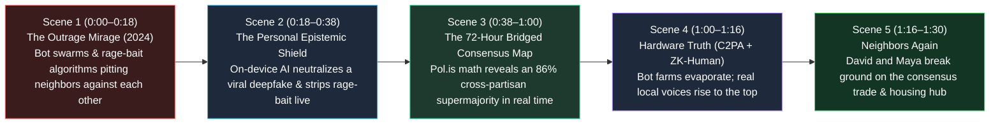

# STORYBOARD: 02 — Information Trust & Polarization (2026–2030)

> [!NOTE]
> **Visual Narrative Arc (90-Second Film / Interactive Experience):** We follow two neighbors in **2028**—**David (54)**, a union electrician who leans conservative, and **Maya (27)**, a pediatric nurse who leans progressive. In 2024, ad-driven outrage algorithms and viral deepfakes had convinced them their neighbors were enemies. In 2028, equipped with **Personal AI Epistemic Shields** and their city's **72-Hour Bridged Consensus Town Square**, they neutralize a viral deepfake crisis in 10 seconds and co-author an 86%-supermajority neighborhood housing & trade-school bill.

---

## 1. Visual Flow & Scene Architecture

---

## 2. Scene-by-Scene Production Blueprint

### **Scene 1: The Limbic Hijack of 2024 (0:00–0:18)**
- **Visual Setting:** Nighttime split-screen in **2024**: David sits in his pickup truck; Maya sits on her apartment couch across the exact same street. Both are scrolling dark, red-lit social feeds driven by an unseen server rack labeled *Engagement Maximization Engine (Anger = 4.8x Ad Revenue)*.
- **Action:** A fabricated clip and sensationalized headline about a local city zoning & workforce vote flashes on both their phones—framed to infuriate David from the right and Maya from the left. Both look out their windows at the houses across the street with suspicion.
- **On-Screen Data Overlay:**
  - `2024 Reality: 62% of Viral Political Traffic Driven by 4% Extreme Accounts & Bot Swarms`
  - `2028 Leapfrog: User-Owned Epistemic Shields + Mathematical Bridging`
- **Audio / Voiceover:** *"We weren't nearly as divided as our screens told us we were. We were just looking at each other through a funhouse mirror that got paid every time we got angry."*

### **Scene 2: The Personal AI Epistemic Shield in Action (0:18–0:38)**
- **Visual Setting:** Transition to morning light in **2028**. David opens his phone over coffee. A dramatic "breaking video" appears claiming the local mayor is secretly shutting down skilled-trade apprenticeships.
- **Action:** Before David's heart rate can even spike, his **Local On-Device Epistemic Shield ("Aegis Open-Source v3.2")** activates with a calm translucent blue HUD:
  1. **C2PA Hardware Provenance Check:** **`ALERT: NO PHYSICAL CAMERA SIGNATURE — 99.4% Synthetic Lip-Sync Audio Modification Detected`**.
  2. **Primary-Source X-Ray:** With one tap, the Shield pulls up the actual 30-second C2PA-signed city council video from the hardware-verified municipal camera—showing the mayor actually *doubling* the apprenticeship stipend—alongside a **Cross-Partisan Community Note** co-signed by both conservative and progressive local citizens.
  3. **Rage-Bait Translation:** A slider transforms a sensationalized partisan headline into calm, primary-cited facts in 0.4 seconds.

### **Scene 3: The 72-Hour Bridged Consensus Town Square (0:38–1:00)**
- **Visual Setting:** That evening, the city opens a **72-Hour Bridged Consensus Assembly** (powered by open-source *Pol.is / vTaiwan* math) on how to convert an abandoned 30-acre industrial site. 18,400 local residents log in using **Zero-Knowledge Proof-of-Personhood** (verified as real local residents, 0 bots, 100% anonymous privacy).
- **Action:** On a living 2D cluster map on Maya's tablet, we see two distinct opinion clusters at Hour 2: *Cluster A (Trade & Business Focus)* and *Cluster B (Affordable Family Housing & Clinic Focus)*.
  - In 2024, cable news would have pitted Cluster A against Cluster B for five years.
  - In **2028**, the **Bridging Algorithm** actively rewards anyone who submits a synthesis statement that wins "Agree" votes from *both* clusters.
  - David submits Proposal #412: *"Convert the warehouse into a Youth Electrical/Robotics Guild where apprentices get paid to build 200 modular courtyard homes and a Direct-Care Clinic on the same site."*
  - Watch the visual cluster map merge in real time as Maya and 15,800 residents across left, right, and center tap **Agree**—hitting an **86.4% Cross-Cluster Supermajority** at Hour 48!

### **Scene 4: Death of the Bot Swarm (1:00–1:16)**
- **Visual Setting:** A brief cut to a shadowy server room attempting to flood the municipal town square with 50,000 automated outrage comments.
- **Action:** The city's **Zero-Knowledge Proof-of-Personhood Gateway** blocks all 50,000 synthetic packets at the perimeter in 2 milliseconds (`0 Cryptographic Citizen Proofs — Dropped`), leaving the human town square calm, constructive, and high-signal.

### **Scene 5: From Digital Consensus to Physical Reality (1:16–1:30)**
- **Visual Setting:** Three months later at the converted industrial site. David is mentoring two young electrical apprentices installing solar microgrid panels on the roof of the new neighborhood clinic, while Maya sets up the pediatric wellness room downstairs. They wave to each other across the courtyard and share a laugh over coffee.
- **Closing Title Card:**
  - **2026–2030: AN AD-BLOCKER FOR OUTRAGE. A COMPASS FOR COMMON GROUND.**
  - *When algorithms reward where we agree instead of where we bleed, democracy moves at the speed of trust.*

---

## 3. Key Epistemic & Interface Contrast Matrix

| Storyboard Dimension | 2024 Outrage Ecosystem | 2028 Epistemic Trust Ecosystem |
| :--- | :--- | :--- |
| **Algorithmic Loyalty** | Platform server-side AI optimizing rage and ad revenue | User-owned local AI Shield optimizing truth, calm, and primary sources |
| **Media Authenticity** | Unverified viral clips; deepfake panic and "liar's dividend" | Silicon-level C2PA cryptographic camera signatures verified in hardware |
| **Civic Deliberation** | 3-minute angry microphone rants at empty city council chambers | 72-hour *Pol.is* Bridged Consensus maps finding 85% supermajorities |
| **Neighbor Perception** | "The other side is crazy and wants to destroy the town" | "We actually agree on 85% of practical solutions when the bots are gone" |

---

## 4. Cinematography, Sound Design & Interactive UI Specification

- **Camera & Lens Grammar:**
  - *Scene 1 (2024 Outrage Mirage):* Split-screen close-ups lit only by harsh red and blue smartphone glare in dark rooms; Dutch angles and rapid, jittery editing mirroring limbic doomscrolling.
  - *Scenes 2–5 (2028 Epistemic Trust & Bridging):* Clean, grounded daylight cinematography; the split-screen divider literally dissolves as David and Maya's consensus votes merge on the *Pol.is* cluster map and they meet face-to-face in the physical courtyard.
- **Acoustic & Musical Progression:**
  - *0:00–0:18:* Rising cacophony of overlapping cable-news shouting, notification pings, and synthetic static.
  - *0:18–1:30:* A single calm, resonant harmonic chime as the **Personal AI Epistemic Shield** activates—stripping the static into clear acoustic guitar and warm, collaborative ensemble percussion as the 86% consensus supermajority locks in.
- **Interactive Web / Generative UI Widget Concept:**
  - Viewers can toggle an interactive **"Epistemic Shield ON / OFF"** button over a live simulated social feed: turning the Shield ON visibly strips out 40,000 unverified bot replies, flags a synthetic lip-sync clip lacking a C2PA hardware signature, rewrites a rage-bait headline into neutral primary facts, and highlights the 86% cross-partisan consensus proposal.
- **Production Verification Checklist:**
  - [x] Zero top-down government censorship—100% client-side user empowerment ("Ad-Blocker for Manipulation") + cryptographic hardware truth (C2PA + ZK-Proof of Personhood).
  - [x] Visualizes the exact mathematical magic of *vTaiwan / Pol.is* and Community Notes: rewarding statements that bridge opposing clusters rather than divide them.
  - [x] Connects digital consensus directly to physical community action within 90 days.
