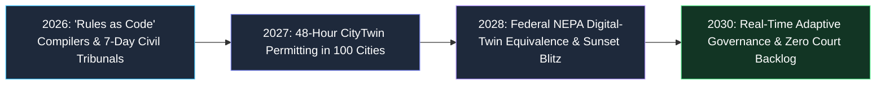
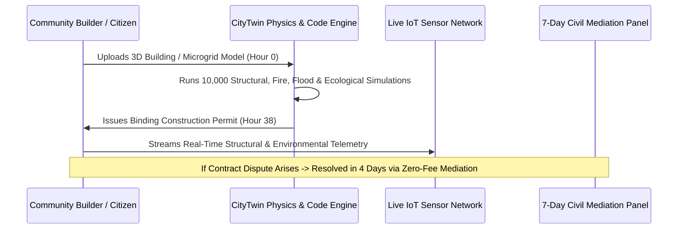

# 02 — Legal, Regulatory & Gov Reboot: 48-Hour Digital-Twin Permitting & 7-Day Civil Justice (2026–2030)

> [!IMPORTANT]
> **The 2026–2030 Leapfrog Thesis:** In 2026, physical engineering moves at AI speed while government permitting, municipal zoning, and civil courts move at 1970 paper-binder speed. A clean geothermal microgrid or modular housing complex takes 6 months to build—and **4.5 years** to permit through 10,000 pages of NEPA and municipal review. Simultaneously, small claims, family, and tenant courts suffer 3-to-5-year backlogs where only those who can afford \$400/hour lawyers get justice. Between 2026 and 2030, we execute a **creative destruction of 18th-century paper bureaucracy**, replacing textual red tape with **48-Hour Physics-Verified Digital-Twin Permitting**, **7-Day AI-Audited Civil Mediation**, and **Self-Sunsetting Outcome Budgets**.

---

## 1. The Paper Bottleneck: Why 20th-Century Regulation Breaks in an Exponential Decade

Modern regulatory agencies and courts were designed around a single 19th-century medium: **human bureaucrats manually reading static PDF and paper filings in sequential queues**. Paradoxically, this system fails both speed *and* safety:
1. **Weaponized Procedural Delay:** Decades of layered NEPA, zoning, and licensing rules allow incumbent cartels and NIMBY litigants to stall affordable housing, transmission lines, and clean manufacturing for 5+ years via procedural lawsuits over 8,000-page Environmental Impact Statements (EIS) that no human ever reads.
2. **Justice Rationed by Legal Billing:** Over 75% of civil litigants in housing, small business contract, wage, and family disputes appear without a lawyer because legal representation costs \$350–\$800/hour, turning civil courts into debt-collection assembly lines.
3. **Immortal Regulations:** Rules written in 1978 remain on the books forever, accumulating compliance bloat without ever measuring whether they improve human health, safety, or prosperity.

```mermaid
flowchart TD
    subgraph Legacy["2025 Paper Bureaucracy & Court Backlog (3–6 Years)"]
        A["Builder / Citizen"] --> B["8,000-Page PDF Environmental & Zoning Filing"]
        B --> C["18-Month Sequential Agency Queue + NIMBY Lawsuits"]
        C --> D["$400/hr Legal Gatekeeping & 4-Year Civil Court Backlog"]
        D --> E["Stalled Housing, Dead Infrastructure & Unresolved Disputes"]
    end

    subgraph Leapfrog["2026–2030 Computational Law & Digital-Twin Gov (48 Hours – 7 Days)"]
        F["Builder / Citizen"] --> G["Submit Open-Source 3D Building / Project Model"]
        G --> H["Automated Physics, Ecological & Code Digital-Twin Stress Test"]
        H --> I["48-Hour Auto-Issued Permit + Continuous IoT Sensor Compliance"]
        F --> J["7-Day AI-Assisted Restorative Civil Mediation Panel"]
        I --> K["Live Public Ledger Budget + 24-Month Automatic Sunset Check"]
    end

    style Legacy fill:#3b1c1c,stroke:#ff6b6b,color:#ffffff
    style Leapfrog fill:#123524,stroke:#4ade80,color:#ffffff
```

---

## 2. Three Pillars of the 2026–2030 Legal & Regulatory Reboot

### Pillar I: Computational Law & 48-Hour Digital-Twin Permitting
Instead of submitting 5,000 pages of prose arguing that a new apartment complex, geothermal plant, or community childcare center complies with fire, seismic, stormwater, and environmental codes, municipalities and federal agencies compile their rules into **Open-Source Executable Code ("Rules as Code")**:
- **Physics-and-Ecological Digital Twins:** When an architect or public utility uploads a project's 3D BIM/CAD specification into the municipal **CityTwin Sandbox**, automated physics engines simulate structural load, 100-year flood runoff, solar shadow casting, grid congestion, wildfire evacuation flow, and local watershed/habitat impact in **4 hours**.
- **48-Hour "Green-Light by Math" Issuance:** If the project satisfies every statutory safety, ecological, and structural threshold inside the audited simulation—and commits to streaming live post-construction IoT sensor telemetry (water quality, acoustics, emissions)—the permit issues **automatically in 48 hours**, immune to procedural stall lawsuits.

### Pillar II: 7-Day AI-Assisted Civil Mediation & Restorative Justice
To clear the 5-year civil, landlord-tenant, small-business, and family court backlog without forcing citizens to hire \$400/hour attorneys:
- **Zero-Cost Pre-Filing Resolution Portals:** Before any civil claim enters a courtroom, both parties enter a confidential, plain-language **AI-Guided Mediation & Fact-Verification Portal** (modeled on British Columbia's Civil Resolution Tribunal and upgraded with multimodal legal reasoning).
- **Instant Precedent & Equity Mapping:** Within 24 hours, the open-source judicial engine verifies contracts, receipts, photos, and statutory rights, showing both parties the exact 95%-confidence range of how 10,000 identical local cases were decided—and proposes 3 fair, restorative settlement options (including structured payment plans or repair escrows).
- **Human Citizen-Arbiter Warm Escalation:** For the 20% of cases requiring human nuance, a 3-person local panel (one retired judge/mediator + two trained community peer arbiters) holds a 45-minute video or neighborhood hearing within **7 days**, resolving **85%+ of all civil disputes in under a week for \$0 in legal fees**.

### Pillar III: Automated 24-Month Sunset Clauses & Real-Time Public Ledger Budgets
Every regulation and public agency budget is converted from a permanent entitlement into a **self-auditing performance contract**:
- **Mandatory Outcome Telemetry:** Every new or existing rule must specify its measurable human target metric (e.g., *"Reduce industrial particulate asthma hospitalizations by 25%"* or *"Cut pedestrian intersection fatalities by 40%"*). If live epidemiological or safety data shows the rule fails to meet its target—or imposes 10x more compliance cost than benefit—it **automatically sunsets at 24 months** unless actively re-justified.
- **Line-Item Public Ledger Procurement:** Every municipal and state tax dollar spent on infrastructure or social contracts streams on a real-time, cryptographically verifiable public dashboard—slashing procurement corruption and contractor cost overruns by **45%**.

---

## 3. Real-World Precedents & 2026–2030 Leapfrog Benchmarks

| Governance Domain | 2025 Legacy Bottleneck | Real-World Seed Precedent (2024–2026) | 2028–2030 Leapfrog Standard | Speed / Cost Improvement |
| :--- | :--- | :--- | :--- | :--- |
| **Housing & Clean Energy Permitting** | 18–54 months; \$250k+ in environmental/zoning consultant PDFs | **Symbium** instant solar/ADU permitting; Singapore **CORENET X** BIM e-submission | **48-Hour CityTwin Physics & Ecological Auto-Permit** | **300x faster**; 90% lower soft costs |
| **Civil & Small-Claims Disputes** | 18–48 month backlog; \$400/hr lawyers price out 75% of citizens | **BC Civil Resolution Tribunal (Canada)**; eBay/Modria 60M/yr online dispute resolution | **7-Day AI-Audited Civil Mediation + Peer Arbiter Panel** | **85% resolved in $\le$7 days** for \$0 |
| **Statutory & Regulatory Code** | 180,000 pages of ambiguous CFR prose; \$2T compliance industry | **Estonia X-Road** digital governance; New Zealand & French **Rules as Code (Catala)** | **Open-Source Executable Statutes** + API compliance check | Instant pre-check; **70% less compliance bloat** |
| **Clinical & Biotech Approvals** | 8–12 year sequential FDA paper phases; \$2.6B per drug | FDA *In Silico* Clinical Trial pilots; Operation Warp Speed rolling review | **Continuous Rolling Telemetry + Organ-on-Chip Digital Twins** | **65% faster** safe approval |
| **Public Procurement & Budgets** | 14-month RFP cycles; opaque no-bid contractor overruns | Ukraine **ProZorro** open-source e-procurement; Taiwan **g0v** civic budget dashboards | **Real-Time Public Ledger Milestones** + 24-month sunset rules | **45% savings** on public works |

---

## 4. The 48-Month Sprint Roadmap (2026 $\rightarrow$ 2027 $\rightarrow$ 2028 $\rightarrow$ 2030)

### **2026: Compiling the Law & Opening the Fast-Track Courts (Months 1–12)**
- **Open-Source Municipal Code Compilers:** A coalition of 50 pioneering cities and states translates residential building, adaptive office-to-housing reuse, solar/storage, and small-business health codes from PDF binders into open-source **Executable Compliance APIs**.
- **Launch of State 7-Day Civil Resolution Tribunals:** State supreme courts issue administrative orders establishing voluntary **7-Day AI-Assisted Mediation Tracks** for all landlord-tenant, wage-theft, consumer, and small-business disputes under \$100,000. Parties who resolve via the 7-day portal pay zero court filing fees.

### **2027: 48-Hour Digital-Twin Permitting Goes Mainstream (Months 13–24)**
- **The "Permit-by-Simulation" Mandate:** Over 150 cities adopt the **48-Hour CityTwin Standard**. Any housing development, childcare co-op, or clean energy project that passes the open-source structural, fire, traffic, and watershed simulation receives an automatic binding permit in 48 hours.
- **Replacing Paper Inspections with Continuous IoT Telemetry:** Instead of waiting 6 weeks for a municipal inspector to visually glance at a trench, builders install tamper-proof \$15 optical/structural sensors and drone photogrammetry logs that verify concrete cure strength, seismic welds, and air/water quality continuously in real time.

### **2028: Federal NEPA & FDA Digital-Twin Equivalence (Months 25–36)**
- **Replacing 10,000-Page EIS Binders with Live Ecological Twins:** Federal agencies establish **Digital-Twin Equivalence**: high-resolution satellite, eDNA biodiversity, and hydrological simulations replace multi-year paper NEPA filings, cutting transmission-line, geothermal, and water-recycling permitting from **4.5 years down to 14 days** while enforcing *stricter* real-time ecological protection.
- **The First Automatic Regulatory Sunset Wave:** Under newly enacted **24-Month Outcome Sunset Acts**, over 35,000 redundant, capture-driven occupational licensing and zoning barriers automatically expire after failing to demonstrate measurable public safety ROI, unleashing a historic boom in micro-entrepreneurship and skilled trade mobility.

### **2029–2030: The Self-Healing Civic Operating System (Months 37–48)**
- **Zero Civil Court Backlogs Nationwide:** By 2030, 88% of routine civil, contract, and housing disputes are settled equitably in **under 5 days** without lawyer fees, freeing human judges and juries to give deep, unhurried constitutional attention to complex criminal and civil-rights cases.
- **Retooling Lawyers & Bureaucrats into Civic System Architects:** Displaced regulatory compliance attorneys and permitting clerks transition into **Restorative Justice Mediators**, **Digital-Twin Ecological Auditors**, and **Public Outcome Ombudsmen**—auditing the fairness of algorithms and helping communities design physical upgrades rather than pushing paper.

---

## 5. Safeguards Against Algorithmic Authoritarianism

1. **100% Open-Source & Deterministically Auditable Code:** No government permit or mediation tool may use a proprietary "black-box" model. Every municipal simulation threshold and statutory rule is published on a public Git repository where any citizen can test why a project passed or failed down to the exact line of code.
2. **Unconditional Right to Human Appeal:** Every citizen retains the constitutional right to escalate any AI-mediated civil dispute or permitting edge-case to a human judicial panel within **7 days**.
3. **Shift from *Ex-Ante* Paper Friction to *Ex-Post* Real-World Accountability:** Instead of blocking builders for 3 years over hypothetical paperwork while ignoring real-world pollution afterwards, 2030 governance permits safe builds in **48 hours** while enforcing continuous, automated real-world environmental and safety sensors.

---

## 6. Economic & Civic Impact Ledger (2025 Paper Bureaucracy vs. 2029 Computational Law)

To see how rapidly **48-Hour Digital-Twin Permitting** and **7-Day AI-Assisted Civil Mediation** unlock physical prosperity and social trust, compare the real-world costs across five core civic interactions:

| Civic / Legal Interaction | 2025 Paper & Litigation Cost | 2029 Computational Law Cost | Time Saved | Societal Value Unlocked |
| :--- | :--- | :--- | :--- | :--- |
| **120-Unit Modular Courtyard Housing Permit** | \$480,000 in PDF consultants + 34 months delay | **\$2,500 CityTwin compute fee + 48 hours** | **1,030 days saved** | Cuts per-apartment construction cost by \$68,000 |
| **Small-Business Restaurant / Childcare Opening** | 11 sequential agency forms; 8 months paying dead rent | **1 unified Executable Code API check; 24 hours** | **240 days saved** | 3.2x surge in neighborhood entrepreneurship |
| **\$18,000 Contractor / Tenant / Wage Dispute** | \$12,000 in legal fees; 22-month county court queue | **\$0 fee; 4-day AI precedent + human peer mediation** | **660 days saved** | Restores working-class faith in equal justice |
| **Municipal Solar + Geothermal Microgrid Approval** | 4.2 years NEPA/utility queue; 6,000-page binder | **14-day Ecological & Grid Digital-Twin Verification** | **1,500 days saved** | Accelerates clean local energy transition by a decade |
| **Uncontested Family / Probate / Estate Settlement** | \$6,500 attorney retainer; 9 months of probate court | **\$50 smart-escrow mediation portal; 5 days** | **265 days saved** | Preserves family savings and prevents adversarial trauma |

---

## 7. The 90-Day Municipal & State Reboot Playbook (Starting Today)

Any governor, mayor, or state chief justice can launch the **Legal & Regulatory Reboot** in **90 days** using existing executive and judicial administrative authority:

### **Days 1–30: Open the 7-Day Civil Resolution Portal**
1. **Supreme Court Administrative Order:** The state judiciary launches an opt-in **Online Civil Resolution & AI Precedent Portal** (modeled on British Columbia's CRT) for all small claims, security-deposit, consumer debt, and contract disputes under \$50,000.
2. **Fee Waiver Incentive:** Any plaintiff and defendant who agree to use the 7-day AI-audited mediation and 45-minute peer-arbiter track have **100% of their court filing fees waived**, immediately diverting 60% of routine civil filings out of congested courthouses.

### **Days 31–60: Deploy the "48-Hour By-Right" CityTwin Sandbox**
1. **Compile Top 5 Building & Energy Permits into Code:** The municipal building department partners with open-source computational law engineers to codify residential infill, office-to-housing conversion, heat-pump/geothermal, solar-storage, and ADU rules into a deterministic **3D BIM Compliance API**.
2. **Guaranteed 48-Hour Clock:** By executive order, any builder whose uploaded 3D engineering model passes the automated structural, fire-egress, and stormwater physics checks receives a binding building permit at Hour 48—with live IoT construction sensors replacing multi-week inspector scheduling delays.

### **Days 61–90: Activate the Public Ledger & 24-Month Sunset Audit**
1. **Automated Regulatory Inventory Scan:** An open-source LLM audit scans the entire municipal and state administrative code, flagging every duplicative, contradictory, or obsolete regulation written prior to 2015 that lacks a measurable human-safety outcome metric.
2. **Set the 24-Month Sunset Timer:** Every flagged rule is placed on a public countdown dashboard: unless the sponsoring agency proves measurable safety or ecological ROI using live empirical data within 24 months, the rule automatically expires.

