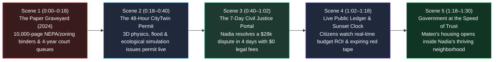

# STORYBOARD: 02 — Legal, Regulatory & Gov Reboot (2026–2030)

> [!NOTE]
> **Visual Narrative Arc (90-Second Film / Interactive Experience):** We follow two everyday citizens in **2028**: **Mateo (42)**, a community builder converting a vacant suburban office building into 80 family apartments with a geothermal microgrid, and **Nadia (29)**, a bakery owner facing a \$28,000 supplier contract & lease dispute that would have bankrupted her in 2024's 3-year court backlog.

---

## 1. Visual Flow & Scene Architecture

---

## 2. Scene-by-Scene Production Blueprint

### **Scene 1: The Paper Graveyard vs. The Exponential Decade (0:00–0:18)**
- **Visual Setting:** Open in **2024** inside a dim municipal basement stacked ceiling-high with 12,000-page printed Environmental Impact Statements and zoning variance binders gathering dust. Cut to a crowded county civil courthouse hallway where exhausted small-business owners and tenants stare at a digital sign: *Next Available Trial Date: 19 Months — Average Legal Cost: \$42,000*.
- **Action:** A dramatic visual shutter-snap transforms the stacks of dead paper into a luminous, living **3D Civic Digital Twin** of the city in **2028**.
- **On-Screen Data Overlay:**
  - `2024 Permitting Delay: 3.8 Years Average | 75% Civil Litigants Priced Out of Courts`
  - `2028 Computational Law Standard: 48-Hour Permits | 7-Day Civil Resolution`
- **Audio / Voiceover:** *"You cannot run a 2028 civilization on 18th-century paper binders. Between 2026 and 2029, we didn't deregulate safety—we compiled our laws into living math."*

### **Scene 2: Mateo's 48-Hour Digital-Twin Permit (0:18–0:40)**
- **Visual Setting:** Mateo stands inside a half-empty 1990s suburban office park slated to become **80 affordable intergenerational courtyard apartments** powered by a shallow geothermal loop.
- **Action:** On his tablet, Mateo uploads the open-source 3D structural and ecological model to the city's **CityTwin Permitting Engine**. In a breathtaking 15-second visual sequence, the screen runs **10,000 automated physics and environmental stress tests**:
  1. **Seismic & Fire Egress Flow:** Virtual emergency smoke and 500-person evacuation paths turn glowing green (`Egress: 112 seconds — PASS`).
  2. **100-Year Stormwater & Watershed Twin:** Simulated torrential rain flows into permeable bioswales with zero toxic runoff (`Watershed Impact: Net Negative — PASS`).
  3. **Grid & Acoustic Harmony:** Geothermal heat pump acoustics and solar microgrid load balance verify automatically.
- **Climax of Scene:** At Hour 36, Mateo's screen flashes: **`BUILDING & ENVIRONMENTAL PERMIT ISSUED — LIVE IOT SENSOR TELEMETRY LINKED`**. Construction crews break ground that same week—saving 3.5 years and \$600,000 in consultant bloat.

### **Scene 3: Nadia's 7-Day Civil Mediation (0:40–1:02)**
- **Visual Setting:** Down the street at *Solstice Sourdough*, Nadia's commercial oven distributor delivered defective equipment and froze her \$28,000 escrow deposit. In 2024, hiring a commercial litigator at \$450/hour would have destroyed her bakery.
- **Action:** Nadia opens the **Municipal 7-Day Civil Resolution Portal** on her laptop.
  - **Day 1 (Fact & Precedent Audit):** Both Nadia and the supplier upload invoices, thermal sensor logs from the oven, and delivery videos. The open-source judicial engine instantly cross-references 4,200 identical uniform commercial code (UCC) cases, displaying an objective visual probability bar: *92% Precedent Likelihood of Buyer Refund + Consequential Downtime Credit*.
  - **Day 4 (Restorative Video Circle):** Because the supplier disputes the downtime amount, a **45-minute Neighborhood Mediation Call** convenes with **Judge Elena Rostova** (a former corporate litigator now serving as a Civic Mediator) and a master baker peer arbiter. Within 40 minutes, a binding smart-escrow settlement releases \$24,500 to Nadia and schedules a replacement oven in 48 hours.
- **On-Screen Data Overlay:**
  - `Total Resolution Time: 4 Days, 6 Hours`
  - `Total Lawyer Fees Paid by Either Party: $0.00`

### **Scene 4: The Self-Sunsetting Public Ledger Wall (1:02–1:18)**
- **Visual Setting:** In the lobby of the neighborhood library, citizens walk past an interactive **Civic Outcome & Sunset Wall**.
- **Action:** The screen shows every local tax dollar flowing in real time to street paving, youth robotics stipends, and watershed restoration—with zero opaque contractor markups. Below it, a live ticker reads: **`24-MONTH REGULATORY SUNSET AUDIT: 14 Outdated Small-Business Licensing Rules Automatically Expired Today After Failing Public-Benefit Thresholds`**.

### **Scene 5: Government at the Speed of Human Need (1:18–1:30)**
- **Visual Setting:** Six months later, families move into Mateo's sunlit courtyard apartments—and Nadia opens her second neighborhood bread kiosk on the ground floor, permitted in 20 minutes via the executable health-code API.
- **Closing Title Card:**
  - **2026–2030: FROM PAPER RED TAPE TO LIVING GUARDRAILS.**
  - *48-Hour Permits. 7-Day Justice. Laws That Have to Prove They Work.*

---

## 3. Key Visual & Institutional Contrast Matrix

| Storyboard Dimension | 2024 Paper Bureaucracy | 2028 Computational Governance |
| :--- | :--- | :--- |
| **Permitting Medium** | 8,000-page static PDF binders read in 24-month sequential queues | 3D physics, flood, fire, and ecological Digital Twins simulated in 48 hours |
| **Civil Justice Experience** | Adversarial \$400/hr lawyer trench warfare over 36 months | Plain-language AI precedent audit + 7-day restorative human panel for \$0 |
| **Regulatory Lifespan** | Immortal 1970s rules that accumulate forever without audit | Mandatory 24-month outcome telemetry with automatic sunset clauses |
| **Citizen Emotion** | Cynicism, exhaustion, helplessness against institutional delay | High agency, transparent rules, immediate constructive feedback |

---

## 4. Cinematography, Sound Design & Interactive UI Specification

- **Camera & Lens Grammar:**
  - *Scene 1 (2024 Paper Bureaucracy):* Static, locked-off wide shots of endless fluorescent courthouse corridors and towering stacks of unread 10,000-page NEPA binders; desaturated slate-gray palette.
  - *Scenes 2–5 (2028 Computational Law):* Dynamic macro-to-aerial transitions blending physical timber construction sites with crisp, luminous 3D spatial overlays of watershed hydrology, structural load vectors, and solar microgrid flows.
- **Acoustic & Musical Progression:**
  - *0:00–0:16:* Heavy rubber stamps, rustling paper mountains, and echoing courthouse hallway murmurs.
  - *0:18–1:30:* Crisp, uplifting marimba and plucked string ostinato synchronized to the 48-hour Digital-Twin simulation checks, resolving into warm acoustic guitar and neighborhood bakery sounds as Nadia and Mateo celebrate opening day.
- **Interactive Web / Generative UI Widget Concept:**
  - Embedded alongside the storyboard is a clickable **"48-Hour CityTwin Permit Simulator"**: users toggle building height, mass-timber fire rating, bioswale stormwater capacity, and geothermal loop depth, watching the municipal code compiler flip from yellow to `PERMIT AUTO-ISSUED` in real time.
- **Production Verification Checklist:**
  - [x] Clearly distinguishes *smart safety via physics simulation* from reckless deregulation—environmental and seismic standards are stricter, verified in 48 hours instead of 4 years of PDF bloat.
  - [x] Shows the human face of civil justice: a small bakery owner resolving a \$28,000 dispute in 4 days for \$0 in legal fees via AI precedent audit + human restorative mediation.
  - [x] Includes the live Public Ledger & 24-Month Regulatory Sunset Wall inside a neighborhood library.
