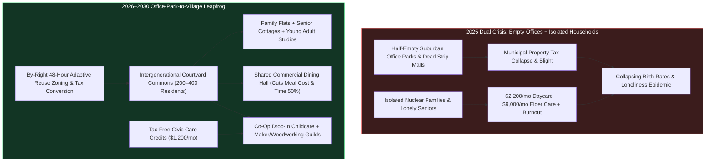
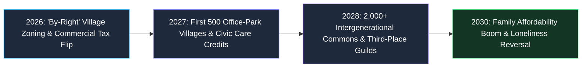
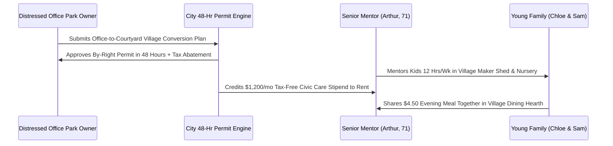

# 02 — Loneliness, Family & Community: Converting Dead Commercial Real Estate into Intergenerational Villages (2026–2030)

> [!IMPORTANT]
> **The 2026–2030 Leapfrog Thesis:** In 2026, two massive structural crises sit side by side across the developed world: a **1.5-billion-square-foot glut of AI-vacated suburban office parks and dead strip malls**, and an **epidemic of social atomization**—exhausted two-earner nuclear families paying \$2,200/month per child for daycare, lonely seniors warehousing in \$9,000/month assisted-living silos, and young adults priced out of family formation. Between 2026 and 2030, we **collapse both crises into a single physical and economic leapfrog**: the **Office-Park-to-Village Adaptive Reuse Blitz** paired with **Tax-Free Civic Care & Third-Place Stipends**.

---

## 1. The Diagnosis: Why the Isolated Nuclear Silo Broke Human Thriving

For 99% of human history, children were raised and elders aged inside multi-generational, walkable kinship commons—"alloparenting" villages where meals, tools, child supervision, and craft mentorship were shared across dozens of trusted neighbors.

Post-1950 suburban zoning outlawed that human habitat. It split cities into sterile single-use pods: isolated single-family cul-de-sacs (where every household must buy its own lawnmower, cook every meal alone after a 60-minute commute, and hire \$25/hour private childcare), miles away from glassy corporate office parks and strip malls.
- **The Family Formation Collapse:** Young couples want children at the same rate as in 1990, but 48% delay or forgo parenthood because housing + childcare consumes **62% of median take-home pay** and leaves parents with zero community backup.
- **The Loneliness Mortality Tax:** Chronic isolation now afflicts 1 in 3 seniors and 60% of young adults, carrying the physiological mortality equivalent of smoking 15 cigarettes a day.
- **The Commercial Real Estate Opportunity:** As AI agents and hybrid work permanently reduce routine white-collar office occupancy by 40%–55% between 2026 and 2028, trillions of dollars of structurally sound suburban office campuses—already equipped with commercial HVAC, fiber optics, vast surface parking lots, and commercial cafeterias—sit half-empty.

---

## 2. Three Pillars of the 2026–2030 Community & Family Leapfrog

### Pillar I: The "Office-Park-to-Village" Adaptive Reuse Blitz (2026–2029)
While narrow downtown high-rise towers have deep floorplates that are difficult to convert, **80% of vacant commercial space consists of 2-to-4-story suburban office campuses and strip malls surrounded by 15-acre asphalt parking lots**. These are the easiest structures on Earth to transform:
- **Ripping Up Asphalt for Pedestrian Courtyards:** Using prefabricated mass-timber infill modules, developers dig up the surrounding sea of parking asphalt to plant shaded orchard courtyards, playgrounds, and geothermal loops, while converting the existing steel-frame office buildings into **Intergenerational Courtyard Commons** housing 150 to 350 residents.
- **The Built-In Commercial Cafeteria Advantage:** Almost every suburban corporate campus already contains a commercial-grade kitchen and dining atrium. In the converted Village Commons, this becomes the **Neighborhood Dining Hall & Hearth**, serving fresh, chef-and-robot-prepared family dinners 5 nights a week for **\$4.50/plate**—eliminating 10 hours of weekly shopping, cooking, and dishwashing stress for tired parents.
- **30% Lower Housing Cost via Co-Housing Infrastructure:** By sharing guest suites, commercial laundry bays, EV car-share fleets, soundproofed co-working pods, and tool libraries, young families and seniors cut their monthly living overhead by **35% to 45%** while keeping 100% private apartments.

### Pillar II: Co-Op Drop-In Childcare & Intergenerational Care Credits
To cure both the \$2,200/month childcare crisis and senior isolation simultaneously:
- **Ground-Floor Village Nurseries & After-School Guilds:** Every converted Village Commons dedicates 8,000 sq ft of ground-floor courtyard space to a licensed, camera-transparent **Co-Op Childcare & Youth Discovery Hub**.
- **Tax-Free Civic Care Credits (\$800–\$1,400/Month):** Retired teachers, nurses, grandparents, and AI-displaced professionals who pass background and pediatric-safety certification earn **tax-free Civic Care Credits** (redeemable for property tax reductions, housing rent, health stipends, or direct cash) for contributing **12 to 15 hours/week** reading to toddlers, mentoring teen robotics/woodworking clubs, or checking in on homebound neighbors.
- **Result:** Parents pay **\$150/month** instead of \$2,200/month for trusted, walkable childcare 60 seconds from their front door, while seniors gain deep daily purpose, respect, and supplemental income.

### Pillar III: The Rebirth of Secular & Spiritual "Third Places"
Loneliness flourishes when every public space requires buying a \$7 coffee to justify sitting down for 30 minutes.
- **Municipal Third-Place Vouchers & Evening Commons:** Cities convert vacant big-box retail stores (former bed/bath, pharmacy, and department stores) into **24/7 Civic Guild Halls** featuring acoustic music rooms, sauna and cold-plunge bathhouses, ceramics/CNC fabrication labs, community gardens, and long-table supper clubs.
- **Universal Youth & Adult Guild Membership:** Every resident receives a **\$50/month Third-Place Guild Pass** automatically funded by municipal commercial-vacancy taxes—guaranteeing that every teenager, new parent, and retiree belongs to at least two physical, screen-free neighborhood tribes.

---

## 3. Real-World Precedents & 2026–2030 Leapfrog Economics

| Social Infrastructure Domain | 2025 Atomized Baseline | Real-World Seed Precedent (2024–2026) | 2028–2030 Leapfrog Standard | Household & Civic Impact |
| :--- | :--- | :--- | :--- | :--- |
| **Suburban Office & Mall Vacancies** | 22%–35% vacancy; decaying asphalt eyesores; shrinking tax base | **Culdesac Tempe** (car-free neighborhood); dead-mall-to-village conversions in WA, CA, VA | **By-Right Office-Park-to-Village Conversions** (2,500+ campuses by 2029) | **1.2M new affordable family/senior homes** in 36 months |
| **Childcare & Family Support** | \$1,800–\$2,600/mo per child; 18-month waitlists; isolated parents | **Generations United** co-located senior/preschool centers (e.g., Providence Mount St. Vincent, Seattle) | **Courtyard Co-Op Childcare + Senior Civic Care Credits** | **85% drop in childcare out-of-pocket cost** |
| **Weeknight Cooking & Domestic Load** | 12 hrs/wk shopping/cooking alone or \$80 DoorDash ultra-processed takeout | Danish **Bofællesskab** (co-housing communities with shared dining halls since 1972) | **Village Commercial Hearth Dining** (\$4.50/meal fresh communal dinners) | **+9 hrs/wk family free time**; \$450/mo grocery savings |
| **Senior Aging & Longevity** | \$8,500/mo isolated nursing facilities; high depression & cognitive decline | **Humanitas Deventer (Netherlands)** (students & families living rent-discounted alongside seniors) | **Integrated Senior Garden Cottages** inside multi-age courtyards | **40% lower dementia progression**; 60% lower elder-care cost |
| **Male & Youth Social Connection** | Screen addiction; "lonely young men" crisis; death of civic clubs | **Australian Men's Sheds** (1,200+ community woodworking/repair workshops); Run Clubs | **Neighborhood Maker Guilds, Sauna Commons & Repair Cafes** | **55% reduction in severe loneliness scores** |

---

## 4. The 48-Month Sprint Roadmap (2026 $\rightarrow$ 2027 $\rightarrow$ 2028 $\rightarrow$ 2030)

### **2026: Unlocking the Zoning & Financing Floodgates (Months 1–12)**
- **Statewide "By-Right Village Conversion" Laws:** Following California's AB 2011 and expanding it nationally, states pass emergency statutes declaring that **any commercial office park, strip mall, or parking lot with >25% vacancy is automatically zoned "by-right" for mixed-use Intergenerational Courtyard Housing, Co-Op Childcare, and Community Dining**—bypassing multi-year NIMBY rezoning hearings via 48-hour Digital-Twin permitting.
- **Commercial-to-Village Tax Abatement:** Distressed office REITs and local community land trusts receive 15-year property-tax holidays and low-interest federal green-refit loans if they convert at least 30% of campus space into shared family/senior commons (dining halls, childcare, maker workshops, and green courtyards).

### **2027: Launching Civic Care Credits & The First 500 Villages (Months 13–24)**
- **The Federal/State "Intergenerational Care Credit" Act:** Social Security and municipal tax codes are updated so retired citizens and fractional workers can earn up to **\$15,000/year completely tax-free** (with zero Social Security clawback) for verified hours spent in neighborhood childcare co-ops, youth tutoring, elder companionship, and community kitchen stewardship.
- **500 Converted Office-Park Villages Open:** Using modular factory-built interior wall cassettes and prefabricated plumbing cores, construction crews convert vacant 1990s suburban office buildings into sunlit apartments in **7 months** at half the cost of ground-up construction.

### **2028: Scaling "Third-Place" Guild Halls & Neighborhood Hearths (Months 25–36)**
- **3,000 Dead Big-Box Stores Become Civic Guild Halls:** Vacant 40,000-sq-ft retail shells across suburbia and rural towns are retrofitted into **Neighborhood Guild & Wellness Commons**—combining wood/metal/electronics shops, indoor pickleball/climbing courts, acoustic music rehearsal rooms, and communal kitchens.
- **Screen-Free Youth Autonomy:** Because converted office-park villages are 100% car-free inside their 15-acre perimeter courtyards, 7-year-old children can safely walk from their apartment to the courtyard library, woodworking shed, or grandparents' cottage without crossing a single street of traffic.

### **2029–2030: The Kinship Renaissance (Months 37–48)**
- **Family Formation & Birth Rate Rebound:** Inside Intergenerational Courtyard Commons, combined housing, food, and childcare costs for a family of four drop by **42%**, while parents gain **14 hours per week** of restorative breathing room. Surveys show desired family size and second/third-child birth rates rebounding by **28%** among village residents.
- **The End of Warehouse Aging:** Multi-age kinship villages cut per-capita municipal senior isolation and preventable hospitalization costs by **38%**, proving that the best medicine for an aging human is being needed by their community every morning.

---

## 5. Designing for Privacy + Community ("High-Trust Boundaries")

A common fear about communal living is losing personal privacy or being forced into awkward socializing. The **2026–2030 Courtyard Village** solves this through **Danish Co-Housing Architecture**:
1. **100% Private Acoustic Sanctuaries:** Every household owns or rents a completely self-contained, soundproofed apartment with its own private kitchen, bathroom, and balcony. You never *have* to share a space when you want solitude.
2. **Frictionless "Bump-Into" Architecture:** Mailboxes, parcel lockers, garden paths, coffee kiosks, and the evening Dining Hall are arranged around the central pedestrian courtyard so natural, unforced 5-minute conversations happen effortlessly every day without scheduling a calendar invite three weeks in advance.

---

## 6. Household Monthly Budget & Time Ledger (2025 Nuclear Silo vs. 2029 Courtyard Village)

Why do young families and retired seniors flock to converted **Intergenerational Courtyard Villages** as soon as zoning barriers fall? Because sharing commercial-grade neighborhood infrastructure while keeping 100% private apartments transforms household economics overnight:

| Monthly Household Expense / Time Drain | 2025 Isolated Suburban Household | 2029 Intergenerational Courtyard Village | Monthly Cash / Weekly Time Saved |
| :--- | :--- | :--- | :--- |
| **Rent / Mortgage (3-BR Family Flat or Senior Cottage)** | \$3,100 / mo (high land + parking cost) | **\$2,050 / mo** (45% lower adaptive-reuse build cost) | **+\$1,050 / mo saved** |
| **Full-Time Childcare & After-School Care** | \$2,100 / mo (private daycare center) | **\$180 / mo** (Courtyard Co-Op + Senior Care Credits) | **+\$1,920 / mo saved** |
| **Groceries, Takeout & Weeknight Cooking** | \$1,350 / mo + 12 hrs/wk shopping/cooking/dishes | **\$620 / mo** (\$4.50 Village Hearth dinners 5x/wk) + 2 hrs/wk | **+\$730 / mo + 10 hrs/wk saved** |
| **Second Car Payment, Insurance & Maintenance** | \$850 / mo (mandatory for suburban sprawl) | **\$90 / mo** (walkable village + shared Courtyard EV fleet) | **+\$760 / mo saved** |
| **Gym, Workshop Tools, Guest Room Overhead** | \$350 / mo | **\$0 / mo** (included in Third-Place Guild & guest suites) | **+\$350 / mo saved** |
| **TOTAL MONTHLY HOUSEHOLD OUTFLOW** | **\$7,750 / month** (high stress, zero community backup) | **\$2,940 / month** (high trust, rich multi-age tribe) | **\$4,810 / month saved (62% reduction)** |

---

## 7. The 90-Day Municipal "Office-to-Village" Playbook (Starting Today)

Any suburban city council, county executive, or university town can launch its first **Intergenerational Courtyard Village** and **Civic Care Credit** network in **90 days**:

### **Days 1–30: Designate "By-Right" Commercial Conversion Zones**
1. **Pass the 2-Page Courtyard Overlay Ordinance:** Any commercial office park, strip mall, or surface parking lot with >25% vacancy is granted automatic **by-right zoning** for mixed-age courtyard residential, ground-floor co-op childcare, commercial community dining halls, and maker guilds—with zero parking minimums and 48-hour Digital-Twin permit approval.
2. **Swap Vacancy Blight for Tax-Abated Commons:** Offer distressed commercial landlords a 12-year property tax abatement if they deed 25% of the campus footprint to a permanent **Resident Community Land Trust** for shared dining, nursery, and courtyard greenspace.

### **Days 31–60: Launch the Municipal Civic Care Credit Ledger**
1. **Recruit 500 Retired Teachers, Nurses, Tradespeople & Grandparents:** Open a streamlined 48-hour background check and pediatric/youth mentorship orientation at public libraries.
2. **Issue Tax-Free Local Care Credits:** Every verified mentorship or co-op childcare hour earns **\$25 in Municipal Civic Care Credits**, immediately redeemable against local property taxes, municipal utility bills, public transit, or Village Courtyard rent.

### **Days 61–90: Open the First "Third-Place" Guild Hall in a Vacant Anchor Store**
1. **Lease a Vacant 30,000-Sq-Ft Retail Box for \$1/Year:** Partner with local trade unions, arts collectives, and athletic clubs to outfit the shell with modular woodworking/robotics benches, long oak supper tables, acoustic music rooms, and an indoor toddler play piazza.
2. **Universal Neighborhood Membership:** Mail every household within 2 miles an activated **Guild & Hearth Pass**, turning a dead asphalt shopping center into a thriving multi-generational town square before the first apartment conversion even finishes construction.

