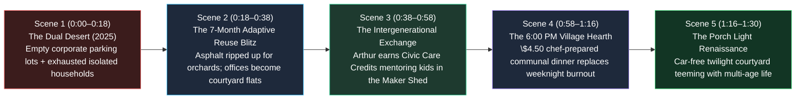

# STORYBOARD: 02 — Loneliness, Family & Community (2026–2030)

> [!NOTE]
> **Visual Narrative Arc (90-Second Film / Interactive Experience):** We trace the physical and emotional transformation of **Sycamore Corporate Park**—a half-empty, asphalt-choked 1998 suburban office campus in **2025**—into **Sycamore Courtyard Village in 2028**, viewed through the eyes of **Arthur (71)**, a widowed retired machinist, and **Chloe & Sam (31 & 33)**, young parents who thought they could never afford a second child.

---

## 1. Visual Flow & Scene Architecture

---

## 2. Scene-by-Scene Production Blueprint

### **Scene 1: The Dual Desert of 2025 (0:00–0:18)**
- **Visual Setting:** Split-screen drone shot in **2025**:
  - *Left Side:* A 20-acre suburban corporate office park at 2:00 PM—80% of the parking spaces are empty cracked asphalt baking in the heat; a *"FOR LEASE — 140,000 SQ FT"* sign flaps in the wind.
  - *Right Side:* Three miles away at 6:30 PM—Arthur (71) eats a microwaved dinner alone in front of a glowing TV; next door, Chloe and Sam stare at a \$2,300/month daycare invoice at their kitchen counter while a pot boils over and their toddler cries.
- **On-Screen Data Overlay:**
  - `2025 Paradox: 1.5 Billion Sq Ft Vacant Commercial Space | 60% Young Adult & Senior Loneliness`
  - `2026–2030 Leapfrog: Collapse Both Crises into One Habitat`
- **Audio / Voiceover:** *"We built a world where millions of square feet of offices sat empty, while families drowned in isolation and seniors grew lonely behind closed doors. In 2026, we realized the cure for both was the same piece of land."*

### **Scene 2: The "Office-Park-to-Village" Transformation (0:18–0:38)**
- **Visual Setting:** Fast-forward time-lapse across **7 months in 2027**. Excavators peel back the black asphalt parking lot like a carpet, revealing rich soil planted with mature shade trees, rain gardens, and a car-free central green.
- **Action:** Modular mass-timber balconies and warm cedar facades clip directly onto the existing steel-frame office buildings. The ground-floor corporate lobby transforms into a sunlit **Co-Op Nursery & Neighborhood Cafe**, while the old corporate maintenance garage becomes a **Community Woodworking, Robotics & Repair Guild**.
- **On-Screen Data Overlay:**
  - `By-Right Adaptive Reuse Permit: 48 Hours`
  - `Construction Cost: 45% Below Ground-Up Housing | Car-Free Interior Courtyard: 14 Acres`

### **Scene 3: The Intergenerational Care Credit in Action (0:38–0:58)**
- **Visual Setting:** 3:30 PM on a Tuesday in **2028** inside the Village Maker Shed & Courtyard Nursery.
- **Action:** Arthur (71)—who sold his lonely, high-maintenance suburban house to move into a ground-floor **Senior Garden Cottage** in Sycamore Village—is surrounded by six 8-year-olds, including Chloe and Sam's son Leo. Arthur is teaching them how to build a solar-powered wooden birdhouse on a safe workbench.
- **Economic Mechanism on Screen:** Arthur's smartwatch chimes softly as he completes his 12th mentorship hour of the week:
  - **`CIVIC CARE CREDIT EARNED: +$300.00 (Tax-Free) | Applied to Village Cottage Rent & Health Account`**
- **Dialogue Snippet:**
  - *Arthur (smiling as he hands Leo a sandpaper block):* *"Two years ago, my doctor wanted to put me on antidepressants. Turns out I didn't need a pill—I just needed ten kids who don't know how to use a miter saw."*

### **Scene 4: The 6:00 PM Village Dining Hearth (0:58–1:16)**
- **Visual Setting:** The former corporate cafeteria—now the warm, vaulted-timber **Village Dining Hall & Hearth** opening onto the courtyard patio with string lights.
- **Action:** At 6:00 PM, Chloe and Sam walk in after their 20-hour workweek—no commute traffic, no grocery bags, no pots to scrub. They grab trays of wood-fired roast chicken, local greens, and sourdough prepared by the village culinary team and automated prep kitchen for **\$4.50 per adult (\$2.00 per child)**. They sit at a long oak table with Arthur and two other young families while the kids play barefoot on the courtyard lawn ten feet away.
- **On-Screen Data Overlay:**
  - `Household Time Saved: 11 Hours/Week on Cooking & Dishes`
  - `Combined Housing + Childcare + Food Cost: Down 42% vs. 2025`

### **Scene 5: The Porch Light Renaissance (1:16–1:30)**
- **Visual Setting:** Crane camera rises slowly at twilight over Sycamore Courtyard Village. Guitar music drifts from the ground-floor Third-Place Guild Hall; teenagers are shooting hoops on the lit courtyard court; Chloe rests her head on Sam's shoulder—visibly pregnant with the second child they finally felt supported enough to welcome.
- **Closing Title Card:**
  - **2026–2030: THE RETURN OF THE VILLAGE.**
  - *We didn't need to invent a new human nature. We just needed to tear up the parking lot.*

---

## 3. Key Architectural & Social Contrast Matrix

| Storyboard Element | 2025 Atomized Suburbia | 2028 Intergenerational Courtyard Village |
| :--- | :--- | :--- |
| **Land Use** | 70% asphalt parking lots & single-use corporate pods | Lush car-free pedestrian courtyards, orchards, and wraparound porches |
| **Childhood Experience** | Driven everywhere in backseats; high screen time; adult-scheduled playdates | Free-range courtyard autonomy; daily mentorship from neighborhood elders |
| **Elder Experience** | Isolated aging-in-place or \$9,000/mo institutional care silos | Ground-floor garden cottages; paid tax-free Civic Care Credits for mentoring |
| **Parent Evening Routine** | Exhausted 6:30 PM solo cooking, dishes, and financial anxiety | Optional \$4.50 communal hearth dinners and shared co-op childcare |

---

## 4. Cinematography, Sound Design & Interactive UI Specification

- **Camera & Lens Grammar:**
  - *Scene 1 (2025 Atomized Suburbia):* High-angle drone shot emphasizing geometric isolation—heat-shimmering black asphalt parking lots juxtaposed with blue-lit, lonely living rooms behind closed blinds.
  - *Scenes 2–5 (2028 Courtyard Village):* Eye-level, human-scale 35mm walk-and-talk shots weaving seamlessly from private apartment balconies to the shared Maker Shed, Co-Op Nursery, and long oak tables of the Village Dining Hearth under warm twilight string lights.
- **Acoustic & Musical Progression:**
  - *0:00–0:18:* Distant highway tire drone, solitary microwave beeps, and a crying infant over tense silence.
  - *0:18–1:30:* The sound of asphalt cracking open gives way to acoustic upright bass, warm fiddle, children laughing on grass, hand-plane wood shavings in the workshop, and clinking glasses at the 6:00 PM communal dinner.
- **Interactive Web / Generative UI Widget Concept:**
  - An interactive **"Before / After Campus Morph"** slider allows viewers to scrub across a real 20-acre suburban office park footprint: watching 1,200 surface parking spaces transform into 14 acres of car-free orchards, senior garden cottages, family flats, and a central dining hearth while the household budget meter drops from \$7,750/mo to \$2,940/mo.
- **Production Verification Checklist:**
  - [x] Solves two macro crises in a single frame: dead commercial real estate + family/senior isolation.
  - [x] Highlights the economic engine of **Tax-Free Civic Care Credits** (\$300/week earned by Arthur mentoring kids in the woodworking shed).
  - [x] Emphasizes *High-Trust Privacy + Community*: 100% private acoustic apartments steps away from optional \$4.50 shared weeknight dinners.
