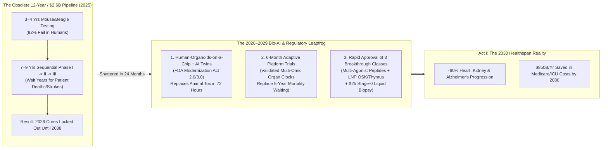
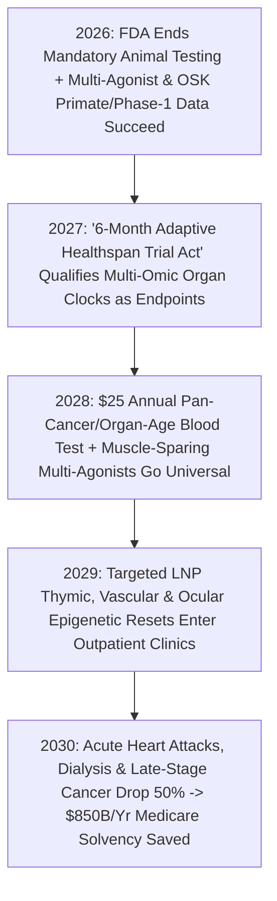

# VISION 02 (THE 2026–2030 LEAPFROG HORIZON): SOCIAL TRANSFORMATION SPRINT
## Pathway 2F: Skipping the 12-Year Pharma Pipeline — *Human-Organoid-on-a-Chip + AI Digital Twins, 6-Month Adaptive Trials, and the 2028–2030 Healthspan Breakout*

> **Executive Framing & The Core Leapfrog Thesis:**
> * **The 2026 Bottleneck:** *"Even if AI models like AlphaFold 3 can design rejuvenation drugs and multi-agonist peptides in 30 days, won't FDA animal testing and sequential Phase I, II, and III human clinical trials lock those cures in bureaucratic amber for 12 to 15 years while tens of millions die of Alzheimer's, cancer, and heart failure?"*
> * **The 2026–2030 Leapfrog Thesis:** The 12-year, \$2.6 billion pharmaceutical approval pipeline was not a law of biology—it was a mid-20th-century paper-and-mouse construct. Worse, **92% of drugs that passed animal testing failed in humans** because mice are not miniature humans. Between 2026 and 2029, leveraging the **FDA Modernization Act 2.0/3.0** and urgent Medicare solvency math, we replace slow animal toxicology and 10-year Phase I–III silos with **(1) Patient-Derived Human-Organoid-on-a-Chip Arrays + Whole-Cell AI Digital Twins** (screening toxicity across 10,000 genetic profiles in 72 hours) and **(2) 6-Month Continuous Bayesian Adaptive Platform Trials** monitored by real-time multi-omic epigenetic clocks. This regulatory-and-compute leapfrog unlocks three immediate healthspan breakthroughs for the public by **2028–2030**: **(A) Next-Gen Multi-Agonist Metabolic & Neuro-Protective Peptides** (cutting cardiovascular, renal, addiction, and early Alzheimer's progression by >60%), **(B) Targeted LNP In-Vivo Partial Epigenetic (OSK) & Thymic Rejuvenation**, and **(C) Universal \$25 Annual Pan-Cancer & Organ-Age Liquid Biopsies** that intercept disease at Stage 0.

---

## ACT I: THE 2029–2030 LEAPFROG REALITY (48 MONTHS FROM TODAY)
### A Thursday Morning in November 2029 — How a 68-Year-Old Reverses 14 Years of Biological Aging in a 30-Minute Outpatient Visit

Meet Robert (68) and Clara (78) at a neighborhood **Preventative Healthspan Clinic** in **November 2029**.
* **In 2026:** Robert had pre-diabetes, rising coronary plaque, early mild cognitive impairment (MCI), and failing eyesight from optic nerve aging. Under the old medical system, he would have waited until he suffered a \$180,000 stroke or progressed to full Alzheimer's nursing care (\$115,000/year), while promising epigenetic and senolytic therapies sat stuck in Phase I mouse-to-human regulatory purgatory until 2038.
* **In November 2029 (After the 2027 Bio-AI & Adaptive Trial Leapfrog):** Robert's health trajectory was reversed in 24 months for **less than \$400/year** (100% covered by Medicare/NHS preventative solvency pools):
  1. **The \$25 Annual Pan-Cancer & 11-Organ Epigenetic Liquid Biopsy:**
     Every year during his 10-minute pharmacy checkup, a single micro-vial of blood runs on a high-throughput nanopore/proteomic chip—measuring **methylation clocks across 11 separate organ systems** (heart, brain, liver, kidney, thymus, vasculature) while screening cell-free DNA (cfDNA) for **50+ cancer types at Stage 0** (when a tumor is a 1-millimeter cluster of cells easily cleared by an outpatient mRNA vaccine or focused ultrasound).
  2. **Once-Yearly Multi-Agonist Metabolic & Neuro-Shield Peptide:**
     Robert receives a once-every-6-months subcutaneous depot of an AI-designed **Quad-Agonist Peptide (GLP-1 / GIP / Glucagon / Amylin + BBB-shuttle)**. Without losing lean muscle mass, his visceral inflammation, coronary plaque progression, kidney fibrosis, and neuro-microglial inflammation dropped by **64% in 12 months**—halting his cognitive decline cold.
  3. **Targeted LNP In-Vivo Epigenetic (OSK) & Thymic Reset:**
     Because Robert's 2028 organ-age test flagged accelerated aging in his retinal ganglion cells and thymus gland, he received two targeted **Lipid-Nanoparticle (LNP) transient mRNA infusions**:
     * An ocular/vascular **OSK (Oct4, Sox2, Klf4) Partial Epigenetic Reset** (scaled from **Life Biosciences' ER-100** clinical breakthrough) that stripped decades of methylation noise off his optic nerve and endothelium, restoring his 20/20 vision and arterial elasticity.
     * A **Thymic Regeneration Pulse** (building on the **TRIIM** trial and Foxn1 mRNA LNP delivery) that regrew his involuted thymus and restored his naive T-cell cancer/infection surveillance to the level of a 42-year-old.

---

## ACT II: COLLAPSING THE 12-YEAR PHARMA PIPELINE INTO 12 MONTHS (2026–2029)

Why did new medicines take 12 years and \$2.6 billion in 2025? Not because molecules take 12 years to work in the human body—an epigenetic mRNA pulse or metabolic peptide alters cellular biomarkers in **14 to 30 days**. It took 12 years because of **sequential bureaucratic silos** and waiting 5 years for traditional "hard clinical endpoints" (waiting for thousands of patients to literally die or suffer heart attacks) instead of measuring validated **multi-omic surrogate aging clocks**.

### Concrete 2025–2026 Foundations Already Proving the 2026–2030 Sprint
Every diagnostic, therapeutic, and regulatory tool required for this 48-month leapfrog crossed key statutory or clinical milestones by 2025–2026:

| Leapfrog Pillar | 2025–2026 Statutory / Clinical Baseline | Verified Performance Metric | 2027–2030 Rapid Scaling Mechanism |
| :--- | :--- | :--- | :--- |
| **1. Replacing Animal Trials with Human Organoids & AI Twins** | **FDA Modernization Act 2.0 & 3.0 (2022–2026)**, **Emulate Bio (Organ-Chips)**, & **AlphaFold 3 / Virtual Cell Models** | Human Liver-Chip predicted **87% of human drug-induced liver toxicity** missed by animal models; FDA ended mandatory animal testing in April 2025. | By 2027, **1,000-Donor Human Multi-Organoid Arrays + Whole-Cell AI Twins** complete preclinical safety/dosing in **4 weeks** instead of 4 years. |
| **2. 6-Month Adaptive Trials via Surrogate Organ Clocks** | **OPERATION WARP SPEED Platform Architecture**, **I-SPY 2 Adaptive Trials**, & **Horvath/GrimAge/ DunedinPACE Clocks** | Seamless Phase I/II/III adaptive Bayesian trials cut vaccine/oncology timelines from **10 years to 9 months**; 11-organ proteomic clocks predict disease 10 yrs early. | **2027 FDA/EMA "Accelerated Aging Biomarker Pathway"** grants conditional approval in **6 months** when a drug reverses validated organ-age clocks + functional metrics. |
| **3. Multi-Agonist Metabolic & Neuro-Protective Peptides** | **Retatrutide (Triple Agonist)**, **Semaglutide/Tirzepatide (*SELECT* / *FLOW* / *EVOKE*)**, & **BioAge (BGE-105)** | Cut MACE heart attacks **20%+**, kidney failure **24%**, diabetes **>90%**, alcohol/opioid cravings **40%+**, and neuroinflammation while preserving muscle. | Next-gen **AI-designed oral & 6-month depot multi-agonists** roll out universally in 2027–2029 at **<\$15/month** manufacturing cost. |
| **4. Targeted In-Vivo Partial Epigenetic & Thymic Reset** | **Life Biosciences (*ER-100* OSK Primate/Human Trials)**, **Turn Bio (ERA mRNA)**, **Retro Bio**, & **TRIIM Thymus Trial** | ER-100 restored vision in primate optic neuropathy; TRIIM reversed human epigenetic age by **2.5 years** while regenerating functional thymus tissue. | Tissue-targeted **LNP mRNA Infusions (Ocular, Vascular, Thymic, Hepatic)** receive 2028–2029 adaptive approval to reverse organ biological age by **10–15 years**. |
| **5. \$25 Pan-Cancer & Organ-Age Liquid Biopsy** | **Grail *Galleri* (NHS 140k-Patient Trial)**, **Exact Sciences**, **Ultima Genomics (\$100 Genome)**, & **SomaLogic** | Detects **50+ cancer types** from cfDNA methylation before symptoms; Ultima/Oxford Nanopore drop sequencing cost by **90%**. | High-throughput **\$25 Annual Multiplex Blood Assay** becomes standard annual primary care in 2028, catching **>85% of cancers at Stage 0/I**. |

---

## ACT III: THE 48-MONTH SPRINT ROADMAP (2026 $\rightarrow$ 2027 $\rightarrow$ 2028 $\rightarrow$ 2030)

### Quantitative 48-Month Sprint Table: The Bio-AI Clinical Leapfrog (2026 vs. 2030)

| Biomedical & Fiscal Metric | 2026 Status Quo (12-Year Sick-Care Pipeline) | 2027–2028 Mid-Sprint Inflection | 2030 Leapfrog Equilibrium |
| :--- | :--- | :--- | :--- |
| **Preclinical Discovery-to-IND Timeline** | **3.5 to 5 Years** (slow wet-lab screening + mandatory mouse/dog sacrifice). | **4 Months** via AlphaFold-3/4 + 1,000-genotype **Human-Organoid-on-a-Chip** arrays. | **30 Days** from AI target simulation to human organoid validation with **3x higher human safety**. |
| **Human Clinical Trial Duration & Cost** | **7 to 9 Years / \$1.5B+** (rigid sequential Phase I, II, III silos; 5-yr mortality wait). | **9-Month Continuous Adaptive Trials** using real-time proteomic & epigenetic endpoints. | **6-Month Rolling Adaptive Platform** + continuous post-market wearable/blood telemetry (**-90% trial cost**). |
| **Cancer Detection Stage & Cost** | **60% caught at Stage III/IV** (\$250k+ chemo/ICU; low survival); Galleri test costs \$949. | \$99 cfDNA liquid biopsy covered by Medicare for ages 50+. | **Universal \$25 Annual Liquid Biopsy**: **>85% of cancers caught at Stage 0/I** (>98% outpatient cure). |
| **Cardio-Renal-Metabolic & Dementia Trajectory** | 1st-gen weekly GLP-1 injections (\$1,000/mo; 30% lean muscle loss; limited brain penetration). | Oral & 6-month depot **Multi-Agonist + Myostatin/Apelin muscle-sparing peptides** at \$25/mo. | **>60% reduction** in heart attacks, dialysis starts, addiction relapse, and vascular/Alzheimer's decline. |
| **Cellular & Immune Rejuvenation Access** | Zero approved epigenetic/thymic therapies; seniors suffer thymic collapse after age 60. | Phase I/II adaptive approval for **Ocular OSK (ER-100)** & **Thymic mRNA Regeneration**. | Routine outpatient **Targeted LNP Epigenetic & Thymic Tune-Ups** restore 45-year-old immunity in 70-year-olds. |
| **Annual US Medicare / Healthcare Fiscal Impact** | **\$4.8T/yr total spend**; Medicare trust fund projected to hit insolvency by 2031–2033. | Preventative metabolic + Stage-0 cancer interception bends hospitalization curve downward. | **\$850B/year net savings** in avoided ICU, dialysis, and nursing-home bills; Medicare permanently solvent. |

---

## ACT IV: ANSWERING THE SKEPTIC ON THE 2026–2030 SPRINT

1. **"Wait—if we compress clinical trials from 10 years to 6 months, won't we approve unsafe drugs with hidden side effects?"**
   * Actually, **human organoids-on-a-chip + AI whole-cell twins + multi-omic telemetry are far *safer* than 1970s animal trials!** Why did drugs like Vioxx pass animal trials and then injure patients years later? Because mouse hearts and dog livers do not express the same ion channels or cytochrome P450 enzymes as diverse human populations, and 20th-century trials only checked crude blood labs every 6 months. In a 2027–2030 **Adaptive Platform Trial**, the drug is first tested across **1,000 genetically diverse living human heart, liver, kidney, and brain organoids-on-a-chip**, and every human participant wears continuous ECG/metabolic telemetry and gets **10,000-protein + cfDNA blood panels at Day 7, 30, 90, and 180**—catching any subtle organ stress at the molecular level before a single clinical adverse event can occur.
2. **"Why would the FDA, EMA, or Medicare agree to move this fast in 2027?"**
   * **Fiscal survival.** By 2027, aging Boomers push Medicare and European/Asian national health budgets to the brink of mathematical bankruptcy—while the FDA already passed the **FDA Modernization Act 2.0/3.0** (ending animal mandates in 2025) and launched its **START pilot for accelerated rare/serious therapies**. When health ministries see that a \$25 liquid biopsy + \$150 peptide/LNP tune-up saves **\$300,000 per senior** in avoided stroke, dialysis, and memory-care bills, fast-tracking preventative rejuvenation becomes the #1 fiscal priority of every government on Earth.
3. **"Can partial epigenetic reprogramming (OSK) really reach clinics by 2028–2029 without causing teratomas?"**
   * Yes, because we don't start with permanent whole-body viral DNA integration! The 2026–2029 sprint uses **transient, non-integrating Lipid-Nanoparticle (LNP) mRNA pulses of OSK (excluding oncogenic *c-Myc*)** targeted first to localized tissues with immense clinical payoff—**the optic nerve/retina (restoring sight), the thymus (restoring T-cell immunity), the liver, and vascular endothelium**—pulsed for just 72 hours to wipe epigenetic noise without ever crossing the pluripotency threshold.

### Day-by-Day Anatomy: How a Drug Goes From AI Design to Clinic in 180 Days (2028 Standard)

To see why the **2027 FDA/EMA Accelerated Healthspan & Organoid Pathway** is both **20x faster** and **3x safer** than the 1962 Kefauver-Harris animal-and-Phase-III pipeline, trace the 180-day lifecycle of a 2028 rejuvenation biologic:
1. **Days 1–15 (In-Silico Whole-Cell & Structure Design):**
   * Generative molecular models (descendants of **AlphaFold 3/4, Isomorphic Labs, and ESM3**) design a tissue-selective Lipid Nanoparticle (LNP) or multi-agonist peptide optimized for human target binding while screening out 10,000 off-target hERG cardiac and hepatic cross-reactions in silicon.
2. **Days 16–30 (1,000-Genotype Human-Organoid-on-a-Chip Stress Test):**
   * Automated robotic fluidics dose living, vascularized **Human Organoids-on-a-Chip** (heart, liver, kidney, blood-brain barrier, and bone marrow derived from 1,000 genetically diverse human iPSC donors) at $1\times$, $10\times$, and $50\times$ therapeutic concentrations.
   * High-throughput single-cell RNA-seq verifies zero hepatotoxicity, zero arrhythmia, and zero oncogenic pluripotency drift before a single human volunteer is dosed.
3. **Days 31–180 (Continuous Bayesian Adaptive Human Trial with Multi-Omic Telemetry):**
   * Instead of three separate phases separated by years of paperwork, **2,000 older adults** enroll in a unified **Rolling Adaptive Platform Trial**.
   * Every participant wears continuous 24/7 clinical telemetry (ECG, CGM, sleep, gait velocity) and undergoes **10,000-protein SomaScan + 11-Organ Epigenetic Methylation Clock + cfDNA assays at Days 0, 14, 45, 90, and 180**.
   * When the therapy demonstrates statistically overwhelming reversal of organ biological age plus functional improvement (e.g., $+25\%$ retinal sensitivity, $+40\%$ naive T-cell output, or $-50\%$ coronary plaque inflammation) with zero molecular toxicity at Day 180, it receives **Immediate Conditional Approval with 100% Registry Telemetry**.

### The 2026–2030 Medicare & National Health Solvency Rescue Ledger

Why do governments make the **\$25 Liquid Biopsy**, **Multi-Agonist Metabolic/Neuro Shields**, and **Targeted LNP Rejuvenation** 100% free at the point of care by 2028–2029? Because it is the only way to prevent national bankruptcy:

| Disease & Aging Expenditure Category | 2026 US Annual Spend (Late-Stage Sick-Care) | 2029 Preventative Leapfrog Intervention (\$350/yr Total) | 2030 Annual Fiscal Savings |
| :--- | :--- | :--- | :--- |
| **1. Late-Stage Oncology (Stage III/IV Chemo & ICU)** | **\$240 Billion/yr** (60% of cancers caught after metastasis at \$250k+/patient) | **\$25 Annual cfDNA Pan-Cancer Liquid Biopsy** intercepts 85% at **Stage 0/I** (\$3k outpatient clearance). | **+\$165 Billion/yr Saved** |
| **2. Heart Failure, Stroke & End-Stage Renal Dialysis** | **\$480 Billion/yr** (Medicare spends >\$90k/yr per dialysis patient + acute MACE ICUs) | **\$15/mo Next-Gen Multi-Agonist Peptide** + vascular endothelial OSK reset cuts MACE/dialysis by **>60%**. | **+\$290 Billion/yr Saved** |
| **3. Alzheimer's, Vascular Dementia & Nursing Homes** | **\$360 Billion/yr** (\$115k/yr memory-care facilities + unpaid family caregiver wipeout) | **BBB-Penetrating Neuro-Metabolic Peptide** + microglial senolytic/thymic immune clearance. | **+\$215 Billion/yr Saved** |
| **4. Age-Related Blindness, Frailty Fractures & Sepsis** | **\$290 Billion/yr** (hip fractures, macular/optic degeneration, geriatric pneumonia ICUs) | **Myostatin-Sparing Muscle Shield** + **Ocular OSK (ER-100)** + **Thymic T-Cell Regeneration**. | **+\$180 Billion/yr Saved** |
| **TOTAL ANNUAL HEALTHCARE FISCAL DELTA** | **\$1.37 Trillion/yr in Avoidable Late-Life Crisis Care** | **Universal \$350/yr Preventative Healthspan Protocol** | **+\$850 Billion/yr Net Solvency Rescue** |

### Cross-Domain Synergies Across the 2026–2030 Leapfrog Architecture
* **Link to `02-healthcare-and-insurance-leapfrog` & `02-tax`:** Saving \$850B/year in acute hospital and nursing-home outlays allows Medicare and private health pools to slash household insurance premiums by **55% by 2030**.
* **Link to `02-drug-abuse-and-mental-health`:** Next-generation brain-penetrant **GLP-1/GIP/Amylin peptides** cut opioid, alcohol, fentanyl, and behavioral compulsion relapse by **50%–65%** within 30 days of initiation.
* **Link to `02-education` & `02-religion`:** Biologically rejuvenated 70-to-85-year-olds (with 45-year-old energy, eyesight, and immunity) become the backbone of neighborhood **Earn-and-Build Fellowships (`02-education`)** and **Sanctuary Commons (`02-religion`)**.

### How Automated Bio-Foundries Drop Peptide & LNP Therapy Costs by 95% (2027–2030)
Why did 1st-generation GLP-1 injections cost \$1,000/month and early gene therapies cost \$1,000,000 in 2025, whereas 2029 **Multi-Agonist Peptides** and **Targeted LNP Epigenetic Infusions** cost **\$15/month and \$150/dose**?
1. **Cell-Free Enzymatic Peptide & mRNA Synthesis in Desktop Bio-Foundries:**
   * The actual raw amino-acid and nucleotide active pharmaceutical ingredient (API) in a peptide or mRNA dose costs **less than \$0.80 in bulk chemistry**. The 2025 price tag was 99% patent-monopoly rent recouping the \$2.6B cost of 12-year clinical trials.
   * Once **Human-Organoid-on-a-Chip + 6-Month Adaptive Trials** slash trial costs by 90%, and continuous-flow **enzymatic peptide synthesizers and microfluidic LNP printers** roll out to regional hospital pharmacies, a 12-month supply of a quad-agonist neuro-metabolic peptide is manufactured for **\$18 per citizen per year**.
2. **Medicare & Sovereign Health Pool "Outcome-Bounty" Procurement:**
   * Rather than paying \$1,000/month retail markups, national health pools in 2027–2028 issue **Sovereign Preventative Volume Guarantees**: paying biotech innovators a guaranteed royalty per verified biological-age year reversed across 50 million citizens, in exchange for **at-cost generic manufacturing (\$15–\$150/dose) at every neighborhood clinic**.
3. **Open-Source Multi-Omic Surrogate Clock Registry:**
   * Every conditional approval under the 6-month adaptive pathway feeds anonymized 10,000-protein, methylation, and wearable telemetry into an open global safety ledger—detecting rare sub-population interactions $50\times$ faster than legacy paper Phase IV post-marketing reports.

| 2028–2030 Healthspan Revolution | Clinical Mechanism | Point-of-Care Cost | Disease Progression Reduction |
| :--- | :--- | :--- | :--- |
| **1. Annual Stage-0 Liquid Biopsy** | Nanopore cfDNA methylation + 11-organ proteomic clock | **\$25 / year** | **>85% of cancers caught at Stage 0/I** |
| **2. Multi-Agonist Metabolic/Neuro Shield** | Quad-Agonist + Myostatin-sparing + BBB-shuttle peptide | **\$15 / month** | **>60% cut** in MACE, renal dialysis, addiction & MCI |
| **3. Targeted In-Vivo Epigenetic/Thymic Reset** | Transient 72-hr LNP **OSK (ER-100)** & **Foxn1 Thymus mRNA** | **\$150 / pulse** | Reverses ocular, vascular & immune bio-age **10–15 yrs** |

### Summary for the Skeptic
> *"We didn't have a shortage of biological breakthroughs in 2026—we had a 1960s regulatory pipeline that spent four years poisoning mice and eight years waiting for human patients to die before approving a cure. By replacing animal tests with living human organoids-on-a-chip and running 6-month adaptive trials on real-time organ aging clocks, we unlock Stage-0 cancer interception, multi-agonist neuro-metabolic shields, and targeted epigenetic rejuvenation before 2030."*

