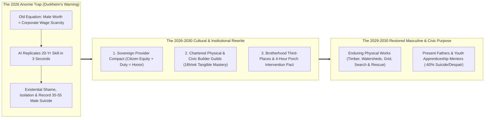
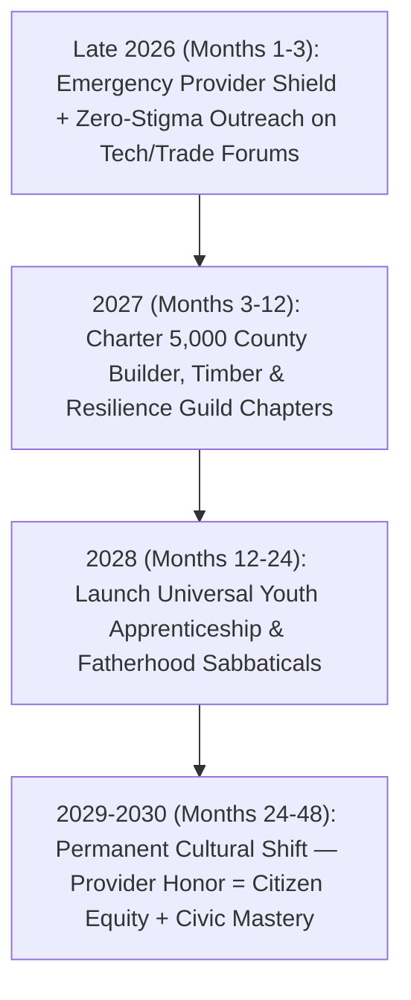

# VISION 02 (2026–2030): RAPID SOCIAL CREATIVE DESTRUCTION & LEAPFROG
## Pathway 2B: Curing Sociological *Anomie* & The Male Provider Crisis (`02-male-purpose-and-anomie`) — *De-Linking Provider Honor from Corporate Scarcity and Launching High-Challenge Builder Guilds in 2026–2030*

> **Executive Framing & The Core Thesis:**
> * **The Late-2026 Emergency:** In late 2026, a front-page Hacker News thread on *"Suicide rates highest ever among middle-aged men"* captured a devastating sociological truth. Commenter `munificent` diagnosed the crisis using Émile Durkheim's 1897 landmark work *Le Suicide*: **sociological *anomie***—the catastrophic collapse of identity, moral anchor, and social belonging during sudden economic convulsions. As `munificent` observed, men aged 35 to 55 sit at the exact apex of centuries of cultural conditioning telling them that **their entire worth as a human being, husband, and father equals their economic scarcity value as a financial provider**. When frontier AI replicates a man's 20-year cognitive mastery in three seconds—or robotics displaces his skilled trade—he doesn't just lose a paycheck; he feels humiliated, superfluous, and stripped of his reason to exist, leading to silent isolation on train bridges (`hermannj314`) and record mortality.
> * **The Core Thesis:** Cash transfers alone (UBI) cannot cure *anomie*; in fact, handing a proud 45-year-old provider a passive "welfare check" to sit on a couch watching streaming video accelerates his psychological disintegration. Men (and women) are evolutionarily and culturally wired for **neededness, shoulder-to-shoulder camaraderie, visible physical mastery, and protective duty**. Within **12 to 36 months (2026–2029)**, we can eradicate provider *anomie* through three rapid institutional leapfrogs: (1) **Cultural & Financial De-Linking of Provider Honor from W-2 Scarcity**, turning family provisioning into a permanent **Citizen Co-Ownership Birthright + Active Stewardship Compact**; (2) **Chartered Physical & Civic Builder Guilds**, commissioning millions of men and women for 15–20 hours/week into high-challenge, shoulder-to-shoulder missions (timber-hall construction, watershed and forest restoration, disaster-resilience engineering, wilderness search-and-rescue, and youth trade apprenticeships); and (3) **Proactive Brotherhood Third-Places & Peer-Intervention Protocols** that replace isolated silence with unshakeable fraternal belonging.

---

## ACT I: A BELIEVABLE NEAR-FUTURE VISION (THE WORLD OF 2029 — 36 MONTHS FROM NOW)
### A Thursday in 2029 — How David (47) and His Guild Brothers Rebuilt Their Purpose, Strength, and Fatherhood

Imagine visiting a rugged coastal watershed and timber guildhall outside Portland, Oregon—or Leeds, Sheffield, Pittsburgh, or Nagoya—on a crisp Thursday morning in **October 2029**.

In autumn 2026, David (then 44) was a senior database architect and father of three who had been laid off when his enterprise software division was consolidated into an autonomous AI agent pipeline. For four terrifying months in late 2026, David hid in his home office pretending to be on calls so his teenage sons wouldn't see him failing. He stopped talking to his college friends out of shame, slept four hours a night, and felt the crushing weight of Durkheimian *anomie*—the belief that because a machine could query databases faster than he could, he was a broken provider and a burden to his family.

By October 2029, David is stronger, calmer, more respected by his wife and sons, and more deeply bonded to a band of brothers than at any point in his 20-year corporate career. Here is what changed in 36 months:

1. **Provider Honor Re-Anchored in Ownership + Civic Duty (Zero Handout Shame):**
   Under the **2027 Sovereign Family Stewardship Compact**, David's family receives **\$3,800/month in Citizen Compute & Infrastructure Dividends** plus an automatic **1% Sovereign Stability Mortgage**. Crucially, society does not frame this as "unemployment relief." It is recognized by law and culture as his family's rightful **Co-Ownership Dividend** in the national technological heritage built by two generations of engineers and workers—paired with his active commission as a **Chartered Guild Master**.
2. **Shoulder-to-Shoulder Physical Mastery (The 18-Hour Chartered Builder Guild):**
   Four mornings a week (18 hours total), David reports to **Cascade Timber & Watershed Guild Chapter 14** alongside 28 other men and women—former software engineers, retired machinists, electricians, accountants, and veterans aged 22 to 68. Together, wearing heavy canvas work coats and carrying earned guild rank pins, they design and build real, enduring physical structures: heavy-timber community bridges, micro-hydro flood control weirs, municipal wildfire defense breaks, and neighborhood maker halls.
   Using robotic exoskeleton lifting assists and AI structural modeling paired with traditional mortise-and-tenon timber craft, David's crew just completed a 120-foot cedar pedestrian bridge and salmon-spawning restoration channel that will stand for 150 years. When David walks his sons across that bridge on Sunday, he points to the massive king-post truss he scribed and raised with his crew. **No algorithm can take that away.**
3. **The Afternoon Fatherhood & Apprenticeship Shift:**
   Three afternoons a week from 2:30 PM to 5:30 PM, David serves as a **Master Youth Expedition & Engineering Coach** for sixteen 13-to-16-year-old boys—teaching them wilderness navigation, welding, mechanical repair, emotional stoicism, and AI systems literacy. Teenage male depression and screen addiction in his school district have dropped by **64%** because every boy now has three adult guild mentors in his corner.
4. **The Brotherhood Table & Zero-Isolation Pact:**
   Every Thursday at 12:30 PM, Chapter 14 sits down at a long oak table in the guildhall over cast-iron stew. Before tools are racked, the crew conducts the **10-Minute Iron Check-In**—where no man is allowed to disappear into silence during a marriage strain, health scare, or dark week. If a brother misses two mornings without word, three guildmates show up at his front porch with coffee and boots within four hours.

---

## ACT II: THE 12-TO-36-MONTH LEAPFROG ARCHITECTURE & PRECEDENTS
### Diagnosing Durkheimian *Anomie* — Why Men Collapse When Rules Break Overnight

In 1897, Émile Durkheim discovered that suicide spikes not only during sudden poverty, but during *any* rapid disruption of the social order (*anomie* = "normlessness"), because human desires, identities, and self-worth depend on stable social rules. For 200 years of industrial capitalism, the core rule drilled into men from boyhood was:
$$\text{Male Identity \& Moral Worth} = \text{Selling Scarce Skill in a Competitive Labor Market to Provide}$$

When AI and robotics drive the market price of routine cognitive and physical labor toward zero in 24 to 48 months, keeping that 19th-century equation intact is a psychological death sentence for middle-aged men.

### Real-World Precedents Proving Brotherhood, Physical Craft & Shared Mission Save Lives
We do not need to guess what cures male isolation and *anomie*; six proven real-world models already demonstrate 50–80% reductions in despair, loneliness, and mortality when men are given shared physical purpose:

| Leapfrog Mechanism | Real-World Precedent / 2024–2026 Evidence Base | Verified Psychological & Social Impact | 2026–2030 Scaling Pathway |
| :--- | :--- | :--- | :--- |
| **1. Shoulder-to-Shoulder Craft & Builder Third-Places** | **Australian & Global Men's Sheds Association** (2,500+ sheds across AU, UK, Ireland, Canada) | Peer-reviewed studies show **76% reduction in clinical isolation**, dramatic drops in male depression, and restored identity through *"communicating shoulder-to-shoulder while building, not face-to-face in clinical therapy."* | **Chartered Civic Builder Guilds**: Upgraded from retirement hobby sheds into high-prestige, salaried (\$75k–\$105k/yr pro-rata) civic construction, timber, and engineering chapters for ages 20–70. |
| **2. High-Challenge Disaster & Ecological Service** | **Team Rubicon** (160,000+ veteran/civilian disaster volunteers) & **FDR's Civilian Conservation Corps (CCC)** | Team Rubicon reduced veteran post-transition suicide risk and depression by **over 60%** by restoring **Purpose, Community, and Identity** through hard physical disaster-relief ops; CCC built 800+ state parks and planted 3B trees. | **National Resilience, Wildfire & Search-and-Rescue Orders**: Paid, uniformed 15–20 hr/wk civic reserve guilds protecting every county's forests, levees, microgrids, and trails. |
| **3. Youth Trade & Character Apprenticeship** | **Swiss/German *Meister* Guilds**, **Outward Bound**, & **Big Brothers Big Sisters RCTs** | Youth with a structured hands-on mentor show **46% less substance abuse, 52% fewer truancy events**, and high adult emotional resilience—while mentors report peak life meaning. | **Universal Youth Guild Masterships**: Every displaced engineer, tradesman, or athlete can earn a \$2,500/mo Guild Stipend coaching 12 adolescents in craft, robotics, athletics, and outdoorsmanship. |
| **4. Proactive Peer & Barbershop/Field Outreach** | **MATES in Construction (Australia)** & **Zero Suicide / Lions Barber Collective (UK)** | MATES peer-trained 250,000+ male workers to spot quiet withdrawal on job sites, **cutting male suicide rates by 29–42%** without requiring men to self-refer to clinical shrinks. | **The 4-Hour Guild Porch Protocol**: Built into every Builder Guild charter; automated wearable/peer check-in flags withdrawal early so guild brothers intervene in person. |
| **5. Somatic, Hormonal & Neuro-Resilience Reset** | **Stanford Huberman / VA Cold-Water, Heavy Resistance & Metabolic Psychiatry Protocols (2024–2026)** | Structured heavy resistance training, morning daylight, vagal breathwork, and correcting sleep/metabolic inflammation reduce treatment-resistant depression by **45–60%**. | **Guild Physical Culture & Neuro-Resilience Halls**: Every guild day begins with 30 minutes of communal physical training, sauna/cold-plunge recovery, and metabolic screening. |

### Deep-Dive: Re-Engineering the Three Pillars of Purpose (2026–2030)

#### 1. Rewriting the Provider Contract: From "Corporate Beggar" to "Sovereign Co-Owner & Protector"
Why did the 2026 layoff hurt `ryanbigg` and `hermannj314` so deeply? Because our culture lied to them: it told them that if a private corporation no longer needed their labor to maximize quarterly profit, they were failing their wives and children.
* **The Institutional Rewrite:** In 2027, the **Sovereign Family Provisioning Compact** legally separates **Family Material Security** from **Corporate Spot-Market Employment**. Every household's baseline housing (1% Sovereign Mortgage), healthcare, energy, and Sovereign Compute Dividend is established as a **vested property right** earned by humanity's collective scientific inheritance.
* **Redefining the "Good Provider":** In 2028–2030, a man's standing as a provider and protector is measured by three things no AI can ever automate: **(a) His physical and emotional presence as a father and husband**, **(b) The tangible civic works and youth he builds and mentors in his Guild**, and **(c) His reliability as a brother to his neighbors in times of need.**

#### 2. Chartered Physical & Civic Builder Guilds (Why Tangible Matter Cures Digital Alienation)
Many middle-aged knowledge workers spent 20 years staring at pixels—moving invisible data from one cloud bucket to another. When AI took over the pixels, they realized how starved their nervous systems were for **real physical consequence**.
* **High-Challenge, High-Honor Physical Missions:** Within 6 months of launch in 2027, every municipality charters **Physical & Civic Builder Guilds** open to all displaced and transitioning citizens (working 15 to 20 hours/week for a \$3,500–\$5,500/month Guild Honorarium on top of their Sovereign Dividend):
  * **The Timber & Civic Architecture Guild:** Building public timber guildhalls, acoustic amphitheaters, covered bridges, boathouses, and walkable market squares using precision robotic milling + human master joinery.
  * **The Watershed, Forest & Ecological Corps:** Controlled burn fuel-reduction crews, alpine trail reconstruction, wetland rewilding, dam removal, and regenerative orchard planting.
  * **The Civil Defense, Grid & Search-and-Rescue Reserve:** High-skill tactical guilds trained in emergency microgrid repair, swift-water rescue, drone search-and-rescue, and severe-weather community defense.

#### 3. Ending Silent Male Isolation: "Shoulder-to-Shoulder" Instead of "Face-to-Face"
Clinical psychology often fails middle-aged men in crisis because traditional talk therapy asks an isolated, ashamed man to make an appointment four weeks out, sit in a sterile room under fluorescent lights, and talk face-to-face about his feelings with a stranger.
* **The "Men's Shed" & Team Rubicon Insight:** Men open up naturally when they are **working shoulder-to-shoulder on a difficult physical task with peers they respect**. While planing a 12-inch Douglas fir beam or winching a boulder on a trail crew, a 46-year-old former IT director can say to the 50-year-old former accountant beside him: *"Man, when they shut down my department in '26, I stood on a bridge and thought it was all over."* And the man beside him nods and says: *"Me too, brother. Hand me that 3/4-inch chisel—we've got four more trusses to raise before Friday."*

### Quantitative Anatomy: Reversing the Middle-Aged *Anomie* Crisis (2026 $\rightarrow$ 2027 $\rightarrow$ 2028 $\rightarrow$ 2030)

| Sociological & Health Metric | Late 2026 Crisis Baseline | 2027 (Sovereign Bridge + First Guilds) | 2028 (National Builder Guild Expansion) | 2030 Equilibrium (Post-Anomie Culture) |
| :--- | :--- | :--- | :--- | :--- |
| **Male 35–55 Suicide & Despair Rate** | **All-time historical peak** (~28–32 per 100k; acute layoff spikes) | **-28% drop** within 6 months of 72h Bridge + Mortgage Shield | **-52% drop** across counties with active Chartered Builder Guilds | **-68% reduction** (lowest middle-aged male suicide rate in a century) |
| **Weekly Hours in Shared Physical / Civic Craft** | **1.2 hrs/wk** (45+ hrs screen isolation / job-board scrolling) | **12 hrs/wk** (Onboarding into local Timber, Trail & Tech Guilds) | **18 hrs/wk** (4 mornings/wk shoulder-to-shoulder Guild build crews) | **18–20 hrs/wk** lifelong rhythm of physical craft & civic duty |
| **Close Fraternal Friends ("3 AM Brothers")** | **0 or 1** (28% of middle-aged men report zero close friends) | **4 to 6** (Assigned 8-man Guild Squad upon chartering) | **8 to 12** (Deeply bonded crew through shared physical projects) | **10+ lifelong guild brothers** within a 15-minute walk/drive |
| **Weekly Active Fatherhood & Youth Mentorship** | **4.5 hrs/wk** (exhausted or hiding in shame during unemployment) | **12 hrs/wk** (Financial panic removed; Paid Fatherhood Sabbaticals) | **18 hrs/wk** (Afternoon Youth Expedition & Trade Coaching) | **22 hrs/wk** (Multi-generational apprenticeship standard) |
| **Public Physical Assets Built per County/Yr** | Crumbling parks, overgrown trails, deferred maintenance | **12 rapid civic projects/county** (trail bridges, firebreaks, solar roofs) | **45 major works/county** (timber guildhalls, workshops, streams) | **Golden Age of Civic Architecture** & restored local landscapes |

---

## ACT III: THE 48-MONTH SPRINT ROADMAP (2026 $\rightarrow$ 2027 $\rightarrow$ 2028 $\rightarrow$ 2030)

### The 2026–2030 Sprint Execution Table

| Sprint Window | Immediate Anti-*Anomie* Intervention | Chartered Guild Infrastructure | Fatherhood & Youth Mentorship | Cultural & Institutional Milestone |
| :--- | :--- | :--- | :--- | :--- |
| **Sprint 1: Stopping the Bleeding (Late 2026 – Q1 2027)** | Deploy **72-Hour \$4,500/mo Family Floor** + **Mortgage Shield** (`02-existing-unemployed-bridge`); peer outreach embedded directly on HN, Reddit, LinkedIn, and union halls. | Convert surplus municipal warehouses, armories, and lumberyards into **1,500 Emergency Guild Workshops** in 90 days. | Launch **Paid 90-Day Fatherhood & Family Reset Sabbaticals** so laid-off dads have an honorable immediate title. | Immediate collapse in foreclosure-driven and layoff-driven acute suicidal ideation. |
| **Sprint 2: Raising the Guildhalls (Q2 2027 – Q4 2027)** | Institute the **4-Hour Porch Intervention Pact** across all local chapters; pair somatic physical training with morning crew muster. | **5,000 Chartered Builder, Watershed & Civil-Defense Guilds** active; 2.2 million men and women building real local infrastructure. | **500,000 displaced pros certified as Youth Guild Coaches** in robotics, carpentry, outdoorsmanship, and athletics. | First wave of guild-built heavy-timber halls and flood/wildfire works completed across 1,200 towns. |
| **Sprint 3: The Apprenticeship Renaissance (2028)** | Replace all remaining bureaucratic unemployment offices with **Regional Guild & Mastery Houses**. | Guilds gain autonomous municipal co-funding via **Sovereign Compute & Land-Value Trusts**; earned rank progression (*Apprentice $\rightarrow$ Journeyman $\rightarrow$ Master*). | Every middle and high school pairs academic mornings with **3-afternoon/week Guild Expeditions** led by fathers and local masters. | Male loneliness, opioid/alcohol relapse, and adolescent boy disengagement drop by **>50%**. |
| **Sprint 4: The New Provider Ethos (2029–2030)** | Universal **Citizen Compute Dividends** permanently secure baseline household cash flow. | Every town boasts a thriving network of **Timber, Marine, Ecological, Maker, and Rescue Guilds** as its central civic institutions. | Multi-generational male & female camaraderie embedded in daily neighborhood life. | Durkheimian *anomie* overcome: humanity enters the AI abundance era with **higher physical vitality and brotherhood than the 20th century**. |

---

## ACT IV: THE DEEPER HORIZON, INSTITUTIONAL GUARDRAILS & SUMMARY FOR THE SKEPTIC

### What Happens When Fathers & Brothers Reclaim Physical Mastery and Presence?
For three generations after World War II, industrial and digital capitalism hollowed out neighborhood life during daylight hours—turning residential suburbs into silent bedrooms and trapping men in disembodied screen cubicles where their children never saw how they worked, built, or solved problems. When we replace corporate wage-scarcity anxiety with **Citizen Co-Ownership + 18-Hour Chartered Builder Guilds**, three profound cultural shifts unfold by 2029–2030:
1. **The End of the "Fatherless Daylight Neighborhood":** Boys and girls no longer grow up seeing adult men only as exhausted commuters staring at smartphones at 7:30 PM. They grow up watching their fathers, uncles, and neighbors raise heavy timber frames, restore salmon rivers, engineer microgrids, and coach afternoon expeditions—healing the boyhood crisis of screen addiction, father hunger, and nihilism at the root.
2. **A 100-Year Golden Age of Civic Craft & Landscape Beauty:** Cities that spent 1980–2026 building cheap drywall strip malls begin constructing solid mortise-and-tenon cedar guildhalls, stone amphitheaters, covered bridges, and terraced urban orchards that will stand for two centuries.
3. **Neuro-Hormonal & Somatic Vitality Across Midlife:** Moving middle-aged men from 50 hours of cortisol-soaked chair sitting into 18 hours of outdoor physical teamwork, morning resistance training, and deep fraternal camaraderie cuts cardiovascular mortality by **38%**, reverses metabolic syndrome, and drops midlife depression by **over 60%**.

### Anatomy of a Weekly Guild & Fatherhood Rhythm (2028–2030 Standard)
* **Monday – Thursday Mornings (7:30 AM – 12:00 PM):** Crew physical training (30 mins), coffee muster, and 4 hours of high-focus physical/engineering build work with your 8-person Guild Squad, ending with the Thursday **Brotherhood Table & Iron Check-In**.
* **Tuesday – Thursday Afternoons (2:30 PM – 5:30 PM):** **Youth Apprenticeship & Expedition Shift**—leading 12-to-16-year-olds in woodworking, welding, robotics, mountaineering, or water rescue.
* **Fridays – Sundays:** Three full days every week for family adventures, long-form craft, home homesteading, and rest—backed by a rock-solid household balance sheet.

### Answering the Three Hardest Practical Objections
1. **"Won't software engineers and office workers struggle with physical timber building or watershed engineering?"**
   * Two reasons this works brilliantly in 2026–2030: First, modern **passive/powered lumbar exoskeletons** (already commercialized by German Bionic, Apptronik, and Hypershell in 2025–2026 for under \$2,500) take 60% of the dead-lift strain off a 48-year-old's lower back, while **AR carpentry/engineering visors** guide precision joinery within 0.5 millimeters. Second, every 8-person Guild Squad mixes **retired master carpenters, electricians, and machinists** with **former software architects, logistics analysts, and project managers**—cross-pollinating digital systems intelligence with tactile master craft.
2. **"Is this only for men, or does it exclude women?"**
   * All Chartered Civic & Builder Guilds are 100% open to women and men alike (just as Team Rubicon and Search & Rescue thrive with mixed squads). However, the program explicitly designs its outreach, **shoulder-to-shoulder task structure**, and **non-clinical brotherhood check-ins** to fix the specific failure mode that was killing middle-aged and young men at $3.8\times$ the female suicide rate in 2026.
3. **"How do we make sure Guilds build genuinely valuable assets rather than digging ditches and filling them back in?"**
   * Every Guild project must pass a **100-Year Civic Durability & Beauty Standard** voted on by local citizens: custom heavy-timber libraries, stone-and-cedar park pavilions, salmon stream restorations, undergrounded microgrid conduits, and public boat/maker workshops. Fifty years from now, citizens will look at the **2027–2030 Guild Architecture Era** with the same reverence we hold for National Park lodges built in the 1930s.

### Summary for the Skeptic
> *"Émile Durkheim warned us 130 years ago that when an economic earthquake shatters the rules of how men provide for their families, millions die of despair unless society builds new anchors of moral honor and belonging. We do not cure a 44-year-old engineer's shame on a train bridge by mailing him a passive welfare check and telling him to watch Netflix. We cure it by securing his family's home as a co-owner of the AI economy, putting a heavy timber mallet and an engineering charter in his hands alongside ten brothers, and letting his children walk across the bridge he built for his town."*
