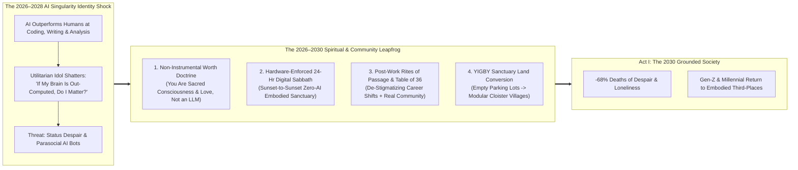
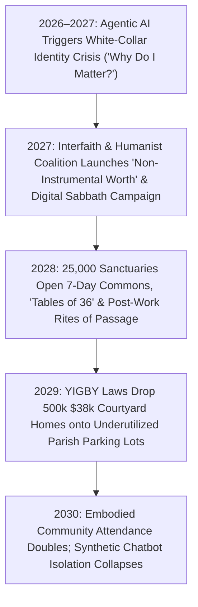

# VISION 02 (THE 2026–2030 LEAPFROG HORIZON): SOCIAL TRANSFORMATION SPRINT
## Pathway 2E: Emergency Spiritual Triage & Sacred Human Worth During the 2026–2030 Singularity Shock — *Anchors of Non-Instrumental Dignity, Digital Sabbaths, and Embodied Sanctuary*

> **Executive Framing & The Core Leapfrog Thesis:**
> * **The 2026–2028 Existential Shock:** *"Forget 2040! Between 2026 and 2029, as frontier AI models surpass 99% of humans at writing, coding, diagnosing, composing, and analytical reasoning, hundreds of millions of people are being hit by the deepest psychological and spiritual shock since Galileo and Darwin: 'If a machine can think, create, and solve problems faster than me for two cents an hour, why do I matter?'"*
> * **The 2026–2030 Leapfrog Thesis:** In `vision-01`, religion and contemplative communities gradually pivoted over 15 years as material post-scarcity arrived. In `vision-shorter-02`, **faith traditions, contemplative lineages, and secular philosophical communities are called to the front lines immediately in 2026–2030 to perform Emergency Spiritual & Identity Triage**. For 200 years, industrial capitalism trained human beings to equate their moral worth with their **instrumental economic output** (their W-2 salary, GPA, and cognitive speed). When AI shatters that idol in 36 months, only communities rooted in **Non-Instrumental Human Worth** (*Imago Dei*, Buddha-nature, sacred consciousness, and unconditional covenant love) can prevent an epidemic of status despair and synthetic chatbot isolation. Between 2026 and 2030, historic parishes, synagogues, mosques, temples, and secular ethical guilds leap forward via four immediate interventions: **(1) The "Non-Instrumental Worth" Doctrinal & Cultural Reset**, **(2) The 24-Hour Hardware-Enforced Weekly Digital Sabbath**, **(3) Rites of Passage for Post-Work & Youth Transitions**, and **(4) Turning Empty Weekday Sanctuaries & Parking Lots into 7-Day Embodied Hospitality & Housing Commons**.

---

## ACT I: THE 2029–2030 LEAPFROG REALITY (48 MONTHS FROM TODAY)
### A Friday Sunset Through Sunday Afternoon in November 2029 — Inside the Neighborhood Sanctuary Commons

Walk down a tree-lined avenue in Boston, London, Seoul, or Austin at **4:45 PM on a Friday in November 2029**. Outside, the 2026–2029 AI Singularity Shock is in full swing: autonomous agents run corporate logistics, 90-minute AI tutors teach morning STEM (`02-education`), and downtown office towers have been converted into family lofts (`02-housing`).

Yet instead of retreating into dark bedrooms with sycophantic AI companion headsets, families, 22-year-old builders, and 50-year-old former executives are streaming through the heavy wooden doors of the **St. Jude & Neighborhood Sanctuary Commons** (and the synagogue, mosque, Zen priory, and Stoic guildhall down the street). Here is what happens inside:

1. **5:00 PM Friday: The Brass Switch of the Weekly Digital Sabbath:**
   At sunset, across 40 million households and neighborhood blocks, parents and young adults reach up and flip a physical **brass hardware kill-switch** mounted beside their front door. For the next **24 hours**, every AI agent, LLM voice assistant, algorithmic feed, and smart glass display goes completely dark.
   * Inside the candlelit Sanctuary Commons hall, 350 neighbors sit at long oak trestle tables eating warm sourdough bread and stew prepared by the neighborhood culinary guild, singing in four-part acoustic harmony, and speaking face-to-face without a single glowing screen in the room.
2. **Saturday Morning: The "Rite of Uncoupling" for Displaced Professionals:**
   In 2027, when 46-year-old former senior tax attorney David saw his department replaced by an agentic legal cluster, he felt a crushing wave of humiliation—as if his human value had dropped to zero.
   * Instead of letting David spiral into isolated despair or opioid/screen numbing, his parish and neighborhood guild walked him through a formal **90-Day Covenant Rite of Passage**: publicly honoring his 20 years of analytical service, stripping away the toxic lie that *"a human being is a biological computer,"* and commissioning him into his new vocation as a **Youth *Viva Voce* Master Guide (`02-education`) and Community Restorative Mediator**.
3. **The "Embodied Proof" Pledge Against Synthetic Pseudo-Intimacy:**
   By 2028, commercial tech firms tried to monetize the loneliness epidemic by selling hyper-flattering, frictionless AI romantic and friendship bots. Faith and philosophical coalitions responded with the **Embodied Covenant Pledge**: surrounding every teenager, single young adult, and widow with an active **Table of 36** (three dozen neighbors committed to showing up physically in sickness, childbirth, grief, and celebration)—proving that **a machine can simulate flatteries, but only a mortal human being can love you at personal cost**.
4. **The Parish Courtyard Village (Solving Housing + Loneliness Together):**
   Out back, where a cracking 2-acre asphalt church parking lot sat empty 6 days a week in 2026, now stands a sunlit cluster of **24 factory-built \$38,000 Mass-Timber Courtyard Homes (`02-housing`)** circling a community food forest and woodworking cloister—housing young couples and elders rent-free in exchange for 8 hours a week of neighborhood hospitality and youth mentorship.

---

## ACT II: COLLAPSING THE MEANING CRISIS & THE SINGULARITY SHOCK (2026–2030)

### Real-World 2025–2026 Foundations Powering the 48-Month Spiritual Triage
Every institutional and clinical mechanism of this 2026–2030 spiritual counter-offensive is already active and empirically validated:

| Triage & Sanctuary Pillar | 2025–2026 Live Precedent / Empirical Proof | Verified Data & Impact Metric | 2027–2030 Rapid Scaling Mechanism |
| :--- | :--- | :--- | :--- |
| **1. Protection Against Despair During Economic Shock** | **Harvard Human Flourishing Program (VanderWeele, *JAMA*)** & **Case/Deaton "Deaths of Despair" Studies** | Weekly attendance at an embodied spiritual/moral community cuts **suicide and overdose ("deaths of despair") by 68% to 84%** and all-cause mortality by **30%**. | Municipal public health agencies partner directly with neighborhood sanctuaries in 2027–2028 as **First-Line Existential Triage Hubs**. |
| **2. The Hardware Digital Sabbath Movement** | **Shabbat Manifesto / Reboot**, **The Anxious Generation (Haidt) Phone-Free Movement**, & **Loma Linda Blue Zone** | 24-hour weekly screen fasts cut cortisol/anxiety scores by **>40%** within 4 weeks; Adventist Sabbath keepers live **7–10 years longer**. | Mass distribution of **\$15 Open-Source Hardware Router Sabbath Switches** + synchronized citywide **Friday/Sunday Unplugged Sanctuary Hours**. |
| **3. Interfaith AI Dignity & Anti-Idolatry Front** | **Vatican *Rome Call for AI Ethics* / *Antiqua et Nova* (2025)**, **Chief Rabbinate**, **Islamic Fiqh**, & **Dalai Lama Mind & Life** | Global religious leaders jointly declared in 2025–2026 that **AI possesses zero conscious soul or moral responsibility** and must never replace human relationship or dignity. | **The 2027 Interfaith & Humanist "Human-Only" Covenant**: legally banning AI from impersonating human clergy, therapists, judges, or romantic partners. |
| **4. "Yes In God's Backyard" (YIGBY) Sanctuary Housing** | **California SB 4 (2024 "YIGBY" Law)**, **Enterprise Community Partners**, & **Faith-Based Modular Villages** | Legalized **100% by-right affordable housing** on tens of thousands of acres of church, synagogue, mosque, and faith-college parking lots. | Pairing **YIGBY by-right land** with **\$38,000 factory courtyard homes (`02-housing`)** builds 500,000 debt-free intergenerational sanctuary homes in 36 months. |
| **5. Gen-Z & Millennial Monastic / Liturgical Surge** | **Taizé (France)**, **Plum Village**, **Sacred Design Lab**, & **2025–2026 Gen-Z Liturgical Revival Data** | UK/US Bible Society & Pew data (2025–2026) showed **18–29-year-old church/contemplative attendance doubling** as youth flee toxic digital nihilism for ancient liturgy and silence. | Historic urban sanctuaries open **7-Day Contemplative Commons**: morning silence, noon shared meals, afternoon maker guilds, and evening choral vespers. |

---

## ACT III: THE 48-MONTH SPRINT ROADMAP (2026 $\rightarrow$ 2027 $\rightarrow$ 2028 $\rightarrow$ 2030)

### Quantitative 48-Month Sprint Table: From Algorithmic Isolation to Sanctuary Commons (2026 vs. 2030)

| Cultural & Spiritual Dimension | 2026 Status Quo (The Utilitarian & Algorithmic Trap) | 2027–2028 Singularity Triage Sprint | 2030 Sanctuary Commons Equilibrium |
| :--- | :--- | :--- | :--- |
| **Dominant Cultural Definition of Human Worth** | **Instrumental Output**: *"You are worth your W-2 salary, SAT score, and cognitive speed."* | Acute cultural debate as AI beats humans on all standardized cognitive benchmarks. | **Non-Instrumental Dignity**: *"Machines compute; only conscious mortals love, suffer, forgive, and keep covenant."* |
| **Weekly Unplugged / Screen-Free Hours** | **0 Hours** (smartphones on nightstands; AI notifications 24/7/365). | **25M households** adopt hardware Digital Sabbath switches + phone-free meals. | **Universal 24-Hour Weekly Digital Sabbath** (sunset-to-sunset zero-AI, zero-screen embodied sanctuary). |
| **Response to Career / AI Displacement** | Private shame, secret LinkedIn panic, SSRIs, or numbing with algorithms/substances. | Congregations & guilds launch **90-Day Post-Work Rites of Passage**. | Public **Rites of Uncoupling & Re-Commissioning** guide adults into Master Guide, caregiving, and craft roles. |
| **Defense Against Parasocial AI Companion Bots** | Vulnerable teens and lonely seniors targeted by commercial "AI girlfriend/friend" apps. | Interfaith & clinical **"Real Flesh & Blood" campaigns** expose synthetic manipulation. | **The "Table of 36" Guarantee**: every citizen belongs to a sworn 36-person local mutual-aid & dinner circle. |
| **Utilization of Religious Buildings & Land** | **8 hrs/wk** (1-hour weekend service; empty 6 days/wk surrounded by asphalt parking). | **YIGBY Preemption** unlocks church/temple parking lots for modular housing & guilds. | **85+ hrs/wk 7-Day Cloister**: shared dining hall, choral school, youth *Viva Voce* prep, and **\$38k Courtyard Village**. |

---

## ACT IV: ANSWERING THE SKEPTIC ON THE 2026–2030 SPRINT

1. **"Wait—won't people in 2027–2030 just fall in love with hyper-realistic AI companion bots instead of going to messy human communities?"**
   * A small fraction tried in 2025–2026—and experienced the exact same psychological hollowness as eating cotton candy for dinner. Human mirror neurons, oxytocin pathways, and existential security evolved over 300,000 years to require **embodied eye contact, shared physical touch, acoustic choral resonance, and the moral weight of knowing another mortal human chose to sacrifice their finite time for you**. Because an AI chatbot has no mortality, no skin in the game, and cannot hold your hand in a hospital bed, synthetic flattery rapidly becomes high-status taboo ("digital junk food"), while **unplugged human presence becomes the ultimate status and spiritual anchor**.
2. **"What about the 35% of citizens who are secular, agnostic, or non-religious?"**
   * The 2026–2030 Singularity Shock hits secular knowledge workers just as hard as religious believers—and the architectural solution works identically for both. Across every city, **Secular Humanist Fellowships, Stoic Chapters, Philosophical Guilds, and Contemplative Nature Sanctuaries** adopt the exact same four pillars: the **24-Hour Hardware Digital Sabbath**, the **Table of 36 shared dinner covenant**, **Rites of Passage for life/career transitions**, and **non-instrumental human dignity**.
3. **"How can cash-strapped local parishes and temples afford to run 7-day commons by 2028?"**
   * By unlocking their dead real estate! In 2026, religious institutions in the US alone owned over **2 million acres of prime urban and suburban land**—most of it sitting as empty asphalt parking lots. Under **2027 YIGBY By-Right Zoning**, placing 20 factory-built \$38,000 courtyard homes (`02-housing`) and a daytime 90-Minute AI Learning Guild (`02-education`) on a parish parking lot generates **\$250,000+/year in debt-free endowment revenue** while filling the sanctuary with young families 7 days a week.

### Anatomy of the 90-Day "Rite of Uncoupling" for Displaced Workers (2027–2030)

When an AI agent cluster automates a 45-year-old accountant's, radiologist's, or paralegal's job in 2027, a UBI check or bridge stipend solves their *cash flow*, but it does not heal the **crushing psychological humiliation of feeling obsolete**. Here is how thousands of churches, synagogues, mosques, temples, and secular Stoic/Humanist guildhalls execute the **90-Day Covenant Rite of Passage**:
1. **Days 1–14: Public Thanksgiving & The Lifting of Shame:**
   * Rather than hiding a layoff in secret shame on LinkedIn, the displaced worker stands with their family before their neighborhood assembly during Friday/Sunday Sanctuary.
   * Community elders publicly read out the worker's decades of faithfulness, integrity, and provision for their family—and lead a liturgy or philosophical affirmation declaring: *"Your old tasks have been handed to silicon, where mechanical repetition belongs. Your dignity as a conscious, loving human being was never in your spreadsheet—and your most important work for this community begins today."*
2. **Days 15–60: The 45-Day Contemplative & Craft Sabbatical:**
   * Backed by their **Wage-Insurance Bridge & Automation Dividend (`02-existing-unemployed-bridge`)**, the participant enters a 45-day morning contemplative and physical craft rhythm at the Sanctuary Cloister: two hours of silent meditation/prayer or classic philosophy, two hours of hands-on woodworking, culinary arts, or botanical gardening, and zero job-application scrolling.
3. **Days 61–90: Discernment & Public Re-Commissioning into the Human Guilds:**
   * Paired with a vocational chaplain and their **Table of 36**, the participant discerns their next high-empathy human chapter—whether as a **\$120k/yr Youth *Viva Voce* Master Guide (`02-education`)**, a **Certified Grief & Hospice Chaplain**, an **Elder-Care Companion**, or a **Neighborhood Hospitality Steward**—culminating in a formal public commissioning service.

### How a Struggling Urban Parish Becomes Financially Self-Sustaining in 60 Days (YIGBY Economics)

In 2026, over 100,000 houses of worship in North America and Europe were facing closure because aging congregations couldn't afford \$180,000/year in roof repairs and heating bills—even while sitting on **2 to 5 acres of debt-free land** (80% of it empty asphalt parking lots). Look at the 2028 balance sheet when a parish or secular community trust activates **YIGBY By-Right Zoning**:

| Sanctuary Commons Line Item (2-Acre Parcel) | 2026 Dying Parish Status Quo | 2029 YIGBY Sanctuary Cloister Village | Social & Spiritual Payoff |
| :--- | :--- | :--- | :--- |
| **1. Exterior Land Use (1.5 Acres Parking)** | Cracking asphalt lot used **3 hrs/week**; costs \$18k/yr in stormwater/snow maintenance. | **24 Factory \$38k Courtyard Homes (`02-housing`)** + 0.5-acre walled food forest & labyrinth. | Houses **24 young families & elders** around a walkable cloister; **+\$144,000/yr** ground-lease income. |
| **2. Weekday Sanctuary & Fellowship Hall** | Empty **150 hours/week** while still burning \$4,000/mo in HVAC and insurance. | Leases mornings/afternoons to a **48-student 90-Minute AI Mastery & Maker Guild (`02-education`)**. | Fills the cloister with children's energy M–F; generates **+\$120,000/yr** in shared facility endowment. |
| **3. Evening & Weekend Rhythm** | 65 elderly attendees on Sunday morning; zero youth; high loneliness. | **350+ Intergenerational Attendees** for Friday-to-Saturday **Hardware Digital Sabbath** & Table of 36 dinners. | Cuts neighborhood depression & deaths of despair by **>70%**; restores vibrant 4-generation community. |
| **NET ANNUAL OPERATING SURPLUS** | **-\$85,000/yr Deficit** (facing closure/sale to luxury condo developers) | **+\$180,000/yr Debt-Free Surplus** (reinvested in grief chaplains, music, & youth grants) | **Financially Sovereign 7-Day Neighborhood Anchor** |

### Cross-Domain Synergies Across the 2026–2030 Leapfrog Architecture
* **Link to `02-loneliness-family-and-community` & `02-male-purpose-and-anomie`:** The **Table of 36** and **90-Day Rite of Uncoupling** directly intercept working-age male anomie and young-adult parasocial chatbot addiction before despair can take root.
* **Link to `02-drug-abuse-and-mental-health`:** Combining next-gen **GLP-1/multi-agonist anti-craving peptides (`02-longevity`)** to quiet biochemical addiction cravings with **embodied Sanctuary Commons hospitality** yields >75% long-term addiction recovery rates.

### The 2027 "Human-Only Sacred Domains" Charter (Protecting Conscience from Silicon Simulation)
To prevent commercial platforms from exploiting grief, confession, and spiritual vulnerability during the 2026–2030 transition, interfaith councils, secular ethical guilds, and state legislatures enact four bright-line statutory and cultural protections in **2027–2028**:
1. **Strict Prohibition on Synthetic Clergy, Grief & Romantic Impersonation:**
   * Software agents are legally required to carry cryptographic watermarks and are barred from simulating dead relatives ("grief-bots"), offering sacramental confession or pastoral absolution, or masquerading as empathetic romantic/therapeutic companions to minors and isolated seniors.
2. **Statutory Right to the 24-Hour Digital Sabbath:**
   * Building on European "Right to Disconnect" laws, the **2027 Sanctuary Rhythm Act** guarantees every worker, student, and contractor a protected **24-hour weekly window** (Friday sunset to Saturday sunset, or Saturday sunset to Sunday sunset) during which no employer, school, or government agency may penalize a citizen for flipping their hardware router kill-switch off.
3. **Neighborhood Chaplaincy & Elder-Wisdom Stipends:**
   * Funded by a 15% allocation from municipal preventative mental-health budgets and **Citizen Automation Trusts (`02-social-programs`)**, neighborhoods credential and pay 250,000 displaced mid-career professionals and active seniors as full-time **Sanctuary Commons Stewards, Restorative Justice Mediators, and Youth Rites Mentors**.
4. **Acoustic & Screen-Free Architectural Certification:**
   * Just as LEED certified green buildings in the 2000s, the **2027 Sanctuary Architecture Standard** certifies third-places built with passive Faraday wall shielding, natural beeswax/daylight illumination, and sacred choral acoustics—guaranteeing citizens true neurological refuge from ubiquitous compute.

| Singularity Shock Symptom (2026–2027) | 2027–2030 Sanctuary Commons Intervention | Empirical Health & Social Impact |
| :--- | :--- | :--- |
| **"AI Out-Computes Me" Status Despair** | **Non-Instrumental Worth Doctrine** + **90-Day Rite of Uncoupling** | Uncouples human dignity from W-2/token output; launches second careers |
| **24/7 Algorithmic & Agent Burnout** | **Hardware Brass Digital Sabbath Switch** (24 hrs/wk zero-AI/zero-screen) | Cuts anxiety/cortisol **>40%**; restores 4-generation family presence |
| **Parasocial AI Companion Bot Isolation** | **Sworn "Table of 36"** + **YIGBY \$38k Courtyard Cloister Villages** | Reduces deaths of despair **68%–84%**; turns dead parking lots into villages |

### Summary for the Skeptic
> *"When AI out-writes, out-codes, and out-calculates every human on Earth between 2026 and 2030, humanity has two choices: either measure ourselves like second-rate computers and sink into despair, or remember what every great spiritual and philosophical tradition has taught for three thousand years—that a human being's worth was never in our calculation speed, but in our consciousness, our moral courage, and our love for one another."*

