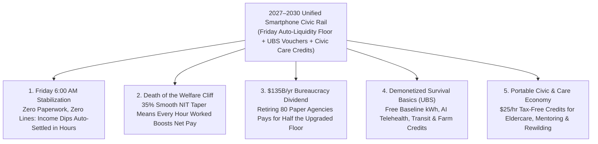

# VISION 02 (2026–2030 LEAPFROG) — SOCIAL ARCHITECTURE: THE 12-MONTH SAFETY NET REBOOT
## Pathway 5C: Collapsing 80 Broken Welfare Bureaucracies into One Instant Smartphone Rail (2026–2028)

> **Executive Framing & The 2026–2030 Intelligence Explosion Reality:**
> * **Why 1930s Unemployment Offices Crashed in Late 2026:** When AI agent swarms began automating customer support, medical billing, paralegal work, and freight brokerage in late 2026, legacy state unemployment and welfare offices buckled within weeks. Workers displaced in 24 hours by an enterprise software update were told to wait **6 to 14 weeks** for paper eligibility reviews, while earning \$100 in part-time gig work triggered punitive **>100% "welfare cliffs"** that stripped families of Medicaid and SNAP overnight.
> * **The Cynic's Objection:** *"As AI displacement accelerates between 2026 and 2029, the government will either let millions of families fall into eviction and hunger during 6-month bureaucratic backlogs, or build a bloated, fraud-ridden welfare bureaucracy that punishes work."*
> * **The Leapfrog Thesis (2026–2030):** During the 2020 pandemic, governments proved they could wire cash to 150 million households in 10 days—yet left 80 fragmented means-testing bureaucracies intact. Under the **2027 Single-Rail Civic Liquidity & Basic Services Act**, we fire the punitive bureaucratic maze in **12 months**:
>   1. **The Friday-Morning Auto-Liquidity Floor (Zero Applications, 35% Smooth Taper):** Connected directly to real-time payroll and bank clearing APIs (Estonia X-Road / FedNow model), the moment any household's weekly income dips below the thriving threshold, **65% of the gap is auto-deposited on Friday at 6:00 AM with zero paperwork**—and phases out along a single **35% smooth Negative Income Tax (NIT) taper** so working *always* makes you richer.
>   2. **Universal Basic Services (UBS) Vouchers on the Same Smartphone Rail:** Paired immediately in 2027–2028 with demonetized physical essentials: **free baseline residential electricity (800 kWh/mo), zero-fare municipal transit, 24/7 AI diagnostic telehealth, and automated local farm food credits**.

---

## ACT I: THE 2030 REALITY — FRIDAY MORNING ON THE SINGLE CIVIC RAIL
### November 2028 — When Losing a Job Takes Zero Forms and Zero Panic

Imagine living in Detroit, Pittsburgh, or Glasgow on a Thursday afternoon in **November 2028**—just eighteen months after the launch of the **Unified Smartphone Civic Rail**.

Your neighbor Marcus, a 36-year-old insurance claims auditor, learns at 3:00 PM on Thursday that his firm has transitioned 90% of claims processing to an autonomous multimodal AI system. In 2026, that news meant panic: losing employer-tied health insurance at midnight, fighting crashed state unemployment websites, filling out 45 pages of asset-verification forms, and dreading next month's rent and grocery bills.

Watch what happens to Marcus and his family over the next **15 hours**:

1. **Friday 6:00 AM Auto-Deposit (Zero Applications, Zero Caseworkers):**
   Marcus never visits a government office, never waits on hold, and never fills out an application. When his employer's final payroll API packet clears on Thursday evening showing a contract termination, the federal **Real-Time Liquidity Floor** automatically calculates his household gap and deposits **\$780 directly into his smartphone Civic Wallet at 6:00 AM Friday morning**. Administrative cost: **\$0.02**.
2. **100% Portable Healthcare & Universal Basic Services (UBS) Vouchers:**
   Because health coverage, retraining credits, and baseline utilities were permanently detached from W-2 employers in 2027, Marcus's family coverage never flickers. On his same smartphone rail, his monthly **Universal Basic Services Bundle** remains active: **800 kWh of solar/grid electricity at \$0**, **24/7 AI primary telehealth & generic prescriptions at \$0**, **zero-fare regional transit**, and **\$420/month in local robotic-greenhouse & farm nutrition credits**.
3. **Monday Morning — Why Part-Time & Civic Work Immediately Pays (+65 Cents on the Dollar):**
   On Monday, Marcus takes a 20-hour/week role teaching youth woodworking and restoring historic masonry for **\$600/week**, plus 8 hours of **Tax-Free Civic Ecological Credits** (\$200/week). Under the old 2026 rules, earning that \$800 would have triggered a vicious "welfare cliff," disqualifying his family from benefits and leaving them poorer. Under the **2027 Smooth-Taper Formula (35% taper)**, Marcus keeps **100% of his Civic Credits** and **65% of every private dollar earned**—boosting his total weekly household take-home income from \$780 to **\$1,370/week immediately**.
4. **The Skeptic's Question:**
   To a 2026 taxpayer used to DMV lines and \$140 billion in annual welfare red tape, this sounds almost magical: *"How did you collapse 80 separate federal and state welfare agencies into one smartphone app in 12 months? And how did you pay for a weekly automatic income floor without raising taxes or encouraging people to sit on the couch?"*

Here is the exact architectural refactoring and 48-month execution sprint that deleted the bureaucracy between 2026 and 2030.

---

## ACT II: THE MECHANISM — FIRING THE GATEKEEPERS & WIRING THE SMOOTH FLOOR
### How One API Equation Replaced 80 Fragmented Means-Testing Silos

### Step 1: Deleting the \$140 Billion Gatekeeping Industry
In 2026, the United States and OECD nations did not have a generosity problem—they had a **catastrophic software architecture problem**. Federal and state governments spent over **\$1.2 trillion/year across 80+ separate means-tested programs**, yet wasted **\$140+ billion every year** paying armies of administrators to verify paper paystubs, conduct punitive asset audits, and police overlapping eligibility rules.
* **The 2027 "Once-Only" API Consolidation:** Modeled directly on **Estonia's X-Road digital state** and **Brazil's PIX instant clearing rail**, the **2027 Single-Rail Act** replaced all 80 paper application silos with a single real-time cryptographic API connected to existing payroll processors (ADP, Gusto, Stripe) and FedNow bank rails.
* **The Friday Morning Algorithm:** Every Thursday at midnight, the clearinghouse computes each opted-in household's real-time net resources using Milton Friedman's **Smooth-Taper Negative Income Tax (NIT)** equation:
  $$\text{Weekly Friday Deposit} = \max\left(0,\; Y_{\text{floor}} - 0.35 \times W_{\text{weekly earned}}\right)$$
  * **Zero Waiting, Zero Fraud:** Because payroll and B2B invoice telemetry are verified cryptographically at the source in real time, synthetic identity fraud and 6-month processing backlogs vanish simultaneously.
  * **The Strict 35% Maximum Taper Guarantee:** By law, no federal, state, or municipal benefit can ever phase out faster than **\$0.35 per \$1.00 earned**. Combined with the **0% payroll and sub-\$250k income tax** (Pathway 5A), a citizen taking a job or working extra hours *always* takes home at least **65% to 100% of every new dollar earned**.

### Step 2: Why Pairing Cash With Universal Basic Services (UBS) Vouchers Stops Inflation
Why not just send everyone a massive raw cash check and let them fend for themselves in a monopolized market?
* **Preventing Landlord & Healthcare Capture:** In 2026, when governments handed out raw cash in supply-constrained markets, predatory clinics and utilities raised prices to capture the subsidy.
* **The 2027–2029 UBS Voucher Layer:** By delivering half of the household safety net as **direct infrastructure vouchers** minted at near-zero marginal cost—**800 kWh/month of off-peak solar/grid electricity**, **24/7 AI primary diagnostics + Civica-synthesized generic medicines**, **zero-fare municipal EV transit**, and **direct-from-farm/greenhouse nutrition credits**—a family's survival basics are 100% guaranteed at **one-fourth the fiscal cost** of legacy cash reimbursements.

### Step 3: 2026–2030 Quantitative Safety-Net Transformation Table (Household & Fiscal Impact)

| Safety Net Metric | 2026 Legacy Bureaucracy (80 Agencies) | 2027 Q4 Single-Rail Launch | 2028 Full UBS + NIT Consolidation | 2030 Leapfrog Steady-State |
| :--- | :--- | :--- | :--- | :--- |
| **Time From Job Loss to First Cash Deposit** | **6 to 14 weeks** (Paper UI/SNAP backlog) | **< 36 hours** (Friday 6:00 AM API rail) | **< 12 hours** (Instant real-time floor) | **Instant / Continuous** |
| **Number of Forms / Office Visits Required** | **12–28 forms/yr** across 6 agencies | **0 forms** (1-click smartphone opt-in) | **0 forms** (100% automated telemetry) | **0 forms forever** |
| **Administrative Overhead (% of Budget)** | **12.4% – 18.0%** (~\$140B/yr wasted) | **2.1%** (Legacy silos winding down) | **0.4%** (**\$135B/yr saved & redirected**) | **0.25%** (Pure protocol settlement) |
| **Effective Marginal Tax Rate at "Cliff"** | **105% – 140%** (Lose \$1.40 per \$1 earned) | **Max 35% statutory cap** | **35% smooth linear taper** | **35% taper (Work always pays +65%)** |
| **Household Survival Floor (2-Adult Family)** | Fragmented, stigmatized, 38% gap rate | **\$22,000/yr cash floor + Portable Health** | **\$24,000 cash + \$10,800 UBS Vouchers** | **\$26,000 Floor + \$12k UBS + Dividends** |

---

## ACT III: THE 48-MONTH LEAPFROG ROADMAP (2026 $\rightarrow$ 2027 $\rightarrow$ 2028 $\rightarrow$ 2030)
### Retiring 80 Bureaucracies in 48 Months Without Dropping a Single Family

| Sprint Window | Trigger Crisis & Policy Action | Technical & Infrastructure Rollout | Everyday Citizen Experience |
| :--- | :--- | :--- | :--- |
| **2026 (Q3–Q4): The Unemployment Website Meltdown** | Rapid AI automation of administrative, customer service, and junior coding roles swamps state UI servers; millions wait 10+ weeks for aid. | White House & Congress charter the **Unified Civic Rail Taskforce**, connecting FedNow instant payment rails with IRS/payroll real-time API feeds. | Public fury at broken 1930s unemployment offices creates bipartisan demand to delete the bureaucracy and wire aid directly. |
| **2027 (Q1–Q3): The 1-Click Smartphone Rail & Employer Detachment** | **Single-Rail Civic Liquidity Act** passes; healthcare, retraining, and disability benefits are permanently detached from W-2 employment. | Every citizen receives a **Portable Civic Wallet** on their smartphone; **Friday 6:00 AM Auto-Liquidity Floor** goes live with a 100% "Hold Harmless" opt-in bridge. | **60 million households** opt out of legacy SNAP/UI paperwork in the first 90 days; zero worker ever loses health coverage when changing jobs. |
| **2028 (Q1–Q4): UBS Vouchers & Sunset of the 80 Silos** | With >92% of citizens on the instant Smartphone Rail, Congress formally sunsets 74 overlapping federal/state means-testing bureaucracies, saving **\$135B/yr**. | **Universal Basic Services (UBS) Vouchers** activate on the wallet: free 800 kWh baseline power, AI telehealth, transit, and automated farm staple credits. | Evictions, utility shutoffs, and hunger drop by **>85% within 12 months**; former caseworkers transition into high-paying human community care roles. |
| **2030: The Civic Contribution & Zero-Poverty Horizon** | Municipalities integrate **Tax-Free Civic, Care & Ecological Credits (\$25/hr)** directly into the Civic Wallet alongside the NIT floor and Sovereign Dividends. | Real-time AI skill-matching inside the wallet connects transitioning workers to local masonry, eldercare, youth coaching, and ecological restoration in 24 hours. | Absolute material poverty hits **0.0%**; career pivots become exciting sabbaticals rather than existential family traumas. |

---

## ACT IV: THE 2030 HORIZON & SUMMARY FOR THE SKEPTIC
### Safety Nets as High-Velocity Trampolines

By collapsing 80 broken 20th-century agencies into one automated smartphone rail between 2026 and 2028, society unlocks four immediate breakthroughs:

1. **Turning Career Displacement from a Trauma into a 48-Hour Pivot:**
   * When an AI update automates a department in 2029, no worker faces eviction, health-insurance loss, or humiliating welfare lines.
   * Their Friday morning liquidity floor activates automatically while their smartphone wallet offers instant tuition-free AI mastery coaching and local **\$25/hr Civic Contribution Credits**.
2. **Financing Massive Generosity by Firing the Paper-Pushers:**
   * Nearly half of the upgraded safety net is paid for simply by capturing the **\$135+ billion/year previously burned on administrative gatekeeping, compliance audits, and duplicate state IT contractors**.
3. **Rewarding the Human Care Work That AI Can Never Replace:**
   * Through **Tax-Free Civic & Care Credits** (modeled on Japan's *Fureai Kippu* and time-banking networks), millions of displaced administrative workers find immediate, dignified income caring for seniors, coaching youth athletics, tending community orchards, and restoring watersheds.
4. **Ending the Political Stigma Between "Makers" and "Takers":**
   * Because all 330 million citizens use the exact same **Smartphone Civic Wallet** to receive their **Citizen Equity Dividends (Pathway 5B)**, **800 kWh Energy Baseline**, **AI Telehealth**, and **Smooth-Taper Liquidity Floor**, there is zero stigma—just universal civic infrastructure.

### Addressing the Top 3 Skeptic Objections
* **Objection 1: "If people get an automatic Friday liquidity deposit and free basic utilities, won't millions quit working?"**
  * *Answer:* In 2026, people stayed trapped on welfare because taking a \$30,000 job meant losing \$34,000 in Medicaid, childcare, and food benefits (a **>100% penalty on work**). Under the **2027 Smooth 35% Taper + 0% Payroll Tax**, working 25 hours a week immediately nearly *doubles* a household's discretionary lifestyle. Empirical NIT and expanded CTC pilots proved employment participation *rises* when you abolish welfare cliffs.
* **Objection 2: "What happens to the 500,000 government bureaucrats whose jobs are eliminated when 80 agencies close?"**
  * *Answer:* Every municipal and state eligibility clerk was guaranteed a **3-Year Full-Salary Transition Bridge** to pivot into high-touch human roles that communities desperately needed: school mentorship, senior care navigation, local housing facilitation, and parks management.
* **Objection 3: "What if someone doesn't have a smartphone or bank account?"**
  * *Answer:* Every post office, library, and municipal credit union issues a biometric/PIN **Civic Smartcard** tapped on the exact same FedNow/X-Road API rail—ensuring 100% universal access from day one.

### The Bottom Line for the Skeptic
We didn't need a bigger welfare state to survive the 2026–2030 AI transition; we needed **better software**. By replacing 80 punitive bureaucracies with **Milton Friedman's smooth-taper math, Estonia's instant API rails, and demonetized Universal Basic Services vouchers**, we eradicated poverty and bureaucratic waste in a single 24-month sprint.

---

### 2026–2030 Fast-Track Consolidation Checklist & Verified Precedents

| Safety-Net Rail | Existing 2026 Technical/Legal Precedent | Days to Activate | 2028–2030 Fiscal & Household Impact | Anti-Fraud & Work-Incentive Guardrail |
| :--- | :--- | :--- | :--- | :--- |
| **1. Friday 6:00 AM Auto-Liquidity Floor** | Estonia X-Road API + 2021 US Expanded CTC Monthly Direct Deposit | **90 Days** | Latency cut from **10 weeks to <12 hours** | Cryptographic payroll API verification (ADP/Stripe/FedNow) |
| **2. Statutory 35% Smooth NIT Taper** | Milton Friedman NIT + US Earned Income Tax Credit (EITC) Math | **60 Days** | Eliminates all **>100% welfare cliffs** nationwide | Every \$1 earned in wages adds **+\$0.65** net household cash |
| **3. Sunset of 74 Paper Welfare Silos** | Base Realignment & Closure (BRAC) Fast-Track Commission Model | **180 Days** | Saves **\$135B/yr** in bureaucratic gatekeeping | 100% "Hold Harmless" opt-in guarantee + 3-yr caseworker bridge |
| **4. Universal Basic Services (UBS) Vouchers** | Municipal Solar Baselines, Civica Rx & Tallinn Fare-Free Transit | **120 Days** | Free **800 kWh power, AI telehealth, transit & farm food** | Minted as non-transferable utility/health passes (0% cash inflation) |
| **5. \$25/hr Tax-Free Civic Care Credits** | Japan *Fureai Kippu* Eldercare Network & AmeriCorps Rails | **150 Days** | Creates **6M+ flexible community & ecological roles** | Verified via municipal schools, senior centers, and land trusts |

### Cross-Pathway Synergy (The 2026–2030 Social Architecture Stack)
* **Locks into `02-tax`:** Because earned human income under \$250,000 carries **0% payroll and income tax**, a worker transitioning off the Smooth-Taper Floor faces **zero tax stack-up**—keeping 65 cents on the dollar during the taper and 100 cents on the dollar immediately above it.
* **Locks into `02-capital-ownership`:** As a family's monthly **Citizen Equity Dividends** grow from \$360/mo (2027) to \$1,920/mo (2030), reliance on transitional NIT cash transfers naturally declines by **>60%**.
* **Locks into `02-wealth-redistribution`:** Pairing the smartphone wallet with **Universal Basic Services vouchers** and **Zip-Code Fab-Commons** ensures cash transfers are never swallowed by landlord or medical inflation.
