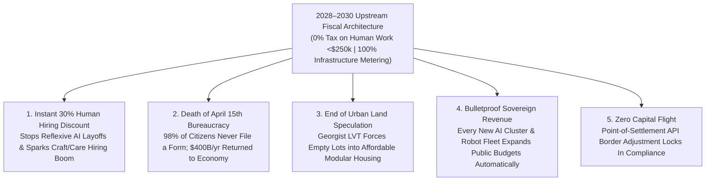

# VISION 02 (2026–2030 LEAPFROG) — SOCIAL ARCHITECTURE: THE 18-MONTH TAX BASE FLIP
## Pathway 5A: Emergency Abolition of Sub-\$250k Payroll & Wage Taxes via Upstream Compute, Energy & Land Metering

> **Executive Framing & The 2026–2030 Intelligence Explosion Reality:**
> * **Why We Cannot Wait Until 2040:** In late 2026, autonomous AI agent swarms are already replacing software engineering, legal discovery, corporate accounting, customer operations, and middle management at breakneck speed. When an enterprise replaces 10,000 W-2 workers with an API call, federal and municipal payroll/income tax revenues evaporate overnight—right when displaced households need infrastructure and liquidity most.
> * **The Cynic's Objection:** *"As white-collar and logistics payrolls collapse between 2026 and 2028, municipal bond markets will crash and federal deficits will explode—forcing governments either to ban AI or impose crushing emergency income tax hikes on the surviving workers."*
> * **The Leapfrog Thesis (2026–2030):** A 15-year phase-in is fiscal suicide when the labor base is automating in 36 months. Instead, the **2027 Emergency Fiscal Pivot Act** executes an **18-Month Tax Base Flip**: **immediate 100% abolition of all employer/employee payroll taxes (15.3% FICA) and earned income taxes under \$250,000 in Q3 2027**—making hiring a human being **30% cheaper overnight**—funded simultaneously by **Upstream Protocol-Level Metering** across the 20 physical chokepoints of the automated economy: **Commercial AI Compute Tokens/ExaFLOPs, Industrial Megawatt-Hours, Robotic Fleet Depreciation Recapture, and Georgist Unimproved Land/Spectrum Rents**. By April 2028, **98% of citizens never file a tax return again**.

---

## ACT I: THE 2030 REALITY — AFTER THE 18-MONTH FISCAL SPRINT
### April 15, 2029 — How We Saved the Tax Base by Firing the 1040 Form

Imagine walking through downtown Austin, Columbus, or Tallinn on **April 15, 2029**—just thirty months after the great AI white-collar displacement wave of late 2026 triggered emergency congressional hearings.

Instead of municipal bankruptcies or riots outside shuttered accounting firms, four radical yet mathematically airtight fiscal realities define everyday life across the economy:

1. **Overnight 30% Cost Drop to Hire Humans (0% Payroll & Sub-\$250k Wage Tax):**
   In July 2027, the federal government abolished the **15.3% FICA payroll tax** and exempted the first **\$250,000 of household human-earned wages** from federal income tax. Overnight, every restaurant, clinic, construction crew, school, and startup saw the cost of keeping or hiring a human worker plunge by nearly a third—halting mass layoffs in their tracks and igniting a boom in high-touch human services.
2. **Upstream Protocol-Level Metering at 20 Chokepoints (Zero Tax Forms for 98% of Citizens):**
   Rather than auditing 165 million citizens over crumpled receipts, the Treasury moved collection upstream to **20 non-offshorable infrastructure APIs**: hyperscale AI data-center interconnects, commercial high-voltage substation meters, autonomous fleet telematics registries, FCC spectrum leases, and municipal unimproved land-title ledgers.
3. **Real-Time Algorithmic Settlement (The Death of April 15th):**
   Every time a frontier AI cluster processes a billion commercial tokens, an autonomous warehouse draws a megawatt-hour of power, or an institutional dark pool clears a trade, a micro-basis-point protocol levy settles into the Treasury in milliseconds. On April 15, 2029, **98% of households file zero forms**—reclaiming **6.5 billion wasted compliance hours and \$400 billion per year**.
4. **The Skeptic's Question:**
   To a panic-stricken policy analyst in late 2026, this sounds impossibly fast: *"How on earth do you flip 80% of the tax base from human payrolls to compute, energy, and land in 18 months without crashing the Treasury market or driving AI labs to offshore tax havens?"*

Here is the exact emergency mechanics and 48-month execution sprint that made the 2026–2030 leapfrog work.

---

## ACT II: THE MECHANISM — UPSTREAM PROTOCOL METERING AT THE CHOKEPOINTS
### Why Taxing 20 Infrastructure Bottlenecks Beats Chasing 165 Million Shrinking Paychecks

```mermaid
flowchart LR
    subgraph Crisis2026["Late-2026 AI Fiscal Cliff (The Payroll Collapse)"]
        C1["AI Agents Automate Coding, Legal, IT & Admin Tasks"]
        C2["W-2 Payroll & Income Tax Base Shrinks -18% in 18 Months"]
        C3["31% Tax Wedge on Humans vs. 5% CapEx Tax on AI/Robots"]
    end

    subgraph Sprint2027["2027–2028 Emergency 18-Month Tax Base Flip"]
        S1["Instant Abolition: 0% FICA Payroll & 0% Income Tax <$250k"]
        S2["Chokepoint 1: Commercial Compute & Token API Levy ($/ExaFLOP-hr)"]
        S3["Chokepoint 2: Industrial MWh & Robotic Fleet Depreciation Recapture"]
        S4["Chokepoint 3: Georgist Unimproved Land Value & Spectrum Rents"]
    end

    subgraph Horizon2030["2029–2030 Zero-Filing Fiscal Architecture"]
        H1["Hiring Humans Is 30% Cheaper Overnight -> Human Craft Surge"]
        H2["98% of Citizens File Zero Tax Returns (100% API Settlement)"]
        H3["Public Revenue Auto-Scales 1:1 with AI & Robotic Exponential Growth"]
    end

    Crisis2026 ==> Sprint2027 ==> Horizon2030
```

### Step 1: Ending the "Fire-a-Human, Save-30%-in-Taxes" Subsidy Overnight
In late 2026, corporate CFOs faced a perverse mathematical mandate: employing a \$100,000 human operations analyst triggered **\$31,000+ in combined payroll and income tax wedges**, whereas replacing that worker with an enterprise AI agent swarm cost \$1,200/year in API tokens and enjoyed **100% immediate R&D/CapEx tax deductibility**.
* **Why Gradualism Failed:** Phasing out payroll taxes at 1% a year while AI capabilities doubled every six months meant the tax code was actively subsidizing mass white-collar layoffs during the critical 2026–2028 window.
* **The 2027 Chokepoint Solution:** Instead of trying to define what counts as an "AI agent" or a "robot," the **2027 Emergency Fiscal Pivot Act** attached an automated cryptographic tax meter directly to the **four physical and legal bottlenecks that no automated enterprise can bypass or offshore**:
  1. **Commercial Compute & Token Throughput ($\text{ExaFLOP-Hours}$ & Substation Meters):** Every commercial data center above 5 MW and every enterprise AI API gateway selling into the domestic market pays an automatic **compute-throughput micro-levy** metered directly at the grid transformer and commercial cloud clearinghouse.
  2. **Robotic Fleet & Autonomous CapEx Recapture:** Repealing accelerated tax depreciation for human-displacing automation and replacing it with a **uniform 8% Automated Capital Throughput Excise** on commercial robotic logistics, autonomous vehicles, and lights-out manufacturing hubs.
  3. **Georgist Split-Rate Land Value Tax (LVT) & Spatial Spectrum Rents:** Replacing municipal property taxes on buildings and state sales taxes with a **1.8% National & Municipal Unimproved Land Value Levy** plus dynamic auctions on electromagnetic spectrum, LEO orbital slots, and autonomous delivery right-of-way corridors.
  4. **0.04% Algorithmic Financial & B2B Clearing Micro-Fee:** Modeled on Brazil's PIX and Switzerland's automated stamp duty, levying a 4-basis-point fee on high-frequency institutional settlement and autonomous B2B agent transactions.

### Step 2: 2026–2030 Quantitative Revenue Flip Table (US Federal & Municipal Baseline)
Can 20 upstream infrastructure meters really replace sub-\$250k human wage and payroll taxes within 24 months? The math of the 2027–2030 automation surge makes it net revenue-positive:

| Fiscal Revenue Stream | 2026 Legacy Baseline (\$B/yr) | 2028 Mid-Sprint Shift (\$B/yr) | 2030 Leapfrog Steady-State (\$B/yr) | Collection Mechanism & Chokepoint |
| :--- | :--- | :--- | :--- | :--- |
| **FICA Payroll Tax & Sub-\$250k Earned Income Tax** | **+\$2,850B** (From human sweat) | **\$0B** (Emergency Abolition Q3 2027) | **\$0B** (Permanently 0% on human work) | Eliminated; saves employers & workers \$2.85T/yr immediately |
| **Chokepoint 1: Commercial AI Compute & Industrial MWh Levy** | \$0B | **+\$780B** (\$0.008/kWh + ExaFLOP fee) | **+\$1,340B** (Scales with 5x AI/robot power surge) | Metered automatically at >5 MW utility substations & cloud APIs |
| **Chokepoint 2: Automated CapEx & Robotic Fleet Recapture** | \$180B (Net after loopholes) | **+\$690B** (Depreciation subsidy ended) | **+\$980B** (Autonomous freight, fab & dark factories) | Settled via commercial equipment telemetry & B2B invoicing |
| **Chokepoint 3: Georgist Unimproved Land (LVT) & Spectrum Rents** | \$310B (Fragmented property tax) | **+\$840B** (National/city split-rate LVT) | **+\$1,120B** (Captures AI-driven land & orbital value) | Automated GIS land-value assessment; 0% tax on buildings/homes |
| **Chokepoint 4: 0.04% B2B Agent & Institutional Clearing Fee** | \$0B | **+\$520B** (FedNow / Clearinghouse API) | **+\$710B** (Captures autonomous agent-to-agent commerce) | Settled at protocol level via central clearinghouse rails |
| **High-Earner (> \$250k) Capital Gains & Sovereign Warrants** | \$1,420B | **+\$1,510B** (Loophole-free mark-to-market) | **+\$1,650B** (Includes Sovereign AI Equity yields) | Automated brokerage & corporate registry withholding |
| **TOTAL PUBLIC REVENUE & COMPLIANCE COST** | **\$4,760B** (*-\$400B filing waste*) | **\$4,340B** (*+\$420B stimulus bridge*) | **\$5,800B** (**+22% surplus; \$0 filing waste**) | **20 infrastructure APIs replace 165 million personal tax filings** |

### Step 3: Stopping "Server Flight" in 24 Hours via Market-Access Tethering
What stops a tech conglomerate from parking an AI cluster on a barge in international waters to dodge the compute meter?
* **Destination-Based Cryptographic API Withholding:** You can put GPUs on a boat, but **you cannot move 330 million consumers, hospital networks, physical roads, local electric grids, or court-enforced commercial contracts offshore**. Under the **2027 Destination-Based Digital & Autonomous Access Protocol**, any AI inference stream, autonomous software agent, or robotic import clearing a payment inside domestic banking rails without a verified domestic compute-tax stamp automatically incurs an equivalent **Point-of-Settlement Border Adjustment** at the payment gateway. Offshore tax evasion becomes mathematically impossible.

---

## ACT III: THE 48-MONTH LEAPFROG ROADMAP (2026 $\rightarrow$ 2027 $\rightarrow$ 2028 $\rightarrow$ 2030)
### Executing the Emergency Fiscal Pivot Without Market Panic

| Sprint Window | Trigger Event & Legislative Action | Infrastructure & API Deployment | Immediate Household & Business Impact |
| :--- | :--- | :--- | :--- |
| **2026 (Q3–Q4): The White-Collar Wake-Up Call** | Enterprise AI agents cut Fortune 500 junior coding, legal, and admin headcount by 18%; municipal income-tax receipts flash red across 30 major cities. | Treasury & Fed deploy **Real-Time Substations & Cloud Telemetry Audit** across the top 200 commercial data centers and clearinghouses; Estonia-style LVT GIS mapping completed for all US counties. | Public realization that taxing human payrolls while leaving AI compute untaxed is an existential fiscal trap. |
| **2027 (Q1–Q3): The Emergency Payroll Abolition & Meter Switch** | Congress passes the **18-Month Tax Base Flip Act**: **15.3% FICA Payroll Tax abolished on July 1, 2027**; earned income under **\$150,000 exempted immediately**. | Upstream meters go live on **>5 MW commercial data centers**, industrial robotics fleets, and **0.04% institutional clearinghouse flows**; corporate human-replacement depreciation subsidies repealed. | Every working family gets an instant **15%–24% raise in Friday take-home pay**; small businesses see human hiring costs drop **15.3%+ overnight**. |
| **2028 (Q1–Q4): Municipal Georgist LVT & Death of Form 1040** | Earned income tax exemption expands to **\$250,000**; states and cities swap sales taxes and building property taxes for **Split-Rate Unimproved Land Value Taxes (LVT)**. | **IRS Form 1040 is officially decommissioned** for 98% of households in April 2028; Destination-Based API Border Withholding locks out offshore compute tax shelters. | **Zero personal tax filing** in spring 2028; housing construction surges **+40%** as building improvements become 100% tax-free. |
| **2030: Self-Scaling Abundance Fiscal Engine** | Autonomous robotics and AI clusters generate >45% of gross national output; wholesale solar/storage + early fusion power expand industrial MWh throughput 3x. | Public revenue is **92% funded by automated compute, industrial energy, spatial commons, and clearinghouse micro-flows**—scaling automatically with machine output. | Human craft, care, mentorship, local hospitality, and entrepreneurship operate in a **100% tax-free zone**, creating 14 million new human-touch roles. |

---

## ACT IV: THE 2030 HORIZON & SUMMARY FOR THE SKEPTIC
### How Tax-Free Human Labor Sparks a Main Street Renaissance

When a nation stops taxing human effort and moves fiscal collection to the physical and digital chokepoints of automation in 18 months, four immediate transformations follow:

1. **Stopping Reflexive Layoffs by Making Humans 30% Cheaper to Employ:**
   * Half of the white-collar and service layoffs projected in 2026 weren't driven by AI superiority—they were driven by the **31% tax penalty on human payrolls**.
   * Eliminating FICA and sub-\$250k income taxes in 2027 instantly restored price competitiveness to human nurses, teachers, artisans, machinists, chefs, and customer specialists.
2. **Turning Every AI Breakthrough Into a Public Revenue Windfall:**
   * Under the 1935 tax code, a company replacing 5,000 workers with a 100-megawatt AI cluster caused a fiscal deficit.
   * Under the 2028 upstream meter code, that 100-megawatt cluster immediately pays continuous, high-velocity compute and kilowatt-hour royalties every second it runs—funding public infrastructure without a single human auditor.
3. **Crushing the Housing Crisis via Split-Rate Land Value Taxation:**
   * By untaxing buildings and taxing only the unimproved location value of land (with automatic homestead circuit-breakers for seniors and working family farms), speculators dumping capital into vacant urban lots were forced to build or sell within 12 months.
4. **Liberating 6.5 Billion Hours of Human Life:**
   * Retiring the personal income tax return in 2028 eliminated the most despised, anxiety-inducing interaction between citizens and their government.

### Addressing the Top 3 Skeptic Objections
* **Objection 1: "Won't an upstream compute and MWh levy slow down domestic AI innovation?"**
  * *Answer:* In 2027–2030, AI hardware efficiency and solar/battery microgrids cut raw cost per token by **>80% every year**. A modest upstream meter fee represents less than **3 weeks of Wright's Law cost declines**, while saving tech companies **15.3% in payroll taxes** on every human researcher and engineer they employ.
* **Objection 2: "Can you really legally abolish FICA and sub-\$250k income taxes in a single congressional session?"**
  * *Answer:* Yes—unlike constitutional amendments, statutory tax rates and depreciation schedules require only a **simple majority budget reconciliation bill**. During the 2020 pandemic, Congress rewrote \$3 trillion of fiscal rails in 14 days; the 2027 Tax Base Flip used the exact same reconciliation fast-track.
* **Objection 3: "What stops landlords from passing the Land Value Tax onto tenants?"**
  * *Answer:* As Adam Smith, Milton Friedman, and modern empirical studies in Estonia and Pennsylvania proved, **the supply of land is fixed (perfectly inelastic)**—meaning a tax on unimproved land value cannot be passed on to tenants; it is capitalized directly into lower land purchase prices and higher housing construction.

### The Bottom Line for the Skeptic
When AI agents began automating knowledge work in 2026, keeping a 1935 payroll tax was like strapping concrete blocks to human workers while handing jetpacks to machines. By flipping the tax base to **upstream compute, industrial energy, robotic fleets, and unimproved land** in 18 months, we made human work 100% tax-free and wired public prosperity directly to the exponential growth of machines.

---

### 2026–2030 Fast-Track Implementation Checklist & Verified Sovereign Precedents

| Infrastructure Chokepoint | Existing 2026 Legal/Technical Rail | Days to Activate | 2028–2030 Revenue Yield (\$/yr) | Verification & Anti-Evasion Protocol |
| :--- | :--- | :--- | :--- | :--- |
| **1. Payroll & Sub-\$250k Tax Repeal** | IRS Withholding Tables (IRC §3402) + Budget Reconciliation | **30 Days** | -\$2,850B (Direct household/employer relief) | Instant W-4/payroll API zeroing across ADP, Gusto, Stripe & Intuit |
| **2. >5 MW Compute & Industrial kWh Meter** | FERC Grid Interconnect Telemetry + Department of Energy API | **90 Days** | **+\$1,340B** | Cryptographic smart-substation meters on all commercial data centers |
| **3. Robotic CapEx Recapture** | Repeal of IRC §168(k) Bonus Depreciation for Human Replacement | **60 Days** | **+\$980B** | Automated B2B equipment serial registry & commercial fleet telematics |
| **4. Split-Rate Georgist Land Value Tax** | Estonia National LVT & Pennsylvania Split-Rate Municipal Codes | **180 Days** | **+\$1,120B** | Satellite/GIS automated unimproved land valuation; 0% tax on structures |
| **5. 0.04% Autonomous B2B Clearing Fee** | FedNow, CHIPS, DTCC & SWIFT Protocol-Level Settlement | **45 Days** | **+\$710B** | Settled in milliseconds at the clearinghouse layer; zero paperwork |

### Cross-Pathway Synergy (The 2026–2030 Social Architecture Stack)
* **Locks into `02-capital-ownership`:** Tech firms paying the upstream compute levy can elect to settle up to 25% of their obligation via **non-voting dividend-paying public equity warrants** into the Citizen Wealth Trust.
* **Locks into `02-social-programs`:** The exact same real-time payroll API that drops human tax withholding to **0.0%** on July 1, 2027 also feeds the **Friday 6:00 AM Auto-Liquidity Floor**—eliminating both the IRS 1040 and 80 welfare agencies on a single cryptographic rail.
* **Locks into `02-wealth-redistribution` & `02-economics`:** Replacing municipal building property taxes with a **Split-Rate Land Value Tax** removes the tax penalty on dropping **\$65/sq ft robotic modular homes** onto urban infill lots.
