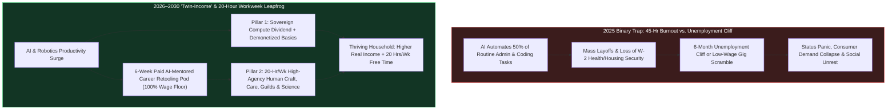
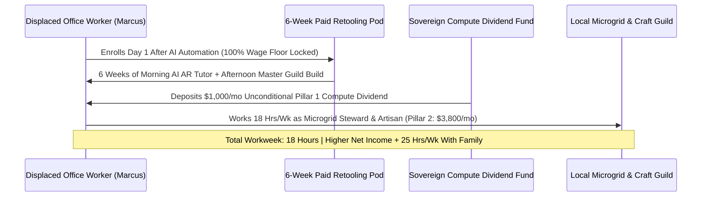

# 02 — Unemployment & The Post-Wage Reorganization: The 20-Hour "Twin-Income" Standard (2026–2030)

> [!IMPORTANT]
> **The 2026–2030 Leapfrog Thesis:** By 2028–2029, autonomous AI agents and physical robotics will perform **50%+ of routine cognitive and manual tasks**—from insurance claims, tier-1 coding, bookkeeping, and legal discovery to warehouse picking and long-haul dispatch. Pretending that 1950s 40-hour "Bullshit Office Jobs" will survive until 2045—or offering laid-off workers a passive poverty-welfare check while stripping their human purpose—is a recipe for social collapse. Instead, between 2026 and 2030, humanity executes **The Great Re-Allocation of Human Time**: establishing the **20-Hour Flexible "Twin-Income" Household Standard** paired with **6-Week Paid Career Retooling Pods**.

---

## 1. The Diagnosis: Why Both "40-Hour Job Hoarding" and "Passive UBI Alone" Fail

As AI and robotics compress the marginal cost of routine cognitive and physical labor toward zero between 2026 and 2030, society faces a false dichotomy:
1. **The Legacy "Make-Work" Trap:** Forcing humans to sit in cubicles 40 to 50 hours a week competing against \$0.02/hour AI agents for routine spreadsheet, customer-service, and administrative tasks breeds mass anxiety, wage compression, and burnout.
2. **The "Passive Dole" Trap:** Simply handing displaced workers a flat Universal Basic Income check while telling them they are economically useless triggers an epidemic of despair, status loss, and social alienation. Humans need **both unconditional material security AND high-agency contribution to their community**.
3. **The 2026–2030 Leapfrog Solution:** Just as the 19th-century industrialization leapfrog compressed the 72-hour agricultural/factory week down to the 40-hour 5-day standard, the **2026–2030 AI Productivity Dividend** compresses the standard full-time human workweek to **18–20 hours of high-agency human craft, care, physical stewardship, and entrepreneurship**, backed by a **Universal Sovereign Compute Dividend + Demonetized Basic Services**.

---

## 2. Three Pillars of the 2026–2030 Post-Wage Labor Reorganization

### Pillar I: The "Twin-Income" Household Architecture (Pillar 1 + Pillar 2)
By 2028, every adult citizen's economic foundation shifts from a fragile single W-2 paycheck to a resilient **Twin-Income Standard**:
- **Income Pillar 1 — The Universal Sovereign Compute & Automation Dividend + Demonetized Basics:**
  - Rather than taxing human payroll (which perversely penalizes hiring humans!), tax codes shift from **payroll taxes to Sovereign Compute, Token-Inference, and Robotic Kilowatt-Hour Royalties**, plus public equity stakes in frontier AI infrastructure (modeled on the **Alaska Permanent Fund** and **Norway's Sovereign Wealth Fund**).
  - Combined with the demonetization of healthcare (\$15/mo AI Diagnostic Pods), housing (48-hour permitted modular Courtyard Villages), and energy/food, Pillar 1 provides every adult with a **\$1,000/month unconditional floor** plus universal healthcare and zero-tuition lifelong retooling.
- **Income Pillar 2 — The 20-Hour High-Agency Human Workweek (\$35–\$85/hr):**
  - On top of Pillar 1, adults work **15 to 20 flexible hours per week** in sectors where human presence, physical dexterity, emotional warmth, ethical accountability, and creative taste carry a massive premium: **skilled physical trades & robotics orchestration, personalized longevity & pediatric coaching, culinary/artisan craft, ecological restoration, neighborhood fabrication guilds, and AI-augmented micro-entrepreneurship**.
  - Because Pillar 1 covers survival basics and demonetizes healthcare, working 20 hours/week in 2028 yields a **higher real material living standard than working 45 hours/week in 2024**—while liberating **20+ hours every week** for family, art, fitness, and community life.

### Pillar II: Zero-Friction 6-Week Career Retooling Pods
Traditional "worker retraining" failed because asking a 42-year-old laid-off bookkeeper or customer-support manager to take out \$40,000 in student loans for a 2-year theoretical community college degree is absurd.
- **6-Week Paid Hands-On Transition Sprints:** Any worker whose routine role is automated steps immediately—with **zero gap in income (100% prior base stipend up to \$6,500/month)**—into a neighborhood **6-Week Retooling Pod**.
- **1-on-1 AI Tutor + Physical Master Guild Apprenticeship:** Using AR spatial-guidance glasses and personalized AI simulation tutors in the morning, and hands-on physical team projects in the afternoon, displaced administrative workers retool in **42 days** into high-demand roles with pre-guaranteed local job placement:
  - *From Insurance Claims / Admin Clerk* $\rightarrow$ **Community Health & Biomonitoring Navigator** or **Restorative Justice Mediator**.
  - *From Tier-1 Call Center / Logistics Dispatcher* $\rightarrow$ **Local Autonomous Fleet & Microgrid Coordinator**.
  - *From Junior Copywriter / Data Entry* $\rightarrow$ **AI-Augmented "One-Person Studio" Micro-Entrepreneur** or **Precision Greenhouse / Food-System Designer**.

### Pillar III: Abolishing the Payroll Tax & Rewarding Job-Sharing
Why did companies in 2024 prefer firing half their staff and working the survivors 55 hours a week? Because fixed per-employee healthcare costs and payroll taxes punished job-sharing.
- **Zero Payroll Tax on the First 24 Hours/Week of Human Labor:** By eliminating employer healthcare mandates (via Universal Direct Care + Catastrophic Pools) and abolishing federal/state payroll taxes on the first 24 hours of weekly human employment, companies find it **more profitable and productive to employ two thriving humans at 20 hours/week** than one burned-out human at 45 hours/week.

---

## 3. Real-World Precedents & 2026–2030 Leapfrog Benchmarks

| Labor & Economic Dimension | 2025 Legacy Wage-Labor Trap | Real-World Seed Precedent (2024–2026) | 2028–2030 Leapfrog Standard | Household & Macro Impact |
| :--- | :--- | :--- | :--- | :--- |
| **Standard Full-Time Workweek** | 40–50 hrs/wk (plus 6 hrs commuting); 38% of office hours spent on performative busywork | **UK & Iceland 4-Day Week Trials** (100% pay, 20% fewer hours, *higher* output); Keynes' 15-hr prediction | **18–20 Hour High-Agency Workweek** (3 days x 6.5 hrs or flexible seasonal blocks) | **+1,000 hrs/yr free time** per adult; zero productivity loss |
| **Automation Wealth Sharing** | AI capex gains accrue to top 0.1% equity holders; payroll taxes punish human hiring | **Alaska Permanent Fund Dividend**; **Norway Sovereign Wealth Fund**; Texas Permanent School Fund | **Sovereign Compute & Robotics Royalty Fund** (\$1,000/mo universal citizen dividend) | **Zero poverty floor**; permanent consumer demand stability |
| **Mid-Career Retraining** | 2-year degree bloat; high dropout; unpaid unemployment panic | **Denmark Flexicurity Model** (90% wage replacement + rapid active upskilling); Per Scholas | **6-Week Paid AI+Guild Retooling Pods** with guaranteed local placement | **88% placement within 45 days** of role automation |
| **Micro-Entrepreneurship** | High legal, coding, accounting & healthcare barriers to starting a business | Shopify / Cursor / Replit AI agents enabling 1-person \$1M revenue companies | **Zero-Overhead "One-Person Artisan & Tech Co-Ops"** backed by portable benefits | **3x surge in local small businesses** & craft guilds |
| **Care, Ecological & Civic Work** | Unpaid or poverty-wage (\$14/hr) despite massive social value | AmeriCorps; New Deal CCC; municipal watershed & elder-care cooperatives | **Pillar 2 Civic & Ecological Stewardship Corps** (\$35–\$50/hr equivalent) | **Millions of high-status local roles** in care & restoration |

---

## 4. The 48-Month Sprint Roadmap (2026 $\rightarrow$ 2027 $\rightarrow$ 2028 $\rightarrow$ 2030)

### **2026: Replacing Unemployment Insurance with Paid Retooling Pods (Months 1–12)**
- **The "Zero-Cliff Transition" Overhaul:** States convert punitive, bureaucratic 1930s Unemployment Insurance offices into **Rapid Retooling & Placement Hubs**. Instead of requiring laid-off workers to fill out weekly forms proving they applied to 5 dying jobs, displaced workers immediately receive **100% stipends during a 6-week hands-on Retooling Sprint** matched directly to local physical, healthcare, energy, and robotics buildouts.
- **Abolishing the Payroll Tax Penalty on Human Hiring:** Emergency tax reform eliminates employer payroll taxes on the first 25 hours of weekly human wages, offset by a **1.5% Sovereign Compute & Automated Inference Royalty** on commercial data centers and autonomous fleets.

### **2027: Scaling the Sovereign Dividend & The 28-Hour Bridge (Months 13–24)**
- **Launch of the National & State Sovereign Compute Dividends:** Every adult citizen begins receiving quarterly automated payouts (scaling from \$400/month in 2027 to \$1,000/month by 2029) from the **Public AI & Robotics Commons Fund**, paired with universal Direct Care health passes.
- **Public Sector & Fortune 500 Shift to 28-Hour Full-Time Parity:** Led by municipal governments, healthcare systems, and AI-augmented enterprises, the statutory definition of "Full-Time Employment" steps down from 40 hours to **28 hours in 2027** (and **20 hours by 2028–2029**), with zero reduction in annual base take-home pay thanks to AI productivity multipliers and eliminated employer healthcare/payroll overhead.

### **2028: The 20-Hour "Twin-Income" Standard Goes Universal (Months 25–36)**
- **The Two-Earner 40-Hour Household (20 Hrs + 20 Hrs):** By 2028, a typical two-adult household works a combined **35 to 40 hours per week total** (instead of 80 to 90 hours in 2024). With Pillar 1 (Sovereign Dividend + Demonetized Healthcare/Childcare/Housing) covering baseline security, their Pillar 2 earnings fund thriving discretionary lifestyles, travel, and savings.
- **Explosion of the "Human-Premium" Economy:** As routine digital commodities become nearly free, consumer spending shifts massively toward **authentic human experiences**: live music, neighborhood culinary hearths, bespoke woodworking and fashion, high-touch athletic and longevity coaching, outdoor guiding, and in-person mentorship.

### **2029–2030: The Great Flourishing of Human Agency (Months 37–48)**
- **End of Involuntary Unemployment Anxiety:** By 2030, the phrase "unemployment rate" is replaced in economic statistics by the **Human Agency & Flourishing Index**.
- **A Nation of Builders, Healers, Artists, and Explorers:** Freed from 40 hours of repetitive screen drudgery, millions of citizens dedicate their newly liberated 20 hours/week to mastering physical crafts, raising resilient children in intergenerational villages, restoring local watersheds, and participating in decentralized scientific discovery.

---

## 5. Psychological Dignity: Why Everyone Still Has a Needed Role

The greatest danger of the AI transition was never a shortage of goods—it was a **shortage of feeling needed**. The 2026–2030 reorganization guarantees psychological dignity through three structural norms:
1. **No One Is "Paid to Stay Home":** While Pillar 1 prevents destitution unconditionally, social prestige, community honors, and Pillar 2 prosperity flow from active 15–20 hour/week contribution—whether in commercial craft, robotics operations, youth/elder care, or ecological stewardship.
2. **Status Parity for Physical & Care Craft:** A master botanical landscaper, pediatric mentor, or robotics technician working 20 hours/week in 2029 enjoys higher net income and social respect than a burned-out middle manager did in 2024.
3. **Lifelong Sabbaticals Without Fear:** Any citizen can take a 6-month Retooling or Creative Sabbatical every 5 years without ever risking their family's healthcare, housing, or baseline security.

---

## 6. Two-Adult Household Income & Time Ledger (2025 90-Hour Grind vs. 2029 Twin-Income Standard)

How can a household work **half as many hours** in 2029 while enjoying a **higher material standard of living** than in 2025? Because the **Twin-Income Standard** combines AI productivity dividends (Pillar 1) with high-hourly-value human work (Pillar 2) while demonetizing healthcare, childcare, and commuting costs:

| Monthly Household Ledger Item (2 Adults, 2 Kids) | 2025 Two-Earner 90-Hr W-2 Grind | 2029 Two-Earner 38-Hr "Twin-Income" Standard | Net Household Transformation |
| :--- | :--- | :--- | :--- |
| **Weekly Paid Work + Commute Hours (Combined)** | **92 hours / week** (80 hrs work + 12 hrs commute) | **38 hours / week** (18 hrs + 20 hrs local high-agency work) | **+54 hours / week reclaimed for life & family** |
| **Pillar 1: Sovereign Compute & Robotics Dividend** | \$0 / month | **+\$2,000 / month** (\$1,000/adult tax-free dividend) | Unconditional survival floor |
| **Pillar 2: High-Agency Human Work Earnings** | +\$8,200 / month (after 24% income & payroll taxes) | **+\$7,400 / month** (0% payroll tax on first 24 hrs/wk) | High hourly reward for human craft & care |
| **Healthcare, Childcare, Commute & Housing Outflow** | -\$6,900 / month (insurance, daycare, 2 cars, rent) | **-\$3,100 / month** (\$15 AI Pod care, Courtyard Village co-op) | **\$3,800 / month lower fixed survival overhead** |
| **NET MONTHLY DISCRETIONARY SAVINGS & THRIVING** | **+\$1,300 / month** (exhausted, zero time, job-locked) | **+\$6,300 / month** (rested, 100% portable, high agency) | **4.8x higher net savings + 2,800 hrs/yr free time** |

---

## 7. The 90-Day Workforce & Municipal Transition Playbook (Starting Today)

Governments, labor unions, and employers can begin the **Post-Wage Reorganization** in **90 days** without waiting for 2030:

### **Days 1–30: Convert Unemployment Bureaus into 6-Week Paid Retooling Pods**
1. **Eliminate the "Job-Search Bureaucracy" Trap:** By executive waiver, state labor departments stop forcing AI-displaced office workers to submit 5 pointless resumes a week to collect unemployment checks. Instead, any displaced worker who enrolls in a **6-Week Hands-On Retooling Sprint** receives **100% wage-floor continuation (up to \$6,500/mo)** plus a guaranteed local apprenticeship interview upon completion.
2. **Stand Up Modular AI+Guild Training Bays:** Partner with local trade unions, robotics integrators, Direct-Care clinics, and ecological land trusts to run 6-week morning-AI-simulation / afternoon-fieldwork sprints in vacant commercial spaces.

### **Days 31–60: Pilot the Zero-Payroll-Tax 24-Hour Workweek**
1. **Municipal & Enterprise Job-Sharing Compacts:** Cities and pioneering regional employers shift administrative, nursing, logistics, and teaching schedules from burnout 45-hour shifts to **two-person paired 22-hour/week roles**—using AI co-pilots to handle 100% of documentation and scheduling handoffs between the pair.
2. **State Tax Credit for Workweek Compression:** Any employer that reduces full-time standard hours from 40 to $\le$28 hours/week while maintaining 100% base living pay via AI productivity tooling receives an immediate **100% state payroll and franchise tax exemption**.

### **Days 61–90: Seed the Sovereign Compute & Automation Commons Fund**
1. **Establish the Public Automation Royalty Charter:** Modeled word-for-word on the **Alaska Permanent Fund**, states and nations dedicate 100% of public land data-center leases, grid-interconnection fees, spectrum auctions, and a 1.5% Sovereign Compute/Robotics dividend into an independent, constitutionally protected **Citizen Dividend Fund**.
2. **Issue Every Citizen's Twin-Income Wallet:** Every adult resident receives an encrypted **Citizen Dividend & Retooling Account**—ready to receive quarterly automation dividends and instant 6-week retooling stipends whenever they choose to upgrade their craft.

