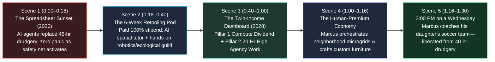

# STORYBOARD: 02 — Unemployment & The Post-Wage Reorganization (2026–2030)

> [!NOTE]
> **Visual Narrative Arc (90-Second Film / Interactive Experience):** We follow **Marcus (44)**, who spent 18 years as a regional logistics & spreadsheet coordinator before autonomous AI agents automated 85% of his department in **late 2026**. Instead of falling off the 2024 unemployment cliff into panic and gig-work poverty, Marcus enters a **6-Week Paid Career Retooling Pod** and thrives in **2028** under the **20-Hour "Twin-Income" Household Standard**.

---

## 1. Visual Flow & Scene Architecture

---

## 2. Scene-by-Scene Production Blueprint

### **Scene 1: The End of the 45-Hour Spreadsheet Cage (0:00–0:18)**
- **Visual Setting:** Open on a fluorescent-lit corporate office floor in **late 2026**. Marcus stares at three monitors of freight-routing spreadsheets. In 2024, learning that an autonomous AI swarm could run his entire department for \$4/day meant terror: losing family healthcare, raiding his 401(k), and driving rideshare 65 hours a week.
- **Action:** Instead of a pink slip and a cardboard box, Marcus's screen opens a warm, gold-bordered **Citizen Transition & Retooling Pass**:
  - **`ROLE AUTOMATION DETECTED — 100% INCOME FLOOR LOCKED ($5,800/mo)`**
  - **`HEALTHCARE & HOUSING: 100% Protected (Zero W-2 Dependency)`**
  - **`SELECT YOUR 6-WEEK PAID RETOOLING SPRINT (Starts Monday — 3 Blocks From Home)`**
- **Audio / Voiceover:** *"When machines learned to do forty hours of routine office work in four seconds, we had a choice: pretend we still needed humans to babysit spreadsheets—or set human time free."*

### **Scene 2: Inside the 6-Week Paid Career Retooling Pod (0:18–0:40)**
- **Visual Setting:** Cut to a bustling, sunlit **Neighborhood Retooling & Fabrication Pod** inside a converted retail atrium. Zero lecture halls, zero student debt.
- **Action:** Marcus is in **Week 4 of his 6-Week Sprint** training as a **Community Microgrid & Autonomous Fleet Orchestrator**.
  1. **Morning (AI Spatial Co-Pilot):** Wearing lightweight AR diagnostic glasses, Marcus troubleshoots a physical solar-storage inverter and a delivery bot alongside a patient, real-time voice AI tutor that adapts to his exact learning pace.
  2. **Afternoon (Master Guild Apprenticeship):** Master technician **Elena** guides Marcus and a cohort of 8 former office workers (ex-accountants, paralegals, and marketing managers) as they commission a real neighborhood geothermal and solar microgrid.
- **On-Screen Data Overlay:**
  - `Retooling Duration: 6 Weeks (Paid at 100% Prior Stipend)`
  - `Tuition Cost: $0.00 | Local Placement Guarantee: 91% Before Graduation`

### **Scene 3: The 2028 "Twin-Income" Household Standard (0:40–1:00)**
- **Visual Setting:** Morning in **2028** at Marcus and his wife Sarah's sunny kitchen table. Sarah is a pediatric speech therapist; Marcus is now a certified **Neighborhood Energy & Robotics Steward**.
- **Action:** Marcus glances at their **Household Twin-Income Ledger** on a tablet:
  - **Pillar 1 (Unconditional Baseline):** `Sovereign Compute & Robotics Dividend: +$2,000/mo (2 Adults) | Healthcare, Childcare & Education: $0 Out-of-Pocket`.
  - **Pillar 2 (20-Hour High-Agency Work):** `Marcus (18 hrs/wk Microgrid & Guild Craft): +$3,800/mo | Sarah (20 hrs/wk Pediatric Care): +$4,100/mo`.
  - **Total Household Weekly Work Hours:** **38 Hours Combined** (down from 92 hours in 2024)—with **24% higher net disposable savings**.

### **Scene 4: High-Agency Work & The Human-Premium Renaissance (1:00–1:16)**
- **Visual Setting:** Split montage of Marcus's 18-hour workweek (Tuesday through Thursday, 8:30 AM – 2:30 PM):
  - In the morning, he walks his neighborhood courtyard village inspecting three autonomous botanical maintenance bots and tuning the community solar battery bank—chatting face-to-face with neighbors.
  - On Thursday afternoon inside the **Village Woodworking Guild**, he finishes hand-joining a custom walnut dining table commissioned by a local family—earning an extra \$900 in artisan guild income doing tangible craft he loves.

### **Scene 5: 2:30 PM on a Wednesday—The Reclaimed Life (1:16–1:30)**
- **Visual Setting:** A vibrant neighborhood park at **2:30 PM on a sunny Wednesday**. In 2024, this park was empty on weekday afternoons while parents sat trapped in commuter traffic and Zoom meetings.
- **Action:** In 2028, the park is alive. Marcus is coaching his 10-year-old daughter's soccer practice alongside three other dads and moms who all finished their 6-hour workday at 2:00 PM. Zero phones buzzing with slack panic; 100% presence.
- **Closing Title Card:**
  - **2026–2030: THE 20-HOUR HIGH-AGENCY WORKWEEK.**
  - *Let the machines do the routine. Let humans build, heal, mentor, and live.*

---

## 3. Key Economic & Lifestyle Contrast Matrix

| Storyboard Dimension | 2024 Wage-Labor Anxiety | 2028 Twin-Income Flourishing |
| :--- | :--- | :--- |
| **Reaction to AI Automation** | Existential dread; loss of healthcare; unpaid resume black holes | Immediate 100%-paid 6-week Retooling Pod into high-agency local roles |
| **Household Work Hours** | 85–95 hrs/wk combined (two exhausted 45-hr full-time parents) | 35–40 hrs/wk combined (two thriving 18–20 hr/wk parents) |
| **Source of Security** | Fragile dependence on a single corporate W-2 employer | Sovereign Compute Dividend + Demonetized Basics + Portable Guild Craft |
| **Weekday Afternoon Reality** | Trapped under fluorescent lights doing performative screen work | Coaching youth sports, building in maker guilds, present with family |

---

## 4. Cinematography, Sound Design & Interactive UI Specification

- **Camera & Lens Grammar:**
  - *Scene 1 (2026 Spreadsheet Sunset):* Overhead geometric shot of identical gray cubicles; cold, flat lighting; transition from the dreaded "pink slip" trope into a warm, empowering golden UI interface.
  - *Scenes 2–5 (2028 Twin-Income Flourishing):* Tactile, kinetic cinematography—close-ups of hands tuning solar microgrid inverters, shaping walnut timber in the neighborhood guild, and kicking a soccer ball across sunlit grass at 2:30 PM on a Wednesday.
- **Acoustic & Musical Progression:**
  - *0:00–0:16:* Monotonous keyboard clatter, Slack notification pings, and fluorescent hum.
  - *0:18–1:30:* Expansive, rhythmic acoustic-electronic score blending workshop craftsmanship sounds (lathe spin, wood plane, solar relay click) with afternoon park vitality and children cheering.
- **Interactive Web / Generative UI Widget Concept:**
  - An interactive **"Household Twin-Income & Time Calculator"** lets viewers input their current 2025 household work hours and expenses, then toggle to the **2028 Twin-Income Standard** (Pillar 1 Sovereign Compute Dividend + Demonetized Healthcare/Childcare + Pillar 2 20-Hour High-Agency Work)—visualizing how 50+ hours/week of family time are reclaimed while net savings rise.
- **Production Verification Checklist:**
  - [x] Rejects both dystopian extremes (45-hour make-work burnout vs. purposeless passive welfare dole).
  - [x] Shows the concrete mechanics of the **6-Week Paid Career Retooling Pod** (100% wage floor, morning AI spatial tutor, afternoon Master Guild fieldwork).
  - [x] Celebrates the psychological dignity of the **20-Hour High-Agency Workweek**: humans doing physical, creative, and relational work that machines should never replace.
