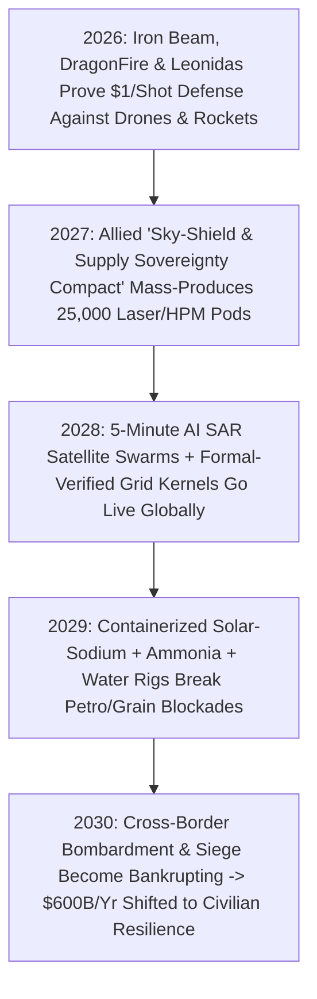

# VISION 02 (THE 2026–2030 LEAPFROG HORIZON): SOCIAL TRANSFORMATION SPRINT
## Pathway 2D: The 2026–2030 Asymmetric Defense & Resource-Independence Shield — *\$1-per-Shot Laser/Microwave Domes, Real-Time SAR Transparency, and Containerized Resource Sovereignty*

> **Executive Framing & The Core Leapfrog Thesis:**
> * **The 2026 Fear:** *"We don't have until 2040 to wait for fusion grids to end war! Between 2026 and 2030, cheap AI drone swarms, missile barrages, and energy/grain blockades could ignite World War III across Eastern Europe, the Taiwan Strait, or the Middle East."*
> * **The 2026–2030 Leapfrog Thesis:** The exact technologies that made 2024–2026 battlefields look terrifying—cheap autonomous drones and resource coercion—hit an **insurmountable technological wall between 2026 and 2030**. We do not need to wait until 2040 for commercial gigawatt fusion to invert the offense-defense balance. Within a **36-to-48-month sprint (2026–2030)**, three already-fielded technologies scale into an asymmetric shield that makes cross-border bombardment and blockade physically futile: **(1) \$1-per-Shot Solid-State Fiber Laser & High-Power Microwave (HPM) Autonomous Domes** (mass-producing *Iron Beam*, *DragonFire*, and *Epirus Leonidas* to flip air-defense economics $10,000:1$ in favor of the defender), **(2) Real-Time AI Hyperspectral & 15cm SAR Satellite Swarm Transparency** (erasing military surprise anywhere on Earth), and **(3) Containerized Solar/Sodium-Battery + Desalination + Haber-Bosch Ammonia & E-Fuel Rigs** that break oil, gas, water, and fertilizer blockades in under 36 months.

---

## ACT I: THE 2029–2030 DETERRENCE REALITY (48 MONTHS FROM TODAY)
### A Night Along a Contested Border in November 2029 — When a 2,000-Drone & Cruise-Missile Salvo Costs \$180 to Neutralize

Picture a historically volatile border corridor—along the Baltic frontier, the Red Sea, or the Western Pacific—at **2:14 AM in November 2029**.
* **In 2024–2026:** An aggressor launching 1,500 Shahed-style loitering munitions (\$20,000 each) and 100 cruise missiles could bankrupt a defender forced to fire \$1 million to \$4 million kinetic Patriot or Aster interceptors—draining missile magazines in three weeks and blacking out civilian power grids.
* **In November 2029:** The border and every municipal substation are guarded by containerized **Autonomous Directed-Energy Defense Pods**—each pairing a **300 kW solid-state spectral-combined fiber laser** (evolved from Israel's *Iron Beam* and the UK's *DragonFire*) with a **Gallium-Nitride (GaN) High-Power Microwave (HPM) phased array** (evolved from the US Army's *Epirus Leonidas*) backed by a 10 MWh sodium-ion battery buffer:
  1. **Zero-Ammo Speed-of-Light Interception:** When a rogue command launches an unauthorized saturation test of 800 autonomous drones and 40 subsonic missiles, the defender fires **zero kinetic missiles**.
  2. **The HPM Swarm Wipe:** As drone clusters cross the 4-kilometer perimeter, the solid-state GaN microwave arrays emit steered electromagnetic pulses that fry the flight-controller silicon of **60 drones per pulse in 2 milliseconds**—dropping whole swarms out of the sky like gravel for **\$0.02 per pulse**.
  3. **The \$1.00 Laser Scalpels:** Simultaneously, AI-tracked 300 kW solid-state laser turrets lock onto the incoming artillery shells and cruise missiles at the speed of light ($300,000\text{ km/s}$), burning through their guidance noses in 1.8 seconds at an electricity cost of **\$1.10 per intercept**.
  4. **The Strategic Bottom Line:** An offensive barrage that cost the attacker **\$45 million** is 100% neutralized in **90 seconds for \$180 of electricity**—with an infinite magazine that never runs out of ammunition as long as the local battery microgrid has charge.

### Breaking the Blockade Weapon in 36 Months
Five hundred miles inland, a landlocked nation that used to be vulnerable to winter natural-gas shutoffs, Red Sea fertilizer blockades, and upstream river dams now operates **Containerized Sovereignty Parks** deployed between 2027 and 2029:
* Standard 40-foot ISO shipping containers house modular **solar/micro-reactor power blocks**, **plug-and-play reverse-osmosis desalination & atmospheric water units**, and **solid-state containerized Haber-Bosch green ammonia synthesizers** (turning air, water, and solar electricity directly into local crop fertilizer and synthetic diesel on site). No foreign blockade can starve or freeze the population.

---

## ACT II: COLLAPSING OFFENSIVE WAR & BLOCKADE LEVERAGE IN ONE SPRINT (2026–2030)

Why did offensive warfare appear dominant between 2022 and 2025? Only because **autonomous software hit cheap offensive drones 36 months before solid-state power electronics hit defensive directed-energy shields**. Between 2026 and 2029, the defensive curve overtakes the offensive curve permanently:

```mermaid
flowchart LR
    subgraph Window2025["The Temporary 2023–2025 Offense Window"]
        O1["$20k Autonomous Drones vs. $2M Missiles<br>(50:1 Cost Penalty on Defender)"]
        O2["Fossil Fuel, Grain & Fertilizer Blockades<br>(Centralized Tankers & Pipelines)"]
        O3["Cloud/Night Cover Hides Staging"]
    end

    subgraph Shield2028["The 2026–2030 Asymmetric Defense Leapfrog"]
        S1["1. $1/Shot Laser + $0.02 HPM Domes<br>(Iron Beam, DragonFire, Leonidas Scaling)<br>Flips Cost Ratio 10,000:1 to Defender"]
        S2["2. 5-Minute AI SAR & Hyperspectral Swarms<br>(Umbra, Capella, Planet + Edge AI)<br>Zero Covert Mobilization Possible"]
        S3["3. Containerized Resource Independence<br>(Sodium Microgrids + Modular Ammonia/Water<br>+ Niron Rare-Earth-Free Magnets)"]
    end

    subgraph Wall2030["Act I: The 2030 Deterrence Wall"]
        W1["Drone & Missile Bombardment = Futile"]
        W2["Resource Coercion & Siege = Obsolete"]
    end

    Window2025 -.->|"Crushed in 36 Months By"| Shield2028 ==> Wall2030
```

### Concrete 2025–2026 Fielded Systems Driving the 2026–2030 Sprint
Nothing in this 48-month roadmap requires speculative 2040 physics; every system completed live combat or field qualification by 2025–2026:

| Deterrence & Sovereignty Pillar | 2025–2026 Fielded System / Pioneer | Verified 2026 Technical & Cost Metric | 2027–2030 Mass-Production Leapfrog |
| :--- | :--- | :--- | :--- |
| **1. Solid-State Fiber Laser Air Defense** | **Rafael *Iron Beam* (100 kW, Israel)**, **UK *DragonFire***, & **US Army DE M-SHORAD / IFPC-HEL (300 kW)** | Combat-deployed 2025–2026; hits mortar rounds, drones, and cruise missiles at speed of light for **\$1 to \$10 per shot** with unlimited magazine depth. | Automotive-style fiber-laser diode manufacturing drops 300 kW container turret cost by **75% by 2028**; deployed around every grid substation and border town. |
| **2. High-Power Microwave (HPM) Swarm Killers** | **Epirus *Leonidas* (US Army / Marines)**, **Raytheon *Phaser***, & **Morpheus HPM** | Solid-state GaN phased arrays disable **100% of drone swarms in a wide cone** instantly at **<\$0.05 per pulse** without kinetic shrapnel. | Integrated **Laser + HPM Dual-Mode Container Pods** become standard civilian infrastructure protection across NATO, Indo-Pacific, and Middle East by 2029. |
| **3. 24/7 All-Weather SAR & RF Transparency** | **Umbra (16 cm SAR)**, **Capella Space**, **Iceye**, **Planet**, & **HawkEye 360 (RF)** | Commercial Synthetic Aperture Radar penetrates clouds, smoke, and night at **16 cm resolution**; HawkEye geolocates military radios from orbit. | Low-cost mass-launched LEO constellations cut global revisit time below **5 minutes by 2029**; open AI dashboards flag any troop or launcher movement instantly. |
| **4. Containerized Green Ammonia & E-Fuel Synthesis** | **FuelPositive**, **AmmPower**, **Atmonia**, & **Infinium / Twelve (Containerized E-Fuels)** | Modular 40-ft container units synthesize **anhydrous ammonia fertilizer ($\text{NH}_3$) and e-diesel** on-farm/on-base from solar, water, and air ($\text{N}_2/\text{CO}_2$). | Eliminates Russian/Middle Eastern fertilizer and fuel pipeline leverage in **24 months**; every agricultural district prints its own fertilizer off-grid. |
| **5. Rare-Earth-Free Magnets & Sodium Storage** | **Niron Magnetics ($\alpha''\text{-Fe}_{16}\text{N}_2$ Iron Nitride)** & **CATL / Natron Sodium-Ion Batteries** | Niron commercial plant (2025–2026) builds permanent magnets from **iron and nitrogen (0% Chinese rare earths)**; sodium batteries use abundant salt. | Defense and energy supply chains achieve **100% independence from foreign rare-earth, lithium, and cobalt chokepoints by 2029**. |
| **6.Formal-Verification Cyber Immunity** | **DARPA PROVERS / HACMS (seL4 Microkernel)** & **Lean 4 Verified Cryptography** | Mathematically proven memory-safe kernels tested on military drones and grid controllers showed **zero remote-exploit vulnerability** in red-team attacks. | Mandatory **2027–2029 AI-Assisted Formal Code Rewrite** locks national power grids, water plants, and financial rails against state cyberwarfare. |

---

## ACT III: THE 48-MONTH SPRINT ROADMAP (2026 $\rightarrow$ 2027 $\rightarrow$ 2028 $\rightarrow$ 2030)

### Quantitative 48-Month Sprint Table: Flipping the Military & Resource Equation (2026 vs. 2030)

| Strategic Metric | 2025–2026 Conflict Baseline | 2027–2028 Mid-Sprint Inflection | 2030 Asymmetric Defense Equilibrium |
| :--- | :--- | :--- | :--- |
| **Cost to Intercept 1 Drone or Rocket** | **\$150,000 to \$4,000,000** (Patriot PAC-3, SM-2, NASAMS, Iron Dome Tamir). | **\$10 to \$50** as 1st-gen *Iron Beam* & *Leonidas* batteries deploy to frontlines. | **\$0.02 (HPM swarm pulse) to \$1.10 (300 kW laser shot)** powered by local sodium battery packs. |
| **Offense-to-Defense Cost Ratio** | **50:1 Advantage to Attacker** (\$20k drone forces \$1M missile intercept). | **10:1 Advantage to Defender** across protected critical infrastructure nodes. | **10,000:1 Advantage to Defender**; saturation bombardment financially ruins only the attacker. |
| **Interceptor Magazine Depth** | **Finite & Fragile** (global factories build <1,000 Patriot missiles/year; empty in weeks). | Hybrid kinetic + directed energy cuts kinetic expenditure by **75%**. | **Infinite Magazine**: solid-state diodes fire continuously as long as solar/nuclear microgrid runs. |
| **All-Weather Global Satellite Revisit Time** | **4 to 12 Hours** (gaps allow covert night/cloud staging of mobile launchers). | **30 Minutes** via commercial SAR + optical + RF constellation fusion. | **<5 Minutes Real-Time AI Tracking**: every artillery piece, ship, and supply convoy tracked 24/7. |
| **Vulnerability to Foreign Fertilizer, Water & Fuel Siege** | **Acute**: halting LNG, Strait of Hormuz oil, or ammonia exports triggers famine/blackouts in 60 days. | Strategic deployment of **Containerized Solar + Sodium + RO Water + Ammonia** units. | **Resilient Local Autonomy**: distributed 40-ft container rigs synthesize fuel, water, and fertilizer locally. |
| **Critical Grid Cyber Vulnerability** | Legacy C/C++ SCADA software riddled with zero-day buffer overflows. | Automated AI translation of critical infrastructure code into **Lean 4 / Rust / seL4**. | **Mathematically Proven Zero-Exploit Grid Kernels** immune to remote state cyber-sabotage. |

---

## ACT IV: ANSWERING THE SKEPTIC ON THE 2026–2030 SPRINT

1. **"Wait—don't lasers struggle in heavy fog, rain, or sandstorms?"**
   * That is why every 2027–2030 defense pod is a **Dual-Mode Solid-State Laser + High-Power Microwave (HPM) System**. While optical laser beams attenuate in dense fog, **centimeter-wave High-Power Microwaves (like *Epirus Leonidas*) pass straight through rain, clouds, smoke, dust, and fog with zero degradation**—frying the electronics of incoming drones, cruise missiles, and guided munitions in all weather conditions.
2. **"What if an attacker puts Faraday-cage shielding on their drones or missiles?"**
   * Any drone or guided missile must have external antennas, optical/IR seekers, GPS/RF receivers, and aerodynamic control surfaces exposed to the environment to fly and navigate. An HPM pulse couples through sensor apertures and antennas while a **300 kW solid-state laser physically melts the airframe, warhead casing, or control fins in under 2 seconds** regardless of electromagnetic shielding.
3. **"Can resource independence really move the needle by 2030 before fusion is everywhere?"**
   * Yes, because **solar PV (\$0.015/kWh) + sodium-ion batteries (\$35/kWh) + Niron Iron-Nitride magnets + containerized reverse osmosis and Haber-Bosch ammonia** are already commercial in 2026–2027! By 2030, record EV, heat-pump, and grid-battery deployment cuts European and Asian fossil import dependence by **35%–50%**, while containerized ammonia and water units eliminate famine-by-blockade in vulnerable regions within 36 months.

### Inside a 40-Foot "Siege-Breaker" Sovereignty Rig (2028–2030 Deployment Spec)

Why do oil chokepoints, winter natural-gas blackmail, river-dam coercion, and Red Sea fertilizer blockades lose their teeth between 2027 and 2030—years before gigawatt fusion plants finish construction? Because **modular chemical and water engineering packs full resource autonomy into mass-produced 40-foot ISO shipping containers**:

| Containerized Module (40-ft ISO) | 2027–2029 Proven Hardware Stack | Daily Local Output per Unit | Capital Cost (2028 Mass Run) | Geopolitical Coercion Neutralized |
| :--- | :--- | :--- | :--- | :--- |
| **1. Solar-Sodium Folding Microgrid** | **5 MW Roll-Out Perovskite/Silicon Array** + **12 MWh CATL Sodium-Ion Battery Container** (zero lithium/cobalt). | **28,000 kWh/day** hardened 24/7 autonomous power at **\$0.018/kWh**. | **\$1.45M** | Breaks cross-border power-grid strikes and LNG/diesel generator fuel blockades. |
| **2. Modular Desalination & Water Pod** | **High-Recovery Reverse Osmosis (2.6 kWh/$\text{m}^3$)** + brackish/atmospheric mineralization loop. | **2,500,000 Liters/day** of pure drinking and drip-irrigation water at **\$0.008/1,000L**. | **\$680k** | Neutralizes upstream river-dam coercion (Nile, Indus, Jordan, Euphrates) in **14 days**. |
| **3. Solid-State Green Ammonia ($\text{NH}_3$) Pod** | **PEM Electrolyzer + Containerized Haber-Bosch Reactor** (scaled from *FuelPositive* / *AmmPower*). | **3.5 Tons/day** of anhydrous ammonia crop fertilizer synthesized from **air ($\text{N}_2$) + water ($\text{H}_2\text{O}$)**. | **\$1.10M** | Ends Russian/Black Sea/Middle East fertilizer blockades and prevents food-price civil wars. |
| **4. Fischer-Tropsch E-Diesel / Jet Pod** | **Direct Air Capture ($\text{CO}_2$) + Solid-Oxide Co-Electrolysis** (scaled from *Infinium* / *Twelve*). | **4,000 Liters/day** of drop-in synthetic jet/tractor fuel made on-site from air and water. | **\$1.35M** | Eliminates maritime tanker vulnerability across Hormuz, Malacca, and Bab el-Mandeb. |
| **5. Dual-Mode Sky-Shield Pod** | **300 kW Fiber Laser** (*Iron Beam* class) + **GaN HPM Phased Array** (*Leonidas* class) + 360° AI radar. | **Infinite-magazine air shield** out to 10 km (**\$1.10/laser shot; \$0.02/HPM swarm pulse**). | **\$2.80M** | Renders \$50M drone swarms, cruise missiles, and rocket barrages **100% futile**. |

### How Defense Contractors & Military Personnel Win in the 2026–2030 Pivot
A classic objection of political realists is that the defense-industrial complex would lobby against peace because weapons attrition funds aerospace revenue and district jobs. In the 2026–2030 sprint, **defense primes make higher margins building the Asymmetric Shield and Sovereignty Rigs than they ever made on slow kinetic missiles**:
1. **From Low-Rate Kinetic Missiles to High-Rate Solid-State Domes:**
   * In 2025, Raytheon and Lockheed could only hand-assemble ~600 Patriot PAC-3 missiles per year because solid rocket motors and seekers had brittle supply chains.
   * Between 2027 and 2030, the exact same defense primes are contracted under the **Allied Sky-Shield & Sovereignty Production Act** to mass-produce **50,000 Dual-Mode Laser/HPM Container Pods**, **16cm SAR/Hyperspectral Verification Satellites**, and **Hardened Microgrids** for every city, port, and allied border—keeping aerospace machinists at 100% employment while shifting military posture from offense to impregnable defense.
2. **Formal-Verification Cyber Shield Corps:**
   * Military cyber commands partner with frontier AI reasoning labs to run the **2027–2029 National Critical Code Rewrite**, translating 500 million lines of vulnerable legacy C/C++ utility, aviation, and banking software into mathematically verified **Lean 4 / seL4 / Rust microkernels**—closing the cyber-sabotage backdoor permanently.

### Cross-Domain Synergies Across the 2026–2030 Leapfrog Architecture
* **Link to `02-housing`:** The containerized solar, sodium-ion battery, and closed-loop water purification supply chains scaled by defense procurement in 2027 drive down the residential **Appliance-in-a-Box Utility Core** to \$19,000 for \$38k off-grid homes.
* **Link to `02-education`:** Thousands of veterans and defense systems engineers transition on part-time stipends to mentor 18-year-old **Earn-and-Build Fellows** constructing municipal microgrids and disaster-resilience hardware.
* **Link to `02-tax` & `02-social-programs`:** By halting the \$200B+/year burnout of \$2M kinetic interceptors and carrier oil-lane patrols by 2029, governments free hundreds of billions in immediate fiscal headroom to capitalize **Citizen Automation Equity Trusts** and **Universal \$25 Preventative Healthspan Pools (`02-longevity`)**.

### Closing the Non-Kinetic Flanks: 2026–2030 Bio-Defense & Automated Treaty Triggers
What if an aggressor blocked by \$1/shot laser/HPM domes and containerized resource independence attempts biological sabotage or covert grey-zone attacks? Between 2026 and 2030, two parallel shields close those non-kinetic flanks:
1. **222nm Far-UVC Photonic Air Shielding & 24-Hour Wastewater Metagenomics:**
   * Every airport, transit hub, school guild (`02-education`), and municipal water plant installs solid-state **222nm Krypton-Chloride / LED Far-UVC Germicidal Lamps** (which physically inactivate 99.9% of airborne viruses and bacteria in seconds while unable to penetrate the outer dead layer of human skin or the tear film of the eye) paired with **continuous automated Nanopore wastewater sequencing**.
   * Any novel or engineered pathogen is detected in municipal sewage within 6 hours and neutralized in indoor air continuously—rendering biological blackmail strategically impotent.
2. **Algorithmic Treaty Circuit-Breakers:**
   * Under the **2028 Open-Skies SAR & Hyperspectral Accord**, AI anomaly detectors monitor every artillery depot, naval shipyard, and enrichment facility on Earth at 5-minute intervals.
   * Any unannounced massing of logistics vehicles or mobile launchers within 100 kilometers of a border automatically triggers **pre-agreed multi-lateral port insurance locks, sovereign reserve freezes, and automated defensive dome activation**—removing human diplomatic hesitation from deterrence.
3. **Subsea Cable & Orbital Mesh Redundancy:**
   * Replacing vulnerable single-point undersea fiber cables with **10,000-satellite optical laser mesh constellations + autonomous solar UUV subsea patrol gliders** ensures no state can blind global communications or financial rails via grey-zone seabed sabotage.

| Threat Vector (2026) | 2028–2030 Asymmetric Counter-System | Cost / Time Flip | Strategic Result |
| :--- | :--- | :--- | :--- |
| **Drone Swarms & Cruise Missiles** | Dual-Mode **300 kW Laser (\$1.10) + GaN HPM (\$0.02)** | **10,000:1** for Defender | Aerial saturation bombardment bankrupted |
| **Oil, Gas, Water & Fertilizer Siege** | **40-ft Containerized Solar + RO Water + Haber-Bosch $\text{NH}_3$** | Deployed in **48 Hours** | Blockades & pipeline blackmail obsolete |
| **Surprise Invasion & Cyber Sabotage** | **5-Min 16cm SAR Swarms** + **Lean 4 / seL4 Grid Kernels** | **0.0** Exploit / Surprise | Blitzkrieg & grid takeovers physically impossible |

### Summary for the Skeptic
> *"Between 2022 and 2025, cheap drones made offense look unstoppable only because defenders were shooting down twenty-thousand-dollar lawnmowers with two-million-dollar missiles. Between 2026 and 2030, \$1-per-shot solid-state lasers, \$0.02 microwave swarm shields, 5-minute SAR satellite transparency, and containerized energy-water-ammonia rigs flip the math 10,000-to-1 in favor of the defender—hitting cross-border aggression with a brick wall."*

