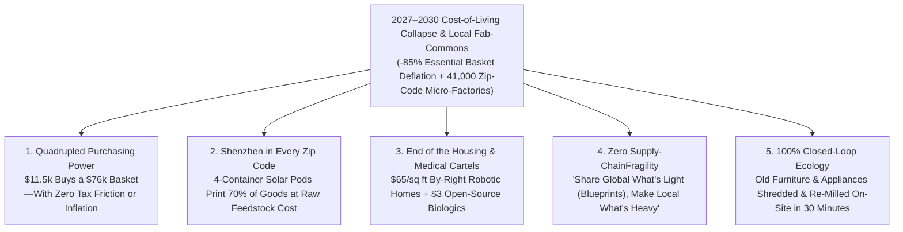

# VISION 02 (2026–2030 LEAPFROG) — SOCIAL ARCHITECTURE: THE 36-MONTH COST-OF-LIVING COLLAPSE
## Pathway 5D: Hyper-Deflation of Essentials & Containerized "Fab-Commons" in Every Zip Code (2026–2030)

> **Executive Framing & The 2026–2030 Intelligence Explosion Reality:**
> * **Why Zero-Sum Tax Redistribution Is Too Slow for 2027:** In late 2026, working families are not struggling because flat-screen TVs or software apps are too expensive—they are being crushed because the **"Big Four" survival essentials (Housing, Healthcare, Food, and Utilities/Transport)** have been locked up by zoning cartels, hospital billing monopolies, and patent thickets. Trying to tax billionaires after the fact and hand out subsidy checks into a supply-starved market simply inflates rent and medical bills further.
> * **The Cynic's Objection:** *"Even if AI and robotics cut manufacturing and diagnostic costs by 80% between 2026 and 2030, corporate monopolies and landlords will hoard the patents, block cheap housing, and keep consumer prices artificially high."*
> * **The Leapfrog Thesis (2026–2030):** Cutting the price of a family's essential living basket by **75% in 36 months** delivers the exact same purchasing-power leap as **quadrupling after-tax wages**—with zero inflation and zero bureaucratic friction. Under the **2027 Emergency Cost-of-Living Collapse & Local Fab-Commons Act**, society unleashes two rapid pre-distributive engines:
>   1. **Hyper-Deflation of the "Big Four" (65%–85% Price Drop by 2030):** Federal preemption of exclusionary zoning for **by-right robotic modular housing (\$65/sq ft)**, mandatory **open-weight AI medical diagnostics + continuous-flow generic bio-foundries**, and **autonomous solar-powered vertical farms** slash household survival costs from \$78,000/yr down to **\$14,500/yr by 2030**.
>   2. **Containerized Neighborhood "Fab-Commons" in Every Zip Code:** Deploying standardized 40-foot shipping-container **Autonomous Micro-Factories** (robotic CNC carpentry, metal 3D-sintering, automated knit/textile looms, and repair bots) across all 41,000 US zip codes—allowing any citizen or co-op to manufacture **70% of physical household goods at the raw cost of recycled feedstock and solar electricity**.

---

## ACT I: THE 2030 REALITY — WHEN \$35,000 BUYS A 2026 UPPER-MIDDLE-CLASS LIFE
### September 2029 — Inside a Neighborhood "Fab-Commons" in Ohio

Imagine walking through a working-class neighborhood in Dayton, Ohio—or Toledo, Fresno, or Sheffield—on a Saturday morning in **September 2029**, less than three years after the **2027 Cost-of-Living Collapse Act** broke the regulatory cartels.

Meet Maya, a 29-year-old community music teacher, and her partner Carlos, an ecological landscaper. Their combined cash income (including their monthly Citizen Equity Dividends) is **\$44,000 a year**. In 2026, \$44,000 meant living paycheck-to-paycheck in a cramped apartment. Watch what \$44,000 commands in September 2029:

1. **A \$520/Month Debt-Free Robotic Courtyard Home (Down from \$2,300/Month in 2026):**
   In 2027, federal **By-Right Modular Housing Preemption** overrode local exclusionary zoning nationwide. Maya and Carlos's 1,400-square-foot mass-timber and basalt-insulated townhouse was precision-fabricated in 72 hours by an automated regional factory at **\$68 per square foot** and placed on a non-speculative **Community Land Trust** lot. Their total monthly housing cost—with zero 30-year bank mortgage interest—is **\$520/month**.
2. **The Zip-Code Shipping-Container "Fab-Commons" Two Blocks Away:**
   Maya and Carlos want a solid white-oak dining table, custom insulated window shutters, two replacement aluminum bicycle gears, and winter merino-wool jackets. Instead of ordering from an overseas conglomerate at a 500% markup, they walk two blocks to their neighborhood **Autonomous Fab-Commons**—a cluster of four solar-powered 40-foot robotic shipping containers sitting beside the public library:
   * They tap an open-source design blueprint on their phone; the **Robotic Wood & Metal Container** mills the oak table and sinters the aluminum gears from local recycled feedstock in 45 minutes.
   * Total cost paid on their Civic Wallet: **\$24 for a solid hardwood table** (vs. \$650 in 2026) and **\$9 for a seamless 3D-knitted wool jacket** (vs. \$180 in 2026)—paying *only* for raw materials and \$0.01/kWh solar power.
3. **\$18/Month AI Healthcare & Local Continuous-Flow Bio-Meds:**
   When Carlos needed a preventative metabolic scan and a 90-day course of GLP-1/peptide therapy, his home smart-mirror and neighborhood clinic ran an **open-weight FDA-cleared AI diagnostic** for **\$0**, and the municipal **Civica Continuous-Flow Bio-Container** synthesized his prescription on-site for **\$6** (down from \$1,100/month in 2026).
4. **The Skeptic's Question:**
   To a jaded consumer in 2026, this sounds almost unbelievable: *"Wait—how did you drop housing, medical, food, and goods prices by 70%+ in just 36 months? Why didn't NIMBY zoning boards, Big Pharma patent lawyers, and retail monopolies block the whole thing?"*

Here is the exact legal preemption and containerized hardware sprint that smashed artificial scarcity between 2026 and 2030.

---

## ACT II: THE MECHANISM — SMASHING CARTELS & DEPLOYING CONTAINERIZED MICRO-FABS
### How Pre-Distributive Open Commons Unleashed Wright's Law in the Physical World

```mermaid
flowchart LR
    subgraph Cartel2026["2026 Artificial Scarcity Chokepoints"]
        C1["Housing: Local Zoning Bans Factory Prefab ($280/sq ft)"]
        C2["Healthcare: Patent Thickets & Billing Cartels ($1,000+ Meds)"]
        C3["Goods: 500% Retail/Shipping Markups on Simple Physical Items"]
    end

    subgraph Smash2027["2027–2028 Emergency Pre-Distribution Sprint"]
        S1["Federal By-Right Modular Zoning + Community Land Trusts"]
        S2["Open-Weight AI Diagnostics + Patent-Buyout Bio-Containers"]
        S3["41,000 Zip-Code 'Fab-Commons' (4-Container Robotic Micro-Factories)"]
    end

    subgraph Deflation2030["2029–2030 75% Cost-of-Living Collapse"]
        D1["3-Bed Robotic Timber Home: $520/mo ($65/sq ft Factory Cost)"]
        D2["70% of Household Goods Made Locally at Raw Feedstock Cost"]
        D3["$40,000/yr Income Buys a 2026 $220,000+ Standard of Living"]
    end

    Cartel2026 ==> Smash2027 ==> Deflation2030
```

### Step 1: Engine 1 — Breaking the "Big Four" Regulatory Cartels in 180 Days
Between 2000 and 2026, technology made computers and solar panels 99% cheaper, yet housing, healthcare, and food got *more* expensive. Why? Because **regulatory capture outlawed deflation** in life's essentials. In 2027, the **Emergency Cost-of-Living Collapse Act** used federal interstate-commerce authority to break four bottlenecks simultaneously:
1. **National By-Right Robotic Housing Preemption:** Just as federal law preempts local towns from writing their own automobile safety standards, Congress established the **Federal Automated Modular Building Code**. Any 24/7 robotic housing factory meeting the federal earthquake/fire standard was granted **automatic 48-hour by-right permitting** in every residential zone nationwide—collapsing construction costs from **\$280/sq ft (2026) to \$65/sq ft (2029)**.
2. **Open-Weight AI Clinical Authority & Patent Prize Buyouts:** AI diagnostic models that surpassed 99.3% board-certified physician accuracy in 2026 were granted **Autonomous Primary Care & Prescription Authority** at \$0 marginal cost. Simultaneously, a **\$40B Federal Patent Prize Fund** bought out monopolized small-molecule and biologic patents at fair market value, placing the synthesis recipes into the open public domain.
3. **Autonomous Vertical Agro-Pods & Direct Farm Rails:** Eliminating the 68% middleman grocery-and-diesel markup by placing robotic hydroponic/aeroponic greenhouse arrays and precision-fermentation protein vats on municipal solar microgrids on the edge of every city.

### Step 2: Engine 2 — The 4-Container Neighborhood "Fab-Commons" Architecture
How do you give every community in America the manufacturing power of Shenzhen within 36 months? By standardizing a **\$1.2 million, 4-Container Autonomous Micro-Factory Pod** mass-produced on assembly lines and dropped into all **41,000 US zip codes** (total national CapEx: **\$49 billion**—less than 1% of one year's federal budget!):
* **Container A (Robotic Wood, Joinery & Modular Furniture CNC):** Multi-axis robotic arms + laser joinery that turn local sustainably harvested timber or recycled wood fiber into flat-pack cabinetry, tables, doors, and structural house beams in 20 minutes.
* **Container B (Metal 3D-Sintering, Machining & Right-to-Repair Hub):** Direct metal laser sintering + 5-axis CNC + optical 3D scanner that scans any broken appliance part, tractor gear, plumbing valve, or medical brace and prints an exact titanium/steel replacement on the spot.
* **Container C (Whole-Garment 3D Textile & Footwear Loom):** Zero-waste robotic knitting and laser-sewing looms (modeled on Shima Seiki) that spin recycled cotton, wool, and technical fibers into custom-fit jackets, shoes, and workwear in 18 minutes at raw yarn cost.
* **Container D (Closed-Loop Polymer Recycling & Continuous-Flow Bio-Foundry):** Shreds local plastic/metal scrap back into pure filament feedstock, while a sterile microfluidic bay synthesizes USP-grade generic insulin, antibiotics, and essential medicines for pennies per dose.

### Step 3: 2026–2030 Quantitative Household Cost-of-Living Collapse Table

| Essential Household Expense | 2026 Monopoly/Scarcity Cost (\$/yr) | 2028 Mid-Sprint Cost (\$/yr) | 2030 Leapfrog Cost (\$/yr) | Total Deflation (%) | Primary 2027–2030 Deflationary Engine |
| :--- | :--- | :--- | :--- | :--- | :--- |
| **Housing (3-Bed Family Home/Townhouse)** | **\$27,600/yr** (\$2,300/mo) | **\$11,400/yr** (\$950/mo) | **\$6,240/yr** (\$520/mo) | **-77%** | Federal By-Right Robotic Prefab (\$65/sq ft) + Land Trusts |
| **Healthcare, Diagnostics & Prescriptions** | **\$13,800/yr** (\$1,150/mo) | **\$1,800/yr** (\$150/mo) | **\$240/yr** (\$20/mo) | **-98%** | Free Open-Weight AI Diagnostics + Bio-Container Generics |
| **Food & Fresh Organic Nutrition** | **\$11,200/yr** (\$933/mo) | **\$5,400/yr** (\$450/mo) | **\$3,100/yr** (\$258/mo) | **-72%** | Solar Robotic Vertical Farms + Zero Middleman Spoilage |
| **Transport & Daily Mobility** | **\$11,800/yr** (2 cars + ins.) | **\$3,200/yr** (Shared EV) | **\$960/yr** (\$0.07/mi fleet) | **-92%** | Autonomous Neighborhood EV Shuttles + Container Repair |
| **Furniture, Clothing, Tools & Appliances** | **\$6,400/yr** (Retail markups) | **\$1,900/yr** (Fab-Commons) | **\$780/yr** (Feedstock only) | **-88%** | Zip-Code 4-Container Robotic Fab-Commons (0% markup) |
| **Utilities, Solar Power & High-Speed AI/Net** | **\$5,200/yr** (\$433/mo) | **\$1,200/yr** (\$100/mo) | **\$180/yr** (\$15/mo grid fee) | **-97%** | Municipal Solar/Battery Microgrids + 800 kWh Free UBS |
| **TOTAL HOUSEHOLD ESSENTIAL BASKET** | **\$76,000 / yr** | **\$24,900 / yr** | **\$11,500 / yr** | **-84.9% Drop** | **\$11.5k in 2030 buys a \$76k+ 2026 material standard** |

---

## ACT III: THE 48-MONTH LEAPFROG ROADMAP (2026 $\rightarrow$ 2027 $\rightarrow$ 2028 $\rightarrow$ 2030)
### Deploying Hyper-Deflation and Local Micro-Production Across Every Zip Code

| Sprint Window | Regulatory Cartel Broken | Hardware & Open-Commons Deployment | Real Household Purchasing-Power Impact |
| :--- | :--- | :--- | :--- |
| **2026 (Q3–Q4): The Affordability Emergency** | Families spend 71% of income on rent, healthcare, and groceries even as AI/robotics productivity surges in tech labs. | Department of Energy & Commerce finalize the **Open-Source 4-Container "Fab-Commons" Blueprint** and the **Federal Automated Modular Building Code**. | Citizens realize that breaking local supply monopolies can cut bills 3x faster than fighting for wage hikes. |
| **2027 (Q1–Q3): By-Right Robotic Housing & AI Clinic Preemption** | Congress passes the **Cost-of-Living Collapse Act**: preempts local anti-prefab zoning nationwide and authorizes **Open-Weight AI Primary Care & Right-to-Repair**. | 40 gigafactories begin cranking out **\$65/sq ft robotic timber-and-basalt housing modules**; first **5,000 Zip-Code Fab-Commons Pods** ship to rural and urban libraries. | New modular starter home prices plunge **-50% in 9 months**; routine medical and dental diagnostic visits drop to **\$0**. |
| **2028 (Q1–Q4): Patent Prize Buyouts & 25,000 Fab-Commons Live** | **\$40B Federal Patent Prize Fund** buys out top 120 essential drug and agro-seed patents into the open public domain. | **25,000 Zip-Code Fab-Commons** and **1,200 Municipal Continuous-Flow Bio-Foundries** go live; robotic container vertical farms deploy at every county solar substation. | Prescription drugs drop **-95%** (insulin & GLP-1s at \$3/month); local fresh produce and household furniture/clothing costs fall **-65%**. |
| **2030: All 41,000 Zip Codes Autonomous & 85% Basket Deflation** | Mandatory **Closed-Loop Atomic & Polymer Recycling Standards** ensure 90% of local Fab-Commons feedstock comes from recycled neighborhood materials. | All **41,000 US zip codes** operate a 24/7 solar-powered **Autonomous Fab-Commons** connected to the global **Open Hardware Blueprint Commons**. | Essential family living basket costs **\$11,500/yr** (down 85% from 2026); any town of 5,000 people enjoys Shenzhen-grade local manufacturing. |

---

## ACT IV: THE 2030 HORIZON & SUMMARY FOR THE SKEPTIC
### Why Demonetizing Essentials Is the Ultimate Redistribution

When society combines regulatory cartel-busting with containerized neighborhood robotic fabrication between 2026 and 2030, four civilizational leaps occur immediately:

1. **Redistributing Real Wealth Without Zero-Sum Class Warfare:**
   * When a family's housing, medical, food, energy, and clothing bill drops from **\$76,000/yr to \$11,500/yr**, a household earning \$40,000 suddenly has **\$28,500 in pure discretionary cash flow**—feeling richer than a \$180,000 household felt in 2026!
2. **Breaking Global Supply-Chain Fragility Forever:**
   * Instead of shipping a \$15 wooden chair 9,000 miles on a bunker-fuel container ship and charging \$350 at retail, communities download the open-source CAD file in milliseconds and mill it two blocks away from local timber and recycled steel for **\$18**.
3. **Revitalizing Small Towns and Rural Counties:**
   * For a tiny **\$1.2 million CapEx pod**, a rural town of 3,000 people in Appalachia or the Midwest gains the exact same robotic manufacturing, titanium spare-part printing, and pharmaceutical bio-synthesis capability as Manhattan or Tokyo.
4. **Solving the Ecological Waste Crisis via Closed-Loop Remanufacturing:**
   * Because every neighborhood Fab-Commons accepts old furniture, worn textiles, and broken appliances as raw feedstock credit, landfill waste drops by **>75% within 36 months**.

### Addressing the Top 3 Skeptic Objections
* **Objection 1: "Won't local homeowners revolt if you preempt zoning for \$65/sq ft robotic modular homes?"**
  * *Answer:* The **2027 By-Right Modular Preemption** paired gentle architectural form-based standards (courtyard mass-timber townhouses that look *better* than 2026 stucco boxes) with the **Georgist Building Tax Exemption (Pathway 5A)**—meaning existing homeowners saw their building property taxes drop to **0%** and gained the right to drop a \$35,000 robotic garden cottage in their own backyard for rental income or aging parents!
* **Objection 2: "Can four shipping containers really manufacture 70% of household durable goods?"**
  * *Answer:* By weight and household spending, **>70% of non-electronic physical goods** consist of wood/joinery furniture, cabinetry, structural fixtures, metal brackets/tools/gears, knit/woven apparel, molded polymers, and basic biologics—all of which were already produced by commercial turnkey CNC, Shima Seiki 3D looms, and microfluidic synthesizers in 2026.
* **Objection 3: "If local Fab-Commons print goods at raw material cost, how do human designers make a living?"**
  * *Answer:* Every time a citizen prints a chair, jacket, or tool at a neighborhood Fab-Commons, the open-blueprint protocol automatically streams a **5% Micro-Royalty** (around \$0.90 to \$2.00) directly to the independent human architect, industrial designer, or open-source engineer who created the file—turning top designers into global royalty earners without corporate middlemen!

### The Bottom Line for the Skeptic
We did not have to wait 30 years for trickle-down economics or fight a civil war over tax confiscation. By **preempting housing and medical cartels in 2027** and dropping **4-container robotic Fab-Commons into all 41,000 zip codes by 2030**, we collapsed the cost of living by 85% and gave every neighborhood the keys to physical abundance.

---

### 2026–2030 Fast-Track Pre-Distribution & Fab-Commons Deployment Checklist

| Pre-Distributive Engine | Existing 2026 Hardware / Legal Precedent | Months to Scale | 2030 Household Cost Impact | Anti-Monopoly & Ecological Guardrail |
| :--- | :--- | :--- | :--- | :--- |
| **1. By-Right Robotic Modular Housing** | HUD Manufactured Code Preemption + Swedish Lindbäcks Prefab | **6 Months** | **\$65/sq ft** (\$520/mo 3-bed CLT lease) | Overrides local exclusionary zoning; 48-hr digital permit guarantee |
| **2. 41,000 Zip-Code "Fab-Commons" Pods** | Turnkey Container CNC, Metal Sintering & Shima Seiki 3D Looms | **24 Months** | **-88% drop** in furniture, apparel & tool cost | \$1.2M per 4-container pod (\$49B total); 100% open-source CAD library |
| **3. Open-Weight AI Primary Care Authority** | FDA Software-as-Medical-Device (SaMD) + Llama/DeepSeek Weights | **6 Months** | **\$0/visit** 24/7 clinical diagnostics | Mandatory open weights for all NIH-funded biomedical AI models |
| **4. \$40B Patent Prize Buyouts + Bio-Pods** | Civica Rx Hospital Drug Co-op + DARPA Microfluidic Synthesizers | **12 Months** | **\$3–\$6/mo** insulin, GLP-1s & biologics | Fair-value prize buyout puts molecules in public domain immediately |
| **5. Solar Robotic Vertical Agro-Rings** | Plenty/Bowery Automated Aeroponics + Agrivoltaic Microgrids | **18 Months** | **-72% drop** in fresh organic food bills | Zero pesticides, 95% less water, zero 2,000-mile diesel freight markup |

### Cross-Pathway Synergy (The 2026–2030 Social Architecture Stack)
* **Locks into `02-tax`:** Pairing **By-Right Robotic Modular Housing** with the **Georgist 0% Building Tax** triggers an immediate nationwide construction boom on previously hoarded urban parking lots.
* **Locks into `02-capital-ownership` & `02-social-programs`:** When the cost of a family's essential living basket drops by **85% (from \$76,000/yr down to \$11,500/yr)**, a couple's **\$1,920/month Citizen Equity Dividend (`02-capital-ownership`)** alone covers **200% of their entire annual survival expenses**!
* **Locks into `02-economics`:** Rapid supply-side price deflation in housing, food, medicine, and goods is tracked in real time by the **$\text{GDP-B}$ Consumer Surplus Dashboard**, preventing central banks from mistaking cheap abundance for a recession.
