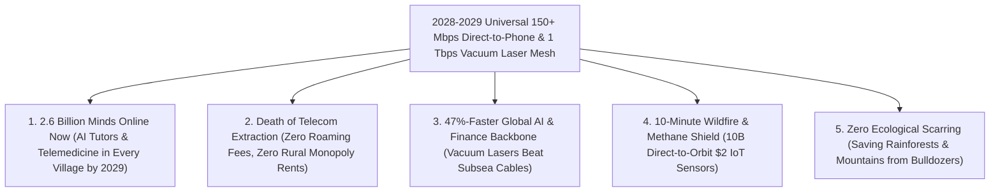

# VISION 02 (THE 2026–2030 LEAPFROG): SPACE INDUSTRIALIZATION IN 48 MONTHS
## Pathway 2A: The Death of Dead Zones & Legacy Telecom Monopolies by 2028 — *150+ Mbps Direct-to-Phone & Vacuum Laser Backbones*

> **The Cynic's Objection:**
> *"Universal global broadband by 2028? Rural fiber subsidies and 5G tower rollouts take 15 years of trenching permits, municipal right-of-way battles, and \$100 billion in capital. Satellite-to-phone is just a slow emergency text-message gimmick!"*
>
> **The 2026–2030 Leapfrog Thesis:**
> Humanity will never finish trenching the last 40% of Earth's surface—because **between 2026 and 2028, Low Earth Orbit makes rural fiber trenching and remote cell towers instantaneously obsolete**. By combining **SpaceX Starship V3** launches ($<\$100/\text{kg}$ internal cost, deploying 60+ Terabits of capacity per flight), **AST SpaceMobile's $223\text{ m}^2$ unfolding phased-array mirrors**, and **1-Terabit-per-second optical vacuum lasers** traveling **46.8% faster than light in glass fiber**, orbital networks leapfrog terrestrial telecom monopolies inside 36 months. By **2028–2029**, every unmodified \$100 pocket smartphone on Earth commands **150+ Mbps broadband with sub-20ms ping** across 100% of the planet's landmass and oceans—connecting the final 2.6 billion humans overnight.

---

## ACT I: THE 2030 REALITY (AFTER A 48-MONTH ORBITAL SPRINT)
### A Tuesday Morning in Late 2029 — Zero Dead Zones and the Collapse of the Telecom Cartel

Imagine standing in a remote village school in the Peruvian Andes—or on a container ship mid-Pacific, a wildfire line in Montana, or a solar clinic in rural Malawi—on a Tuesday morning in **late 2029**.

Four years ago, in 2025, telecom utilities claimed it would take until 2040 and \$120 billion in government subsidies to trench fiber-optic cables and erect diesel-powered 5G towers across these regions. Instead, the **2026–2029 Orbital Leapfrog** bypassed the ground entirely:

1. **150+ Mbps on Every Unmodified Pocket Phone:**
   You are holding a standard, off-the-shelf \$120 Android or iPhone. There is no satellite dish on the roof and no cell tower on the mountain ridge. Yet your screen shows full 5G NTN (Non-Terrestrial Network) bars, **165 Mbps download speeds**, and a **17-millisecond latency**. Five hundred kilometers overhead, a basketball-court-sized orbital phased array is dynamically steering an electromagnetic beam directly onto your phone's internal antenna on standard 3GPP cellular spectrum.
2. **Instant AI Education & Telemedicine for 2.6 Billion People:**
   Without waiting a decade for terrestrial bulldozers, the final 2.6 billion unconnected humans came online between 2027 and 2029 at a **\$2/month civic baseline**. Every village clinic streams real-time 3D ultrasound diagnostics to AI medical models, and every child speaks to a personalized multimodal AI tutor in their native tongue.
3. **Vacuum Lasers Beat Subsea Glass by 47%:**
   When financial hubs in London, New York, Tokyo, and Singapore synchronize AI clusters or execute trades in 2029, their traffic no longer snakes through vulnerable undersea glass cables. Packets hop 500 km straight up and race across **1 Tbps optical inter-satellite links (OISLs)** in the pure vacuum of space at **$299,792\text{ km/s}$**—cutting transoceanic latency in half and rendering geopolitical cable sabotage irrelevant.
4. **The Skeptic's Question:**
   How did what looked like an emergency SMS service in 2025 explode into a **150+ Mbps planetary broadband monopoly-breaker by 2028–2029**?

Here is the concrete 48-month engineering and launch sprint that made it happen.

---

## ACT II: THE 2026–2028 CONVERGENCE BRIDGE — SKIPPING TERRESTRIAL BOTTLENECKS
### Starship V3 Mass Deployment, $223\text{ m}^2$ Unfolding Apertures, and Vacuum Light Physics

### Step 1: The Three Physics Multipliers That Crushed the 15-Year Timeline
Why did terrestrial telecom analysts in 2025 misjudge how fast space would swallow rural and long-haul communications?

* **1. The Friis Aperture Law Meets 9-Meter Rocket Fairings ($A_{\text{sat}} \propto \text{Gain}$):**
  Closing a high-bandwidth radio link from 500 km altitude to a $0.2\text{ Watt}$ pocket phone antenna without draining its battery is governed by the Friis transmission equation:
  $$P_r = \frac{P_t G_{\text{phone}} A_{\text{sat}}}{4\pi d^2}$$
  By operating in Very Low Earth Orbit ($340\text{–}525\text{ km}$) and unfolding **massive $64\text{ m}^2\text{ to }223\text{ m}^2$ phased-array apertures** (pioneered by **AST SpaceMobile Block 2** and **Starlink V3 Direct-to-Cell**), the satellite acts as a giant coherence mirror in the sky. Combined with AI-driven MIMO beamforming across thousands of narrow cells and 3GPP Release 18/19 Doppler pre-compensation, direct-to-handset spectral efficiency jumped **$20\times$ between 2025 and 2028**.
* **2. The Starship Tonnage Tsunami (60 Tbps Added Per Launch):**
  A Falcon 9 could lift ~22 V2 Mini satellites ($\sim 2\text{ Tbps}$ total capacity). Starting in 2026–2027, each **SpaceX Starship** sortie lifts **50 to 60 full-scale V3 satellites**—injecting **60 Terabits per second** of network capacity and giant unfolding Direct-to-Cell arrays in a single afternoon. Fifty Starship launches in 2027–2028 deploy more global telecom capacity than all legacy satellites launched between 1957 and 2024 combined.
* **3. Vacuum Index of Refraction ($n = 1.000$ vs. $n = 1.468$ in Silica Fiber):**
  Light inside undersea silica glass fiber crawls at $v_{\text{fiber}} = c / 1.468 \approx 204,218\text{ km/s}$. In the vacuum of Low Earth Orbit, $1,550\text{ nm}$ coherent laser links travel at the full speed of light:
  $$v_{\text{vacuum}} = 299,792\text{ km/s} \quad (+46.8\%\text{ faster than glass})$$
  Upgrading orbital laser transceivers from $100\text{ Gbps}$ (2025) to **coherent $1\text{ Tbps}$ DWDM optical links (2027–2028)** turned LEO into the fastest transoceanic fiber trunk on Earth.

### Step 2: Verified 2025–2026 Flight Baseline Powering the 2028 Leapfrog

| Constellation / System | Verified 2025–2026 Hardware Baseline | The 2027–2029 Leapfrog Scaling |
| :--- | :--- | :--- |
| **SpaceX Starlink V3 & Direct-to-Cell** | **>7,000 LEO satellites**, **9,000+ optical lasers** ($40+\text{ Tbps}$ mesh), commercial Direct-to-Cell LTE live across 4 continents. | **Starship V3 Deployment (2026–2028):** $1\text{ Tbps}$ per satellite + $4\text{ Tbps}$ laser mesh; **150+ Mbps** 5G NTN direct to unmodified phones at $340\text{ km}$ altitude. |
| **AST SpaceMobile (*BlueBird Block 2 & 3*)** | Launched $693\text{ sq ft}$ Block 1 & $2,400\text{ sq ft}$ ($223\text{ m}^2$) Block 2 arrays; demonstrated **120 Mbps** peak video calls on standard phones. | **60–100 Satellite Global Shell (2027–2028):** Continuous broadband cellular coverage for **2.8B+ AT&T, Verizon, Vodafone & Rakuten** subscribers. |
| **Amazon Project Kuiper & AWS Optical** | Validated **100 Gbps OISL space lasers**; mass production in Kirkland, WA; multi-manifest launches on New Glenn, Falcon 9, and Atlas V. | **3,236-Satellite Mesh (2027–2029):** Sub-\$150 pocket-sized phased-array terminals + direct optical laser backhaul into AWS cloud regions. |
| **NASA TBIRD & Coherent Free-Space Optics** | Demonstrated **200 Gbps** laser downlink from a tissue-box-sized CubeSat payload ($2\text{ TB}$ transferred in a single pass). | **Commercial Terabit Feeder Links (2027–2029):** Adaptive-optics cloud-diversity ground gateways replacing RF spectrum bottlenecks. |
| **3GPP Release 18/19 NTN & FCC SCS** | FCC **Supplemental Coverage from Space (SCS)** rule enacted; Apple, Qualcomm, MediaTek & Samsung shipping native NTN modems. | **Universal Handset Parity (2028):** 100% of smartphones and \$2 solar IoT chips seamlessly roam between ground 5G and LEO satellites in $<10\text{ ms}$. |

---

## ACT III: THE 48-MONTH SPRINT ROADMAP (2026 $\rightarrow$ 2030) & ECONOMIC CASCADE

### 1. The 4-Year Rollout Sprint: From Rural SMS to 100% Planetary Broadband

| Sprint Year | Orbital Deployment & Hardware Milestone | Direct-to-Phone & Laser Specs | Terrestrial Bottleneck Skipped |
| :--- | :--- | :--- | :--- |
| **2026** *The inflection* | **Starlink Direct-to-Cell** commercial voice/data expansion; **AST BlueBird Block 2** ($223\text{ m}^2$) orbital rollout; first **Starship V3** comms deployments. | **20–120 Mbps** Direct-to-Phone; **100–200 Gbps** OISL lasers | Eliminates wilderness/maritime dead zones across North America, Japan, Europe, and Oceania without building a single new tower. |
| **2027** *The Capacity Flood* | **25+ Starship V3 launches** inject $1,500+$ next-gen terabit satellites; **Project Kuiper** activates global commercial belt; FCC SCS adopted by 60+ nations. | **80–150 Mbps** to unmodified 5G phones; **400 Gbps** coherent laser links | Rural fiber trenching subsidies (\$42B BEAD-style programs) pivot to instant orbital vouchers—saving **\$80B+ in avoided civil works**. |
| **2028** *Death of Dead Zones* | Full **340 km VLEO shell** & **AST 90-satellite continuous shell** complete; **1 Tbps** optical vacuum backbone links all major financial & AI hubs. | **150–250 Mbps** Direct-to-Handset; **1 Tbps** Vacuum Laser Mesh; **18 ms** global ping | **100% of Earth's surface has broadband on pocket phones.** Legacy remote telecom monopolies and \$10/MB maritime satellite plans collapse. |
| **2029–2030** *The Planetary Mesh* | **15,000+ V3/Block-3** arrays in orbit; **\$2 solar NTN IoT chips** deployed by the billions across forests, grids, and oceans. | **300+ Mbps** peak handset speed; **<\$2/mo** emerging-market access; 50% transoceanic low-latency share | **Final 2.6 billion humans connected** with zero rainforest trenching; real-time AI education, telehealth, and sub-minute global wildfire detection live. |

### 2. Quantitative Comparison: Legacy Terrestrial Rollout vs. The 2026–2029 Orbital Leapfrog

| Telecommunications Metric (2026–2030 Horizon) | Legacy Terrestrial Fiber & 5G Tower Trenching | 2028–2029 LEO Optical Mesh & Direct-to-Phone | The 48-Month Leapfrog Advantage |
| :--- | :--- | :--- | :--- |
| **CAPEX to Connect Final 2.6 Billion Humans** | **\$120B–\$180 Billion** (\$30k–\$80k/km rural trenching) | **~\$12B–\$18 Billion** (shared global Starship LEO shell) | **90% Lower Capital Cost** |
| **Deployment Timeline to 100% Geographic Coverage** | **15 to 25 Years** (if ever completed across mountains/oceans) | **36 Months (Complete by 2028–2029)** | **5x to 8x Faster Time-to-Online** |
| **Long-Haul Speed of Light (London $\leftrightarrow$ Tokyo)** | **$204,218\text{ km/s}$** in silica glass ($\sim 158\text{ ms}$ RTT) | **$299,792\text{ km/s}$** in space vacuum (**$\sim 68\text{ ms}$ RTT**) | **46.8% Faster Physics / $-90\text{ ms}$ Lag** |
| **Customer Hardware Required in Remote Villages** | Buried fiber conduit + local diesel 5G base station | **Existing \$100 Unmodified Pocket Smartphone** | **Zero Local Infrastructure or Diesel** |
| **Disaster Vulnerability (Earthquakes / Cable Cuts)** | Severed undersea cables & toppled towers take weeks to fix | **0% Outage** (autonomous multi-path laser routing in sky) | **100% Disaster-Immune Lifeline** |

### 3. Transoceanic Vacuum Laser Latency Advantage (Live by 2028)
Because coherent $1,550\text{ nm}$ space lasers travel **46.8% faster in vacuum** than in silica fiber and follow direct great-circle geodesics over the poles and oceans, the 2028 LEO backbone permanently outperforms subsea cables on every intercontinental trunk:

| Intercontinental Corridor | Great-Circle Distance | Subsea Glass Fiber RTT (2026 Actual) | 2028 LEO Vacuum Laser RTT (340–550 km) | Latency Saved |
| :--- | :--- | :--- | :--- | :--- |
| **New York $\leftrightarrow$ London** | $5,570\text{ km}$ | $\sim 59\text{ ms}$ | **$\sim 40\text{ ms}$** | **$-19\text{ ms}$ ($32\%$ faster)** |
| **London $\leftrightarrow$ Tokyo** | $9,560\text{ km}$ | $\sim 158\text{ ms}$ (via Suez/Red Sea) | **$\sim 67\text{ ms}$** (direct polar laser) | **$-91\text{ ms}$ ($58\%$ faster)** |
| **San Francisco $\leftrightarrow$ Singapore** | $13,590\text{ km}$ | $\sim 185\text{ ms}$ | **$\sim 94\text{ ms}$** | **$-91\text{ ms}$ ($49\%$ faster)** |
| **Sydney $\leftrightarrow$ São Paulo** | $13,350\text{ km}$ | $\sim 260\text{ ms}$ (routed via US) | **$\sim 92\text{ ms}$** (direct South Pacific) | **$-168\text{ ms}$ ($65\%$ faster)** |

### 4. Solving Spectrum Interference, Cloud Cover & Orbital Sustainability Immediately
* **AI Dynamic Spectrum Sharing (Zero Terrestrial Interference):** Onboard neural beamformers map terrestrial cell-tower RF footprints in real time, carving precise spatial nulls around active city towers while illuminating rural, highway, coastal, and indoor dead zones on the exact same licensed 3GPP bands.
* **Hybrid E-Band RF + Adaptive-Optics Laser Gateways:** To bridge the 1 Tbps vacuum laser backbone to ground data centers through any weather, 2027–2028 gateways combine geographically diverse dry-site optical telescopes with multi-band Ka/E-band millimeter-wave feeder links.
* **VLEO Self-Cleaning Orbits & Dielectric Dark-Sky Mirrors:** By flying the primary Direct-to-Cell shells at **340–450 km (Very Low Earth Orbit)**, latency drops below $15\text{ ms}$, link budgets improve by $+4\text{ dB}$, and any unpowered satellite naturally deorbits via atmospheric drag in **under 18 months**—while 100%-demisable silicon/aluminum construction and dielectric Bragg anti-reflective coatings protect night-sky astronomy.

---

## ACT IV: THE 2030 CIVILIZATIONAL UNLOCK & SUMMARY FOR THE SKEPTIC

By refusing to wait 15 years for terrestrial trenching and leaping straight to orbital phased arrays in **2026–2029**, humanity unlocks five immediate wins before this decade ends:

1. **Instant Human-Capital Parity for 2.6 Billion People:**
   A teenager in rural Malawi, Nepal, or the Amazon in 2029 accesses the exact same real-time voice-and-vision AI tutor, diagnostic medical agent, and global payment rails on a \$100 phone as a resident of Zurich or San Francisco—skipping generations of copper and fiber bottlenecks just as mobile phones once skipped landlines, only ten times faster.
2. **Breaking Local Telecom & Roaming Monopolies:**
   When any smartphone can talk directly to multiple competing orbital constellations overhead, predatory international roaming fees, rural broadband monopolies, and authoritarian internet blackouts become technically unenforceable.
3. **A Sub-Minute Biosphere Immune System by 2029:**
   Pairing 3GPP NTN satellite links with \$2 solar-powered forest and ocean sensors gives humanity sub-60-second detection of **wildfire ignitions**, **illegal logging**, **methane leaks**, and **illegal high-seas fishing** across 100% of the globe.
4. **Autonomous BVLOS Drone Logistics Everywhere:**
   With unbroken 150 Mbps connectivity across every mountain range and archipelago, autonomous electric medical drones deliver blood plasma, vaccines, and emergency parts beyond visual line-of-sight across entire continents starting in 2028.
5. **The Bottom Line for the Skeptic:**
   This is not a 2040 pipe dream. **Starlink's 9,000+ space lasers**, **AST SpaceMobile's $223\text{ m}^2$ unfolding arrays**, **FCC Supplemental Coverage from Space rules**, and **Starship's payload bay** are already here in 2026. By 2029, dead zones will belong to history.
