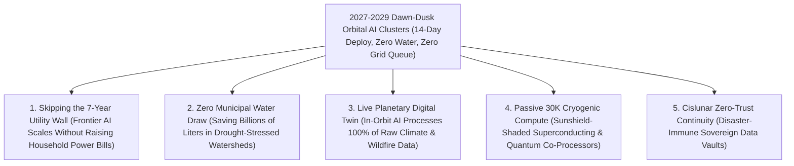

# VISION 02 (THE 2026–2030 LEAPFROG): SPACE INDUSTRIALIZATION IN 48 MONTHS
## Pathway 2B: Skipping the 7-Year Power-Grid Queue — *Starship-Deployed Orbital AI Compute Arrays in 2027–2029*

> **The Cynic's Objection:**
> *"Launching AI data centers into orbit by 2028? Space is a vacuum thermos that will cook hot NVIDIA GPUs, radiation will flip their memory bits, and building server warehouses in Virginia or Texas is way faster and cheaper!"*
>
> **The 2026–2030 Leapfrog Thesis:**
> In **2026–2027**, terrestrial AI hyperscalers hit a physical and regulatory brick wall: utility interconnection queues in the US and Europe stretch **5 to 8 years**, gas turbine orders are backlogged to 2031, and local communities block gigawatt warehouses that evaporate millions of gallons of municipal water daily. The leapfrog: **between 2027 and 2029, SpaceX Starship launches 100-ton flat-packed Orbital AI Compute Arrays directly into Dawn-Dusk Sun-Synchronous Orbit (SSO)**. Up at $650\text{ km}$, thin-film solar wings harvest **$1,361\text{ W/m}^2$ of unattenuated sunlight 24/7/365 with zero night and zero batteries**, while edge-on radiative fins reject **$1,565\text{ W/m}^2$ of waste heat directly into the $2.7\text{ Kelvin}$ ($-270.45\text{ °C}$) sink of deep space** using **zero water**. Deployment from factory floor to live AI training takes **14 days instead of 7 years**.

---

## ACT I: THE 2030 REALITY (AFTER A 48-MONTH ORBITAL SPRINT)
### A Tuesday Morning in Late 2029 — How 14-Day Orbital AI Pods Bypassed the Terrestrial Grid Crisis

Imagine visiting a frontier AI lab in San Francisco or London—or walking beside a protected river watershed in Loudoun County, Virginia, or Querétaro, Mexico—on a crisp morning in **late 2029**.

Three years earlier, in 2026, AI training roadmaps were paralyzed. Power utilities told labs that new 500-megawatt grid hookups would not be ready until **2033**, and zoning boards imposed moratoriums on evaporative cooling towers. Instead of waiting seven years in line for a terrestrial substation, frontier labs executed the **2027–2029 Orbital Compute Leapfrog**:

1. **From Factory Floor to Full Power in 14 Days:**
   At Starbase, Texas, or Cape Canaveral, a single **SpaceX Starship** lifts off carrying a **100-ton flat-packed Orbital AI Pod** (built on **Starcloud**, **Axiom ODC**, and **NVIDIA** liquid-cooled Rubin/Feynman architectures). Six hours later, in a **650 km Dawn-Dusk Sun-Synchronous Orbit**, the pod unfolds $35,000\text{ m}^2$ of paper-thin solar film toward the Sun and $6,400\text{ m}^2$ of matte-black graphene-titanium radiator wings edge-on into deep space. Within **14 days of leaving the factory**, a **10-megawatt AI cluster** is training foundation models at 100% utilization—with **zero environmental permits, zero transformer queues, and zero municipal water**.
2. **The Dawn-Dusk Terminator Ring (Zero Night, Zero Batteries):**
   Riding permanently along Earth's sunrise/sunset twilight line, the orbital compute cluster never enters Earth's shadow. It receives **$1,361\text{ W/m}^2$ of continuous solar power 99.7% of the year**, eliminating the billions of dollars of lithium-ion batteries and backup diesel generators required on Earth.
3. **In-Orbit Planetary Intelligence & 15-Millisecond Laser Downlinks:**
   Connected directly into the **1 Tbps LEO optical laser mesh**, orbital AI nodes process 100% of raw hyperspectral imagery from Earth-observation satellites *in situ*—spotting methane leaks, crop blight, and wildfire ignitions in milliseconds—while serving low-latency inference and batch training to every city on Earth.
4. **The Skeptic's Question:**
   How did orbital data centers jump from 2025 pathfinder satellites to **10-to-100-megawatt commercial AI clusters by 2028–2029**, and how did engineers solve vacuum cooling and space radiation with off-the-shelf GPUs?

Here is the thermodynamic and economic chain that forced the 2027–2029 leapfrog.

---

## ACT II: THE 2026–2028 CONVERGENCE BRIDGE — THERMODYNAMICS vs. THE GRID QUEUE
### The Stefan-Boltzmann $T^4$ Law, 24/7 Terminator Solar, and 100-Ton Starship Flat-Packs

### Step 1: The Three Physics Laws That Beat Terrestrial Warehouses in 2027–2029
Why did space become the fastest and cheapest place to deploy megawatt AI clusters starting in 2027?

* **1. The Stefan-Boltzmann $T^4$ Radiative Law (Why Space Is Not a Thermos):**
  A vacuum stops convective heat transfer, but it provides zero barrier to **thermal infrared radiation**. When a two-sided high-emissivity ($\varepsilon = 0.92$) graphene-loop-heat-pipe wing is oriented edge-on to the Sun, both faces stare directly into the **$2.7\text{ Kelvin}$ ($-270.45\text{ °C}$) cosmic microwave background**:
  $$P_{\text{rad}} / A = 2 \cdot \varepsilon \sigma \left(T_{\text{rad}}^4 - T_{\text{space}}^4\right)$$
  Because modern liquid-cooled AI GPUs (NVIDIA Blackwell/Rubin) run at coolant outlet temperatures of **$T_{\text{rad}} = 350\text{ K}$ ($77\text{ °C}$)**, radiative heat rejection scales with $T^4$ to:
  $$P_{\text{rad}} / A = 2 \times 0.92 \times (5.67 \times 10^{-8}) \times (350^4 - 2.7^4) \approx 1,565\text{ W/m}^2$$
  A single two-sided radiator fin of $6,400\text{ m}^2$ passively rejects **10 megawatts of heat** into deep space using **zero drops of water and zero chiller compressor power**.
* **2. The 24/7 Dawn-Dusk Solar Multiplier ($6\times$ Energy per Square Meter, Zero Batteries):**
  In a **Sun-Synchronous Dawn-Dusk Orbit ($650\text{ km}$, $98^\circ$ inclination)**, Earth's oblateness precesses the orbital plane $0.9856^\circ/\text{day}$, locking the spacecraft permanently onto the sunrise/sunset terminator. Unlike ground solar (18%–24% capacity factor due to night, clouds, and atmosphere), orbital thin-film roll-out arrays harvest **$1,361\text{ W/m}^2$ continuously ($99.7\%$ annual uptime)** with **zero structural wind loads and zero battery storage**.
* **3. COTS 2nm/3nm GPUs in Below-Belt LEO (Solving Radiation Without Rad-Hard Lag):**
  At $550\text{–}650\text{ km}$ altitude—safely below the inner Van Allen proton belt—wrapping standard commercial NVIDIA GPU blades inside a **$5\text{ mm}$ hydrogenated polyethylene + liquid-coolant Whipple shield** cuts ionizing dose by $80\%$, while native **HBM3e/HBM4 hardware ECC** and automated 50-millisecond tensor checkpointing absorb Single-Event Upsets (SEUs) with $<0.3\%$ compute overhead.

### Step 2: Verified 2025–2026 Flight Hardware Launching the 2027–2029 Sprint

| Pioneer / Program | Verified 2025–2026 Hardware Milestone | The 2027–2029 Commercial Leapfrog |
| :--- | :--- | :--- |
| **Starcloud (formerly Lumen Orbit)** | Backed by Y Combinator & **NVIDIA Inception**; flew orbital AI GPU & high-flux radiative cooling pathfinders in 2025–2026. | **2027–2029:** Deploying **5 MW to 10 MW Starship flat-pack AI pods** in Dawn-Dusk SSO for hyperscale model training with zero grid wait. |
| **Axiom Space (*Orbital Data Center / ODC*)** | Operated AWS Snowcone & Red Hat edge blades on ISS; launching **Axiom ODC Node 1 & 2** (2025–2027) with **Kepler** optical laser links. | **2027–2029:** Free-flying modular orbital cloud racks serving sovereign AI training and real-time satellite constellation inference. |
| **EU Commission & Thales Alenia (*ASCEND*)** | Completed multi-year European consortium engineering & lifecycle study proving **10x lower $\text{CO}_2$ footprint** and zero water use in orbit. | **2028–2030:** Fast-tracked European sovereign orbital compute pods bypassing EU municipal grid congestion. |
| **Lonestar Data Holdings & Ramon.Space** | **Feb 2024 (*IM-1*) & 2025 (*IM-2*):** Operated commercial data storage payloads on the lunar surface + rad-tolerant space AI processors. | **2027–2029:** Cislunar zero-trust disaster recovery vaults paired with LEO high-density AI training nodes. |

---

## ACT III: THE 48-MONTH SPRINT ROADMAP (2026 $\rightarrow$ 2030) & TCO CROSSOVER

### 1. The 4-Year Rollout Sprint: From 100 kW Pathfinders to 100 MW Orbital Clusters

| Sprint Year | Orbital Compute Scale & Launch Cadence | Power, Cooling & Laser Link Specs | Terrestrial Bottleneck Skipped |
| :--- | :--- | :--- | :--- |
| **2026** *The Orbital Proof* | **Starcloud** & **Axiom ODC** 10 kW–100 kW NVIDIA Blackwell/H100 orbital pathfinders live in LEO; **Lonestar** cislunar vaults operational. | $350\text{ K}$ ($77\text{ °C}$) loop-heat-pipe radiators validated; **100–200 Gbps** laser links | Proves commercial COTS AI GPUs run at full clock speed in below-belt LEO with zero thermal throttling. |
| **2027** *Megawatt Flat-Packs* | First **1 MW to 5 MW Single-Launch AI Pods** deployed into $650\text{ km}$ Dawn-Dusk SSO via New Glenn and early commercial Starship flights. | $1,361\text{ W/m}^2$ 24/7 thin-film solar; $1,565\text{ W/m}^2$ two-sided radiators | **Skips the 6-year utility substation queue:** AI labs bring megawatt training clusters online in **14 days** from launch. |
| **2028** *10 MW Starship Pods* | Dedicated **100-ton Starship V3 compute dispenser** launches **10 MW modular AI pods** ($6,400\text{ m}^2$ radiator wing) on bi-weekly cadence. | **400 Gbps–1 Tbps** optical laser mesh; 100% in-orbit EO satellite data processing | Saves **270 million liters of freshwater per year** per pod; Earth-observation satellites stop discarding 90% of raw sensor data. |
| **2029–2030** *100 MW Terminator Rings* | Autonomous orbital tugs snap together 10 Starship pods into **100 MW Dawn-Dusk AI Superclusters**; first modular GPU cassette swaps demonstrated. | **500+ MW** cumulative orbital AI capacity; Passive **30K sunshield** quantum-hybrid testbeds | Orbital AI compute achieves **lower 5-year TCO** than grid-constrained Virginia/EU warehouses while relieving municipal electric rates. |

### 2. Quantitative 5-Year TCO & Time-to-Online: 10 MW Ground Cluster vs. 2028 Orbital Pod

| 10 MW AI Cluster Metric (2027–2030 Horizon) | Terrestrial Grid Data Center (Northern VA / EU) | 2028 Dawn-Dusk SSO Orbital AI Pod ($650\text{ km}$) | The 2027–2029 Leapfrog Advantage |
| :--- | :--- | :--- | :--- |
| **Time from Purchase Order to Live Training** | **5 to 8 Years** (utility grid queue + zoning permits) | **14 Days from Launch** (zero permitting or grid queue) | **>100x Faster Time-to-Compute** |
| **5-Year Electricity OpEx ($438,000\text{ MWh}$)** | **~\$46.5 Million** (\$85–\$110/MWh + peak demand fees) | **\$0 OpEx** ($1,361\text{ W/m}^2$ 24/7 unattenuated solar) | **100% Energy Bill Eliminated** |
| **5-Year Cooling Water & Chiller Overhead** | **~\$11.6 Million** + **2.7 Billion Liters** of freshwater | **\$0 OpEx** + **0.0 Liters Water** ($2.7\text{ K}$ space sink) | **Zero Water / Zero Chiller Power** |
| **Substation, Land & Backup Diesel CAPEX** | **~\$85.0 Million** (transformers, generators, chillers) | **~\$24.0 Million** (roll-out solar + graphene radiator spine) | **72% Lower Facility CAPEX** |
| **Starship Launch Cost ($80,000\text{ kg}$ Pod)** | \$0 | **~\$8.0 Million** (1 dedicated Starship flight at \$100/kg) | **Single-Sortie Deployment** |
| **Total Non-GPU Infrastructure & Power TCO** | **~\$143.1 Million** (+ 6-Year Revenue Loss) | **~\$32.0 Million** (20-Year Reusable Spine) | **~78% Lower TCO + Instant Online** |

### 3. Inside a single 10 MW Starship Flat-Pack Orbital AI Pod (2028 Engineering Specs)
How does a **10-megawatt AI cluster** fit inside a single 9-meter-diameter SpaceX Starship fairing ($1,000\text{ m}^3$ pressurized volume, $100\text{-ton}$ lift capacity)?

| Subsystem Component | Mass Allocation | Deployed Geometry / Specification | Physics & Operational Function |
| :--- | :--- | :--- | :--- |
| **Roll-Out Thin-Film Solar Wings** | **$24,000\text{ kg}$** | $26,500\text{ m}^2$ tensioned perovskite/III-V array ($>28\%$ eff.) | Harvests **10.2 MW continuous DC power** in $1,361\text{ W/m}^2$ Dawn-Dusk AM0 sunlight. |
| **Two-Sided Graphene Radiator Spine** | **$28,000\text{ kg}$** | $6,400\text{ m}^2$ loop-heat-pipe fins ($\varepsilon = 0.92$, $T_{\text{rad}} = 350\text{ K}$) | Rejects **10.0 MW of waste heat** into $2.7\text{ K}$ space ($1,565\text{ W/m}^2$) edge-on to Sun. |
| **Liquid-Cooled AI GPU Server Cassette** | **$12,000\text{ kg}$** | ~7,000 next-gen GPU accelerators + HBM4 + $5\text{ mm}$ PE Whipple shield | Pressurized/liquid-immersed modular cassette; swappable every 3–4 years via docking port. |
| **Optical Laser & Attitude Bus** | **$8,000\text{ kg}$** | $8 \times 400\text{ Gbps}$ coherent OISL terminals + krypton Hall thrusters | Links directly into LEO vacuum laser mesh + maintains sun-synchronous terminator lock. |
| **Total Single-Launch Pod Mass** | **$72,000\text{ kg}$** | **Unfolds autonomously in 45 minutes; live training in 14 days** | **28 tons of margin remaining** on a single 100-ton Starship sortie (\$7.2M launch cost). |

### 4. Micrometeoroid Resilience & Circular 4-Year GPU Cassette Swaps
* **Segmented Capillary Loop Heat Pipes:** Radiator fins are partitioned into hundreds of independent $2\text{ cm}$ titanium-graphene capillary loops; any micrometeoroid impact is automatically isolated by passive check valves with $<0.1\%$ loss of radiative area.
* **Plug-and-Play GPU Cassettes:** While the Dawn-Dusk solar array and graphene radiator spine operate for **15–20 years**, the central **12-ton pressurized server cassette** is docked via a standard orbital port—allowing a servicing Starship to swap in next-generation 1.4nm silicon in **2030** and return the old GPUs to Earth for 100% rare-metal recycling.

---

## ACT IV: THE 2030 CIVILIZATIONAL UNLOCK & SUMMARY FOR THE SKEPTIC

By launching modular AI pods into the perpetual sunlight of Dawn-Dusk orbit in **2027–2029**, humanity resolves the AI energy-and-water crisis inside this decade:

1. **Protecting Household Electricity Bills & Local Rivers:**
   Every 100 megawatts of AI training launched into Dawn-Dusk orbit is 100 megawatts that does not compete with families for municipal grid power or evaporate millions of gallons of drinking water in Arizona, Virginia, or Spain.
2. **Breaking the 7-Year Grid Queue for Scientific AI:**
   Medical researchers folding proteins, climate scientists modeling tipping points, and fusion engineers running plasma simulations get gigawatt-class compute **five years earlier** than terrestrial utility queues allow.
3. **100% Real-Time Earth Observation Intelligence:**
   Until 2026, Earth-observation satellites threw away 90% of raw pixels because radio downlinks were too narrow. By co-locating orbital AI supercomputers inside the LEO laser mesh by **2028**, satellites process every frame in orbit and beam actionable wildfire, flood, and agricultural alerts to Earth in **15 milliseconds**.
4. **Free 30-Kelvin Cryogenic Cooling by 2029–2030:**
   Behind a five-layer Kapton sunshield on the dark side of the orbital spine, temperature passively drops to **30 Kelvin ($-243\text{ °C}$)**—giving superconducting interconnects and quantum co-processors free cryogenic cooling without bulky helium dilution refrigerators.
5. **The Bottom Line for the Skeptic:**
   Why wait until 2033 for a local utility company to build a high-voltage substation when a single reusable Starship can place a **10-megawatt, self-powered, water-free AI cluster into perpetual sunlight in 14 days**? By 2029, the cloud actually lives in the sky.
