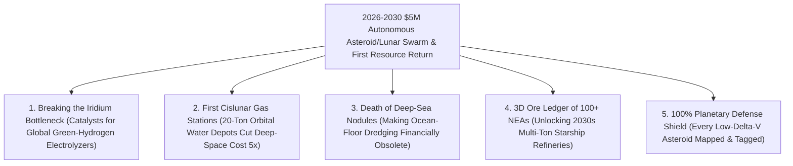

# VISION 02 (THE 2026–2030 LEAPFROG): SPACE INDUSTRIALIZATION IN 48 MONTHS
## Pathway 2D: The 2026–2030 Swarm Micro-Prospector & Cislunar Water/PGM Leapfrog — *\$5M Autonomous Swarms & First Orbital Resource Depots*

> **The Cynic's Objection:**
> *"Asteroid and lunar mining by 2030? NASA's OSIRIS-REx took seven years and \$1 billion just to bring back 121 grams of dust! How could commercial space mining possibly happen inside a four-year window?"*
>
> **The 2026–2030 Leapfrog Thesis:**
> *OSIRIS-REx* was a bespoke, hand-built 2010s government flagship launched on an expendable Atlas V rocket. Between **2026 and 2030**, the economics invert by $200\times$: instead of billion-dollar singletons, **AI-designed \$5M dishwasher-sized autonomous micro-swarms** (built on **AstroForge**, **TransAstra**, and **Karman+** architectures) ride-share by the dozen on monthly lunar and deep-space launches in **2026–2028**. Guided by autonomous onboard optical navigation, these micro-swarms rendezvous with ultra-low-$\Delta v$ Near-Earth Objects (NEOs) and lunar polar ice craters—using **concentrated solar spallation** and **zero-G magnetic/carbonyl separation** to fill the first cislunar water-propellant depots and parachute **high-purity Platinum-Group Metal (PGM) catalyst capsules** back to Earth via free atmospheric aerobraking by **2029–2030**.

---

## ACT I: THE 2030 REALITY (AFTER A 48-MONTH SWARM PROSPECTING SPRINT)
### A Tuesday Morning in Late 2029 — The First Commercial Iridium Capsule in Utah and the Cislunar Water Depot

Imagine standing on the salt flats of the Utah Test and Training Range—or at the Woomera Range in South Australia—on a crisp dawn in **late 2029**.

Four years earlier, in 2025, conventional wisdom held that asteroid and lunar resource extraction wouldn't matter until the 2040s. Instead, by replacing billion-dollar government flagships with mass-produced Silicon Valley micro-spacecraft and rideshare economics, commercial pioneers executed the **2026–2030 Swarm Resource Leapfrog**:

1. **The \$5M Swarm Assay of 100 Near-Earth Asteroids (2026–2028):**
   Instead of launching one probe per decade, monthly SpaceX Falcon 9, Starship, and Rocket Lab launches between 2026 and 2028 ejected **clusters of 150-kilogram, \$5M autonomous ion-and-solar-sail micro-prospectors** into high-energy trajectories. By late 2028, this autonomous swarm has rendezvoused with and assayed **over 100 low-$\Delta v$ Near-Earth Asteroids**, publishing the first high-resolution 3D radar and gamma-ray ore-grade ledger of metallic (M-type) and water-rich (C-type) bodies within $0.05\text{ AU}$ of Earth.
2. **The Utah & Woomera Platinum/Iridium Drop (2029–2030):**
   Streaking across the morning sky at $11.2\text{ km/s}$ is a $1.2\text{-meter}$ blunt-body carbon-phenolic reentry capsule deployed by an autonomous **AstroForge / Karman+ refinery craft**. Using Earth's atmosphere to absorb **99.5% of its return kinetic energy for free**, the capsule pops its parafoil and lands softly on the desert floor. Inside is a **250-kilogram solid boule of enriched iridium, rhodium, and platinum**—vapor-distilled in zero gravity from a metallic NEA core with $50\times$ higher PGM richness than any terrestrial mine, delivering essential catalysts for green-hydrogen PEM electrolyzers on Earth.
3. **First Water in the Sky (The 2029 Cislunar Propellant Depot):**
   Simultaneously, in High Earth Orbit and at Earth-Moon Lagrange Point $L_1$, an inflatable **TransAstra /Lunar ISRU water depot** receives its first **20-ton delivery of pure $\text{H}_2\text{O}$** extracted via concentrated solar optical spallation from a carbonaceous mini-moon and Lunar South Pole ice—slashing the cost of refueling orbital tugs and deep-space probes by **$80\%$** because not a single liter had to be lifted out of Earth's deep gravity well.

---

## ACT II: THE 2026–2028 CONVERGENCE BRIDGE — \$5M SWARMS vs. \$1B FLAGSHIPS
### Rideshare Economics, Low-$\Delta v$ Accessibility, and Mass-Less Zero-G Refining

### Step 1: The Three Physics & Economic Inflections Driving the 48-Month Sprint
How did commercial teams compress asteroid and lunar resource extraction from a 20-year dream into a **2026–2030 commercial sprint**?

* **1. The $200\times$ Probe Cost Collapse (\$1 Billion $\rightarrow$ \$5 Million Rideshare Swarms):**
  NASA's *OSIRIS-REx* cost ~\$1.16 billion because every sensor, thruster, and computer was custom-built before the CubeSat/SmallSat supply chain existed. By 2026, off-the-shelf Starfacker optical cameras, compact **krypton/iodine Hall-effect ion thrusters ($I_{\text{sp}} \approx 2,500\text{–}3,500\text{ s}$)**, deployable solar sails, and radiation-tolerant AI edge boards allow startups like **AstroForge**, **Karman+**, and **TransAstra** to build a deep-space prospector-refinery bus for **\$5M to \$12M**—and launch it as a secondary rideshare payload on a monthly lunar or GTO rocket for **<\$2M**.
* **2. The $\Delta v$ Gravity-Well Paradox (NEAs Easier to Reach Than the Moon):**
  Landing on the Moon requires fighting lunar gravity ($\Delta v \approx 6.0\text{ km/s}$ from LEO). By contrast, over **1,500 Near-Earth Asteroids** in Earth-like orbits (such as *2010 UJ*, *1998 KY26*, *2000 SG344*, and *1986 DA* fragments) have microgravity escape velocities of **$v_{\text{esc}} < 1\text{ m/s}$** and require a total round-trip return impulse from asteroid to Earth atmospheric entry of only:
  $$\Delta v_{\text{return}} \approx 0.15\text{ to }0.60\text{ km/s}$$
  Once the return capsule intersects Earth's upper atmosphere at $11\text{–}12\text{ km/s}$, **aerodynamic drag provides $60+\text{ MJ/kg}$ of braking energy for free**.
* **3. Zero-Gravity Mass-Less Refining (No Heavy Excavators Needed):**
  Instead of launching 20-ton diesel mining trucks, 2027–2029 spacecraft use sunlight and vacuum physics:
  * **Zero-G Vacuum Fractional Distillation & Carbonyl Separation:** On M-type metallic cobbles (which hold **50–400 ppm of Platinum-Group Metals** because protoplanetary cores differentiated 4 billion years ago), focused electron/solar beams or low-temperature ($60\text{ °C}$) recycled carbon monoxide gas volatilize bulk iron and nickel while concentrating non-volatile **iridium, rhodium, and platinum** by **$30\times\text{ to }50\times$** inside a compact return crucible.
  * **Concentrated Solar Optical Spallation (*TransAstra*):** A $2\text{-kilogram}$ inflatable Mylar mirror focuses solar thermal flux onto water-rich carbonaceous regolith; thermal shock spalls the rock surface and flashes 10%–20% bound water directly into a passive cryogenic cold trap with zero moving drill bits.

### Step 2: Verified 2024–2026 Flight Baseline Powering the 2026–2030 Sprint

| Pioneer / Program | Verified 2024–2026 Flight & Lab Baseline | The 2027–2030 Leapfrog Execution |
| :--- | :--- | :--- |
| **AstroForge (*Brokkr-1*, *Odin*, *Vestri*)** | **2023:** Flew *Brokkr-1* zero-G refinery in LEO. **Feb 2025:** Launched *Odin* deep-space asteroid probe (first commercial craft past Lunar orbit); built *Vestri* docking craft. | **2026–2029:** *Vestri* asteroid rendezvous & in-situ PGM assay followed by first commercial **100–500 kg enriched PGM capsule return** to Utah/Australia. |
| **Karman+ (Netherlands / US)** | Fully funded commercial asteroid mission developing autonomous low-$\Delta v$ microgravity regolith excavation and return bus. | **2027–2029:** Autonomous rendezvous and regolith processing on low-$\Delta v$ Near-Earth Object, validating swarm excavation hardware. |
| **TransAstra (*Sutter* & *Optical Mining*)** | Deployed global **Sutter** telescope network across 3 continents discovering low-$\Delta v$ NEAs; ground-validated **Optical Mining** & **Worker Bee** tugs. | **2027–2030:** Capturing volatile-rich asteroid boulders/cobbles to supply **20-ton orbital water depots** in LEO/Cislunar space. |
| **NASA CLPS / Intuitive Machines / ispace** | **2024–2026:** Multiple commercial lunar landings (*IM-1*, *IM-2 PRIME-1*, *ispace*) operating **TRIDENT** ice drills and mass spectrometers at Lunar South Pole. | **2027–2030:** Pilot lunar polar ice and ilmenite oxygen/water extraction feeding cislunar Starship/Blue Moon propellant depots. |
| **NASA *OSIRIS-REx* (*APEX*) & JAXA *Hayabusa2*** | Proven autonomous asteroid touch-and-go (TAG) excavation and $12.4\text{ km/s}$ precision desert capsule reentry; *OSIRIS-APEX* intercepting **Apophis in April 2029**. | **2026–2029:** Open-source autonomous optical navigation algorithms and carbon-phenolic heatshield specs adopted by commercial micro-swarms. |

---

## ACT III: THE 48-MONTH SPRINT ROADMAP (2026 $\rightarrow$ 2030) & ECONOMIC SPLIT

### 1. The 4-Year Rollout Sprint: From Rideshare Swarms to First Commercial Return

| Sprint Year | Swarm Deployment & Mission Milestone | Target Resource & Technical Specs | Bottleneck Skipped |
| :--- | :--- | :--- | :--- |
| **2026** *The Swarm Launch* | **AstroForge *Vestri*** & early commercial micro-probes launch; **TransAstra *Sutter*** telescopes triple catalog of ultra-low-$\Delta v$ ($\Delta v < 4.2\text{ km/s}$) NEAs. | $150\text{–}250\text{ kg}$ spacecraft; \$5M–\$10M unit cost; Rideshare on lunar flights | Skips \$1B flagship procurement by using standardized COTS smallsat buses and rideshare slots. |
| **2027** *In-Situ Docking & Assay* | **Karman+** & **20+ autonomous micro-prospectors** dock with metallic and carbonaceous NEAs; **CLPS Lunar South Pole** pilot ice extractors produce first lunar $\text{H}_2\text{O}$. | Micro-spine zero-G grapples; Laser-induced breakdown spectroscopy (LIBS) | Replaces decade-long government survey timelines with parallel swarm prospecting across 50+ targets at once. |
| **2028** *Zero-G Pilot Refining* | First **in-space optical spallation** captures **2–5 tons of asteroid water** in cold traps; **AstroForge/partner refinery pods** smelt 500 kg of PGM-enriched dore in microgravity. | $10^{-12}\text{ Torr}$ vacuum distillation; Solar concentrator spallation; $\Delta v_{\text{return}} < 0.4\text{ km/s}$ | Proves zero-chemical, zero-gravity mineral upgrading without launching heavy crushing machinery. |
| **2029–2030** *First Depot & Earth Drop* | **Apophis 2029 Earth flyby** ($31,600\text{ km}$) greeted by commercial swarm; **first 250–500 kg PGM catalyst capsules** land in Utah/Woomera; **20-ton Cislunar Water Depot** live. | **\$15M–\$40M** PGM value/capsule; **\$2,500/kg** orbital water value; 99.5% free air braking | **Inaugurates the off-Earth resource economy 10 years ahead of schedule**, supplying green-hydrogen catalysts and orbital fuel. |

### 2. Quantitative Comparison: 2010s Flagship vs. 2026–2030 Commercial Micro-Swarm vs. Earth Mining

| Resource & Mission Metric (2026–2030 Horizon) | 2016–2023 NASA Flagship (*OSIRIS-REx*) | 2026–2030 Commercial Micro-Swarm (*AstroForge / Karman+ / TransAstra*) | Terrestrial Open-Pit Crust Mine (South Africa / Russia) |
| :--- | :--- | :--- | :--- |
| **Spacecraft / Project Capital Cost** | **\$1,160 Million** (1 bespoke probe) | **\$5M–\$12 Million per Probe** (mass-produced swarm) | **\$3,000M–\$5,000 Million** (10-year shaft/pit build) |
| **Mission Timeline (Build to Return)** | **7 to 10 Years** | **24 to 36 Months** (high-energy rideshare + ion drive) | **8 to 12 Years** (permitting + excavation) |
| **Platinum-Group Metal (PGM) Grade** | N/A (scientific sample) | **$50\text{–}400\text{ g/ton}$** (M-type protoplanetary core) | **$1.5\text{–}4.0\text{ g/ton}$** (300 tons rock per kg Pt) |
| **Value of $1\text{ Ton}$ Water Delivered to LEO** | N/A | **\$2,500,000–\$5,000,000/ton** (avoided gravity penalty) | \$1/ton on Earth (costs \$100k+/ton to launch to cislunar) |
| **Acid Tailings & Freshwater Consumed** | 0 Liters | **0 Liters Water / 0 Acid** (vacuum distillation) | **$400,000\text{ Liters Water}$** + cyanide/acid per kg PGM |

### 3. The Two-Direction Orbital Resource Split & Prime 2026–2030 Targets
Commercial swarm mining between 2026 and 2030 obeys a strict **Two-Direction Gravity-Well Rule**: high-value catalysts come **down** to Earth via free atmospheric braking, while bulk water and structural metals stay **up** in orbit to save \$50,000+/ton in launch costs:

| Target Class & Archetype | Round-Trip $\Delta v$ (from HEO/Cislunar) | Primary Extracted Resource | 2028–2030 Destination & Market Value |
| :--- | :--- | :--- | :--- |
| **M-Type Metallic NEAs** *(e.g., 1986 DA family / AstroForge targets)* | **$3.8\text{–}4.6\text{ km/s}$** ($\Delta v_{\text{return}} < 0.4\text{ km/s}$) | **Iridium, Platinum, Rhodium, Palladium** ($50\text{–}400\text{ g/ton}$ core grade) | **Parachuted to Earth (Utah/Australia):** \$35,000–\$150,000/kg for PEM hydrogen electrolyzers & fuel cells. |
| **C-Type Carbonaceous NEAs** *(e.g., 2000 SG344 / 1998 KY26 class)* | **$3.4\text{–}4.1\text{ km/s}$** ($\Delta v_{\text{return}} < 0.25\text{ km/s}$) | **Water ($\text{H}_2\text{O}$), Volatiles & Nickel-Iron** ($10\%\text{–}20\%$ bound water by mass) | **Kept in LEO/Cislunar Depots:** \$2,500–\$5,000/kg as $\text{LH}_2/\text{LOX}$ rocket fuel & radiation shielding. |
| **Lunar South Pole Craters** *(Shackleton / Cabeus — CLPS Landers)* | **$1.8\text{ km/s}$** (Lunar surface to $L_1$ depot) | **Polar Water Ice & Ilmenite Oxygen** ($42\%$ of lunar regolith is $\text{O}_2$) | **Kept in Cislunar Orbit:** Refuels Starship, Blue Moon, and deep-space ion tugs at $80\%$ cost savings. |
| **99942 Apophis Flyby** *(April 13, 2029 — $31,600\text{ km}$ pass)* | **$<0.8\text{ km/s}$** (direct GEO-altitude intercept) | **Live Swarm Assay & Regolith Excavation Demo** | **Global Proof-of-Concept:** 12+ commercial micro-probes dock and assay in real time above Earth. |

### 4. The April 13, 2029 Apophis Catalyst & Legal Certainty
* **The April 2029 Apophis Flyby Opportunity:** On April 13, 2029, the 370-meter asteroid **99942 Apophis** passes harmlessly within **$31,600\text{ km}$ of Earth** (closer than geostationary satellites!), requiring **$<0.8\text{ km/s}$ $\Delta v$** for commercial micro-probes to rendezvous and demonstrate live regolith assay in front of 8 billion people.
* **Low-Temperature Carbonyl Refining ($60\text{ °C}$ Zero-G Mond Process):** In addition to solar/electron-beam distillation, circulating carbon monoxide gas over metallic regolith at $60\text{ °C}$ volatilizes nickel and iron as carbonyl gas ($\text{Ni(CO)}_4, \text{Fe(CO)}_5$), leaving a **50x-concentrated Platinum-Group Metal sponge** with near-zero thermal power overhead.
* **Clear Title Under the Artemis Accords:** Under the **U.S. Commercial Space Launch Competitiveness Act**, Luxembourg/Japan/UAE space laws, and the **50+ Nation Artemis Accords**, private operators hold clear legal title to extracted water and PGMs.

---

## ACT IV: THE 2030 CIVILIZATIONAL UNLOCK & SUMMARY FOR THE SKEPTIC

By unleashing **\$5M autonomous micro-swarms in 2026–2028** instead of waiting for billion-dollar government flagships, humanity crosses the threshold of off-Earth resource abundance by **2030**:

1. **Unblocking the Green-Hydrogen Iridium Bottleneck:**
   Global decarbonization via Proton-Exchange Membrane (PEM) water electrolyzers is severely throttled because all terrestrial mines produce barely **7 tons of iridium per year**. Parachuting the first commercial enriched iridium/platinum capsules from metallic NEAs in **2029–2030** proves the supply curve that unlocks terawatt clean hydrogen—and convinces capital markets to cancel destructive **deep-sea polymetallic nodule dredging** before it starts.
2. **Turning Cislunar Water into Orbital Rocket Fuel by 2029:**
   Every ton of water ($\text{H}_2\text{O}$) harvested from a carbonaceous NEA or Lunar South Pole crater and parked at an orbital depot saves **\$100,000+ in Earth-launch propellant penalties**. Electrolyzed by solar power into $\text{LH}_2/\text{LOX}$, it turns cislunar space into a self-refueling highway.
3. **A Complete Planetary Defense Shield as a Free Byproduct:**
   When commercial telescope networks (*TransAstra Sutter*) and 100+ micro-prospector probes map every low-$\Delta v$ Near-Earth Object between 2026 and 2029, humanity simultaneously achieves **100% early-warning tracking and ion-tug deflection capability** against any city-killer asteroid.
4. **Abundant Platinum & Rhodium for Oncology and Green Ammonia:**
   Beyond hydrogen electrolyzers, platinum-group compounds form the backbone of over 40% of human chemotherapy treatments (cisplatin, carboplatin) and low-pressure green fertilizer catalysts—turning space PGM drops into an immediate biomedical and agricultural dividend on Earth.
5. **The Bottom Line for the Skeptic:**
   **AstroForge (*Brokkr-1*, *Odin*, *Vestri*)**, **Karman+**, **TransAstra**, and **CLPS lunar ice landers** are already built and launching in 2025–2027. By 2030, the first commercial space water will sit in orbital depots, and the first space-refined platinum-group ingots will rest on Earth.

