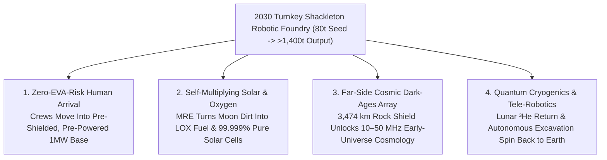

# VISION 02 (LEAPFROG 2026–2030) — SPACE EXPANSION & CISLUNAR CIVILIZATION
## Sub-Pathway 2A: The "Robots-First" 1,000-Day Autonomous Shackleton Factory — *Skipping 15 Years of Slow Human EVA Construction via VLA Swarms & 100-Ton Heavy Lift (2026–2030)*

> **Executive Framing & The 48-Month Leapfrog Thesis**
> * **The Legacy Aerospace Bottleneck:** *"Traditional space agency plans assume astronauts must land in fragile foil cans first, spend a decade doing slow, dangerous spacesuit EVAs, and maybe build a small power station by 2040. At that pace, a real lunar industrial base is twenty years away."*
> * **The 2026–2030 Leapfrog Thesis:** Why risk human lives swinging hammers in vacuum when **Vision-Language-Action (VLA) embodied AI robots**, **100-ton uncrewed Starship HLS & Blue Moon cargo landers**, and **zero-reagent Molten Regolith Electrolysis (MRE)** exist right now? Instead of waiting for slow human construction, **two uncrewed heavy cargo landers touch down at Shackleton Rim in 2027–2028 packed with 80 metric tons of VLA-driven humanoid and wheeled robotic swarms, ICON microwave/laser regolith-sintering rovers, and Blue Alchemist MRE kilns.** Directed by onboard foundation models with **1.3-second-latency supervisory teleoperation from Earth**, this robotic vanguard works 24/7 across a **1,000-day sprint**—grading blast-proof landing pads, printing 3-meter radiation vaults, cracking liquid oxygen from moon dirt, and carpeting the polar ridge with Moon-made silicon solar arrays by **2029–2030**. When the first commercial and Artemis crews step out of their airlocks in **2030**, they don't pitch a tent—they walk into a turnkey, megawatt-class industrial foundry.

---

## ACT I: THE WORLD OF 2030 — A TURNKEY INDUSTRIAL BASE BUILT BEFORE HUMANS ARRIVE
### Touchdown at Shackleton Autonomous Foundry (October 2030)

It is **late 2030** along the sunlit connecting ridge between **Shackleton and de Gerlache craters** (`89.9° S`). Here, the Moon's tiny `1.54°` axial tilt bathes the mountain peaks in **continuous horizontal sunlight for up to 92% of the year**, directly overlooking permanently shadowed crater floors at **40 Kelvin (-233 °C)** packed with hundreds of millions of tons of water ice.

When the crewed lander touches down in **2030**, it does not land in a cloud of razor-sharp dust—because an **autonomous robotic labor force of 120 wheeled excavators, spider-cranes, and vacuum-rated humanoid robots** has been working non-stop for **1,000 days (2027–2030)**:

1. **Vitrified Basalt Landing Aprons & Pre-Printed Radiation Vaults:**
   * Two **100-meter-wide hexagonal landing pads** gleam like dark volcanic glass. Over the preceding 24 months, autonomous **ICON *Olympus*** microwave-and-laser sintering rovers swept loose regolith into graded berms and fused it at `1,450 °C` into dust-free basaltic stone (`>57 MPa` compressive strength—stronger than terrestrial concrete, with zero grams of cement launched from Earth).
   * Beside the pad, three inflatable **Sierra Space *LIFE*** and metallic habitat cores sit already pressurized, heated, and buried beneath **3-meter-thick 3D-printed regolith arches** that block 99.9% of cosmic radiation and micrometeorites.
2. **The Autonomous Dirt-to-Solar & Liquid Oxygen Refinery:**
   * Stretching two kilometers along the sunlit polar ridge, a vertical fence of **lunar-manufactured silicon solar arrays** tracks the 360-degree horizon sun, backed by a **400-kilowatt container-sized fission microreactor** tucked into a trench.
   * Inside the **Blue Alchemist Molten Regolith Electrolysis (MRE)** reactor bank, robotic loaders dump raw gray moon dirt into `1,600 °C` crucibles. Without a single imported chemical reagent, electric current bubbles off **150 metric tons of pure liquid oxygen ($\text{LOX}$) per year** while casting **`>99.999%` pure solar-grade silicon**, iron, and aluminum ingots.
3. **The 1.3-Second Earth-Moon Tele-Robotics Nerve Center:**
   * Every robot at Shackleton runs an onboard **Embodied VLA Foundation Model** that handles real-time footstep planning, regolith scooping, and tool manipulation locally in milliseconds.
   * Whenever a rover or humanoid encounters an unfamiliar boulder or valve jam, a human supervisor sitting in Houston, Tokyo, or Munich—connected via Intuitive Machines' **Khon** lunar relay constellation with just **2.6 seconds round-trip light delay**—sends a high-level goal correction, allowing one Earth operator to supervise **25 lunar robots simultaneously**.
4. **Far-Side Dark-Ages Radio Unfurling (`LuSEE-Night` to `10 km` Array):**
   * On the lunar far side—shielded by **3,474 kilometers of solid rock** from all terrestrial radio noise—lightweight robotic spools deployed by commercial CLPS landers have already rolled out polyimide-film dipole antennas across *Daedalus* crater, streaming the first interference-free `10–50 MHz` hydrogen maps from the cosmic Dark Ages by **2030**.

---

## ACT II: THE 2026–2030 LEAPFROG ENGINE — WHY WE DON'T NEED TO WAIT FOR 2040
### How Uncrewed Heavy Cargo + Embodied AI Swarms + MRE Compress 15 Years into 48 Months

### Step 1: The "Zero Life-Support Tax" Advantage (Why Robots Go First)
Why did traditional lunar base plans take 15 to 20 years? Because **human astronauts require 90% of landed mass to be dedicated to keeping them alive**: pressurized cabins, food, water, emergency abort rockets, radiation shelters, and strict EVA hour limits.
* **The Uncrewed Cargo Shortcut:**
  An uncrewed **Starship Cargo lander** or **Blue Origin *Blue Moon MK1/MK2*** needs **zero life support, zero cabin pressurization, and zero human-rating abort margins** on its initial cargo drops in **2027–2028**.
  * Every single kilogram of its **30-to-80-metric-ton payload capacity** is pure productive machinery: excavators, solar blankets, MRE electrolysis cells, microwave sintering heads, and robotic arms.
  * Better still, uncrewed robotic swarms don't sleep, don't eat, tolerate high background radiation prior to vault completion, and run **24 hours a day for 1,000 straight days** powered by horizontal polar sunlight.
* **The VLA Tele-Autonomy Multiplier (`1.3s` Light Time):**
  Unlike Mars (where a 6-to-44-minute communication blackout forces slow, conservative rover movement), the Moon is only **384,400 kilometers (`1.28 light-seconds`)** away.
  * By combining **2026-era Vision-Language-Action (VLA) foundation models** (trained in NVIDIA Isaac / Omniverse physics simulations of `0.165 g` low-gravity regolith mechanics) with high-bandwidth optical links, lunar robots execute complex construction tasks at **100% human speed** while guided by three-shift engineering teams sitting comfortably on Earth.
* **Zero-Reagent Molten Regolith Electrolysis (MRE):**
  Lunar soil is **42% oxygen, 21% silicon, 13% iron/aluminum/titanium** by weight. Blue Origin's **Blue Alchemist** reactor melts raw regolith at `1,600 °C` and electrolyzes it with an inert anode—releasing pure breathable/propellant **$\text{O}_2$ gas** at the top and casting **solar-grade silicon and structural iron** at the bottom, with zero imported chemicals.

### Step 2: 2026–2030 Verified Hardware & Leapfrog Deployment Matrix

| System / Organization | Verified 2025–2026 Baseline | 2027–2028 Uncrewed Sprint Role | 2029–2030 Operational Output |
| :--- | :--- | :--- | :--- |
| **Firefly (*Blue Ghost*) & Intuitive Machines (*Nova-C/D*)** | **2024–2025:** *Blue Ghost M1* flawless landing + GPS lock at Moon; *IM-1/IM-2* South Pole landings & Nokia LTE test. | High-precision polar LiDAR mapping, cold-trap ice coring, and **Khon** continuous South Pole optical/RF comms relay. | Sub-meter terrain digital twins + `10 Gbps` Earth-Moon supervisory control link for 120+ surface robots. |
| **SpaceX (*Starship Cargo*) & Blue Origin (*Blue Moon MK1/MK2*)** | **2024–2026:** Super Heavy booster catches, orbital propellant transfer demos, *Blue Moon MK1* pathfinder integration. | **2027–2028:** Two uncrewed heavy cargo touchdowns at Shackleton Rim delivering **80+ metric tons** of seed factory hardware. | Reduces surface delivery cost from `>\$50,000/kg` (Apollo) to **\$800–\$1,500/kg** in a single 36-month window. |
| **Blue Origin (*Blue Alchemist* MRE)** | Demonstrated end-to-end oxygen, `>99.999%` silicon solar cell, and cover-glass fabrication from 100% regolith simulant. | Modular `1,600 °C` MRE kiln bank unloaded autonomously and fed 24/7 by robotic skid-steer regolith loaders. | **150+ tons/yr of Lunar $\text{LOX}$** (refueling ascent landers) + **300 kW/yr of Moon-made solar arrays**. |
| **ICON (*Project Olympus*) & Redwire** | Completed NASA Marshall vacuum laser/microwave sintering tests (`>57 MPa` basalt strength) under \$57M NASA contract. | Autonomous gantry and rover sintering heads fusing loose dust into blast pads, haul roads, and 3m habitat arches. | **Two 100m dust-free landing pads** + radiation-shielded habitat vaults ready prior to first long-duration crew arrival. |
| **Astrolab (*FLEX*), Lunar Outpost & VLA Humanoids** | Selected for NASA \$4.6B LTV contract; *FLEX* modular rover chassis & embodied VLA robotic manipulators tested in thermal-vac. | Swarm of wheeled haulers and vacuum-jacketed humanoid torso/legged units assembling trusses, cables, and pipes. | **1,000-day continuous autonomous construction** (`>2,000,000` robot labor-hours before the first astronaut EVA). |
| **Interlune & Westinghouse (*eVinci*)** | Interlune demonstrated millikelvin $\text{^3He}$ separation (DOE contracts); nuclear microreactor TRISO/heat-pipe designs complete. | Pilot volatile-skimming excavator + `100–400 kWe` heat-pipe fission unit for shadow-period baseload thermal/electric power. | First commercial return of **Lunar Helium-3 ($\text{^3He}$)** canisters for terrestrial quantum computing cryogenics by 2030. |

---

## ACT III: THE 48-MONTH SPRINT ROADMAP (2026 $\rightarrow$ 2027 $\rightarrow$ 2028 $\rightarrow$ 2030)

| Sprint Year | Milestone Window | Uncrewed & Robotic Operations on the Moon | Mass, Power & Cost Inflection Metrics | Threshold Unlocked by Year-End |
| :--- | :--- | :--- | :--- | :--- |
| **Year 1** | **2026: Polar Recon & Pathfinder Drop** | *Blue Ghost M2*, *IM-3*, and *Blue Moon MK1* land at South Pole; deploy *Khon* comms relays, subsurface ice drills, and a `10 kW` pilot MRE + microwave sintering head. | Surface Cost: **\$4,500/kg**; `1st kg` of lunar oxygen & sintered basalt brick produced in situ at `89.9° S`. | Centimeter-accurate 3D digital twin of Shackleton Rim landing zone; verification of polar regolith mineralogy & ice depth. |
| **Year 2** | **2027: Heavy Cargo Drop #1 (The Site Prep Swarm)** | First uncrewed **Starship Cargo / Heavy Lander** delivers **40 metric tons** to Shackleton: 35 VLA rovers/excavators, 2 ICON *Olympus* sintering rovers, and `250 kW` vertical solar fence. | Surface Cost: **\$1,500/kg**; `250 kW` continuous polar solar power online within 14 days of landing. | **Pad Alpha (`100 m` vitrified basalt)** fused in 120 days; zero dust-plume ejecta hazard for all subsequent landings. |
| **Year 3** | **2028: Heavy Cargo Drop #2 (The MRE & Habitat Core)** | Second uncrewed heavy lander touches down on Pad Alpha with **45 metric tons**: *Blue Alchemist* MRE refinery, 3 expandable habitat cores, and `400 kWe` fission power unit. | Surface Cost: **\$900/kg**; MRE kilns reach **5 tons/month $\text{LOX}$** output; habitats buried under 3m printed stone. | **Self-expanding power loop ignited:** first lunar-refined silicon solar panels wired into the Shackleton microgrid by robots. |
| **Year 4** | **2029–2030: Full Propellant Loop & Crew Turnkey Arrival** | Robotic swarm completes `150 tons` of stored $\text{LOX}$, pressurizes the vaulted base, strings the far-side radio pathfinder, and refuels the first returning cargo/crew lander. | Net Earth-launch mass per ton of surface infrastructure drops **5x**; **1+ MW total base power** operational. | **Astronauts step into a completed, shielded industrial base**—spending 100% of their time on science & expansion, not survival. |

### Why the 1,000-Day Robotic Sprint Wins Economically (2026 vs. 2030)
* **Eliminating the EVA Bottleneck:**
  * *Legacy Crewed Plan:* Astronauts in pressurized spacesuits cost **>\$100,000 per EVA hour** and can safely perform at most `150–200 EVA hours` per mission before radiation and fatigue limits intervene.
  * *2026–2030 VLA Robotic Swarm:* 100 autonomous rovers and humanoid manipulators operating 24/7 deliver **876,000 robotic work-hours per year** at **<\$5 per work-hour** marginal cost—achieving 15 years of human construction in **18 months**.
* **The 80% Propellant Mass Shortcut:**
  * Because **78% to 80% of a methalox or hydrolox lander's propellant mass is liquid oxygen ($\text{LOX}$)**, filling the ascent tanks with MRE-derived oxygen at Shackleton Rim in **2029–2030** immediately multiplies the return payload and cuts Earth tanker launches per mission by **more than half**.
* **1,000-Day Seed Factory Mass Multiplication (80 Tons In $\rightarrow$ 1,400+ Tons Out by 2030):**
  * *Sintered Basalt Pads, Roads & 3m Vault Arches:* **1,100+ metric tons** of local regolith vitrified in situ (`>13x` landed mass).
  * *Breathable & Propellant Liquid Oxygen ($\text{LOX}$):* **150+ metric tons** extracted and liquefied at `90 K`.
  * *Solar-Grade Silicon, Cast Iron & Aluminum:* **150+ metric tons** of refined metals and `600 kW` of indigenous vertical solar arrays.

### Engineering Bottlenecks & 2026–2030 Hardware Mitigations

| Lunar Surface Bottleneck | Why It Stopped Apollo | 2026–2030 Verified Engineering Solution |
| :--- | :--- | :--- |
| **Electrostatic Razor-Sharp Dust (Regolith Abrasion)** | Clung to spacesuit seals, scratched visors, and overheated radiators within 72 hours. | **Vitrified Basalt Aprons + Electrodynamic Dust Shields (EDS):** NASA's EDS (proven on *Blue Ghost M1*, 2025) uses AC electric fields to flick dust off lenses/radiators, while ICON laser sintering turns loose dust into solid stone around the base. |
| **354-Hour Freezing Nights & Shadow Pockets (`40 K`)** | Battery mass required to survive 14 days of darkness exceeded lander payload capacity. | **Shackleton Peak Geometry (`~90%` Sunlight) + Compact Fission:** Vertical rotating solar fences on `89.9° S` ridges catch continuous low-angle sun, backed by a container-sized `400 kWe` heat-pipe microreactor (*Westinghouse eVinci*). |
| **1,600 °C Anode Corrosion in MRE Furnaces** | Early electrolysis anodes dissolved in molten silicates after a few days. | **Blue Alchemist Inert Anode & Self-Coating Slag Skull:** Uses a frozen regolith "skull" crucible (the outer layer of moon dirt insulates the wall so molten lava never touches metal) paired with zero-consumption inert anodes. |
| **Cryogenic Boil-Off of Liquid Oxygen ($\text{LOX}$)** | Stored cryogens boiled away under solar heating before rockets arrived. | **20 K Zero-Boiloff Cryocoolers + Crater-Shadow Tank Farms:** Blue Origin (*Blue Moon*) pulse-tube cryocoolers paired with multi-layer sunshields store $\text{LOX}$ indefinitely at `<85 K`. |

---

## ACT IV: THE 2030 DIVIDEND & SUMMARY FOR THE SKEPTIC
### What Humanity Gains in Just Four Years

1. **Flipping the Sequence of Human Spaceflight Forever:**
   * In 1969, humans had to go first because computers had 74 kilobytes of memory and robots didn't exist.
   * In **2026–2030**, sending humans *before* autonomous robots build the landing pads, radiation vaults, power grid, and oxygen tanks is backwards. By letting **80 tons of VLA-guided robots** work for 1,000 days first, human presence on the Moon begins at the **industrial comfort phase**, not the tent-camping survival phase.
2. **Igniting the Self-Replicating Solar Loop by 2029:**
   * The single most important industrial milestone of the 21st century happens the day a *Blue Alchemist* reactor at Shackleton Rim refines raw lunar silicate into a working solar cell, and a robotic arm plugs that solar cell back into the furnace's power bus.
   * From that moment in **2028–2029**, humanity possesses an **exponentially self-expanding clean energy and metal factory** outside Earth's biosphere.
3. **Immediate Scientific & Commercial Returns to Earth (2028–2030):**
   * **Cosmology:** The far-side radio pathfinder (`LuSEE-Night` and its 10-kilometer expansion) opens the last unexplored frequency window in astronomy (`<30 MHz`) before the decade ends.
   * **Quantum Computing:** Returning even **5 to 20 kilograms of solar-wind Helium-3 ($\text{^3He}$)** inside returning cargo capsules by **2030** alleviates the acute global cryogenics bottleneck for millikelvin dilution refrigerators in AI/quantum data centers.
   * **Terrestrial Mining & Construction:** Autonomous zero-reagent smelting and 1.3-second supervisory swarm robotics spin directly back into zero-emission steelmaking and disaster-zone autonomous construction on Earth.

4. **Preparing the Cislunar Propellant & Mass-Driver Highway (2030+):**
   * Because escaping the Moon's gravity well (`2.38 km/s` $\Delta v$) takes **22 times less energy** than escaping Earth's (`11.2 km/s` $\Delta v$), the `150 tons/yr` of lunar $\text{LOX}$ and cast iron/silicon produced at Shackleton by **2030** immediately becomes the low-cost fuel and structural supply depot for every satellite, asteroid tug, and rotating space station in cislunar space.

### The 48-Month Leapfrog Snapshot (2026 vs. 2030)
* **Surface Delivery Cost:** `\$4,500/kg` on small robotic scouts (2026) $\rightarrow$ **`\$800–\$1,200/kg` on heavy cargo landers (2030)**.
* **Surface Construction Labor:** `0` continuous workers (2026) $\rightarrow$ **`120` VLA-guided autonomous robots delivering `876,000+` work-hours/yr (2030)**.
* **Indigenous Power & Oxygen:** `0 W` local solar / `0 kg` local $\text{LOX}$ (2026) $\rightarrow$ **`1.0+ MW` hybrid grid + `150 tons/yr` MRE liquid oxygen (2030)**.
* **Astronaut Arrival Experience:** Risky spacesuit tent-camping in abrasive dust $\rightarrow$ **Stepping off onto a 100m vitrified stone pad into a pre-shielded, pre-powered industrial foundry.**

> **Bottom Line for the Skeptic:**
> We do not need to wait until 2045 to industrialize the Moon. Every piece of required hardware—**Starship HLS & Blue Moon heavy landers, CLPS scouts, Blue Alchemist Molten Regolith Electrolysis, ICON microwave sintering, and VLA embodied AI robotics**—is already built and testing in **2025–2026**. Put 80 tons of autonomous robots on Shackleton Rim in **2027–2028**, let them run 24/7 for **1,000 days**, and by **2030** humanity owns a permanent, self-expanding megawatt foundry on our nearest world.
> * **80 Tons of VLA Robots & MRE Kilns In (2027–2028)** $\rightarrow$ **1,400+ Tons of Lunar Oxygen, Solar Silicon & Basalt Vaults Out (2030).**
> * **Zero Human EVA Construction Risk** $\rightarrow$ **100% Turnkey Megawatt Base Waiting When the Crew Arrives.**
