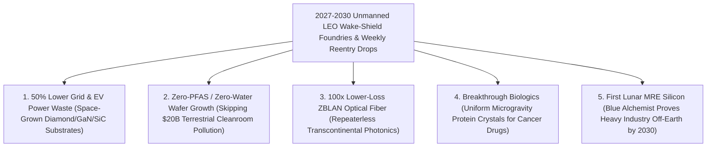

# VISION 02 (THE 2026–2030 LEAPFROG): SPACE INDUSTRIALIZATION IN 48 MONTHS
## Pathway 2E: Autonomous Free-Flying "Wake-Shield" Vacuum Foundries by 2028–2030 — *1,000x Cleaner Semiconductor Wafers Without Manned Stations*

> **The Cynic's Objection:**
> *"Moving toxic manufacturing into space by 2030? You'd need trillion-dollar manned orbital cities and thousands of factory workers in spacesuits! How could space manufacturing possibly beat terrestrial semiconductor fabs in the next four years?"*
>
> **The 2026–2030 Leapfrog Thesis:**
> You don't need astronauts or giant space stations to move toxic, ultra-high-vacuum semiconductor and crystal fabrication off Earth—in fact, **human presence ruins the vacuum and adds micro-vibrations!** Between **2026 and 2030**, unmanned free-flying reentry capsules (scaling **Varda Space Industries' *W-Series*** and **Space Forge's *ForgeStar*** into **10-ton modular Starship bay foundries**) deploy stainless-steel **Wake Shields** in Low Earth Orbit. Plowing through the upper thermosphere at $7.6\text{ km/s}$, a wake shield sweeps residual gas atoms aside to create a trailing shadow of **$10^{-14}\text{ Torr}$ ultra-pure vacuum—$1,000\times\text{ to }10,000\times$ cleaner than any \$20 billion cleanroom on Earth, at zero pumping cost**. Inside that open-space wake and zero-buoyancy microgravity, robotic furnaces grow defect-free **wide-bandgap diamond, Gallium Nitride (GaN), and Silicon Carbide (SiC) power wafers**, ZBLAN optical fibers, and monoclonal biologic crystals with **zero terrestrial PFAS, zero $\text{NF}_3/\text{SF}_6$ greenhouse gases, and zero ultrapure water draw**—parachuting finished wafer cassettes back to Earth every single week by **2029–2030**.

---

## ACT I: THE 2030 REALITY (AFTER A 48-MONTH ORBITAL FOUNDRY SPRINT)
### A Tuesday Morning in Late 2029 — The Weekly Wafer Drop That Slashed Grid Power Losses by 50%

Imagine standing at the coastal landing zone in South Australia (Koonibba)—or at the Utah Test Range, or a clean-energy inverter plant in Bavaria—on a Tuesday morning in **late 2029**.

Four years earlier, in 2025, terrestrial semiconductor fabs were locked in an escalating ecological and financial crisis: each new terrestrial fab cost \$25 billion, consumed **15 million liters of ultrapure municipal water every day**, and vented toxic perfluorinated chamber-cleaning gases ($\text{NF}_3$, $\text{SF}_6$, PFAS) while struggling to grow defect-free wide-bandgap power substrates under Earth's $1g$ gravity. Instead of waiting for manned space stations in the 2040s, materials pioneers executed the **2026–2030 Autonomous Wake-Shield Foundry Leapfrog**:

1. **The Weekly Autonomous Wafer Drop:**
   Overhead, a reusable **Space Forge *Pridwen* alloy-shielded craft** or **Varda *W-Series* heavy capsule** glides back from a 30-day orbital production run, shedding $7.6\text{ km/s}$ of orbital velocity via free atmospheric braking before touching down softly. Technicians open the sterile cassette to retrieve **500 kilograms of 300mm epitaxial diamond-on-GaN and ultra-pure Silicon Carbide (SiC) wafers**—worth **\$150 million** and grown with **$100\times$ fewer crystal dislocations** than any wafer ever made on Earth.
2. **The $10^{-14}\text{ Torr}$ Wake-Shield Foundry in LEO (Zero Astronauts Required):**
   Five hundred kilometers up, an unmanned **10-ton Modular Wake-Shield Foundry** (deployed three at a time from a SpaceX Starship payload bay) flies autonomously in Sun-Synchronous Orbit. Ahead of its robotic Molecular Beam Epitaxy (MBE) deposition stage curves a 4-meter stainless-steel **Wake Shield**. Because the spacecraft moves 7 times faster than the thermal speed of stray oxygen and hydrogen atoms, the space immediately behind the shield is a **near-perfect $10^{-14}\text{ Torr}$ vacuum**—requiring zero mechanical turbopumps, zero cleanroom walls, and zero fluorinated chamber purge gases.
3. **50% Lower Power Losses on Earth's Electric Grids & Data Centers:**
   Installed into electric-vehicle fast chargers, HVDC wind/solar grid inverters, and AI server power supplies across Earth in 2028–2030, those space-grown wide-bandgap diamond/GaN switches handle **$10\times$ higher voltages** and cut AC-to-DC electricity conversion waste by **50%**—saving more gigawatt-hours of clean electricity on Earth inside 90 days than the rocket fuel used to launch the capsule.
4. **Lunar *Blue Alchemist* Pilot Plants (2029–2030):**
   Simultaneously, on the Lunar South Pole, **Blue Origin's *Blue Alchemist* Molten Regolith Electrolysis (MRE)** payload demonstrates the first automated zero-chemical production of **99.999% pure solar silicon and breathable oxygen** directly from raw lunar dirt.

---

## ACT II: THE 2026–2028 CONVERGENCE BRIDGE — WHY UNMANNED CAPSULES WON FIRST
### Wake-Shield Vacuum Physics, Zero-Buoyancy Crystal Growth, and Weekly Reentry Logistics

```mermaid
flowchart LR
    subgraph FabCrisis["The 2026 Terrestrial Cleanroom Trap (Skipped)"]
        F1["1g Buoyancy Convection Ruins Wide-Bandgap Crystal Boules"]
        F2["10⁻⁸ Torr Pumped Chambers + Toxic NF₃ / SF₆ / PFAS Etch Gases"]
        F3["15M Liters/Day Ultrapure Water Draw & 5-Yr Fab Construction"]
    end

    subgraph WakeEngine["The 2026-2029 Autonomous Wake-Shield Leapfrog"]
        W1["Unmanned Free-Flying Capsules (Zero Human Vibration or Outgassing)"]
        W2["Orbital Wake Shield (7.6 km/s): Passive 10⁻¹⁴ Torr Vacuum (1,000x Cleaner)"]
        W3["Zero-G Containerless & Epitaxial Growth + Weekly Aerobraking Return"]
    end

    subgraph Impact2030["The 2029-2030 Clean Industrial Reality"]
        I1["Weekly 500 kg Drops of Defect-Free Diamond/GaN/SiC Wafers & ZBLAN Fiber"]
        I2["50% Reduction in Terrestrial Grid & EV Power-Conversion Waste"]
        I3["Zero PFAS/Acid/Water Wafer Growth + First Lunar MRE Silicon Demo"]
    end

    FabCrisis -. "Bypassed via Free-Flying Capsules" .-> WakeEngine
    WakeEngine ==> Impact2030
```

### Step 1: The Three Physics Laws That Make Unmanned Orbital Foundries Beat Earth Fabs
Why did unmanned orbital capsules leapfrog terrestrial cleanrooms between 2026 and 2029 without needing a single astronaut?

* **1. The Hypersonic Wake-Shield Vacuum Law ($10^{-14}\text{ Torr}$ for Free):**
  In Low Earth Orbit ($500\text{ km}$), the ambient pressure is $\sim 10^{-8}\text{ Torr}$ (mostly atomic oxygen with thermal velocity $v_{\text{th}} \approx 1.1\text{ km/s}$). When a spacecraft plows through this rarefied gas at orbital velocity **$v_{\text{orb}} = 7.6\text{ km/s}$**, gas molecules cannot catch up to the rear surface of a convex shield. The pressure ratio in the trailing wake drops exponentially with the speed ratio squared ($S^2 = v_{\text{orb}}^2 / v_{\text{th}}^2 \approx 48$):
  $$P_{\text{wake}} \approx P_{\text{ambient}} \cdot \exp(-S^2) \longrightarrow 10^{-13}\text{ to }10^{-14}\text{ Torr}$$
  As proven in flight by NASA's **Wake Shield Facility**, this creates an open, infinite **$10^{-14}\text{ Torr}$ epitaxial growth zone**—**$1,000\times\text{ to }10,000\times$ cleaner than terrestrial UHV chambers**—while toxic dopant byproducts ($\text{As}, \text{P}, \text{Ga}$) are harmlessly swept into the ionized solar wind stream or condensed on a cold plate with **zero terrestrial water or air exposure**.
* **2. Zero Gravity = Zero Buoyancy Convection ($100\times$ Fewer Crystal Defects):**
  On Earth, whenever you heat a molten semiconductor boule (SiC, GaN, InP), heavy-metal **ZBLAN fluoride optical glass**, or a **monoclonal antibody crystal** in $1g$ gravity, hot fluid rises and cooler fluid sinks (**buoyancy-driven convection**). These turbulent eddies create microscopic striations, dislocations, and phase separation. In an **unmanned free-flying capsule** ($<10^{-6}g$ quiet microgravity, free from astronaut footsteps and life-support fans), buoyancy convection **vanishes completely**—producing uniform, large-diameter crystals and optical fibers with **$10\times\text{ to }100\times$ higher performance**.
* **3. Downhill Aerobraking Return ($99.5\%$ Free Energy):**
  High-value wafers, ZBLAN optical preforms, and biologic crystals command **\$50,000 to \$1,000,000 per kilogram**. Returning a 500 kg wafer cassette from LEO requires only a tiny **$120\text{ m/s}$ deorbit burn**, after which Earth's atmosphere brakes the capsule for free.

### Step 2: Verified 2024–2026 Flight Baseline Powering the 2027–2030 Sprint

| Pioneer / System | Verified 2024–2026 Flight & Lab Baseline | The 2027–2030 Autonomous Foundry Leapfrog |
| :--- | :--- | :--- |
| **Varda Space Industries (*W-1, W-2, W-3, W-4*)** | **Feb 2024 (*W-1*) & 2025–2026 (*W-2, W-3, W-4*):** Completed world's first commercial autonomous orbital factory missions and precision hypersonic capsule landings in Utah & South Australia. | **2027–2029:** Scaling to weekly/bi-weekly **heavy W-Series autonomous foundries** returning pharmaceuticals, optical fibers, and semiconductor substrates. |
| **Space Forge (*ForgeStar-1 & 2* / *Pridwen*)** | Launched *ForgeStar* pathfinder; developed reusable **Pridwen** high-temperature alloy radiative heatshield & autonomous microgravity/vacuum crystal furnace. | **2027–2030:** Commercial orbital production of **wide-bandgap GaN, SiC, and diamond power wafers** returned intact via reusable *Pridwen* shields. |
| **Redwire Space (*MSTIC*, *PIL-BOX* & *ZBLAN*)** | Operated **MSTIC** in-space semiconductor deposition, **28+ PIL-BOX** pharmaceutical crystal missions, and microgravity **ZBLAN** optical fiber drawing. | **2027–2029:** Transitioning proven ISS crystal/semiconductor recipes into dedicated unmanned free-flying commercial production modules. |
| **Blue Origin (*Blue Alchemist* MRE)** | **2023–2026:** Demonstrated zero-chemical **Molten Regolith Electrolysis** producing **$>99.999\%$ pure solar silicon**, iron, aluminum, and $\text{O}_2$ from regolith simulant. | **2028–2030:** First automated **Lunar South Pole MRE pilot plant** aboard a *Blue Moon* lander proving off-Earth heavy silicon/metal refining. |

---

## ACT III: THE 48-MONTH SPRINT ROADMAP (2026 $\rightarrow$ 2030) & INDUSTRIAL COMPARISON

### 1. The 4-Year Rollout Sprint: From 100 kg Capsules to 10-Ton Starship Wake-Shield Fabs

| Sprint Year | Orbital Foundry Scale & Cadence | Products & Vacuum / Micro-G Specs | Terrestrial Bottleneck Skipped |
| :--- | :--- | :--- | :--- |
| **2026** *Monthly Capsule Cadence* | **Varda *W-4+*** & **Space Forge *ForgeStar*** establish routine commercial reentry cadence in Australia & Utah; **Redwire** scales orbital crystal libraries. | $50\text{–}100\text{ kg}$ payloads; $10^{-6}g$ free-flyer quiet; First space GaN/biologic batches | Bypasses slow, vibration-noisy manned ISS schedules with dedicated unmanned free-flying capsules. |
| **2027** *The Wake-Shield Unfold* | First **1-ton autonomous Wake-Shield Epitaxy Capsules** deploy $3\text{ m}$ stainless-steel shields in LEO, growing multi-wafer **GaN-on-Diamond** & **ZBLAN** batches. | **$10^{-13}\text{ Torr}$** wake vacuum; Zero $\text{NF}_3/\text{SF}_6$ chamber gases; Reusable *Pridwen* alloy shields | **Skips \$20B terrestrial cleanroom CAPEX:** Achieves $1,000\times$ purer vacuum in open space on day one of orbit. |
| **2028** *10-Ton Starship Bay Fabs* | **SpaceX Starship** deploys **three 10-ton Modular Wake-Shield Foundries** per launch into Dawn-Dusk SSO, each equipped with robotic wafer-cassette reentry pods. | **$10^{-14}\text{ Torr}$** ultra-pure wake; $1,361\text{ W/m}^2$ 24/7 solar furnace; Bi-weekly 250 kg wafer drops | Supplies wide-bandgap diamond/SiC power chips directly to AI data-center power shelves and EV fast-charging grids. |
| **2029–2030** *Weekly Drops & Lunar MRE* | **50+ autonomous orbital foundries** parachute **500 kg wafer & ZBLAN cassettes weekly**; **Blue Origin *Blue Alchemist*** runs first zero-chemical silicon smelt on the Moon. | **25+ Tons/Year** of ultra-pure space wafers/fibers; **99.999% Lunar Silicon** demo | Cuts terrestrial power-electronics conversion losses by **50%** with **zero municipal water draw and zero PFAS waste**. |

### 2. Quantitative Comparison: Terrestrial Semiconductor Cleanroom vs. 2028–2030 LEO Wake-Shield Foundry

| Wafer & Crystal Fab Metric (2027–2030 Horizon) | Terrestrial Wide-Bandgap Cleanroom Fab | 2028–2030 Unmanned LEO Wake-Shield Foundry | The 48-Month Leapfrog Advantage |
| :--- | :--- | :--- | :--- |
| **Facility CAPEX & Time-to-First-Wafer** | **\$5B–\$20 Billion** / **4 to 6 Years** to build | **\$25M–\$60 Million** / **90 Days** (modular Starship pod) | **>100x Lower Entry CAPEX & 15x Faster** |
| **Epitaxial Deposition Vacuum Purity** | **$10^{-8}\text{ to }10^{-9}\text{ Torr}$** (costly cryo/turbopumps) | **$10^{-13}\text{ to }10^{-14}\text{ Torr}$** (passive hypersonic wake) | **1,000x to 10,000x Cleaner Vacuum for Free** |
| **Crystal Dislocation Density (GaN / SiC / Diamond)** | High ($10^6\text{–}10^8\text{ cm}^{-2}$ due to $1g$ convection) | **Ultra-Low ($<10^3\text{ cm}^{-2}$ in $<10^{-6}g$ zero-buoyancy)** | **100x Fewer Defects / 10x Breakdown Voltage** |
| **Ultrapure Water & Toxic PFAS / $\text{NF}_3$ Gases** | **$15\text{M Liters/Day}$** + $\text{NF}_3/\text{SF}_6$ ($17,000\times\text{ CO}_2$) | **0.0 Liters Water** + **0 Fluorinated Purge Gases** | **100% Zero Watershed or PFAS Pollution** |
| **Astronaut Life-Support Overhead** | N/A | **\$0 (100% Unmanned Robotic Free-Flyer)** | **Zero Human Cost, Risk, or Micro-Vibration** |

### 3. High-Margin 2027–2030 Orbital Products That Pay for the Foundry on Flight One
Why don't orbital wake-shield foundries need sub-\$10/kg launch costs to be wildly profitable in **2027–2030**? Because their products sell for **\$100,000 to \$2,000,000 per kilogram** on Earth while solving acute terrestrial energy and medical bottlenecks:

| Orbital Product Line (2027–2030) | Physics Mechanism in LEO ($10^{-14}\text{ Torr}$ + $0g$) | Terrestrial Value per Kilogram | Earth Biosphere & Energy Payoff |
| :--- | :--- | :--- | :--- |
| **300mm GaN-on-Diamond & SiC Power Wafers** | Wake-shield $10^{-14}\text{ Torr}$ MBE + zero buoyancy convection yields $<10^3\text{ cm}^{-2}$ defects | **\$150,000–\$350,000/kg** | Cuts EV charger, grid inverter & AI server power conversion losses by **50%**; zero PFAS/$\text{NF}_3$. |
| **ZBLAN Heavy-Metal Fluoride Optical Fiber** | Zero-G drawing prevents barium-fluoride micro-crystallization ($0.001\text{ dB/km}$ loss) | **\$250,000–\$1,000,000/kg** | **$20\times\text{ to }50\times$ lower signal loss** than silica fiber; eliminates undersea optical repeaters. |
| **Monoclonal Antibody & Biologic Crystals** | Quiet $<10^{-6}g$ free-flyer sedimentation-free growth yields uniform micro-crystals | **\$1,000,000+/kg** (active pharmaceutical) | Turns 3-hour hospital IV cancer infusions into **10-second subcutaneous home injections**. |
| **Containerless Bulk Metallic Glasses & Optics** | Electromagnetic levitation in vacuum avoids crucible wall contamination | **\$50,000–\$120,000/kg** | $3\times$ stronger than titanium, corrosion-proof medical implants and deep-UV lithography mirrors. |

### 4. Why Unmanned Free-Flyers Beat Manned Stations for Dirty & Ultra-Pure Industry
* **Zero Human Vibration & Zero Cabin Outgassing:** A single astronaut exercising on a space station treadmill creates $10^{-3}g$ micro-accelerations that ruin delicate crystal lattices, while human cabin air leaks water vapor around the station. Unmanned free-flying capsules maintain **$<10^{-6}g$ stillness** and **pure $10^{-14}\text{ Torr}$ vacuum**.
* **Closed-Loop Toxic Dopant Cold-Trapping:** Hazardous Group III-V precursors (arsenic, phosphorus, gallium, beryllium) used in high-performance optoelectronics are condensed onto replaceable external cryo-baffles in vacuum—never touching an atmosphere, river, or human worker.
* **Reusable Non-Ablative Alloy Heatshields (*Space Forge Pridwen*):** High-temperature radiative alloy skirts fold out for atmospheric entry and land gently in recovery nets or under parafoils, enabling **15-day turnaround** of the reentry cassette.

---

## ACT IV: THE 2030 CIVILIZATIONAL UNLOCK & SUMMARY FOR THE SKEPTIC

By launching **unmanned free-flying Wake-Shield Foundries in 2027–2030** instead of waiting decades for manned orbital cities, humanity begins zoning toxic, high-energy materials processing off Earth inside the next 48 months:

1. **Slashing Earth's Electricity Waste with Space-Grown Power Chips:**
   Roughly 10% of all electricity generated on Earth is lost as waste heat during AC/DC conversion in grid transformers, EV chargers, and AI data centers. Replacing legacy silicon switches with defect-free **space-grown diamond, GaN, and SiC substrates** in 2028–2030 cuts those conversion losses in half—paying back the rocket launch energy **over $50\times$ every year**.
2. **Eliminating PFAS, $\text{NF}_3$ Super-Greenhouse Gases & Cleanroom Water Draw:**
   Because a $7.6\text{ km/s}$ orbital Wake Shield provides a free, self-sweeping **$10^{-14}\text{ Torr}$ vacuum**, epitaxial crystal growth in LEO requires zero fluorinated chamber-cleaning gases ($\text{NF}_3/\text{SF}_6$) and zero liters of municipal ultrapure water.
3. **Subcutaneous Cancer Drugs & Zero-Loss ZBLAN Photonics:**
   Using **Varda** and **Redwire**'s flight-proven microgravity crystallization, pharmaceutical makers reformulate hospital-IV cancer immunotherapies (like pembrolizumab) into uniform micro-crystalline suspensions that patients can inject at home in 10 seconds—while space-drawn **ZBLAN fluoride optical fibers** achieve $20\times$ lower signal attenuation than silica glass.
4. **Bootstrapping Zero-Chemical Lunar Metallurgy by 2030:**
   With **Blue Origin's *Blue Alchemist*** demonstrating direct solar Molten Regolith Electrolysis on the Lunar South Pole by 2029–2030, humanity validates the blueprint to smelt bulk silicon, iron, titanium, and aluminum off-Earth with zero carbon emissions and breathable oxygen as the sole byproduct.
5. **The Bottom Line for the Skeptic:**
   We don't need astronauts in hardhats to industrialize space. **Varda Space Industries** has already landed multiple autonomous factory capsules in Utah and Australia, **Space Forge** and **Redwire** have flown orbital semiconductor furnaces, and **Blue Origin's *Blue Alchemist*** has proven zero-chemical silicon smelting. By 2029, space-made wafers land every week.

