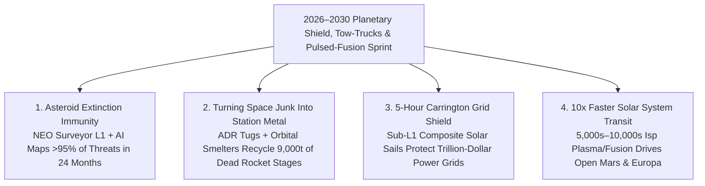

# VISION 02 (LEAPFROG 2026–2030) — SPACE EXPANSION & CISLUNAR CIVILIZATION
## Sub-Pathway 2D: The 2026–2030 Planetary Shield, Magnetic Debris Tow-Trucks & Pulsed-Fusion Thrusters — *Securing Earth's Sky and Firing the First High-$I_{\text{sp}}$ Nuclear/Fusion Drives in 48 Months*

> **Executive Framing & The 48-Month Leapfrog Thesis**
> * **The Legacy Aerospace Bottleneck:** *"Critics think planetary asteroid defense, orbital debris cleanup, and nuclear/fusion space propulsion are slow, multi-decade government programs that won't mature until the 2040s. Meanwhile, LEO is filling up with mega-constellations and dead rocket stages today."*
> * **The 2026–2030 Leapfrog Thesis:** Between **2026 and 2030**, three rapid hardware deployments compress twenty years of deep-space stewardship into a **48-month sprint**:
>   1. **The 24-Month AI + Infrared Asteroid Shield:** Launching NASA's **NEO Surveyor** infrared space telescope (2027–2028) paired with **Vera C. Rubin Observatory's *HelioLinc3D* AI synthetic-tracklet algorithms** maps **>95% of region-killer and city-killer Near-Earth Asteroids in 24 months**, backed by pre-positioned modular kinetic/standoff interceptor buses on **72-hour launch readiness** on heavy-lift pads.
>   2. **Autonomous Debris Tow-Trucks & Orbital Aluminum Smelting:** Commercial servicing swarms (**Astroscale *ADRAS-J2 / ELSA-M*, Starfish Space *Otter*, ClearSpace**) move from 2024–2026 flyarounds to **active robotic/magnetic capture in 2027–2029**—clearing priority LEO lanes while towing multi-ton derelict aluminum rocket stages to **ThinkOrbital electron-beam & induction smelters** to become raw orbital feedstock.
>   3. **First Orbital Flight Demos of Nuclear & Pulsed Magneto-Inertial Fusion Thrusters:** Compact **HALEU Nuclear Thermal/Electric modules** (BWXT), **100-kW Magnetoplasma thrusters** (Ad Astra *VASIMR*), and **Pulsed Plasma / Magneto-Inertial Fusion drives** (**Howe Industries *PPR*, Helicity Space, Princeton *PFRC***) execute their first in-space propulsion demonstrations in **2028–2030**, proving **$I_{\text{sp}} = 900\text{ to }10,000\text{ seconds}$** and cutting outer-planet probe transit times by **$4\times$**.

---

## ACT I: THE WORLD OF 2030 — EARTH'S ACTIVE IMMUNE SYSTEM & ORBITAL FAST LANE
### Inside the Planetary Defense, Orbital Recycling, and Deep-Space Operations Center (2030)

It is **2030**. Look at three live telemetry feeds inside the joint Cislunar & Planetary Stewardship Operations Center:

1. **Feed 1 — The Sun-Earth L1 Asteroid & Solar-Storm Shield:**
   * One-and-a-half million kilometers sunward of Earth at Lagrange Point 1, NASA's **NEO Surveyor** cryogenic infrared telescope (`4–10 μm` thermal bands) scans the blinding daytime sky near the Sun—where dark, charcoal-black asteroids used to sneak up unseen.
   * Coupled with the **Vera C. Rubin Observatory** and AI tracklet-linking algorithms (*HelioLinc3D*), the global catalog of hazardous Near-Earth Objects surged from `40%` in 2025 to **>95% by 2030**.
   * When ESA's **Hera** probe completed its 2026–2027 forensic survey of the **DART** impact crater at *Dimorphos*, engineers locked in the exact momentum-transfer recipes ($\beta = 3.61$). Today, two standardized **Rapid-Response Kinetic & Ion-Shepherd Interceptor Buses** sit fueled on standby—capable of intercepting any newly flagged `50-meter` Tunguska-class rock within **72 hours of warning**.
   * Upstream of L1, composite **solar-sail "statites"** (evolved from NASA's 2024 **ACS3** carbon-boom sail and NOAA's **SWFO-L1**) hover continuously at `2.5 million km`, giving terrestrial power grids **5+ hours of warning** before Carrington-class solar storms arrive.
2. **Feed 2 — The LEO Tow-Truck Fleet & Orbital Aluminum Foundry:**
   * Eight hundred kilometers above Earth in the crowded sun-synchronous orbital shell, an autonomous **Astroscale / Starfish Space** debris tug approaches a tumbling, 4-ton dead rocket stage moving at `7.5 km/s`.
   * Using onboard **Vision-Language-Action (VLA) optical navigation** and a contactless **magnetic eddy-current detumbling array**, the tug damps the stage's spin to zero without touching it, locks onto its engine thrust ring, and tows it—not down into the ocean, but across to an **orbital induction & electron-beam recycling node** (**ThinkOrbital**).
   * Within 48 hours, that dangerous piece of space junk is melted into **4,000 kilograms of refined aerospace aluminum-lithium ingots and hull plates** worth **\$12,000,000+** in saved launch costs.
3. **Feed 3 — Firing the First Pulsed-Fission & Fusion Thrusters in High Orbit:**
   * In a `1,200 km` nuclear-safe orbit, a deep-space fast clipper built around a **Howe Industries Pulsed Plasma Rocket (PPR)** and a **Helicity Space peristaltic magneto-inertial fusion nozzle** fires bursts of superheated plasma at an exhaust velocity of **`50 to 98 km/s` ($I_{\text{sp}} = 5,000\text{–}10,000\text{ s}$)**—launching an uncrewed ocean-finder probe on a **14-month direct sprint to Jupiter's moon Europa** (a trip that used to take 6 to 8 years).

---

## ACT II: THE 2026–2030 LEAPFROG ENGINE — CONVERGING HARDWARE IN 48 MONTHS
### How AI Sky Surveys, Eddy-Current Grapples, and Pulsed Magnetic Nozzles Skip Decades

```mermaid
flowchart LR
    subgraph Baseline2026["2024–2026 Verified Hardware Proofs"]
        B1["DART Deflection (β=3.61) +<br>ESA Hera Arrival (Late 2026)"]
        B2["Astroscale ADRAS-J (15m Rendezvous)<br>& Starfish Otter Servicing"]
        B3["BWXT HALEU Fuel, VASIMR 80kW<br>Endurance & Helicity/PFRC Fusion"]
        B4["NASA ACS3 Composite Solar Sail<br>& NOAA SWFO-L1 Operational"]
    end

    subgraph Sprint2028["2027–2028 Orbital Deployment"]
        S1["NEO Surveyor Launches to L1 +<br>Rubin AI Finds 5x More Asteroids"]
        S2["ADRAS-J2, ELSA-M & ClearSpace<br>Capture First Multi-Ton Rocket Stages"]
        S3["100kW Nuclear-Electric / VASIMR<br>& Pulsed Plasma Ground/Suborbital Full-Power"]
    end

    subgraph Horizon2030["2029–2030 Active Shield & Fast Transit"]
        H1[">95% City-Killer Asteroids Mapped<br>+ 72-Hr Standby Interceptor Buses"]
        H2["Orbital Scrap Smelters Convert<br>Dead Stages Into Station Aluminum"]
        H3["First In-Space Flight Demos of<br>5,000s–10,000s Isp Pulsed Fission/Fusion"]
    end

    Baseline2026 --> Sprint2028 --> Horizon2030
```

### Step 1: The Three Technical Multiplier Loops (2026–2030)
Why can planetary defense, orbital cleanup, and high-$I_{\text{sp}}$ propulsion leapfrog from technology demos in 2026 to operational fleets by **2030**?

* **Multiplier #1: Thermal Infrared (`NEO Surveyor`) + AI Tracklet Linking (*HelioLinc3D*):**
  In visible light, a dark carbonaceous asteroid reflects only `4%` of sunlight, making it nearly invisible. In the `4–10 μm` thermal infrared spectrum at Sun-Earth L1, that same asteroid glows like a beacon from absorbed solar heat.
  * When **NEO Surveyor** launches (2027–2028) and streams thermal sky frames into **AI synthetic-tracklet software** (proven on the Vera C. Rubin Observatory to connect sparse asteroid dots across nights with 10x lower compute), humanity discoveries jump from `~2,500 NEOs/yr` to **`>25,000 NEOs/yr`**—completing a 20-year survey in **24 to 36 months**.
* **Multiplier #2: Eddy-Current Detumbling + Orbital Metal Smelting (Turning Trash into Cash):**
  Over **9,000 metric tons** of refined aerospace aluminum, titanium, and stainless steel are already sitting in LEO as dead rocket stages.
  * Instead of treating debris removal as a pure government cleanup tax, **Astroscale (*ADRAS-J2*)**, **Starfish Space (*Otter*)**, and **ClearSpace** pair autonomous computer-vision rendezvous with **orbital induction/e-beam smelters** (**ThinkOrbital**). By **2029–2030**, harvesting a 4-ton upper stage in orbit yields structural metal cheaper than launching raw stock from Earth, while **AstroForge** and **Karman+** use the exact same autonomous deep-space buses to assay platinum-group metallic asteroids.
* **Multiplier #3: Pulsed Magneto-Inertial Fusion & Fission-Plasma Nozzles (Skipping Giant Reactors):**
  Traditional nuclear-electric propulsion required massive, football-field-sized radiator wings to dump waste heat from a steam turbine in vacuum.
  * **Pulsed Plasma Rockets (Howe Industries *PPR*)** and **Magneto-Inertial Direct Fusion Drives (Helicity Space & Princeton *PFRC*)** bypass the steam-turbine conversion loop completely: they compress small pulses of fissionable HALEU or $\text{D–^3He / D–D}$ fusion plasma inside a **magnetic nozzle** (`peristaltic magnetic reconnection`), channeling kinetic plasma energy directly into exhaust at **$I_{\text{sp}} = 5,000\text{ to }10,000\text{ seconds}$** in a compact **2-to-5-metric-ton engine pod** that fits inside a standard Falcon 9 or Starship fairing by **2028–2030**!

### Step 2: 2025–2026 Verified Hardware & 2027–2030 Leapfrog Execution Matrix

| Organization / Program | Verified 2024–2026 Hardware Status | 2027–2028 Sprint Milestone | 2029–2030 Operational Capability |
| :--- | :--- | :--- | :--- |
| **NASA *NEO Surveyor*, ESA *Hera* & Rubin AI** | **ESA *Hera*** arriving at *Dimorphos* (late 2026) to map *DART* crater; **NEO Surveyor** IR telescope integrated at JPL for 2027–2028 launch. | *NEO Surveyor* reaches Sun-Earth L1 halo orbit; *HelioLinc3D* AI links thermal + optical tracklets in real time. | **>95% of 140m+ region-killers mapped** + `150,000+` city-killer (`30m–50m`) asteroids cataloged with 72-hr standby interceptors. |
| **Astroscale (*ADRAS-J2 / ELSA-M*), Starfish & ClearSpace** | **2024–2025:** *ADRAS-J* flew within `15m` of uncooperative H-2A rocket stage; Starfish *Otter* & ClearSpace under USSF/ESA/JAXA contracts. | **2027–2028:** First commercial robotic grapple, eddy-current detumbling, and towing of multi-ton dead rocket bodies in LEO/GEO. | Fleet of **10+ commercial orbital tow-trucks** enforcing "Zero-Debris 2030" and feeding upper stages to orbital smelters. |
| **ThinkOrbital & AstroForge / Karman+** | **ThinkOrbital** tested vacuum e-beam welding/cutting; **AstroForge** (*Odin/Vestri*) launched commercial deep-space asteroid probes. | Orbital demonstration of electron-beam cutting and induction melting of captured aluminum satellite/stage scrap. | **Orbital metal circular economy** supplying recycled aluminum hull plates & first commercial NEA metallic sample capture. |
| **BWXT (HALEU NTP/NEP) & Ad Astra (*VASIMR*)** | **BWXT** fabricating `2,700 K` HALEU fuel cores; **Ad Astra *VX-200SS*** passed `88-hr` continuous `80 kW` plasma endurance test. | **2027–2028:** Orbital integration of `100–300 kWe` solar/nuclear-electric **VASIMR** (`I_sp ≈ 5,000 s`) & HALEU thermal/electric tug. | High-$I_{\text{sp}}$ cislunar cargo tugs moving 50-ton payloads between LEO and Lunar South Pole using **80% less propellant**. |
| **Howe Industries (*PPR*), Helicity Space & Princeton *PFRC*** | **Howe *PPR*** in NASA NIAC Phase II (`5,000s Isp`, `100 kN` thrust); **Helicity** (Lockheed-backed) & **PFRC-2** testing magnetic fusion nozzles. | **2028:** Full-scale vacuum magnetic-nozzle pulse testing and suborbital/LEO pathfinder integration. | **2029–2030:** First orbital firing of a **pulsed fission/magneto-inertial fusion drive** (`I_sp = 5,000–10,000 s`), enabling **14-month Jupiter/Europa** probes. |

---

## ACT III: THE 48-MONTH SPRINT ROADMAP (2026 $\rightarrow$ 2027 $\rightarrow$ 2028 $\rightarrow$ 2030)

| Sprint Year | Milestone Window | Defense, Debris & Propulsion Flight Operations | Exhaust ($I_{\text{sp}}$) & Stewardship Metrics | Civilizational Threshold Unlocked |
| :--- | :--- | :--- | :--- | :--- |
| **Year 1** | **2026: *Hera* Arrival & Servicing Docking** | ESA *Hera* arrives at *Dimorphos* (validating exact DART kinetic deflection physics); Starfish *Otter* & Astroscale execute commercial docking demos. | Deflection momentum multiplier **$\beta = 3.61$** fully modeled in 3D; GEO satellite life extended by `+5 years`. | Validated blueprint for planetary kinetic deflection; commercial satellite life-extension market goes live. |
| **Year 2** | **2027: *NEO Surveyor* Launch & First Stage Capture** | NASA *NEO Surveyor* launches toward Sun-Earth L1; Astroscale *ADRAS-J2* & *ELSA-M* robotically grapple and tow the first multi-ton dead rocket stage. | Asteroid discovery rate jumps **10x** (`>2,000/month`); non-cooperative debris capture proven on 3-ton upper stage. | Blind spot for daytime sunward asteroids (`Chelyabinsk class`) permanently closed; active LEO cleanup begins. |
| **Year 3** | **2028: Orbital Scrap Smelting & 5,000s $I_{\text{sp}}$ Plasma Tug** | First dead aluminum upper stage cut and induction-smelted in orbit (*ThinkOrbital*); `150 kW` *VASIMR* / HALEU electric tug begins LEO-to-L1 cargo runs. | Thruster exhaust hits **$I_{\text{sp}} = 4,500\text{–}5,000\text{ s}$** (`10x` chemical rockets); recycled orbital metal at **<\$800/kg**. | **Kessler Syndrome trajectory reversed**; orbital scrap becomes a profitable raw material supply chain. |
| **Year 4** | **2029–2030: Pulsed Fusion Demo & 95% Planetary Shield** | **First orbital flight test of a Pulsed Plasma / Magneto-Inertial Fusion Drive** (*Howe PPR / Helicity / PFRC*); two 72-hr standby asteroid interceptors emplaced. | **$I_{\text{sp}} = 5,000\text{–}10,000\text{ s}$** demonstrated in orbit; **>95% of hazardous NEOs cataloged**; 5-hr solar-storm warning at Sub-L1. | **Earth gains an active planetary immune system**; outer-planet transit times slashed from **7 years $\rightarrow$ 14–18 months**. |

### Propulsion & Planetary Stewardship Leapfrog Metrics (2026 vs. 2030)
* **Exhaust Velocity & Transit Time Compression:**
  * *Chemical Rocket ($\text{CH}_4/\text{LOX}$, 2026):* $I_{\text{sp}} \approx 380\text{ s}$ (`3.7 km/s` exhaust) $\rightarrow$ **240 days** to Mars; **6–8 years** to Jupiter/Europa.
  * *HALEU Nuclear Thermal (*BWXT / DRACO*, 2027–2028):* $I_{\text{sp}} \approx 900\text{ s}$ (`8.8 km/s` exhaust) $\rightarrow$ **120 days** to Mars; **2x payload mass**.
  * *Magnetoplasma (*VASIMR*, 2028 Cislunar Tug):* $I_{\text{sp}} \approx 5,000\text{ s}$ (`49 km/s` exhaust) $\rightarrow$ **80% propellant mass reduction** for LEO-to-Moon cargo.
  * *Pulsed Plasma Fission (*Howe PPR*) & Magneto-Inertial Fusion (*Helicity / PFRC*, 2029–2030 Demo):* $I_{\text{sp}} = 5,000\text{–}10,000\text{ s}$ (`49–98 km/s` exhaust) $\rightarrow$ **45–60 days** to Mars; **14–18 months** direct to Europa or Saturn's Titan.
* **Planetary Defense & Orbital Scrap Leverage:**
  * *Deflection Leverage:* Applying just **`1.5 cm/s` $\Delta v$** (`~0.03 mph`) to a threatening asteroid **8–10 years prior to impact** shifts its trajectory by **`>25,000 km`** (nearly 4 Earth radii), amplified **$3.61\times$** by crater ejecta recoil ($\beta$).
  * *Orbital Aluminum Stockpile:* **9,000+ metric tons** of aerospace-grade aluminum-lithium (`Al-Li 2195`) and titanium already sit at `7.8 km/s` in LEO—worth **>\$27 Billion** in avoided launch costs once melted in orbital induction furnaces.

### Engineering Bottlenecks & 2026–2030 Hardware Mitigations

| Space Stewardship Bottleneck | Why Critics Thought It Would Take Decades | 2026–2030 Verified Engineering Solution |
| :--- | :--- | :--- |
| **Sunward Asteroid Blind Spot (Chelyabinsk Class)** | Optical ground telescopes are blinded by daylight and cannot see dark (`4%` albedo) rocks approaching from the Sun's direction. | **Sun-Earth L1 Thermal Infrared (*NEO Surveyor*) + *HelioLinc3D* AI:** At `4–10 μm` infrared wavelengths, solar-heated dark rocks glow brightly against `2.7 K` space, while Rubin AI links sparse multi-night tracklets with `10x` lower false positives. |
| **Capturing Tumbling, Uncooperative Debris at `7.8 km/s`** | Touching a dead rocket stage spinning at `10°/s` with a rigid robotic arm shears the grapple off and creates more shrapnel. | **Contactless Magnetic Eddy-Current Detumbling + VLA Vision:** Proven by Astroscale (*ADRAS-J* 15m flyaround), the servicing tug projects an alternating magnetic field that induces braking eddy currents in the aluminum skin—stopping its spin *before* physical capture. |
| **Massive Radiator Wings on Nuclear Space Ships** | Traditional nuclear-electric Brayton turbines require acres of heavy radiators to dump `70%` waste heat in vacuum. | **Direct Magnetic Nozzle Pulsed Propulsion (*Howe PPR / Helicity*):** Plasma is heated and expelled directly through a pulsed magnetic nozzle at `5,000–10,000s Isp` in microseconds—dumping waste heat straight out the exhaust plume without steam turbines. |
| **Stratospheric Alumina Pollution from Burning Satellites** | Deorbiting thousands of dead mega-constellation satellites and stages dumps conductive aluminum-oxide soot into the ozone layer. | **Zero-Reentry Orbital Induction Smelting (*ThinkOrbital*):** Towing dead aluminum stages up to an orbital e-beam/induction foundry keeps `100%` of the metal in space as clean structural hull feedstock. |

---

## ACT IV: THE 2030 DIVIDEND & SUMMARY FOR THE SKEPTIC
### How 48 Months of Orbital Stewardship Protects Everything on Earth

1. **Making Asteroid Impacts the First 100% Preventable Natural Disaster by 2030:**
   * A single undetected 50-meter city-killer asteroid striking an urban basin would cause trillions of dollars in damage and millions of casualties.
   * For the cost of a single highway interchange, **NEO Surveyor at L1 + Rubin AI + standby DART-derived interceptors** guarantee by **2030** that humanity will never be blindsided from the sky again.
2. **Defeating Kessler Syndrome Through Profit, Not Just Regulation:**
   * Why burn up thousands of tons of ultra-pure aerospace aluminum-lithium in Earth's upper atmosphere (polluting the stratosphere with alumina soot) when **Astroscale and Starfish tow-trucks** can haul dead rocket stages to **ThinkOrbital smelters** and sell recycled metal plates to spinning-habitat builders at a massive discount?
3. **Shrinking the Solar System by $4\times$ to $10\times$ Before the Decade Ends:**
   * By testing **magnetic-nozzle pulsed fission and fusion drives** directly in vacuum orbit in **2029–2030**, humanity leaps past the 450-second chemical rocket ceiling—making 50-day crewed Mars transits (with 75% less cosmic radiation) and 14-month life-hunting missions to Europa's subsurface ocean the engineering baseline of the 2030s.

4. **Protecting Trillion-Dollar Terrestrial Grids & Climate Optionality at Sub-L1:**
   * A fleet of propellantless **composite solar-sail "statites"** (built on NASA's 2024 **ACS3** rollable carbon-boom technology) hovering `2.5 million km` upstream of Earth doubles advance warning of extreme coronal mass ejections to **5–6 hours**—allowing grid operators to isolate high-voltage transformers before a Carrington-class geomagnetic storm strikes, while testing reversible L1 solar-insolation shading mechanics.

### The 48-Month Leapfrog Snapshot (2026 vs. 2030)
* **City-Killer Asteroid Catalog (`30m–140m` NEOs):** `<45%` mapped with a daytime sunward blind spot (2025–2026) $\rightarrow$ **`>95%` mapped via L1 *NEO Surveyor* thermal infrared + *HelioLinc3D* AI, backed by 72-hour standby interceptors (2030)**.
* **Orbital Debris Trajectory:** Passive tracking of `9,000+ tons` of dead rocket bodies (2025) $\rightarrow$ **Active contactless eddy-current capture & orbital induction smelting into `<\$800/kg` recycled aluminum ingots (2029–2030)**.
* **In-Space Rocket Exhaust Efficiency ($I_{\text{sp}}$):** `380–450 s` chemical rocket ceiling (2026) $\rightarrow$ **`900 s` (HALEU NTP) to `5,000–10,000 s` (*VASIMR* / *Howe PPR* / *Helicity* pulsed magnetic-nozzle flight demos in 2028–2030)**.
* **Deep-Space Transit Times:** `8 months` to Mars / `6–8 years` to Jupiter's Europa $\rightarrow$ **`45–60 days` to Mars / `14–18 months` direct to Europa unlocked**.

> **Bottom Line for the Skeptic:**
> Between **2026 and 2030**, we don't just explore space—we **install Earth's planetary immune system**. **ESA's *Hera* and NASA's *NEO Surveyor* lock in asteroid defense; *Astroscale* and *Starfish* tow-trucks turn orbital junk into recycled aluminum; and compact *VASIMR*, *Howe PPR*, and *Helicity* fusion thrusters fire the first 5,000-to-10,000-second $I_{\text{sp}}$ pulses in orbit.** In four short years, Earth's sky is clean, shielded, and open to the outer solar system:
> * **L1 Thermal Infrared + AI Tracklets** $\rightarrow$ **Asteroid Impacts Become the First 100% Preventable Natural Disaster.**
> * **9,000 Tons of Dead Rocket Stages** $\rightarrow$ **Converted from Kessler Shrapnel Risk into \$27B of Orbital Aluminum Feedstock.**
> * **Pulsed Magnetic-Nozzle Fission & Fusion (`5,000–10,000s Isp`)** $\rightarrow$ **Shrinks the Solar System by $4\times$ to $5\times$.**
